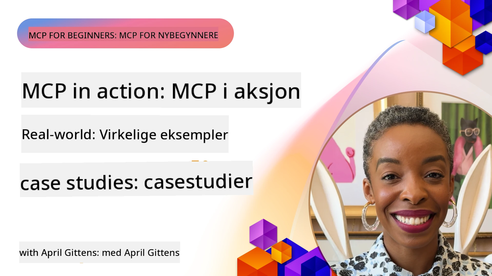

# MCP i aksjon: Case-studier fra virkeligheten

_(Klikk på bildet over for å se video av denne leksjonen)_

Model Context Protocol (MCP) endrer hvordan AI-applikasjoner samhandler med data, verktøy og tjenester. Denne delen presenterer case-studier fra virkeligheten som demonstrerer praktiske anvendelser av MCP i forskjellige bedrifts-scenarier.

## Oversikt

Denne seksjonen viser konkrete eksempler på implementeringer av MCP, og fremhever hvordan organisasjoner bruker denne protokollen for å løse komplekse forretningsutfordringer. Ved å studere disse case-studiene får du innsikt i MCPs allsidighet, skalerbarhet og praktiske fordeler i virkelige scenarier.

## Viktige læringsmål

Ved å utforske disse case-studiene vil du:

- Forstå hvordan MCP kan brukes til å løse spesifikke forretningsproblemer
- Lære om forskjellige integrasjonsmønstre og arkitektoniske tilnærminger
- Gjenkjenne beste praksis for implementering av MCP i bedriftsmiljøer
- Få innsikt i utfordringer og løsninger som møter i virkelige implementeringer
- Identifisere muligheter for å anvende lignende mønstre i egne prosjekter

## Fremhevede case-studier

### 1. [Azure AI Travel Agents – Referanseimplementering](./travelagentsample.md)

Denne case-studien undersøker Microsofts omfattende referanseløsning som viser hvordan man bygger en multi-agent, AI-drevet reiseplanleggingsapplikasjon ved bruk av MCP, Azure OpenAI og Azure AI Search. Prosjektet viser:

- Multi-agent orkestrering gjennom MCP
- Bedriftsintegrasjon av data med Azure AI Search
- Sikker, skalerbar arkitektur ved hjelp av Azure-tjenester
- Utvidbart verktøy med gjenbrukbare MCP-komponenter
- Konversasjonell brukeropplevelse drevet av Azure OpenAI

Arkitektur- og implementasjonsdetaljene gir verdifulle innsikter i å bygge komplekse, multi-agent systemer med MCP som koordineringslag.

### 2. [Oppdatering av Azure DevOps-elementer fra YouTube-data](./UpdateADOItemsFromYT.md)

Denne case-studien viser en praktisk anvendelse av MCP for automatisering av arbeidsflytprosesser. Den viser hvordan MCP-verktøy kan brukes til å:

- Hente data fra nettplattformer (YouTube)
- Oppdatere arbeidsoppgaver i Azure DevOps-systemer
- Lage gjentakbare automatiseringsarbeidsflyter
- Integrere data på tvers av ulike systemer

Dette eksemplet illustrerer hvordan til og med relativt enkle MCP-implementeringer kan gi betydelige effektivitetsgevinster ved å automatisere rutineoppgaver og forbedre datakonsistens på tvers av systemer.

### 3. [Sanntids dokumentasjonsinnhenting med MCP](./docs-mcp/README.md)

Denne casestudien guider deg gjennom hvordan du kobler en Python-konsollklient til en Model Context Protocol (MCP)-server for å hente og logge sanntids, kontekstbevisst Microsoft-dokumentasjon. Du vil lære hvordan du:

- Koble til en MCP-server med en Python-klient og den offisielle MCP SDK
- Bruke HTTP-streamingklienter for effektiv, sanntids datainnhenting
- Kalle dokumentasjonsverktøy på serveren og logge svar direkte i konsollen
- Integrere oppdatert Microsoft-dokumentasjon i arbeidsflyten uten å forlate terminalen

Kapitlet inkluderer en praktisk oppgave, et minimalt fungerende kodeeksempel og lenker til ekstra ressurser for dypere læring. Se hele gjennomgangen og koden i det tilkoblede kapitlet for å forstå hvordan MCP kan transformere dokumentasjonstilgang og utviklerproduktivitet i konsollbaserte miljøer.

### 4. [Interaktiv studieplan-generator web-app med MCP](./docs-mcp/README.md)

Denne casestudien demonstrerer hvordan man bygger en interaktiv webapplikasjon med Chainlit og Model Context Protocol (MCP) for å generere personlige studieplaner for ethvert emne. Brukere kan spesifisere et tema (for eksempel "AI-900 sertifisering") og studietid (f.eks. 8 uker), og appen vil gi en uke-for-uke oversikt over anbefalt innhold. Chainlit muliggjør en konversasjonell chattegrensesnitt, noe som gjør opplevelsen engasjerende og tilpasset.

- Konversasjonell webapp drevet av Chainlit
- Brukerstyrte prompt for tema og varighet
- Uke-for-uke anbefalinger av innhold ved bruk av MCP
- Sanntids, adaptive svar i chattegrensesnittet

Prosjektet illustrerer hvordan konversasjonell AI og MCP kan kombineres for å skape dynamiske, brukerstyrte utdanningsverktøy i et moderne webmiljø.

### 5. [In-Editor Docs med MCP-server i VS Code](./docs-mcp/README.md)

Denne casestudien viser hvordan du kan hente Microsoft Learn Docs direkte inn i ditt VS Code-miljø ved bruk av MCP-serveren—aldri mer måtte bytte nettleserfaner! Du vil se hvordan du kan:

- Søke og lese dokumentasjon umiddelbart inne i VS Code ved bruk av MCP-panelet eller kommandopaletten
- Referere dokumentasjon og sette inn linker direkte i README-filer eller kurs markdown-filer
- Bruke GitHub Copilot og MCP sammen for sømløse, AI-baserte dokumentasjons- og kodearbeidsflyter
- Validere og forbedre dokumentasjonen med sanntids tilbakemelding og Microsoft-kildet nøyaktighet
- Integrere MCP med GitHub arbeidsflyter for kontinuerlig dokumentasjonsvalidering

Implementeringen inkluderer:

- Eksempelkonfigurasjon `.vscode/mcp.json` for enkel oppsett
- Skjermbildebaserte gjennomganger av in-editor-opplevelsen
- Tips for å kombinere Copilot og MCP for maksimal produktivitet

Dette scenariet passer ideelt for kursforfattere, dokumentasjonsskrivere og utviklere som ønsker å holde fokus i sin editor mens de jobber med dokumentasjon, Copilot og valideringsverktøy—alt drevet av MCP.

### 6. [APIM MCP Serverskapning](./apimsample.md)

Denne casestudien gir en steg-for-steg-guide for hvordan du kan opprette en MCP-server ved bruk av Azure API Management (APIM). Den dekker:

- Oppsett av en MCP-server i Azure API Management
- Eksponering av API-operasjoner som MCP-verktøy
- Konfigurering av policyer for ratebegrensning og sikkerhet
- Testing av MCP-serveren ved bruk av Visual Studio Code og GitHub Copilot

Eksemplet illustrerer hvordan Azure sine muligheter kan utnyttes til å lage en robust MCP-server som kan brukes i ulike applikasjoner, og forbedre integrasjonen av AI-systemer med bedrifts-APIer.

### 7. [GitHub MCP Registry — Akselererende agentintegrasjon](https://github.com/mcp)

Denne casestudien undersøker hvordan GitHubs MCP Registry, lansert i september 2025, adresserer en kritisk utfordring i AI-økosystemet: fragmentert oppdagelse og distribusjon av Model Context Protocol (MCP) servere.

#### Oversikt
**MCP Registry** løser den økende smerten med spredte MCP-servere på tvers av repositories og registre, noe som tidligere gjorde integrasjon treg og feilutsatt. Disse serverne gjør det mulig for AI-agenter å samhandle med eksterne systemer som APIer, databaser og dokumentasjonskilder.

#### Problemstilling
Utviklere som bygger agentstyrte arbeidsflyter møtte flere utfordringer:
- **Dårlig tilgjengelighet** av MCP-servere på tvers av ulike plattformer
- **Redundant oppsettsinformasjon** spredt i forum og dokumentasjon
- **Sikkerhetsrisikoer** fra ukontrollerte og utroverdige kilder
- **Manglende standardisering** i serverkvalitet og kompatibilitet

#### Løsningsarkitektur
GitHubs MCP Registry sentraliserer betrodde MCP-servere med nøkkelfunksjoner:
- **Ett-klikk installasjon** integrasjon via VS Code for strømlinjeformet oppsett
- **Signal-over-støy sortering** etter stjerner, aktivitet og validering fra fellesskapet
- **Direkte integrasjon** med GitHub Copilot og andre MCP-kompatible verktøy
- **Åpen bidragsmodell** som gjør det mulig for både fellesskap og bedrifts partnere å bidra

#### Forretningspåvirkning
Registeret har gitt målbare forbedringer:
- **Raskere onboarding** for utviklere ved bruk av verktøy som Microsoft Learn MCP Server, som streamer offisiell dokumentasjon rett inn i agenter
- **Forbedret produktivitet** via spesialiserte servere som `github-mcp-server`, som muliggjør naturlig språk GitHub-automatisering (PR-opprettelse, CI-kjøringer på nytt, kodeskanning)
- **Styrket økosystemtillit** gjennom kuraterte oppføringer og gjennomsiktige konfigurasjonsstandarder

#### Strategisk verdi
For praktikere som spesialiserer seg på agentlivssyklusadministrasjon og reproduserbare arbeidsflyter, tilbyr MCP Registry:
- **Modulær agentdistribusjon** med standardiserte komponenter
- **Registerstøttede evalueringspipelines** for konsistent testing og validering
- **Kryssverktøy interoperabilitet** som muliggjør sømløs integrasjon på tvers av forskjellige AI-plattformer

Denne casestudien viser at MCP Registry er mer enn bare en katalog—det er en grunnleggende plattform for skalerbar, reell modellintegrasjon og agentbasert systemdistribusjon.

### 8. [Publisering til sosiale nettverk fra en agent](./publora-social-publishing.md)

Denne casestudien gjennomgår en **skrivekapabel fjern MCP-server** – en hvis verktøy utfører irreversible handlinger på vegne av en bruker – med sosial publisering som arbeidseksempel. En agent utarbeider et innlegg, et menneske godkjenner det, og serveren planlegger det på tvers av nettverkene.

Den interessante delen er designbegrensningene som publisering pålegger, og som gjelder for enhver server som skriver i stedet for å lese:

- **Åpen oppdagelse, autentisert utførelse** — `tools/list` besvares uten legitimasjon slik at registre og klienter kan inspisere, mens hver `tools/call` krever en token og ellers returnerer `401` med en `WWW-Authenticate` header
- **OAuth-registrering uten et utenom-bånd steg** — dynamisk klientregistrering i dag, med Client ID Metadata Documents som retningen `2026-07-28` spesifikasjonen peker mot
- **Verktøysannotasjoner** (`readOnlyHint`, `destructiveHint`, `idempotentHint`) som klienter bruker for å avgjøre hva som skal bekreftes — hint snarere enn håndhevelse, og noe koblingskataloger nå forventer ved gjennomgang
- **Uoppfinnelige identifikatorer**, slik at en hallusinerende verdi mislykkes høyt tydelig i stedet for å utføre på en plausibel utseende verdi
- **Idempotenskoder på verktøyene som oppretter innlegg**, slik at agentruntime sitt forsøk på å gjenta ikke blir en duplikatpublisering
- **Et no-op-mål beskrevet i verktøyskjemaet** som trener hele skrivebanen og publiserer ingenting, for anmeldere og CI

Kapitlet avsluttes med en kort sjekkliste du kan bruke på en server du bygger.

## Konklusjon

Disse åtte omfattende case-studiene demonstrerer den bemerkelsesverdige allsidigheten og praktiske anvendelser av Model Context Protocol på tvers av ulike virkelige scenarier. Fra komplekse multi-agent reiseplanleggingss systemer og bedrifts-API-styring til strømlinjeformede dokumentasjonsarbeidsflyter og det revolusjonerende GitHub MCP Registry, viser disse eksemplene hvordan MCP gir en standardisert, skalerbar måte å koble AI-systemer med verktøy, data og tjenester de trenger for å levere eksepsjonell verdi.

Case-studiene dekker flere dimensjoner av MCP-implementering:
- **Bedriftsintegrasjon**: Azure API Management og Azure DevOps-automatisering
- **Multi-Agent Orkestrering**: Reiseplanlegging med koordinerte AI-agenter
- **Utviklerproduktivitet**: VS Code-integrasjon og sanntidsdokumentasjonstilgang
- **Økosystemutvikling**: GitHub MCP Registry som en grunnleggende plattform
- **Utdanningsapplikasjoner**: Interaktive studieplangeneratorer og konversasjonelle grensesnitt

Ved å studere disse implementeringene får du kritiske innsikter i:
- **Arkitektoniske mønstre** for ulike skalaer og bruksområder
- **Implementeringsstrategier** som balanserer funksjonalitet og vedlikeholdbarhet
- **Sikkerhets- og skalerbarhets** vurderinger for produksjonsdistribusjoner
- **Beste praksis** for MCP serverutvikling og klientintegrasjon
- **Økosystemtenking** for å bygge sammenkoblede AI-drevne løsninger

Disse eksemplene viser samlet at MCP ikke bare er et teoretisk rammeverk, men en moden, produksjonsklar protokoll som muliggjør praktiske løsninger på komplekse forretningsutfordringer. Enten du bygger enkle automatiseringsverktøy eller sofistikerte multi-agent systemer, gir mønstrene og tilnærmingene som illustreres her et solid grunnlag for dine egne MCP-prosjekter.

## Ytterligere ressurser

- [Azure AI Travel Agents GitHub Repository](https://github.com/Azure-Samples/azure-ai-travel-agents)
- [Azure DevOps MCP Tool](https://github.com/microsoft/azure-devops-mcp)
- [Playwright MCP Tool](https://github.com/microsoft/playwright-mcp)
- [Microsoft Docs MCP Server](https://github.com/MicrosoftDocs/mcp)
- [GitHub MCP Registry — Akselererende agentintegrasjon](https://github.com/mcp)
- [MCP Community Examples](https://github.com/microsoft/mcp)

## Hva kommer videre

- Forrige: [Modul 8: Beste praksis](../08-BestPractices/README.md)
- Neste: [Modul 10: Effektivisering av AI-arbeidsflyter: Bygge en MCP-server med Microsoft Foundry Toolkit](../10-StreamliningAIWorkflowsBuildingAnMCPServerWithAIToolkit/README.md)

---

<!-- CO-OP TRANSLATOR DISCLAIMER START -->
**Ansvarsfraskrivelse**:
Dette dokumentet er oversatt ved hjelp av AI-oversettelsestjenesten [Co-op Translator](https://github.com/Azure/co-op-translator). Selv om vi streber etter nøyaktighet, vær oppmerksom på at automatiske oversettelser kan inneholde feil eller unøyaktigheter. Det opprinnelige dokumentet på originalspråket skal betraktes som den autoritative kilden. For kritisk informasjon anbefales profesjonell menneskelig oversettelse. Vi er ikke ansvarlige for eventuelle misforståelser eller feiltolkninger som oppstår ved bruk av denne oversettelsen.
<!-- CO-OP TRANSLATOR DISCLAIMER END -->