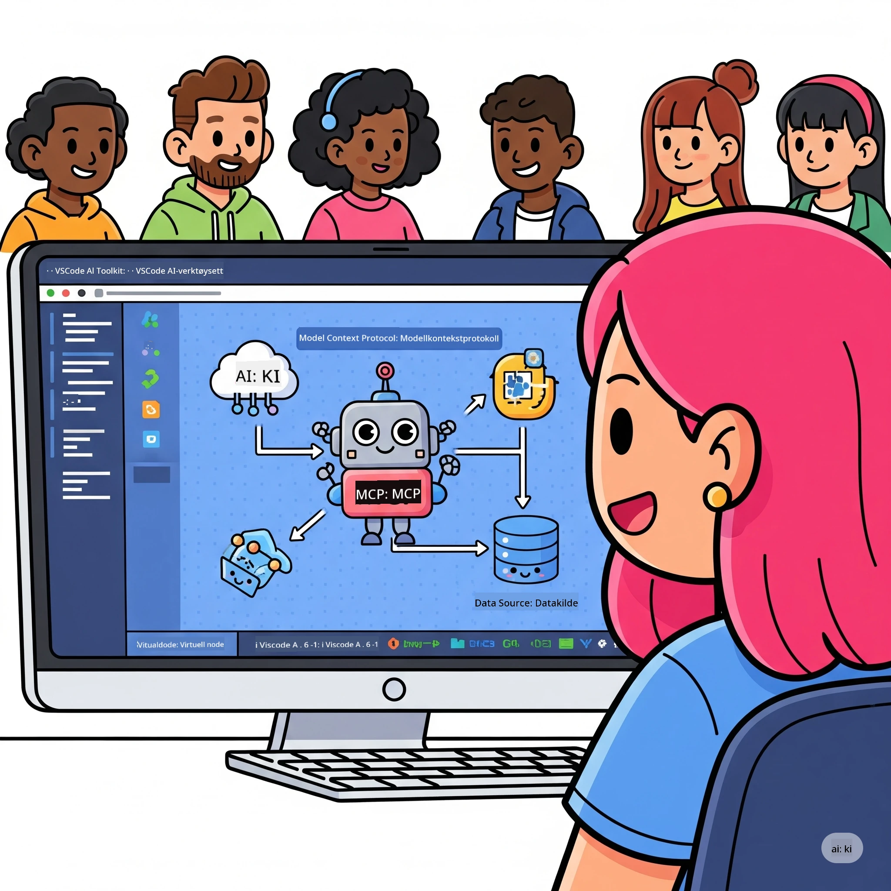
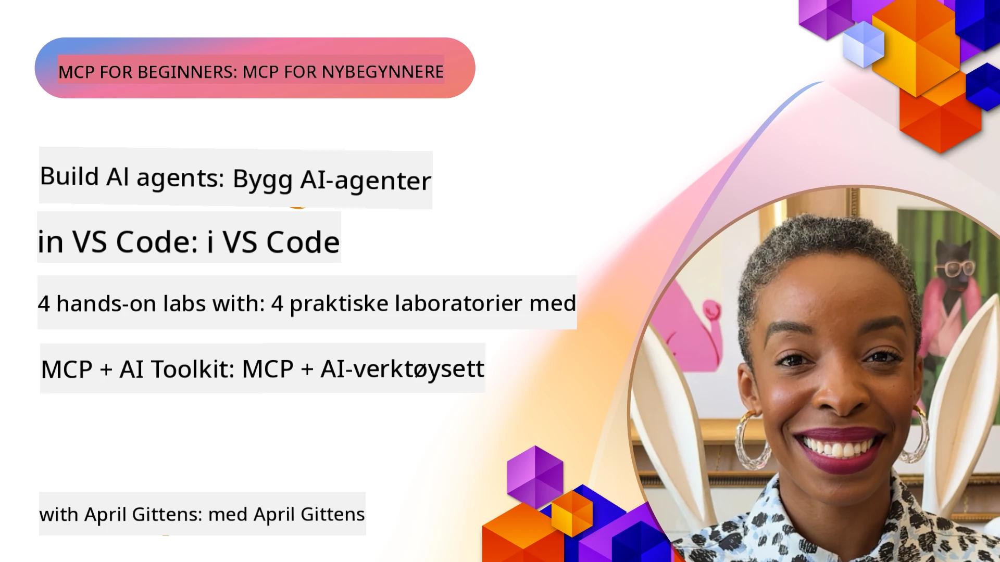

# Effektivisering av AI-arbeidsflyter: Bygge en MCP-server med Microsoft Foundry Toolkit

## 🎯 Oversikt

_(Klikk på bildet over for å se video av denne leksjonen)_

Velkommen til **Model Context Protocol (MCP) Workshop**! Dette omfattende, praktiske kurset kombinerer to banebrytende teknologier for å revolusjonere AI-applikasjonsutvikling:

> **Kompatibilitetsmerknad:** workshop-koden ble bygget og testet med MCP
> `2025-11-25`, som vist på merket over. Bruk
> [gjeldende `2026-07-28`-spesifikasjon](https://modelcontextprotocol.io/specification/2026-07-28/)
> for nye protokollimplementeringer og gå gjennom SDK-utgivelsesnotater før
> du migrerer laboratoriene.

- **🔗 Model Context Protocol (MCP)**: En åpen standard for sømløs AI-verktøyintegrasjon
- **🛠️ Microsoft Foundry Toolkit-utvidelse for VS Code**: Microsofts kraftige AI-utviklingsutvidelse

### 🎓 Hva du vil lære

Ved slutten av dette kurset vil du ha mestret kunsten å bygge intelligente applikasjoner som kobler AI-modeller til virkelige verktøy og tjenester. Fra automatisert testing til tilpassede API-integrasjoner vil du få praktiske ferdigheter for å løse komplekse forretningsutfordringer.

## 🏗️ Teknologistabel

### 🔌 Model Context Protocol (MCP)

MCP er **“USB-C for AI”** – en universell standard som kobler AI-modeller til eksterne verktøy og datakilder.

**✨ Hovedfunksjoner:**

- 🔄 **Standardisert integrasjon**: Universelt grensesnitt for AI-verktøykoblinger
- 🏛️ **Fleksibel arkitektur**: Lokale og eksterne servere via stdio/SSE-transport
- 🧰 **Rikt økosystem**: Verktøy, prompts og ressurser i en protokoll
- 🔒 **Klar for bedrifter**: Innebygd sikkerhet og pålitelighet

**🎯 Hvorfor MCP er viktig:**
Akkurat som USB-C eliminerte kabelkaos, fjerner MCP kompleksiteten i AI-integrasjoner. Én protokoll, uendelige muligheter.

### 🤖 Microsoft Foundry Toolkit-utvidelse for VS Code

Microsofts flaggskip AI-utviklingsutvidelse som forvandler VS Code til en AI-kraftpakke.

**🚀 Kjernefunksjoner:**

- 📦 **Modellkatalog**: Tilgang til modeller fra Azure AI, GitHub, Hugging Face, Ollama
- ⚡ **Lokal inferens**: ONNX-optimalisert CPU/GPU/NPU-kjøring
- 🏗️ **Agentbygger**: Visuell utvikling av AI-agenter med MCP-integrasjon
- 🎭 **Multi-modalt**: Støtte for tekst, visjon og strukturert output

**💡 Utviklingsfordeler:**

- Null-konfigurasjons modellutrulling
- Visuell prompt-design
- Sanntidstesting
- Sømløs MCP-serverintegrasjon

## 📚 Læringsreise

### [🚀 Modul 1: Microsoft Foundry Toolkit Grunnleggende](./lab1/README.md)

**Varighet**: 15 minutter

- 🛠️ Installer og konfigurer Microsoft Foundry Toolkit for VS Code
- 🗂️ Utforsk Modellkatalogen (100+ modeller fra GitHub, ONNX, OpenAI, Anthropic, Google)
- 🎮 Mestre Interaktiv lekeplass for sanntidstesting av modeller
- 🤖 Bygg din første AI-agent med Agentbygger
- 📊 Evaluer modellprestasjon med innebygde metrikker (F1, relevans, likhet, koherens)
- ⚡ Lær om batchprosessering og multi-modale støttefunksjoner

**🎯 Læringsmål**: Lag en funksjonell AI-agent med full forståelse av Microsoft Foundry Toolkits kapasiteter

### [🌐 Modul 2: MCP med Microsoft Foundry Toolkit Grunnleggende](./lab2/README.md)

**Varighet**: 20 minutter

- 🧠 Mestere Model Context Protocol (MCP) arkitektur og konsepter
- 🌐 Utforsk Microsofts MCP-serverøkosystem
- 🤖 Bygg en nettleserautomatiseringsagent med Playwright MCP-server
- 🔧 Integrer MCP-servere med Microsoft Foundry Toolkit Agentbygger
- 📊 Konfigurer og test MCP-verktøy i agentene dine
- 🚀 Eksporter og distribuer MCP-drevne agenter til produksjon

**🎯 Læringsmål**: Distribuer en AI-agent superladet med eksterne verktøy via MCP

### [🔧 Modul 3: Avansert MCP-utvikling med Microsoft Foundry Toolkit](./lab3/README.md)

**Varighet**: 20 minutter

- 💻 Lag tilpassede MCP-servere med Microsoft Foundry Toolkit
- 🐍 Konfigurer og bruk nyeste MCP Python SDK (v1.9.3)
- 🔍 Sett opp og bruk MCP Inspector for feilsøking
- 🛠️ Bygg en Weather MCP-server med profesjonelle feilsøkingsflyter
- 🧪 Feilsøk MCP-servere i både Agentbygger og Inspector-miljøer

**🎯 Læringsmål**: Utvikle og feilsøk tilpassede MCP-servere med moderne verktøy

### [🐙 Modul 4: Praktisk MCP-utvikling - Tilpasset GitHub Clone-server](./lab4/README.md)

**Varighet**: 30 minutter

- 🏗️ Bygg en reell GitHub Clone MCP-server for utviklingsarbeidsflyter
- 🔄 Implementer smart kloning av repo med validering og feilhåndtering
- 📁 Lag intelligent mappestyring og VS Code-integrasjon
- 🤖 Bruk GitHub Copilot Agent Mode med tilpassede MCP-verktøy
- 🛡️ Påfør produksjonsklar pålitelighet og kryssplattform-kompatibilitet

**🎯 Læringsmål**: Distribuer en produksjonsklar MCP-server som effektiviserer ekte utviklingsarbeidsflyter

## 💡 Virkelige bruksområder og påvirkning

### 🏢 Bedriftsbrukstilfeller

#### 🔄 DevOps-automatisering

Forvandle utviklingsarbeidsflyten din med intelligent automatisering:

- **Smart repositoriehåndtering**: AI-drevet kodegjennomgang og beslutninger om sammenslåing
- **Intelligent CI/CD**: Automatisert optimalisering av arbeidsflyt basert på kodeendringer
- **Issue Triage**: Automatisk klassifisering og tildeling av feil

#### 🧪 Revolusjon innen kvalitetssikring

Hev testingen med AI-drevet automatisering:

- **Intelligent testgenerering**: Lag omfattende testsuiter automatisk
- **Visuell regresjonstesting**: AI-drevet UI-endringsdeteksjon
- **Ytelsesovervåkning**: Proaktiv identifisering og løsning av problemer

#### 📊 Intelligente datapipelines

Bygg smartere dataflyt-arbeidsflyter:

- **Adaptive ETL-prosesser**: Selvoptimaliserende datatransformasjoner
- **Anomalideteksjon**: Sanntidsovervåkning av datakvalitet
- **Intelligent ruting**: Smart styring av dataflyt

#### 🎧 Forbedring av kundeopplevelsen

Skap eksepsjonelle kundeinteraksjoner:

- **Kontekstbevisst støtte**: AI-agenter med tilgang til kundehistorikk
- **Proaktiv problemløsning**: Prediktiv kundeservice
- **Multikanal-integrasjon**: Enhetlig AI-opplevelse på tvers av plattformer

## 🛠️ Forutsetninger og oppsett

### 💻 Systemkrav

| Komponent | Krav | Notater |
|-----------|-------------|-------|
| **Operativsystem** | Windows 10+, macOS 10.15+, Linux | Ethvert moderne OS |
| **Visual Studio Code** | Nyeste stabile versjon | Påkrevd for Microsoft Foundry Toolkit |
| **Node.js** | v18.0+ og npm | For MCP-serverutvikling |
| **Python** | 3.10+ | Valgfritt for Python MCP-servere |
| **Minne** | Minimum 8GB RAM | 16GB anbefalt for lokale modeller |

### 🔧 Utviklingsmiljø

#### Anbefalte VS Code-utvidelser

- **Microsoft Foundry Toolkit** (ms-windows-ai-studio.windows-ai-studio)
- **Python** (ms-python.python)
- **Python Debugger** (ms-python.debugpy)
- **GitHub Copilot** (GitHub.copilot) - Valgfritt men nyttig

#### Valgfrie verktøy

- **uv**: Moderne Python-pakkebehandler
- **MCP Inspector**: Visuelt feilsøkingsverktøy for MCP-servere
- **Playwright**: For webautomatiseringseksempler

## 🎖️ Læringsutbytte og sertifiseringsvei

### 🏆 Sjekkliste for ferdighetsmestring

Når du fullfører denne workshopen vil du ha oppnådd mestring i:

#### 🎯 Kjernekompetanser

- [ ] **MCP-protokollmestring**: Dyp forståelse av arkitektur og implementeringsmønstre
- [ ] **Microsoft Foundry Toolkit-ferdigheter**: Ekspertbruk av Microsoft Foundry Toolkit for rask utvikling
- [ ] **Tilpasset serverutvikling**: Bygg, distribuer og vedlikehold produksjons-MCP-servere
- [ ] **Verktøyintegrasjonsdyktighet**: Sømløs tilkobling av AI med eksisterende utviklingsarbeidsflyter
- [ ] **Problem­løsende anvendelse**: Anvend lærte ferdigheter på reelle forretningsutfordringer

#### 🔧 Tekniske ferdigheter

- [ ] Sett opp og konfigurer Microsoft Foundry Toolkit i VS Code
- [ ] Design og implementer tilpassede MCP-servere
- [ ] Integrer Microsoft Foundry-modeller med MCP-arkitektur
- [ ] Bygg automatiserte testflyter med Playwright
- [ ] Distribuer AI-agenter for produksjon
- [ ] Feilsøk og optimaliser MCP-serverytelse

#### 🚀 Avanserte kapasiteter

- [ ] Arkitekter AI-integrasjoner i bedriftsformat
- [ ] Implementer sikkerhetsbeste praksis for AI-applikasjoner
- [ ] Design skalerbare MCP-serverarkitekturer
- [ ] Lag tilpassede verktøykjeder for spesifikke domener
- [ ] Veilede andre i AI-native utvikling

## 📖 Ytterligere ressurser

- [MCP-spesifikasjon (2026-07-28)](https://modelcontextprotocol.io/specification/2026-07-28/)
- [Microsoft Foundry Toolkit GitHub-repositorium](https://github.com/microsoft/vscode-ai-toolkit)
- [Samling av MCP-servereksempler](https://github.com/modelcontextprotocol/servers)
- [Beste praksis-guide](https://modelcontextprotocol.io/docs/best-practices)
- [OWASP MCP Topp 10](https://microsoft.github.io/mcp-azure-security-guide/mcp/) - Sikkerhetsbeste praksis

---

**🚀 Klar til å revolusjonere AI-utviklingsarbeidsflyten din?**

La oss bygge fremtidens intelligente applikasjoner sammen med MCP og Microsoft Foundry Toolkit!

## Hva Nå

Fortsett til: [Modul 11: MCP Server Hands-On Labs](../11-MCPServerHandsOnLabs/README.md)

---

<!-- CO-OP TRANSLATOR DISCLAIMER START -->
**Ansvarsfraskrivelse**:
Dette dokumentet er oversatt ved hjelp av AI-oversettelsestjenesten [Co-op Translator](https://github.com/Azure/co-op-translator). Selv om vi streber etter nøyaktighet, vær oppmerksom på at automatiske oversettelser kan inneholde feil eller unøyaktigheter. Det opprinnelige dokumentet på originalspråket skal betraktes som den autoritative kilden. For kritisk informasjon anbefales profesjonell menneskelig oversettelse. Vi er ikke ansvarlige for eventuelle misforståelser eller feiltolkninger som oppstår ved bruk av denne oversettelsen.
<!-- CO-OP TRANSLATOR DISCLAIMER END -->