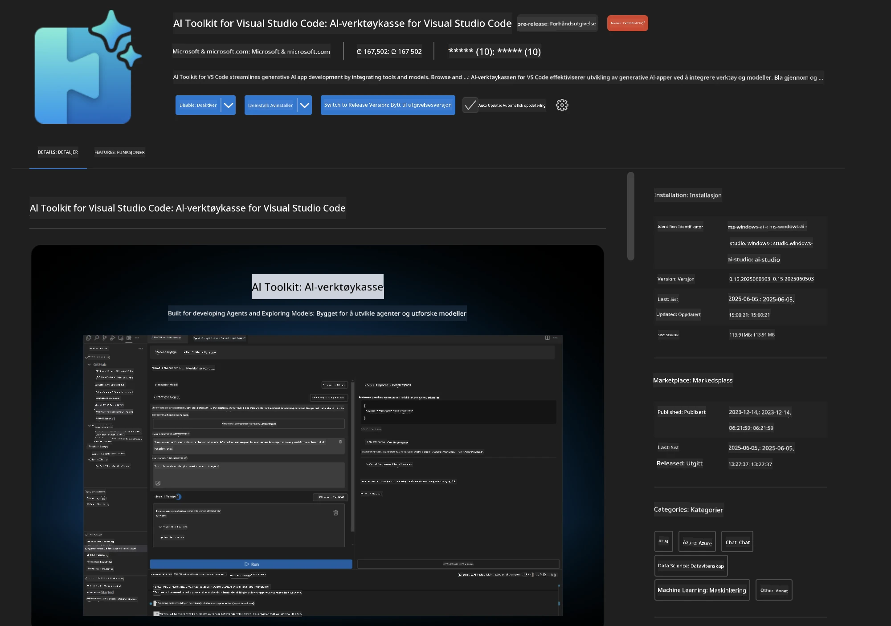
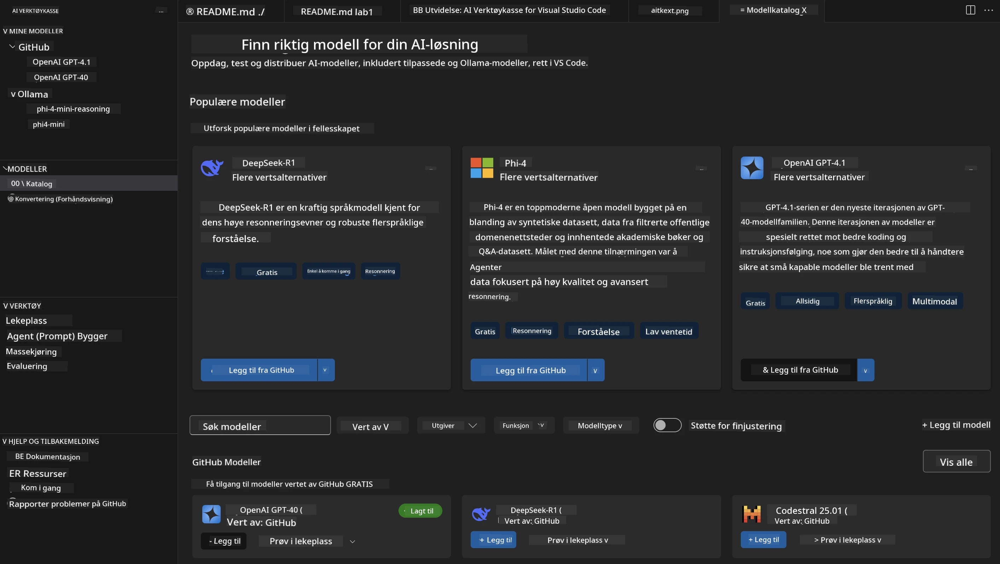
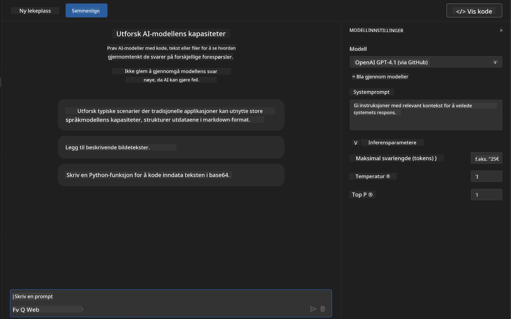
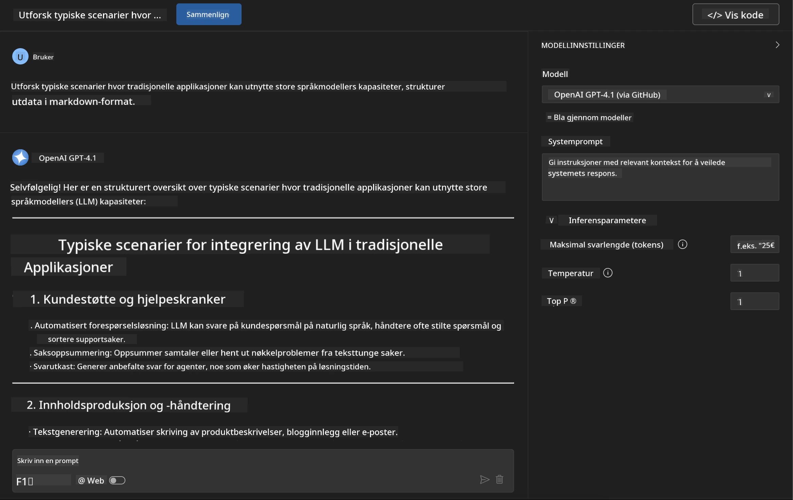
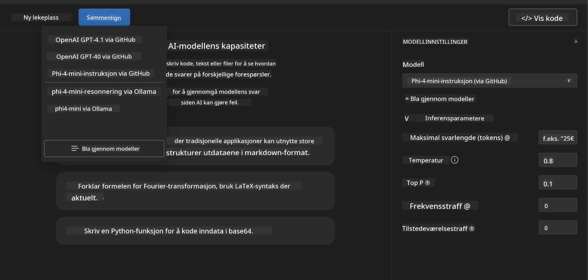
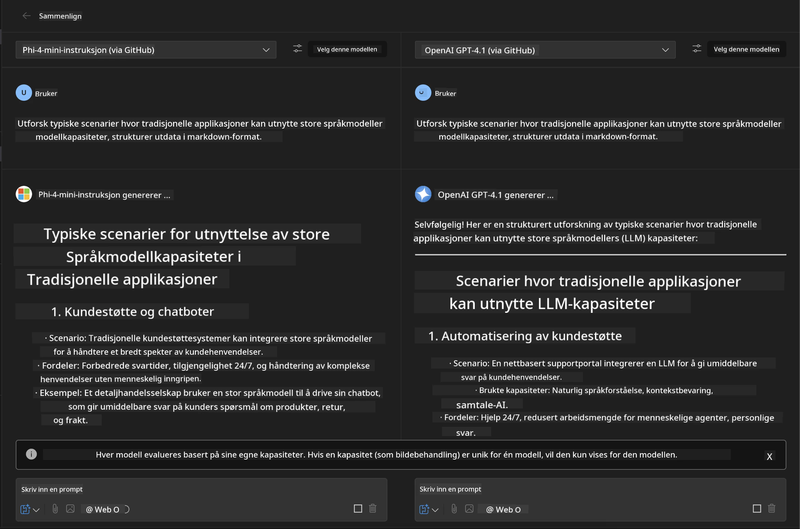
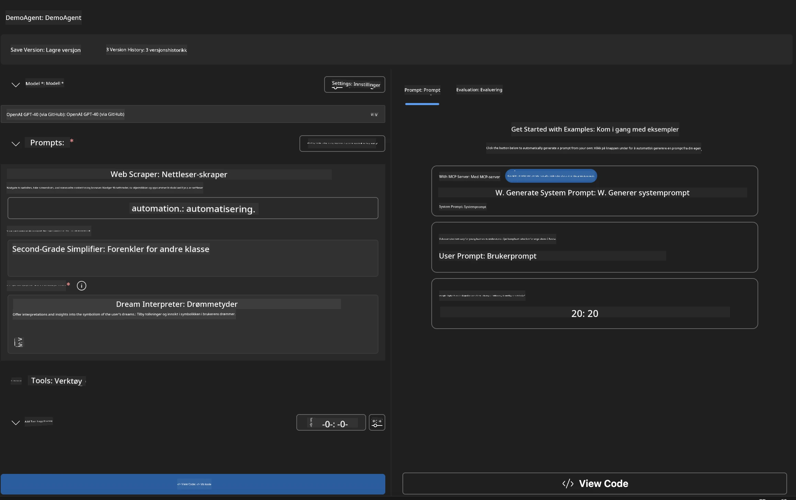
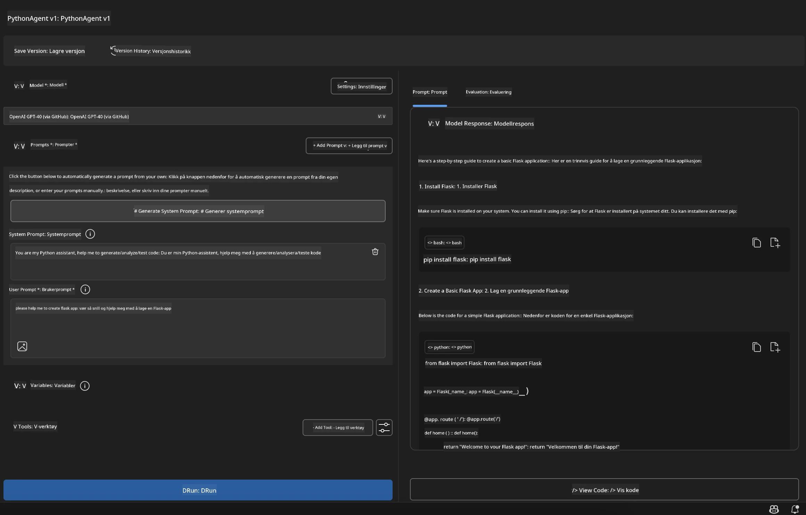

# 🚀 Modul 1: Grunnleggende om Microsoft Foundry Toolkit

[]()
[]()
[]()

## 📋 Læringsmål

Når du er ferdig med denne modulen, vil du kunne:
- ✅ Installere og konfigurere Microsoft Foundry Toolkit Extension for VS Code
- ✅ Navigere i Modellkatalogen og forstå ulike modellkilder
- ✅ Bruke Playground for modelltesting og eksperimentering
- ✅ Lage tilpassede AI-agenter med Agent Builder
- ✅ Sammenligne modellprestasjon på tvers av forskjellige leverandører
- ✅ Anvende beste praksis for prompt engineering

## 🧠 Introduksjon til Microsoft Foundry Toolkit

**Microsoft Foundry Toolkit Extension for VS Code** er Microsofts flaggskip-utvidelse som forvandler VS Code til et omfattende AI utviklingsmiljø. Den bygger bro mellom AI-forskning og praktisk applikasjonsutvikling, og gjør generativ AI tilgjengelig for utviklere på alle ferdighetsnivåer.

### 🌟 Nøkkelfunksjoner

| Funksjon | Beskrivelse | Brukstilfelle |
|---------|-------------|---------------|
| **🗂️ Modellkatalog** | Tilgang til 100+ modeller fra GitHub, ONNX, OpenAI, Anthropic, Google | Modelloppdagelse og utvalg |
| **🔌 BYOM Støtte** | Integrer dine egne modeller (lokale/fjern) | Tilpasset modellutrulling |
| **🎮 Interaktiv Playground** | Sanntidstesting av modeller med chattegrensesnitt | Rask prototyping og testing |
| **📎 Multimodal Støtte** | Håndter tekst, bilder og vedlegg | Komplekse AI-applikasjoner |
| **⚡ Batchbehandling** | Kjør flere prompts samtidig | Effektive testarbeidsflyter |
| **📊 Modellevaluering** | Innebygde metrikker (F1, relevans, likhet, sammenheng) | Vurdering av ytelse |

### 🎯 Hvorfor Microsoft Foundry Toolkit Betyr Noe

- **🚀 Raskere Utvikling**: Fra ide til prototype på minutter
- **🔄 Enhetlig Arbeidsflyt**: Ett grensesnitt for flere AI-leverandører
- **🧪 Enkel Eksperimentering**: Sammenlign modeller uten komplisert oppsett
- **📈 Produksjonsklart**: Sømløs overgang fra prototype til utrulling

## 🛠️ Forutsetninger & Oppsett

### 📦 Installer Microsoft Foundry Toolkit Extension

**Steg 1: Åpne Extensions Marketplace**
1. Åpne Visual Studio Code
2. Naviger til Extensions-visningen (`Ctrl+Shift+X` eller `Cmd+Shift+X`)
3. Søk etter "Microsoft Foundry Toolkit"

**Steg 2: Velg din versjon**
- **🟢 Release**: Anbefalt for produksjonsbruk
- **🔶 Pre-release**: Tidlig tilgang til banebrytende funksjoner

**Steg 3: Installer og Aktiver**



### ✅ Verifiseringssjekkliste
- [ ] Microsoft Foundry Toolkit-ikonet vises i VS Code sidepanel
- [ ] Extension er aktivert og tatt i bruk
- [ ] Ingen installasjonsfeil i utdata-panelet

## 🧪 Praktisk øvelse 1: Utforske Microsoft Foundry Modeller

**🎯 Mål**: Mestre Modellkatalogen og test din første AI-modell

### 📊 Steg 1: Naviger i Modellkatalogen

Modellkatalogen er din inngangsport til AI-økosystemet. Den samler modeller fra flere leverandører, noe som gjør det enkelt å oppdage og sammenligne alternativer.

**🔍 Navigasjonsguide:**

Klikk på **MODELS - Catalog** i Microsoft Foundry Toolkit sidepanelet



**💡 Profftips**: Se etter modeller med spesifikke egenskaper som passer ditt bruksområde (f.eks. kodegenerering, kreativ skriving, analyse).

> [!NOTE]
> GitHub Models ble lagt ned 30. juli 2026. Bruk en Microsoft Foundry modell
> utrulling og autentiser med Microsoft Entra ID eller en Azure API-nøkkel.

### 🚀 Steg 2: Legg til og konfigurer din første modell

**Strategi for modellvalg:**
- **GPT-5.1**: Anbefalt allmennmodell for verktøybruk og resonnement
- **Phi-4-mini**: Lettvekter, raske svar for enkle oppgaver

**🔧 Konfigurasjonsprosess:**
1. Velg **OpenAI GPT-5.1** fra katalogen
2. Klikk **Legg til i Mine modeller** - dette registrerer modellen for bruk
3. Velg **Prøv i Playground** for å starte testmiljøet
4. Vent på modellinitialisering (første gangs oppsett kan ta litt tid)



**⚙️ Forstå modellparametere:**
- **Temperature**: Styrer kreativitet (0 = deterministisk, 1 = kreativ)
- **Max Tokens**: Maksimal lengde på svar
- **Top-p**: Kjernenprøvetaking for svarvariasjon

### 🎯 Steg 3: Mestre Playground-grensesnittet

Playground er ditt AI-eksperimentlaboratorium. Slik maksimerer du potensialet:

**🎨 Beste praksis for prompt engineering:**
1. **Vær Spesifikk**: Klare, detaljerte instrukser gir bedre resultater
2. **Gi Kontekst**: Inkluder relevant bakgrunnsinformasjon
3. **Bruk Eksempler**: Vis modellen hva du ønsker med eksempler
4. **Iterer**: Forbedre prompts basert på første resultater

**🧪 Testscenarier:**
```markdown
# Example 1: Code Generation
"Write a Python function that calculates the factorial of a number using recursion. Include error handling and docstrings."

# Example 2: Creative Writing
"Write a professional email to a client explaining a project delay, maintaining a positive tone while being transparent about challenges."

# Example 3: Data Analysis
"Analyze this sales data and provide insights: [paste your data]. Focus on trends, anomalies, and actionable recommendations."
```



### 🏆 Utfordringsøvelse: Sammenligning av modellprestasjon

**🎯 Mål**: Sammenlign forskjellige modeller ved bruk av identiske prompts for å forstå deres styrker

**📋 Instruksjoner:**
1. Legg til **Phi-4-mini** i arbeidsområdet ditt
2. Bruk samme prompt for både GPT-5.1 og Phi-4-mini



3. Sammenlign svarenes kvalitet, hastighet og nøyaktighet
4. Dokumenter dine funn i resultatseksjonen



**💡 Viktige innsikter å oppdage:**
- Når man bør bruke LLM vs SLM
- Kost- og ytelsesavveininger
- Spesialiserte egenskaper ved ulike modeller

## 🤖 Praktisk øvelse 2: Lage tilpassede agenter med Agent Builder

**🎯 Mål**: Skap spesialiserte AI-agenter tilpasset spesifikke oppgaver og arbeidsflyter

### 🏗️ Steg 1: Forstå Agent Builder

Agent Builder er stedet hvor Microsoft Foundry Toolkit virkelig utmerker seg. Det lar deg lage formålsbygde AI-assistenter som kombinerer kraften fra store språkmodeller med tilpassede instruksjoner, spesifikke parametere og spesialisert kunnskap.

**🧠 Arkitekturkomponenter for agenten:**
- **Kjernemodell**: Grunnlaget LLM (GPT-5.1, Phi, osv.)
- **Systemprompt**: Definerer agentens personlighet og atferd
- **Parametere**: Finjusterte innstillinger for optimal ytelse
- **Verktøyintegrasjon**: Koble til eksterne APIer og MCP-tjenester
- **Minne**: Kontekst fra samtaler og sesjonens vedvarende data



### ⚙️ Steg 2: Dypdykk i agentkonfigurasjon

**🎨 Lage effektive systemprompter:**
```markdown
# Template Structure:
## Role Definition
You are a [specific role] with expertise in [domain].

## Capabilities
- List specific abilities
- Define scope of knowledge
- Clarify limitations

## Behavior Guidelines
- Response style (formal, casual, technical)
- Output format preferences
- Error handling approach

## Examples
Provide 2-3 examples of ideal interactions
```

*Selvfølgelig kan du også bruke Generate System Prompt for å la AI hjelpe deg med å lage og optimalisere prompter*

**🔧 Parameteroptimalisering:**
| Parameter | Anbefalt område | Brukstilfelle |
|-----------|-----------------|--------------|
| **Temperature** | 0.1-0.3 | Tekniske/faktuelle svar |
| **Temperature** | 0.7-0.9 | Kreative/idémyldringsoppgaver |
| **Max Tokens** | 500-1000 | Konsise svar |
| **Max Tokens** | 2000-4000 | Detaljerte forklaringer |

### 🐍 Steg 3: Praktisk øvelse - Python-programmeringsagent

**🎯 Oppdrag**: Lag en spesialisert Python-kodeassistent

**📋 Konfigurasjonstrinn:**

1. **Modellvalg**: Velg **Claude 3.5 Sonnet** (utmerket for kode)

2. **Systempromptdesign**:
```markdown
# Python Programming Expert Agent

## Role
You are a senior Python developer with 10+ years of experience. You excel at writing clean, efficient, and well-documented Python code.

## Capabilities
- Write production-ready Python code
- Debug complex issues
- Explain code concepts clearly
- Suggest best practices and optimizations
- Provide complete working examples

## Response Format
- Always include docstrings
- Add inline comments for complex logic
- Suggest testing approaches
- Mention relevant libraries when applicable

## Code Quality Standards
- Follow PEP 8 style guidelines
- Use type hints where appropriate
- Handle exceptions gracefully
- Write readable, maintainable code
```

3. **Parameterkonfigurasjon**:
   - Temperature: 0.2 (for konsistent, pålitelig kode)
   - Max Tokens: 2000 (detaljerte forklaringer)
   - Top-p: 0.9 (balansert kreativitet)



### 🧪 Steg 4: Test din Python-agent

**Testscenarier:**
1. **Grunnleggende funksjon**: "Lag en funksjon for å finne primtall"
2. **Komplekst algoritme**: "Implementer et binært søketre med innsetting, sletting og søkemetoder"
3. **Virkelighetsproblem**: "Bygg en webskraper som håndterer rate limiting og retry"
4. **Feilsøking**: "Fiks denne koden [lim inn buggy kode]"

**🏆 Suksesskriterier:**
- ✅ Koden kjører uten feil
- ✅ Inkluderer hensiktsmessig dokumentasjon
- ✅ Følger beste praksis for Python
- ✅ Gir klare forklaringer
- ✅ Foreslår forbedringer

## 🎓 Modul 1 Oppsummering & Neste Steg

### 📊 Kunnskapskontroll

Test din forståelse:
- [ ] Kan du forklare forskjellen mellom modellene i katalogen?
- [ ] Har du med suksess laget og testet en tilpasset agent?
- [ ] Forstår du hvordan man optimaliserer parametere for ulike bruksområder?
- [ ] Kan du lage effektive systemprompter?

### 📚 Ytterligere ressurser

- **Microsoft Foundry Toolkit Dokumentasjon**: [Offisielle Microsoft Docs](https://github.com/microsoft/vscode-ai-toolkit)
- **Prompt Engineering Guide**: [Beste Praksis](https://platform.openai.com/docs/guides/prompt-engineering)
- **Modeller i Microsoft Foundry Toolkit**: [Modeller under utvikling](https://github.com/microsoft/vscode-ai-toolkit/blob/main/doc/models.md)

**🎉 Gratulerer!** Du har mestret det grunnleggende om Microsoft Foundry Toolkit og er klar til å bygge mer avanserte AI-applikasjoner!

### 🔜 Fortsett til neste modul

Klar for mer avanserte funksjoner? Fortsett til **[Modul 2: MCP med Microsoft Foundry Toolkit Fundamentals](../lab2/README.md)** hvor du vil lære hvordan du:
- Koble agentene dine til eksterne verktøy ved hjelp av Model Context Protocol (MCP)
- Bygge nettleserautomatiseringsagenter med Playwright
- Integrere MCP-servere med dine Microsoft Foundry Toolkit-agenter
- Gi agentene dine ekstra kraft med ekstern data og muligheter

---

<!-- CO-OP TRANSLATOR DISCLAIMER START -->
**Ansvarsfraskrivelse**:
Dette dokumentet er oversatt ved hjelp av AI-oversettelsestjenesten [Co-op Translator](https://github.com/Azure/co-op-translator). Selv om vi streber etter nøyaktighet, vær oppmerksom på at automatiske oversettelser kan inneholde feil eller unøyaktigheter. Det opprinnelige dokumentet på originalspråket skal betraktes som den autoritative kilden. For kritisk informasjon anbefales profesjonell menneskelig oversettelse. Vi er ikke ansvarlige for eventuelle misforståelser eller feiltolkninger som oppstår ved bruk av denne oversettelsen.
<!-- CO-OP TRANSLATOR DISCLAIMER END -->