# 🌐 Modul 2: MCP med Microsoft Foundry Toolkit Grunnleggende


## 📋 Læringsmål

Innen slutten av denne modulen vil du kunne:

- ✅ Forstå Model Context Protocol (MCP) arkitektur og fordeler
- ✅ Utforske Microsofts MCP-serverøkosystem
- ✅ Integrere MCP-servere med Microsoft Foundry Toolkit Agent Builder
- ✅ Bygge en funksjonell nettleserautomatiseringsagent med Playwright MCP
- ✅ Konfigurere og teste MCP-verktøy i agentene dine
- ✅ Eksportere og distribuere MCP-drevne agenter for produksjonsbruk

## 🎯 Bygger videre på Modul 1

I Modul 1 mestret vi Microsoft Foundry Toolkit-grunnleggende og laget vår
første Python-agent. Nå skal vi **superlade** agentene dine ved å koble dem
til eksterne verktøy og tjenester gjennom den revolusjonerende
**Model Context Protocol (MCP)**.

Tenk på dette som å oppgradere fra en enkel kalkulator til en fullverdig datamaskin. AI-
agentene dine vil få muligheten til å:

- 🌐 Surfe på og interagere med nettsider
- 📁 Få tilgang til og manipulere filer
- 🔧 Integrere med bedriftsystemer
- 📊 Behandle sanntidsdata fra API-er

## 🧠 Forstå Model Context Protocol (MCP)

### 🔍 Hva er MCP?

Model Context Protocol (MCP) er **"USB-C for AI-applikasjoner"**: en åpen
standard som kobler Store Språkmodeller (LLMs) til eksterne verktøy, datakilder
og tjenester. Akkurat som USB-C gir én universell kontakt, reduserer MCP
kompleksiteten ved AI-integrasjon gjennom én standardisert protokoll.

### 🎯 Problemet MCP Løser

**Før MCP:**

- 🔧 Tilpassede integrasjoner for hvert verktøy
- 🔄 Leverandørlås med proprietære løsninger  
- 🔒 Sikkerhetssårbarheter fra ad hoc-tilkoblinger
- ⏱️ Måneder med utvikling for grunnleggende integrasjoner

**Med MCP:**

- ⚡ Plug-and-play verktøyintegrasjon
- 🔄 Leverandøruavhengig arkitektur
- 🛡️ Innebygde sikkerhetsbeste praksiser
- 🚀 Minutter for å legge til nye funksjoner

### 🏗️ MCP Arkitektur Dypdykk

MCP følger en **klient-tjener-arkitektur** som skaper et sikkert, skalerbart økosystem:

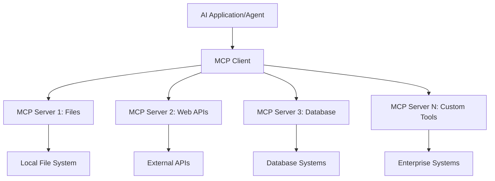

**🔧 Kjernekomponenter:**

| Komponent | Rolle | Eksempler |
| --------- | ---- | -------- |
| **MCP-verter** | Forbruker MCP-tjenester | VS Code, Foundry Toolkit |
| **MCP-klienter** | Håndterer protokolltilkoblinger | Innebygget i verter |
| **MCP-servere** | Tilbyr funksjonalitet | Playwright, Files, Azure, GitHub |
| **Transportlag** | Knytter klienter og servere | stdio, HTTP, WebSockets |

## 🏢 Microsofts MCP-Serverøkosystem

Microsoft leder MCP-økosystemet med en omfattende portefølje av
bedriftssertifiserte servere som dekker virkelige forretningsbehov.

### 🌟 Utvalgte Microsoft MCP-servere

#### 1. ☁️ Azure MCP-server

**🔗 Arkiv**: [azure/azure-mcp](https://github.com/azure/azure-mcp)
**🎯 Formål**: Omfattende Azure-ressursstyring med AI-integrasjon

**✨ Nøkkelegenskaper:**

- Deklarativ infrastrukturprovisjonering
- Sanntidsovervåking av ressurser
- Anbefalinger for kostnadsoptimalisering
- Sikkerhetsoverholdelseskontroll

**🚀 Bruksområder:**

- Infrastruktur som kode med AI-assistanse
- Automatisk ressurs-skalering
- Skykostnadsoptimalisering
- Automatisering av DevOps-arbeidsflyt

#### 2. 📊 Microsoft Dataverse MCP

**📚 Dokumentasjon**: [Microsoft Dataverse Integrasjon](https://go.microsoft.com/fwlink/?linkid=2320176)
**🎯 Formål**: Naturlig språkgrensesnitt for forretningsdata

**✨ Nøkkelegenskaper:**

- Forespørsler til databaser med naturlig språk
- Forståelse av forretningskontekst
- Tilpassede promptmaler
- Bedriftsdataforvaltning

**🚀 Bruksområder:**

- Forretningsintelligensrapportering
- Analyse av kundedata
- Innsikt i salgspipeline
- Forespørsler om samsvarsdokumentasjon

#### 3. 🌐 Playwright MCP-server

**🔗 Arkiv**: [microsoft/playwright-mcp](https://github.com/microsoft/playwright-mcp)
**🎯 Formål**: Nettleserautomatisering og webinteraksjonsmuligheter

**✨ Nøkkelegenskaper:**

- Tvers gjennom nettlesere automatisering (Chrome, Firefox, Safari)
- Intelligent elementgjenkjenning
- Skjermbilde- og PDF-generering
- Nettverkstrafikkovervåking

**🚀 Bruksområder:**

- Automatiserte testarbeidsflyter
- Nettskraping og datauttrekk
- UI/UX-overvåking
- Automatisering av konkurrentanalyse

#### 4. 📁 Files MCP-server

**🔗 Arkiv**: [microsoft/files-mcp-server](https://github.com/microsoft/files-mcp-server)
**🎯 Formål**: Intelligente filsystemoperasjoner

**✨ Nøkkelegenskaper:**

- Deklarativ filhåndtering
- Innholdssynkronisering
- Versjonskontrollintegrasjon
- Metadatautvinning

**🚀 Bruksområder:**

- Dokumentasjonsadministrasjon
- Organisering av kodearkiv
- Arbeidsflyt for publisering av innhold
- Filhåndtering for datapipelines

#### 5. 📝 MarkItDown MCP-server

**🔗 Arkiv**: [microsoft/markitdown](https://github.com/microsoft/markitdown)
**🎯 Formål**: Avansert Markdown-behandling og manipulering

**✨ Nøkkelegenskaper:**

- Omfattende Markdown-parsing
- Formatkonvertering (MD ↔ HTML ↔ PDF)
- Analyse av innholdsstruktur
- Malbehandling

**🚀 Bruksområder:**

- Tekniske dokumentasjonsarbeidsflyter
- Innholdsadministrasjonssystemer
- Rapportgenerering
- Kunnskapsbaseautomatisering

#### 6. 📈 Clarity MCP-server

**📦 Pakke**: [@microsoft/clarity-mcp-server](https://www.npmjs.com/package/@microsoft/clarity-mcp-server)
**🎯 Formål**: Webanalyse og innsikt i brukeradferd

**✨ Nøkkelegenskaper:**

- Heatmap-dataanalyse
- Innspillinger av brukersesjoner
- Ytelsesmetrikker
- Analyse av konverteringsfunneler

**🚀 Bruksområder:**

- Nettstedsoptimalisering
- Brukeropplevelsesforskning
- A/B-testanalyse
- Forretningsintelligens-dashboard

### 🌍 Fellesskapets Økosystem

Utover Microsofts servere inkluderer MCP-økosystemet:

- **🐙 GitHub MCP**: Repository-administrasjon og kodeanalyse
- **🗄️ Database MCP-er**: Integrasjoner for PostgreSQL, MySQL, MongoDB
- **☁️ Skyleverandør-MCP-er**: AWS, GCP, Digital Ocean-verktøy
- **📧 Kommunikasjons-MCP-er**: Slack, Teams, e-postintegrasjoner

## 🛠️ Praktisk Lab: Lage en Nettleserautomatiseringsagent

**🎯 Prosjektmål**: Lage en intelligent nettleserautomatiseringsagent med
Playwright MCP-server som kan navigere på nettsider, hente informasjon og
utføre komplekse webinteraksjoner.

### 🚀 Fase 1: Grunnoppsett for agent

#### Steg 1: Initialiser agenten din

1. **Åpne Microsoft Foundry Toolkit Agent Builder**
2. **Opprett Ny Agent** med følgende konfigurasjon:
   - **Navn**: `BrowserAgent`
   - **Modell**: Velg GPT-5.1. Se
      [Microsoft Foundry modellpensjonsplan](https://learn.microsoft.com/azure/foundry/openai/concepts/model-retirement-schedule)
      for gjeldende informasjon om modellens livssyklus.

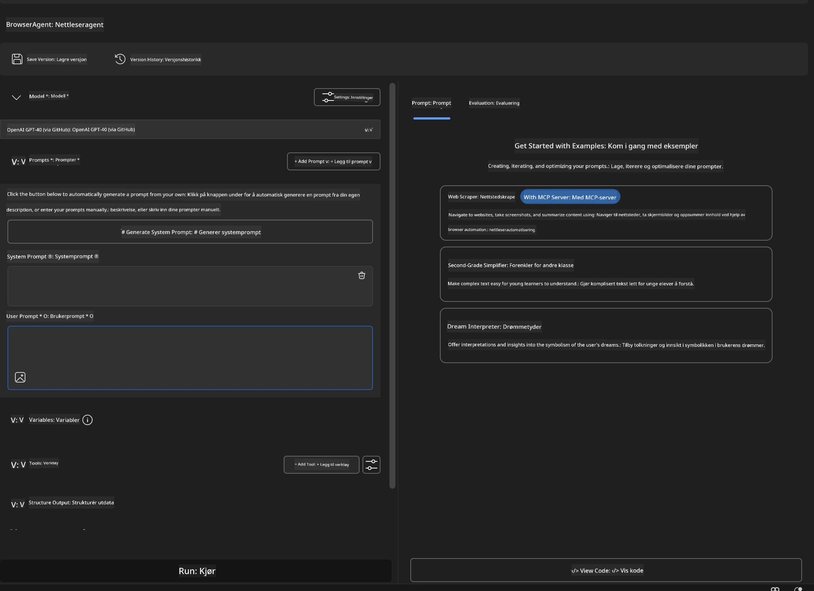

### 🔧 Fase 2: MCP-integrasjonsarbeidsflyt

#### Steg 3: Legg til MCP-serverintegrasjon

1. **Naviger til Verktøy-delen** i Agent Builder
2. **Klikk "Legg til Verktøy"** for å åpne integrasjonsmenyen
3. **Velg "MCP Server"** fra tilgjengelige alternativer

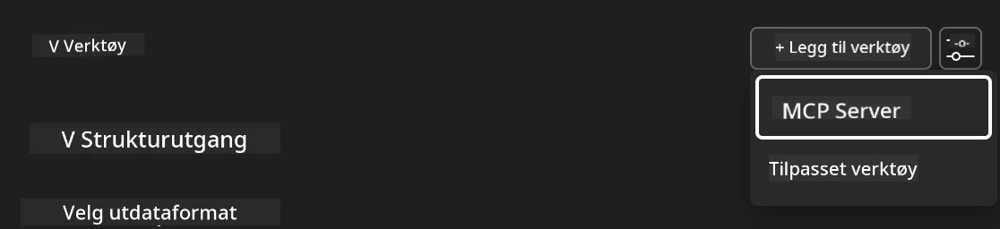

**🔍 Forstå Verktøytyper:**

- **Innebygde Verktøy**: Forhåndskonfigurerte Microsoft Foundry Toolkit-funksjoner
- **MCP-servere**: Eksterne tjenesteintegrasjoner
- **Egendefinerte API-er**: Egne tjenendepunkter
- **Funksjonskall**: Direkte modellfunksjons-tilgang

#### Steg 4: Velg MCP-server

1. **Velg "MCP Server"**-alternativet for å fortsette
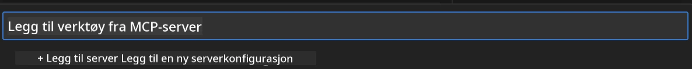

2. **Bla gjennom MCP-katalogen** for å utforske tilgjengelige integrasjoner
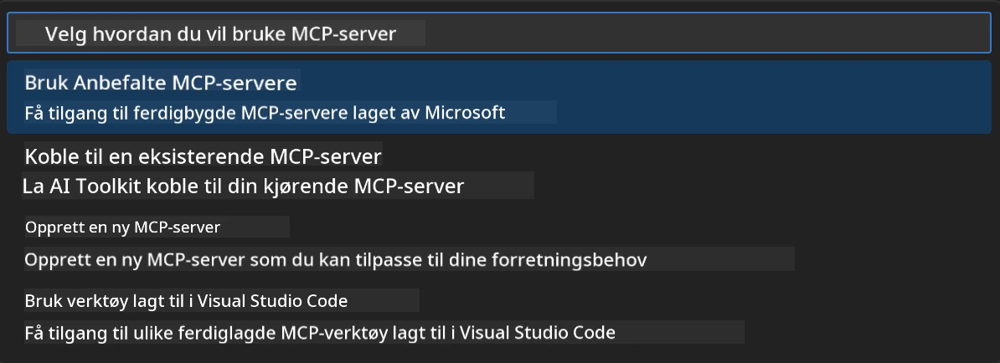

### 🎮 Fase 3: Playwright MCP-konfigurasjon

#### Steg 5: Velg og konfigurer Playwright

1. **Klikk "Bruk utvalgte MCP-servere"** for å få tilgang til Microsofts verifiserte servere
2. **Velg "Playwright"** fra den utvalgte listen
3. **Godta standard MCP-ID** eller tilpass for ditt miljø

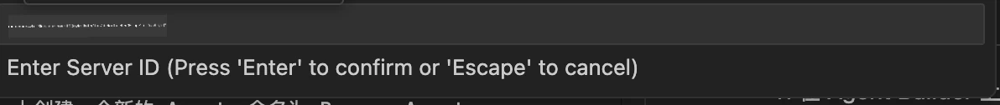

#### Steg 6: Aktivere Playwright-funksjoner

**🔑 Kritisk steg**: Velg **ALLE** tilgjengelige Playwright-metoder for maksimal funksjonalitet

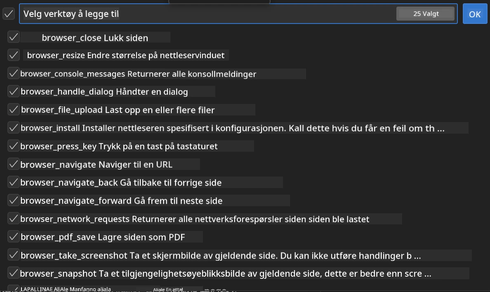

**🛠️ Viktige Playwright-verktøy:**

- **Navigasjon**: `goto`, `goBack`, `goForward`, `reload`
- **Interaksjon**: `click`, `fill`, `press`, `hover`, `drag`
- **Utvinning**: `textContent`, `innerHTML`, `getAttribute`
- **Validering**: `isVisible`, `isEnabled`, `waitForSelector`
- **Fangst**: `screenshot`, `pdf`, `video`
- **Nettverk**: `setExtraHTTPHeaders`, `route`, `waitForResponse`

#### Steg 7: Bekreft integrasjonssuksess

**✅ Suksessindikatorer:**

- Alle verktøy vises i Agent Builder-grensesnittet
- Ingen feilmeldinger i integrasjonspanelet
- Playwright-serverstatus viser "Tilkoblet"

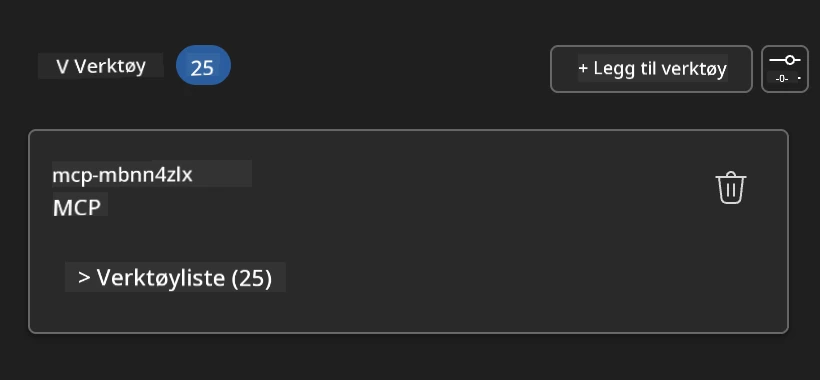

**🔧 Feilsøking av vanlige problemer:**

- **Tilkobling feilet**: Sjekk internett-tilkobling og brannmurinnstillinger
- **Manglende verktøy**: Sørg for at alle funksjoner ble valgt under oppsett
- **Tillatelsesfeil**: Kontroller at VS Code har nødvendige systemtillatelser

### 🎯 Fase 4: Avansert promptutforming

#### Steg 8: Design intelligente systemprompt

Lag sofistikerte prompt som utnytter Playwrights fulle funksjonalitet:

```markdown
# Web Automation Expert System Prompt

## Core Identity
You are an advanced web automation specialist with deep expertise in browser
automation, web scraping, and user experience analysis. You have access to
Playwright tools for comprehensive browser control.

## Capabilities & Approach
### Navigation Strategy
- Always start with screenshots to understand page layout
- Use semantic selectors (text content, labels) when possible
- Implement wait strategies for dynamic content
- Handle single-page applications (SPAs) effectively

### Error Handling
- Retry failed operations with exponential backoff
- Provide clear error descriptions and solutions
- Suggest alternative approaches when primary methods fail
- Always capture diagnostic screenshots on errors

### Data Extraction
- Extract structured data in JSON format when possible
- Provide confidence scores for extracted information
- Validate data completeness and accuracy
- Handle pagination and infinite scroll scenarios

### Reporting
- Include step-by-step execution logs
- Provide before/after screenshots for verification
- Suggest optimizations and alternative approaches
- Document any limitations or edge cases encountered

## Ethical Guidelines
- Respect robots.txt and rate limiting
- Avoid overloading target servers
- Only extract publicly available information
- Follow website terms of service
```

#### Steg 9: Lag dynamiske brukerprompt

Design prompt som demonstrerer ulike funksjoner:

**🌐 Webanalyse-eksempel:**

```markdown
Navigate to github.com/kinfey and provide a comprehensive analysis including:
1. Repository structure and organization
2. Recent activity and contribution patterns  
3. Documentation quality assessment
4. Technology stack identification
5. Community engagement metrics
6. Notable projects and their purposes

Include screenshots at key steps and provide actionable insights.
```

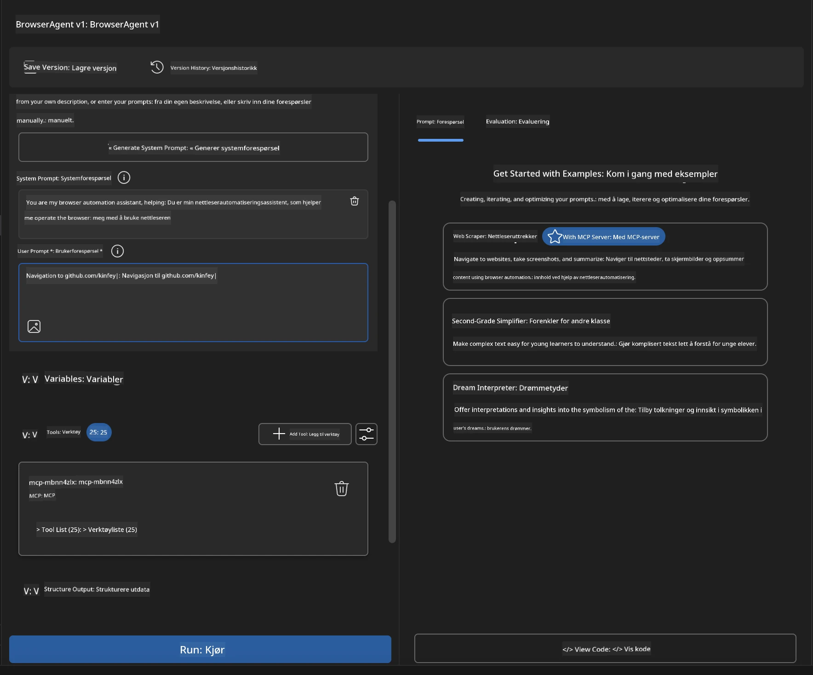

### 🚀 Fase 5: Kjøring og testing

#### Steg 10: Kjøre din første automatisering

1. **Klikk "Kjør"** for å starte automatiseringssekvensen
2. **Overvåk sanntidskjøring**:
   - Chrome-nettleseren åpnes automatisk
   - Agent navigerer til mål-nettsiden
   - Skjermbilder tas for hvert viktig steg
   - Analyseresultater strømmer i sanntid

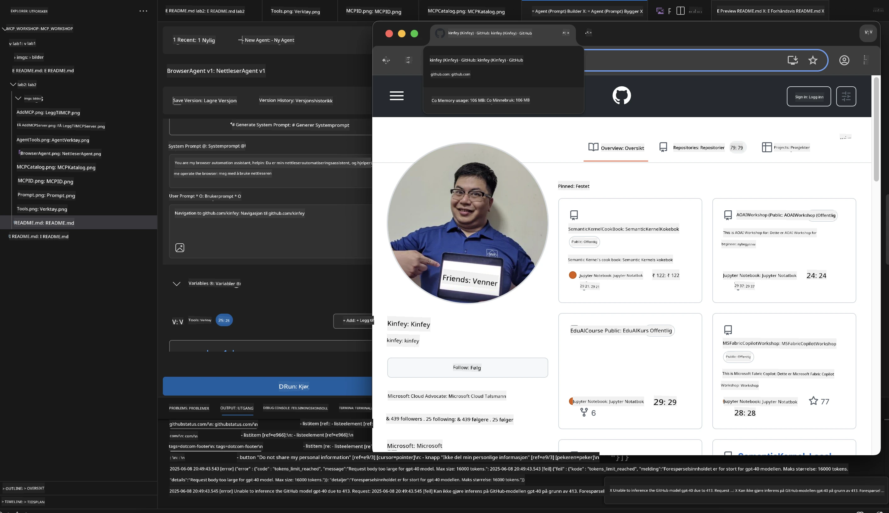

#### Steg 11: Analyser resultater og innsikt

Gå gjennom omfattende analyser i Agent Builder sitt grensesnitt:

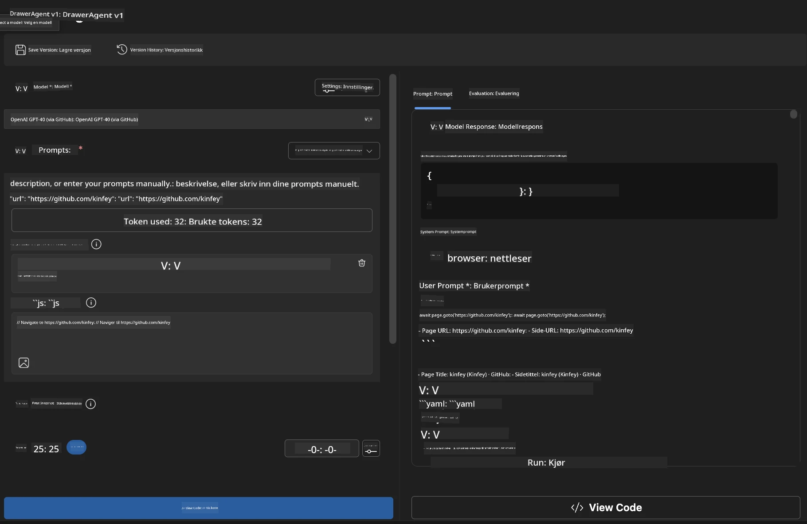

### 🌟 Fase 6: Avanserte funksjoner og distribusjon

#### Steg 12: Eksporter og distribuer til produksjon

Agent Builder støtter flere distribusjonsalternativer:

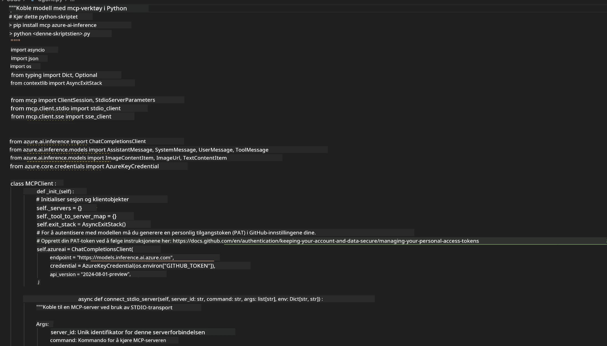

## 🎓 Modul 2 Oppsummering & Neste Steg

### 🏆 Oppnåelse Låst Opp: MCP-integrasjonsmester

**✅ Ferdigheter mestret:**

- [ ] Forståelse av MCP-arkitektur og fordeler
- [ ] Navigering i Microsofts MCP-serverøkosystem
- [ ] Integrering av Playwright MCP med Microsoft Foundry Toolkit
- [ ] Bygging av sofistikerte nettleserautomatiseringsagenter
- [ ] Avansert promptutforming for nettleserautomatisering

### 📚 Ekstra ressurser

- **🔗 MCP-spesifikasjon**: [Offisiell protokollokumentasjon](https://modelcontextprotocol.io/)
- **🛠️ Playwright API**: [Fullstendig metodeoversikt](https://playwright.dev/docs/api/class-playwright)
- **🏢 Microsoft MCP-servere**:
   [Bedriftssintegrasjonsguide](https://github.com/microsoft/mcp-servers)
- **🌍 Fellesskapseksempler**: [MCP Servergalleri](https://github.com/modelcontextprotocol/servers)

**🎉 Gratulerer!** Du har med suksess mestret MCP-integrasjon og kan
nå bygge produksjonsklare AI-agenter med funksjoner for eksterne verktøy!

### 🔜 Fortsett til neste modul

Klar til å ta MCP-ferdighetene dine til neste nivå? Fortsett til
**[Modul 3: Avansert MCP-utvikling med Microsoft Foundry Toolkit](../lab3/README.md)**
hvor du vil lære å:

- Lage dine egne tilpassede MCP-servere
- Konfigurere og bruke den nyeste MCP Python SDK-en
- Sette opp MCP Inspector for feilsøking
- Mestre avanserte arbeidsflyter for MCP-serverutvikling
- Bygge en Weather MCP-server fra bunnen av

---

<!-- CO-OP TRANSLATOR DISCLAIMER START -->
**Ansvarsfraskrivelse**:
Dette dokumentet er oversatt ved hjelp av AI-oversettelsestjenesten [Co-op Translator](https://github.com/Azure/co-op-translator). Selv om vi streber etter nøyaktighet, vær oppmerksom på at automatiske oversettelser kan inneholde feil eller unøyaktigheter. Det opprinnelige dokumentet på originalspråket skal betraktes som den autoritative kilden. For kritisk informasjon anbefales profesjonell menneskelig oversettelse. Vi er ikke ansvarlige for eventuelle misforståelser eller feiltolkninger som oppstår ved bruk av denne oversettelsen.
<!-- CO-OP TRANSLATOR DISCLAIMER END -->