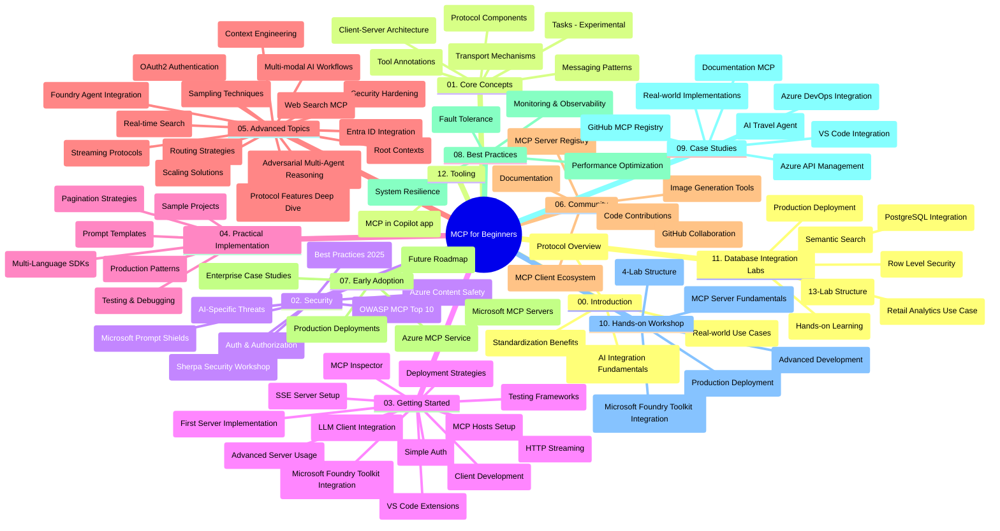

# Modellkontekstprotokoll (MCP) for nybegynnere - Studieveiledning

Denne studieveiledningen gir en oversikt over depotstrukturen og innholdet for læreplanen "Modellkontekstprotokoll (MCP) for nybegynnere". Bruk denne guiden for å navigere i depotet effektivt og få mest mulig ut av de tilgjengelige ressursene.

## Oversikt over depotet

Modellkontekstprotokollen (MCP) er et standardisert rammeverk for interaksjoner mellom AI-modeller og klientapplikasjoner. Opprinnelig opprettet av Anthropic, vedlikeholdes MCP nå av det bredere MCP-fellesskapet gjennom den offisielle GitHub-organisasjonen. Dette depotet tilbyr en omfattende læreplan med praktiske kodeeksempler i C#, Java, JavaScript, Python og TypeScript, designet for AI-utviklere, systemarkitekter og programvareingeniører.

## Visuell læreplankart

## Depotstruktur

Depotet er organisert i tolv hovedseksjoner, hver med fokus på forskjellige aspekter av MCP:

1. **Introduksjon (00-Introduction/)**
   - Oversikt over modellkontekstprotokollen
   - Hvorfor standardisering er viktig i AI-pipelines
   - Praktiske bruksområder og fordeler

2. **Kjernebegreper (01-CoreConcepts/)**
   - Klient-server-arkitektur
   - Viktige protokollkomponenter
   - Meldingsmønstre i MCP
   - Gjeldende spesifikasjon: [Hva som har endret seg i MCP: Spesifikasjonen 2026-07-28](./01-CoreConcepts/mcp-2026-07-28.md) — den statsløse protokollkjernen, utvidelsesrammeverk og utfasing av Roots/Sampling/Logging

3. **Sikkerhet (02-Security/)**
   - Sikkerhetstrusler i MCP-baserte systemer
   - Beste praksis for sikring av implementasjoner
   - Autentisering- og autorisasjonsstrategier
   - Praktisk [CIMD- og DCR-autorisasjonseksempel](./02-Security/samples/cimd-dcr-auth/README.md)
   - **Omfattende sikkerhetsdokumentasjon**:
     - MCPs beste praksis for sikkerhet
     - Veiledning for Azure Content Safety-implementering
     - MCP sikkerhetskontroller og teknikker
     - Rask referanse for MCP beste praksis
   - **Viktige sikkerhetsemner**:
     - Promptinjeksjon og angrep som forgifter verktøy
     - Sesjonskapring og problemer med forvirret stedfortreder
     - Token-gjennomstrømningssårbarheter
     - Overdrevne tillatelser og tilgangskontroll
     - Sikkerhet i forsyningskjeden for AI-komponenter
     - Integrasjon av Microsoft Prompt Shields

4. **Kom i gang (03-GettingStarted/)**
   - Oppsett og konfigurasjon av miljø
   - Oppretting av grunnleggende MCP-servere og klienter
   - Integrasjon med eksisterende applikasjoner
   - Inkluderer seksjoner for:
     - Første serverimplementering
     - Klientutvikling
     - LLM-klientintegrasjon
     - VS Code-integrasjon
     - Server-Sent Events (SSE)-server
     - Avansert serverbruk
     - HTTP-strømming
    - Microsoft Foundry Toolkit-integrasjon
     - Teststrategier
     - Distribusjonsretningslinjer

5. **Praktisk implementering (04-PracticalImplementation/)**
   - Bruk av SDK-er i forskjellige programmeringsspråk
   - Feilsøking, testing og valideringsteknikker
   - Utforming av gjenbrukbare promptmaler og arbeidsflyter
   - Eksempelsprosjekter med implementeringseksempler

6. **Avanserte emner (05-AdvancedTopics/)**
   - Kontekstteknikker
   - Foundry-agentintegrasjon
   - Multimodale AI-arbeidsflyter 
   - OAuth2-autentiseringsdemoer
   - Sanntidssøkfunksjonalitet
   - Sanntidsstrømming
   - Implementering av root-kontekster
   - Rutingsstrategier
   - Utvalgsteknikker
   - Skaleringsmetoder
   - Sikkerhetshensyn
   - Entra ID sikkerhetsintegrasjon
   - Integrasjon med web-søk
   - Adversarial multil-agent resonnering (debattmønstre)

7. **Fellesskapsbidrag (06-CommunityContributions/)**
   - Hvordan bidra med kode og dokumentasjon
   - Samarbeid via GitHub
   - Fellesskapsdrevne forbedringer og tilbakemeldinger
   - Bruke ulike MCP-klienter (Claude Desktop, Cline, VSCode)
   - Arbeide med populære MCP-servere inkludert bildegenerering

8. **Lærdom fra tidlig adopsjon (07-LessonsfromEarlyAdoption/)**
   - Virkelige implementeringer og suksesshistorier
   - Bygge og distribuere MCP-baserte løsninger
   - Trender og fremtidig veikart
   - **Microsoft MCP Server Guide**: Omfattende guide til 10 produksjonsklare Microsoft MCP-servere inkludert:
     - Microsoft Learn Docs MCP-server
     - Azure MCP-server (15+ spesialiserte tilkoblinger)
     - GitHub MCP-server
     - Azure DevOps MCP-server
     - MarkItDown MCP-server
     - SQL Server MCP-server
     - Playwright MCP-server
     - Dev Box MCP-server
     - Microsoft Foundry MCP-server
     - Microsoft 365 Agents Toolkit MCP-server

9. **Beste praksis (08-BestPractices/)**
   - Ytelsesjustering og optimalisering
   - Design av feiltolerante MCP-systemer
   - Test- og robusthetsstrategier

10. **Case-studier (09-CaseStudy/)**
    - **Sju omfattende case-studier** som demonstrerer MCPs allsidighet på tvers av ulike scenarier:
    - **Azure AI Travel Agents**: Multi-agent orkestrering med Azure OpenAI og AI Search
    - **Azure DevOps-integrasjon**: Automatisering av arbeidsflytprosesser med YouTube dataoppdateringer
    - **Sanntids dokumenthenting**: Python konsollklient med HTTP-strømming
    - **Interaktiv studieplan-generator**: Chainlit webapp med samtalebasert AI
    - **In-Editor dokumentasjon**: VS Code-integrasjon med GitHub Copilot-arbeidsflyter
    - **Azure API Management**: Bedrifts-API-integrasjon med opprettelse av MCP-server
    - **GitHub MCP Registry**: Økosystemutvikling og agentbasert integrasjonsplattform
    - Implementeringseksempler som dekker bedriftsintegrasjon, utviklerproduktivitet og økosystemutvikling

11. **Praktisk verksted (10-StreamliningAIWorkflowsBuildingAnMCPServerWithAIToolkit/)**
    - Omfattende, praktisk verksted som kombinerer MCP med Microsoft Foundry Toolkit
    - Bygge intelligente applikasjoner som kobler AI-modeller med virkelige verktøy
    - Praktiske moduler som dekker grunnleggende, tilpassing av serverutvikling og distribusjonsstrategier for produksjon
    - **Labstruktur**:
      - Lab 1: MCP servergrunnlag
      - Lab 2: Avansert MCP serverutvikling
      - Lab 3: Microsoft Foundry Toolkit-integrasjon
      - Lab 4: Produksjonsdistribusjon og skalering
    - Lab-basert læringsmetode med trinnvise instruksjoner

12. **MCP server databaseintegrasjonslaboratorier (11-MCPServerHandsOnLabs/)**
    - **Omfattende læringssti med 13 laboratorier** for å bygge produksjonsklare MCP-servere med PostgreSQL-integrasjon
    - **Virkelighetsnær retailanalyse-implementering** ved bruk av Zava Retail-brukstilfellet
    - **Bedriftsklare mønstre** inkludert Row Level Security (RLS), semantisk søk og flerleietaker datatilgang
    - **Fullstendig labstruktur**:
      - **Laboratorier 00-03: Grunnleggende** - Introduksjon, arkitektur, sikkerhet, miljøoppsett
      - **Laboratorier 04-06: Bygging av MCP-server** - Databasedesign, MCP-serverimplementering, verktøyutvikling
      - **Laboratorier 07-09: Avanserte funksjoner** - Semantisk søk, testing og feilsøking, VS Code-integrasjon
      - **Laboratorier 10-12: Produksjon og beste praksis** - Distribusjon, overvåking, optimalisering
    - **Teknologier dekket**: FastMCP-rammeverk, PostgreSQL, Azure OpenAI, Azure Container Apps, Application Insights
    - **Læringsutbytte**: Produksjonsklare MCP-servere, databaseintegrasjonsmønstre, AI-drevet analyse, bedriftsikkerhet

13. **Verktøy (12-tooling/)**
    - Lær hvordan man bruker MCP i Copilot-appen og andre verktøy

## Ytterligere ressurser

Depotet inkluderer støtteressurser:

- **Bilder-mappe**: Inneholder diagrammer og illustrasjoner brukt i hele læreplanen
- **Oversettelser**: Flerspråklig støtte med automatiserte oversettelser av dokumentasjon
- **Offisielle MCP-ressurser**:
  - [MCP-dokumentasjon](https://modelcontextprotocol.io/)
  - [MCP-spesifikasjon](https://modelcontextprotocol.io/specification/2026-07-28/)
  - [MCP GitHub-depot](https://github.com/modelcontextprotocol)

## Hvordan bruke dette depotet

1. **Sekvensiell læring**: Følg kapitlene i rekkefølge (00 til 11) for en strukturert læringsopplevelse.
2. **Språkspesifikt fokus**: Hvis du er interessert i et bestemt programmeringsspråk, utforsk mappene med eksempler for implementeringer i ditt foretrukne språk.
3. **Praktisk implementering**: Start med seksjonen "Kom i gang" for å sette opp miljøet ditt og lage din første MCP-server og klient.
4. **Avansert utforskning**: Når du er komfortabel med det grunnleggende, kan du fordype deg i de avanserte emnene for å utvide kunnskapen.
5. **Fellesskapsengasjement**: Bli med i MCP-fellesskapet gjennom GitHub-diskusjoner og Discord-kanaler for å knytte kontakt med eksperter og andre utviklere.

## MCP-klienter og verktøy

Læreplanen dekker ulike MCP-klienter og verktøy:

1. **Offisielle klienter**:
   - Visual Studio Code 
   - MCP i Visual Studio Code
   - Claude Desktop
   - Claude i VSCode 
   - Claude API

2. **Fellesskapsklienter**:
   - Cline (terminalbasert)
   - Cursor (kodeeditor)
   - ChatMCP
   - Windsurf

3. **MCP-administrasjonsverktøy**:
   - MCP CLI
   - MCP Manager
   - MCP Linker
   - MCP Router

## Populære MCP-servere

Depotet introduserer ulike MCP-servere, inkludert:

1. **Offisielle Microsoft MCP-servere**:
   - Microsoft Learn Docs MCP-server
   - Azure MCP-server (15+ spesialiserte tilkoblinger)
   - GitHub MCP-server
   - Azure DevOps MCP-server
   - MarkItDown MCP-server
   - SQL Server MCP-server
   - Playwright MCP-server
   - Dev Box MCP-server
   - Microsoft Foundry MCP-server
   - Microsoft 365 Agents Toolkit MCP-server

2. **Offisielle referanseservere**:
   - Filssystem
   - Henting (Fetch)
   - Minne (Memory)
   - Sekvensiell tenking

3. **Bildegenerering**:
   - Azure OpenAI DALL-E 3
   - Stable Diffusion WebUI
   - Replicate

4. **Utviklingsverktøy**:
   - Git MCP
   - Terminalkontroll
   - Kodeassistent

5. **Spesialiserte servere**:
   - Salesforce
   - Microsoft Teams
   - Jira & Confluence

## Bidra

Dette depotet ønsker bidrag fra fellesskapet velkommen. Se delen om fellesskapsbidrag for veiledning om hvordan du kan bidra effektivt til MCP-økosystemet.

----

*Denne studieveiledningen ble sist oppdatert 9. september 2026. Den gjenspeiler MCP
Spesifikasjon `2026-07-28`, den aktuelle protokollrevisjonen. Noen praktiske
eksempler er eksplisitt versjonert til `2025-11-25` mens deres SDK-er og verktøy
adopterer de statsløse protokoll-APIene.*

---

<!-- CO-OP TRANSLATOR DISCLAIMER START -->
**Ansvarsfraskrivelse**:
Dette dokumentet er oversatt ved hjelp av AI-oversettelsestjenesten [Co-op Translator](https://github.com/Azure/co-op-translator). Selv om vi streber etter nøyaktighet, vær oppmerksom på at automatiske oversettelser kan inneholde feil eller unøyaktigheter. Det opprinnelige dokumentet på originalspråket skal betraktes som den autoritative kilden. For kritisk informasjon anbefales profesjonell menneskelig oversettelse. Vi er ikke ansvarlige for eventuelle misforståelser eller feiltolkninger som oppstår ved bruk av denne oversettelsen.
<!-- CO-OP TRANSLATOR DISCLAIMER END -->