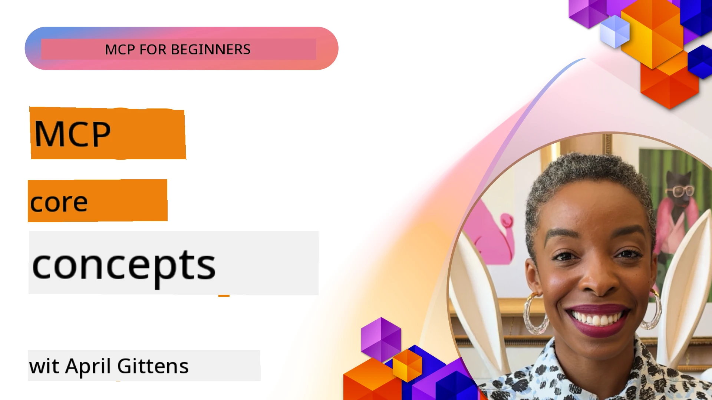
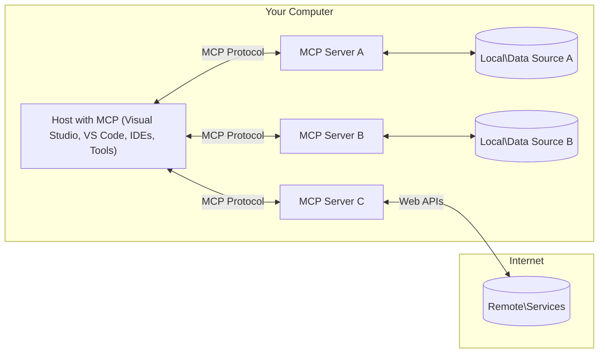

# MCP Core Concepts: How to sabi di Model Context Protocol for AI Integration

[](https://youtu.be/earDzWGtE84)

_(Click di image wey de up to watch di video of dis lesson)_

The [Model Context Protocol (MCP)](https://github.com/modelcontextprotocol) na powerful, standardized framework wey dey optimize communication between Large Language Models (LLMs) and external tools, applications, and data sources. 
Dis guide go guide you through di core concepts of MCP. You go learn about im client-server architecture, essential components, communication mechanics, and implementation best practices.

- **User Control and Consent**: Hosts suppose clearly show which data and tools a
  server exposes, make users fit deny operations, and obtain explicit confirmation
  for sensitive or consequential actions. MCP no require one confirmation
  dialog before every tool call.

- **Data Privacy Protection**: User data dey only exposed with explicit consent and must be protected by robust access controls throughout the entire interaction lifecycle. Implementations must prevent unauthorized data transmission and maintain strict privacy boundaries.

- **Tool Execution Safety**: Hosts suppose make tool invocations visible and keep
  a human able to deny them. Sensitive operations suppose show the tool inputs
  and impact before execution, with security boundaries that prevent unintended
  or malicious actions.

- **Transport Security**: Remote connections suppose use HTTPS and the MCP
  authorization model. Local stdio servers rely on process isolation, trusted
  configuration, and secure handling of inherited credentials.

#### Implementation Guidelines:

- **Permission Management**: Implement fine-grained permission systems wey allow users to control which servers, tools, and resources dem fit access
- **Authentication & Authorization**: Use secure authentication methods (OAuth, API keys) with proper token management and expiration  
- **Input Validation**: Validate all parameters and data inputs according to defined schemas to prevent injection attacks
- **Audit Logging**: Maintain comprehensive logs of all operations for security monitoring and compliance

## Overview

Dis lesson go explore di fundamental architecture and components wey make up di Model Context Protocol (MCP) ecosystem. You go learn about di client-server architecture, key components, and communication mechanisms wey power MCP interactions.

## Key Learning Objectives

By di end of dis lesson, you go:

- Understand di MCP client-server architecture.
- Identify di roles and responsibilities of Hosts, Clients, and Servers.
- Analyze di core features wey make MCP a flexible integration layer.
- Learn how information dey flow inside di MCP ecosystem.
- Gain practical insights through code examples for .NET, Java, Python, and JavaScript.

## MCP Architecture: A Deeper Look

The MCP ecosystem is built on a client-server model. This modular structure allows AI applications to interact with tools, databases, APIs, and contextual resources efficiently. Let's break down this architecture into its core components.

At its core, MCP follows a client-server architecture where a host application can connect to multiple servers:



- **MCP Hosts**: Programs like VSCode, Claude Desktop, IDEs, or AI tools wey wan access data through MCP
- **MCP Clients**: Protocol components wey maintain one logical relationship
  with a server; MCP `2026-07-28` requests no depend on one persistent
  connection or session
- **MCP Servers**: Lightweight programs wey each expose specific capabilities through di standardized Model Context Protocol
- **Local Data Sources**: Your computer files, databases, and services wey MCP servers fit access securely
- **Remote Services**: External systems wey dey for internet wey MCP servers fit connect to through APIs.

The MCP Protocol na evolving standard wey dey use date-based versioning
(YYYY-MM-DD format). The current protocol version is **2026-07-28**. See the
[2026-07-28 protocol specification](https://modelcontextprotocol.io/specification/2026-07-28/).

> **Current release:** MCP `2026-07-28` make di protocol stateless at the
> transport layer by removing di `initialize` handshake and protocol-level
> session IDs. E also formalizes an Extensions framework and deprecates
> Roots, Sampling, and Logging in favor of newer patterns. See
> [What's Changed in MCP: The 2026-07-28 Specification](./mcp-2026-07-28.md)
> for a full breakdown and migration guidance. Examples wey explicitly target
> `2025-11-25` are retained as legacy compatibility lessons.

### 1. Hosts

For di Model Context Protocol (MCP), **Hosts** na AI applications wey serve as di main interface wey users dey use interact with di protocol. Hosts dey coordinate and manage connections to many MCP servers by creating dedicated MCP clients for each server connection. Examples of Hosts include:

- **AI Applications**: Claude Desktop, Visual Studio Code, Claude Code
- **Development Environments**: IDEs and code editors with MCP integration  
- **Custom Applications**: Purpose-built AI agents and tools

**Hosts** na applications wey dey coordinate AI model interactions. Dem:

- **Orchestrate AI Models**: Execute or interact wit LLMs to generate responses and coordinate AI workflows
- **Manage Client Relationships**: Create and manage one MCP client for each MCP
  server wey di host uses
- **Control User Interface**: Handle conversation flow, user interactions, and response presentation  
- **Enforce Security**: Control permissions, security constraints, and authentication
- **Handle User Consent**: Manage user approval for data sharing and tool execution


### 2. Clients

**Clients** na protocol components wey host create for particular MCP
servers. Dis na a logical one-to-one relationship, no be requirement for a
persistent network connection. For MCP `2026-07-28`, each request is
self-contained and fit be handled by any server instance.

**Clients** are connector components within the host application. They:

- **Protocol Communication**: Send JSON-RPC 2.0 requests to servers with prompts and instructions
- **Capability Discovery**: Use `server/discover` to learn a server's supported
  protocol versions, capabilities, and extensions
- **Tool Execution**: Manage tool execution requests from models and process responses
- **Real-time Updates**: Handle notifications and real-time updates from servers
- **Response Processing**: Process and format server responses for display to users

### 3. Servers

**Servers** na programs wey provide context, tools, and capabilities to MCP clients. Dem fit execute locally (same machine as the Host) or remotely (on external platforms), and dem responsible for handling client requests and providing structured responses. Servers expose specific functionality through the standardized Model Context Protocol.

**Servers** na services wey provide context and capabilities. Dem:

- **Feature Registration**: Register and expose available primitives (resources, prompts, tools) to clients
- **Request Processing**: Receive and execute tool calls, resource requests, and prompt requests from clients
- **Context Provision**: Provide contextual information and data to enhance model responses
- **State Management**: Maintain application state with explicit handles wey dem pass
  in requests when needed; MCP `2026-07-28` no get protocol-level sessions
- **Real-time Notifications**: Send notifications about capability changes and updates to connected clients

Servers fit be developed by anybody to extend model capabilities with specialized functionality, and dem support both local and remote deployment scenarios.

### 4. Server Primitives

Servers for di Model Context Protocol (MCP) provide three core **primitives** wey define di fundamental building blocks for rich interactions between clients, hosts, and language models. These primitives specify di types of contextual information and actions available through di protocol.

MCP servers fit expose any combination of di following three core primitives:

#### Resources 

**Resources** na data sources wey provide contextual information to AI applications. Dem represent static or dynamic content wey fit enhance model understanding and decision-making:

- **Contextual Data**: Structured information and context for AI model consumption
- **Knowledge Bases**: Document repositories, articles, manuals, and research papers
- **Local Data Sources**: Files, databases, and local system information  
- **External Data**: API responses, web services, and remote system data
- **Dynamic Content**: Real-time data wey dey update based on external conditions

Resources dey identified by URIs and support discovery through `resources/list` and retrieval through `resources/read` methods:

```text
file://documents/project-spec.md
database://production/users/schema
api://weather/current
```

#### Prompts

**Prompts** na reusable templates wey help structure interactions with language models. Dem provide standardized interaction patterns and templated workflows:

- **Template-based Interactions**: Pre-structured messages and conversation starters
- **Workflow Templates**: Standardized sequences for common tasks and interactions
- **Few-shot Examples**: Example-based templates for model instruction
- **System Prompts**: Foundational prompts wey define model behavior and context
- **Dynamic Templates**: Parameterized prompts wey adapt to specific contexts

Prompts support variable substitution and fit be discovered via `prompts/list` and retrieved with `prompts/get`:

```markdown
Generate a {{task_type}} for {{product}} targeting {{audience}} with the following requirements: {{requirements}}
```

#### Tools

**Tools** na executable functions wey AI models fit invoke to perform specific actions. Dem represent di "verbs" of di MCP ecosystem, enabling models to interact with external systems:

- **Executable Functions**: Discrete operations wey models fit invoke with specific parameters
- **External System Integration**: API calls, database queries, file operations, calculations
- **Unique Identity**: Each tool get a distinct name, description, and parameter schema
- **Structured I/O**: Tools accept validated parameters and return structured, typed responses
- **Action Capabilities**: Enable models to perform real-world actions and retrieve live data

Tools dey defined wit JSON Schema for parameter validation and dem dey discovered through `tools/list` and executed via `tools/call`. Tools fit also include **icons** as additional metadata for better UI presentation.

**Tool Annotations**: Tools support behavioral annotations (e.g., `readOnlyHint`, `destructiveHint`) wey describe whether a tool na read-only or destructive, helping clients make informed decisions about tool execution.

Example tool definition:

```typescript
server.tool(
  "search_products", 
  {
    query: z.string().describe("Search query for products"),
    category: z.string().optional().describe("Product category filter"),
    max_results: z.number().default(10).describe("Maximum results to return")
  }, 
  async (params) => {
    // Execute search and return structured results
    return await productService.search(params);
  }
);
```

## Client Primitives

For di Model Context Protocol (MCP), **clients** fit expose primitives wey enable servers to request additional capabilities from di host application. These client-side primitives allow for richer, more interactive server implementations wey fit access AI model capabilities and user interactions.

### Sampling

> **Deprecated in MCP `2026-07-28`:** Sampling still dey available for
> compatibility, but new implementations suppose integrate directly with an LLM
> provider API. E fit get removed in di first specification revision
> wey dem release on or after July 28, 2027. See
> [What's Changed in MCP: The 2026-07-28 Specification](./mcp-2026-07-28.md).

Sampling allow servers to request language model completions from di client's AI application. Dis primitive enable servers to access LLM capabilities without embedding their own model dependencies:

- **Model-Independent Access**: Servers fit request completions without including LLM SDKs or managing model access
- **Server-Initiated AI**: Enable servers to autonomously generate content using di client's AI model
- **Recursive LLM Interactions**: Support complex scenarios where servers need AI assistance for processing
- **Dynamic Content Generation**: Allow servers to create contextual responses using di host's model
- **Tool Calling Support**: Servers fit include `tools` and `toolChoice` parameters to enable di client's model to invoke tools during sampling

Sampling use the `sampling/createMessage` method, where servers request a
completion from clients.

### Roots

> **Deprecated in MCP `2026-07-28`:** Roots still dey available for
> compatibility, but new implementations suppose pass directories or files via
> tool parameters, resource URIs, or server configuration. Roots fit
> for removal in di first specification revision wey dem release on or after July
> 28, 2027. See
> [What's Changed in MCP: The 2026-07-28 Specification](./mcp-2026-07-28.md).

**Roots** provide one standardized way for clients to identify filesystem
locations wey relevant to servers:

- **Filesystem Hints**: Identify directories and files wey relevant to the request
- **Separate Authorization**: No be to grant access or enforce a security boundary
- **Per-request Capability**: Clients advertise Roots support in request metadata
- **URI-Based Identification**: Roots use `file://` URIs to identify accessible directories and files

For MCP `2026-07-28`, a server requests `roots/list` through an
`InputRequiredResult` while processing a supported client request. The client
returns the roots when e retry that original request.

### Elicitation  

**Elicitation** enable servers to request extra information or confirmation from users through di client interface:

- **User Input Requests**: Servers fit ask for additional information when dem need am for tool execution
- **Confirmation Dialogs**: Ask user approval for sensitive or impactful operations
- **Interactive Workflows**: Enable servers to create step-by-step user interactions
- **Dynamic Parameter Collection**: Gather missing or optional parameters during tool execution

Elicitation dey use the `elicitation/create` method inside an
`InputRequiredResult` to gather wetin di user put through di client's interface.

**URL Mode Elicitation**: Servers fit also request URL-based user interactions, so dem fit direct users go external web pages for authentication, confirmation, or data entry.

### Logging

> **Deprecated in MCP `2026-07-28`:** Logging still dey available for
> compatibility, but new implementations suppose use `stderr` with stdio and
> OpenTelemetry for structured observability. Logging fit dey removed
> in the first specification revision released on or after July 28, 2027. See
> [Wetin don change for MCP: The 2026-07-28 Specification](./mcp-2026-07-28.md).

**Logging** dey allow servers to send structured log messages to clients for debugging, monitoring, and operational visibility:

- **Debugging Support**: Make servers fit provide detailed execution logs for troubleshooting
- **Operational Monitoring**: Dey send status updates and performance metrics to clients
- **Error Reporting**: Give detailed error context and diagnostic information
- **Audit Trails**: Create comprehensive logs of server operations and decisions

Logging messages dey sent to clients to show wetin server dey do and help with debugging.

## How Information Dey Flow for MCP

The Model Context Protocol (MCP) define how information go dey flow between hosts, clients, servers, and models. Knowing this flow dey help make clear how user requests dey process and how external tools and data dey get join model responses.

- **Host Dey Start Connection**  
  The host application (like an IDE or chat interface) dey establish connection to an MCP server, typically via STDIO, WebSocket, or another supported transport.

- **Capability Negotiation**  
  The client (wey dey inside the host) and the server go exchange information about the features, tools, resources, and protocol versions wey dem support. This make sure both sides sabi wetin capabilities dey available for the session.

- **User Request**  
  The user dey interact with the host (e.g., dem enter a prompt or command). The host go collect this input and pass am to the client for processing.

- **Resource or Tool Use**  
  - The client fit request extra context or resources from the server (like files, database entries, or knowledge base articles) to make the model understand better.
  - If the model see sey tool needed (e.g., to fetch data, do a calculation, or call an API), the client go send a tool invocation request to the server, specifying the tool name and parameters.

- **Server Execution**  
  The server go receive the resource or tool request, run the needed operations (like run a function, query a database, or fetch a file), and return the results to the client in a structured format.

- **Response Generation**  
  The client go integrate the server's responses (resource data, tool outputs, etc.) into the ongoing model interaction. The model go use this information to generate a comprehensive and contextually relevant response.

- **Result Presentation**  
  The host go receive the final output from the client and present am to the user, often including both the model's generated text and any results from tool executions or resource lookups.

This flow dey allow MCP support advanced, interactive, and context-aware AI apps by connecting models with external tools and data sources smoothly.

## Protocol Architecture & Layers

MCP get two different architectural layers wey dey work together to provide a complete communication framework:

### Data Layer

The **Data Layer** implement the core MCP protocol using **JSON-RPC 2.0** as its foundation. This layer define the message structure, semantics, and interaction patterns:

#### Core Components:

- **JSON-RPC 2.0 Protocol**: All communication dey use standardized JSON-RPC 2.0 message format for method calls, responses, and notifications
- **Lifecycle Management**: Dey handle connection initialization, capability negotiation, and session termination between clients and servers
- **Server Primitives**: Enable servers make dem provide core functionality through tools, resources, and prompts
- **Client Primitives**: Enable servers to request sampling from LLMs, elicit user input, and send log messages
- **Real-time Notifications**: Support asynchronous notifications for dynamic updates without polling

#### Key Features:

- **Protocol Version Negotiation**: Use date-based versioning (YYYY-MM-DD) to ensure compatibility
- **Capability Discovery**: Clients and servers exchange info about supported features during initialization
- **Stateful Sessions**: Maintain connection state across multiple interactions for context continuity

### Transport Layer

The **Transport Layer** manage communication channels, message framing, and authentication between MCP participants:

#### Supported Transport Mechanisms:

1. **STDIO Transport**:
   - Uses standard input/output streams for direct process communication
   - Optimal for local processes on the same machine with no network overhead
   - Commonly used for local MCP server implementations

2. **Streamable HTTP Transport**:
   - Uses HTTP POST for client-to-server messages  
   - Optional Server-Sent Events (SSE) for server-to-client streaming
   - Enables remote server communication across networks
   - Supports standard HTTP authentication (bearer tokens, API keys, custom headers)
   - MCP recommends OAuth for secure token-based authentication

#### Transport Abstraction:

The transport layer dey abstract communication details from the data layer, making the same JSON-RPC 2.0 message format fit work across all transport mechanisms. This abstraction allow applications to switch between local and remote servers seamlessly.

### Security Considerations

MCP implementations must follow some critical security principles to make sure interactions safe, trustworthy, and secure across all protocol operations:

- **User Consent and Control**: Users must give explicit consent before any data get accessed or any operations perform. Dem suppose get clear control over which data dem share and which actions dem authorize, supported by easy-to-use user interfaces wey dem fit use to review and approve activities.

- **Data Privacy**: User data suppose only show if explicit consent dey and e must dey protected by correct access controls. MCP implementations must protect against unauthorised data transmission and make sure privacy dey maintained for all interactions.

- **Tool Safety**: Before you invoke any tool, explicit user consent dey required. Users suppose get clear understanding of each tool functionality, and strong security boundaries must dey to prevent unintended or unsafe tool execution.

By following these security principles, MCP ensures user trust, privacy, and safety are maintained across all protocol interactions while enabling powerful AI integrations.

## Code Examples: Key Components

Below be code examples for some popular programming languages wey show how to implement key MCP server components and tools.

### .NET Example: Creating a Simple MCP Server with Tools

Here na practical .NET code example wey show how to implement a simple MCP server with custom tools. This example show how to define and register tools, handle requests, and connect the server using the Model Context Protocol.

```csharp
using System;
using System.Threading.Tasks;
using ModelContextProtocol.Server;
using ModelContextProtocol.Server.Transport;
using ModelContextProtocol.Server.Tools;

public class WeatherServer
{
    public static async Task Main(string[] args)
    {
        // Create an MCP server
        var server = new McpServer(
            name: "Weather MCP Server",
            version: "1.0.0"
        );
        
        // Register our custom weather tool
        server.AddTool<string, WeatherData>("weatherTool", 
            description: "Gets current weather for a location",
            execute: async (location) => {
                // Call weather API (simplified)
                var weatherData = await GetWeatherDataAsync(location);
                return weatherData;
            });
        
        // Connect the server using stdio transport
        var transport = new StdioServerTransport();
        await server.ConnectAsync(transport);
        
        Console.WriteLine("Weather MCP Server started");
        
        // Keep the server running until process is terminated
        await Task.Delay(-1);
    }
    
    private static async Task<WeatherData> GetWeatherDataAsync(string location)
    {
        // This would normally call a weather API
        // Simplified for demonstration
        await Task.Delay(100); // Simulate API call
        return new WeatherData { 
            Temperature = 72.5,
            Conditions = "Sunny",
            Location = location
        };
    }
}

public class WeatherData
{
    public double Temperature { get; set; }
    public string Conditions { get; set; }
    public string Location { get; set; }
}
```

### Java Example: MCP Server Components

This example show the same MCP server and tool registration as the .NET example above, but e implement for Java.

```java
import io.modelcontextprotocol.server.McpServer;
import io.modelcontextprotocol.server.McpToolDefinition;
import io.modelcontextprotocol.server.transport.StdioServerTransport;
import io.modelcontextprotocol.server.tool.ToolExecutionContext;
import io.modelcontextprotocol.server.tool.ToolResponse;

public class WeatherMcpServer {
    public static void main(String[] args) throws Exception {
        // Create an MCP server
        McpServer server = McpServer.builder()
            .name("Weather MCP Server")
            .version("1.0.0")
            .build();
            
        // Register a weather tool
        server.registerTool(McpToolDefinition.builder("weatherTool")
            .description("Gets current weather for a location")
            .parameter("location", String.class)
            .execute((ToolExecutionContext ctx) -> {
                String location = ctx.getParameter("location", String.class);
                
                // Get weather data (simplified)
                WeatherData data = getWeatherData(location);
                
                // Return formatted response
                return ToolResponse.content(
                    String.format("Temperature: %.1f°F, Conditions: %s, Location: %s", 
                    data.getTemperature(), 
                    data.getConditions(), 
                    data.getLocation())
                );
            })
            .build());
        
        // Connect the server using stdio transport
        try (StdioServerTransport transport = new StdioServerTransport()) {
            server.connect(transport);
            System.out.println("Weather MCP Server started");
            // Keep server running until process is terminated
            Thread.currentThread().join();
        }
    }
    
    private static WeatherData getWeatherData(String location) {
        // Implementation would call a weather API
        // Simplified for example purposes
        return new WeatherData(72.5, "Sunny", location);
    }
}

class WeatherData {
    private double temperature;
    private String conditions;
    private String location;
    
    public WeatherData(double temperature, String conditions, String location) {
        this.temperature = temperature;
        this.conditions = conditions;
        this.location = location;
    }
    
    public double getTemperature() {
        return temperature;
    }
    
    public String getConditions() {
        return conditions;
    }
    
    public String getLocation() {
        return location;
    }
}
```

### Python Example: Building an MCP Server

This example dey use fastmcp, so abeg make sure you install am first:

```python
pip install fastmcp
```
Code Sample:

```python
#!/usr/bin/env python3
import asyncio
from fastmcp import FastMCP
from fastmcp.transports.stdio import serve_stdio

# Create a FastMCP server
mcp = FastMCP(
    name="Weather MCP Server",
    version="1.0.0"
)

@mcp.tool()
def get_weather(location: str) -> dict:
    """Gets current weather for a location."""
    return {
        "temperature": 72.5,
        "conditions": "Sunny",
        "location": location
    }

# Alternative approach using a class
class WeatherTools:
    @mcp.tool()
    def forecast(self, location: str, days: int = 1) -> dict:
        """Gets weather forecast for a location for the specified number of days."""
        return {
            "location": location,
            "forecast": [
                {"day": i+1, "temperature": 70 + i, "conditions": "Partly Cloudy"}
                for i in range(days)
            ]
        }

# Register class tools
weather_tools = WeatherTools()

# Start the server
if __name__ == "__main__":
    asyncio.run(serve_stdio(mcp))
```

### JavaScript Example: Creating an MCP Server

This example show MCP server creation for JavaScript and how to register two weather-related tools.

```javascript
// Using the official Model Context Protocol SDK
import { McpServer } from "@modelcontextprotocol/sdk/server/mcp.js";
import { StdioServerTransport } from "@modelcontextprotocol/sdk/server/stdio.js";
import { z } from "zod"; // For parameter validation

// Create an MCP server
const server = new McpServer({
  name: "Weather MCP Server",
  version: "1.0.0"
});

// Define a weather tool
server.tool(
  "weatherTool",
  {
    location: z.string().describe("The location to get weather for")
  },
  async ({ location }) => {
    // This would normally call a weather API
    // Simplified for demonstration
    const weatherData = await getWeatherData(location);
    
    return {
      content: [
        { 
          type: "text", 
          text: `Temperature: ${weatherData.temperature}°F, Conditions: ${weatherData.conditions}, Location: ${weatherData.location}` 
        }
      ]
    };
  }
);

// Define a forecast tool
server.tool(
  "forecastTool",
  {
    location: z.string(),
    days: z.number().default(3).describe("Number of days for forecast")
  },
  async ({ location, days }) => {
    // This would normally call a weather API
    // Simplified for demonstration
    const forecast = await getForecastData(location, days);
    
    return {
      content: [
        { 
          type: "text", 
          text: `${days}-day forecast for ${location}: ${JSON.stringify(forecast)}` 
        }
      ]
    };
  }
);

// Helper functions
async function getWeatherData(location) {
  // Simulate API call
  return {
    temperature: 72.5,
    conditions: "Sunny",
    location: location
  };
}

async function getForecastData(location, days) {
  // Simulate API call
  return Array.from({ length: days }, (_, i) => ({
    day: i + 1,
    temperature: 70 + Math.floor(Math.random() * 10),
    conditions: i % 2 === 0 ? "Sunny" : "Partly Cloudy"
  }));
}

// Connect the server using stdio transport
const transport = new StdioServerTransport();
server.connect(transport).catch(console.error);

console.log("Weather MCP Server started");
```

This JavaScript example show how to create an MCP server using the Model Context Protocol SDK. E show how to register two tools named `weatherTool` and `forecastTool` and make dem available to MCP clients through the `StdioServerTransport`.

## Security and Authorization

MCP get several built-in concepts and mechanisms wey dem use to manage security and authorization for the whole protocol:

1. **Tool Permission Control**:  
  Clients fit specify which tools a model may use for each request or workflow.
  This make sure say only tools wey explicitly authorized dey accessible, reducing
  the risk of unintended or unsafe operations.

2. **Authentication**:  
  Servers fit require authentication before dem grant access to tools, resources, or sensitive operations. This fit involve API keys, OAuth tokens, or other authentication schemes. Proper authentication make sure say only trusted clients and users fit invoke server-side capabilities.

3. **Validation**:  
  Parameter validation dey enforced for all tool invocations. Each tool define the expected types, formats, and constraints for its parameters, and the server go validate incoming requests accordingly. This prevent malformed or malicious input from reach tool implementations and help maintain the integrity of operations.

4. **Rate Limiting**:  
  To prevent abuse and make sure fair usage of server resources, MCP servers fit
  implement rate limiting for tool calls and resource access. Rate limits fit
  be applied per user, credential, operation, or globally.

By combining these mechanisms, MCP provides a secure foundation for integrating language models with external tools and data sources, while giving users and developers fine-grained control over access and usage.

## Protocol Messages & Communication Flow

MCP communication dey use structured **JSON-RPC 2.0** messages to make clear and reliable interactions between hosts, clients, and servers. The protocol define specific message patterns for different types of operations:

### Core Message Types

#### **Request Metadata and Discovery**

- **Per-request metadata**: Every `2026-07-28` request dey self-contained and
  carry protocol version, client identity, and client capabilities inside `_meta`.
- **`server/discover` Request**: Retrieve supported protocol versions, server
  identity, capabilities, and extensions when the client need dem.
- **Streamable HTTP headers**: HTTP requests include `MCP-Protocol-Version` and
  `Mcp-Method`; methods wey address a named tool or resource also include
  `Mcp-Name`.

The `initialize`/`initialized` handshake and protocol-level session IDs belong
to earlier protocol revisions and no dey part of MCP `2026-07-28`.

#### **Discovery Messages**
- **`tools/list` Request**: Discover available tools from the server
- **`resources/list` Request**: List available resources (data sources)
- **`prompts/list` Request**: Retrieve available prompt templates

#### **Execution Messages**  
- **`tools/call` Request**: Execute a specific tool with provided parameters
- **`resources/read` Request**: Retrieve content from a specific resource
- **`prompts/get` Request**: Fetch a prompt template with optional parameters

#### **Client-side Input Requests**

- **`elicitation/create`**: Server request user input through the client
  interface while e dey process a client request.
- **`sampling/createMessage`**: Deprecated server request for an LLM completion.
- **`roots/list`**: Deprecated server request for client filesystem roots.

Under `2026-07-28`, server-to-client input requests dey use the multi-round-trip
`InputRequiredResult` pattern instead of relying on a persistent session.

#### **Notification Messages**
- **`notifications/tools/list_changed`**: Server notify client of tool changes
- **`notifications/resources/list_changed`**: Server notify client of resource changes  
- **`notifications/prompts/list_changed`**: Server notify client of prompt changes

### Message Structure:

All MCP messages follow JSON-RPC 2.0 format with:
- **Request Messages**: Include `id`, `method`, and optional `params`
- **Response Messages**: Include `id` and either `result` or `error`  
- **Notification Messages**: Include `method` and optional `params` (no `id` or response expected)

This structured communication make sure interactions dey reliable, traceable, and extensible, supporting advanced scenarios like real-time updates, tool chaining, and robust error handling.

### Tasks Extension

In MCP `2026-07-28`, Tasks na official extension instead of an experimental
core feature. E uses a redesigned `tasks/get`, `tasks/update`, and
`tasks/cancel` lifecycle; `tasks/list` was removed. The experimental
`2025-11-25` Tasks API no backward compatible with this extension. See
[Wetin don change for MCP: The 2026-07-28 Specification](./mcp-2026-07-28.md).

**Tasks** provide durable execution wrappers for deferred result retrieval and
status tracking:

- **Long-Running Operations**: Track expensive computations, workflow automation, and batch processing
- **Deferred Results**: Poll for task status and retrieve results when operations complete
- **Status Tracking**: Monitor task progress through defined lifecycle states
- **Multi-Step Operations**: Support complex workflows wey span multiple interactions

Tasks wrap standard MCP requests to enable asynchronous execution patterns for operations wey no fit complete immediately.

## Key Takeaways

- **Architecture**: MCP use a client-server architecture where hosts manage multiple client connections to servers
- **Participants**: The ecosystem include hosts (AI applications), clients (protocol connectors), and servers (capability providers)
- **Transport Mechanisms**: Communication supports stdio (local) and Streamable
  HTTP (remote); `2026-07-28` removes the standalone GET event stream
- **Core Primitives**: Servers expose tools (executable functions), resources (data sources), and prompts (templates)
- **Client Primitives**: Elicitation support user input, while Sampling and
  Roots dey retained only as deprecated compatibility features
- **Extensions**: Di official Tasks extension dey provide durable execution
  wrapper dem wey dey handle operations wey dey run long time
- **Protocol Foundation**: Dem build am on top JSON-RPC 2.0 wey versioning dey base on date
  (wey dey now: `2026-07-28`)
- **Real-time Capabilities**: E dey support notification dem for dynamic updates and real-time synchronization
- **Security First**: Make sure user give explicit consent, protect data privacy, and secure transport na core requirements

## Exercise

Design one simple MCP tool wey go dey useful for your domain. Define:
1. Wetin dem go name the tool
2. Which parameters e go accept
3. Wetin output e go return
4. How model fit use dis tool to solve user problem dem


---

## Wetin next

Next: [Chapter 2: Security](../02-Security/README.md)

Read [Wetin don change for MCP: The 2026-07-28 Specification](./mcp-2026-07-28.md)
for guidance wey go show how to migrate from `2025-11-25`.

---

<!-- CO-OP TRANSLATOR DISCLAIMER START -->
**Disclaimer**:
Dis document don translate wit AI translation service [Co-op Translator](https://github.com/Azure/co-op-translator). Even tho we dey try make am correct, abeg make you know say automated translation fit get errors or mistakes. Di original document for dia own language na im be di correct source. For important info, make person wey sabi human translation do am. We no go responsible for any misunderstanding or wrong understanding wey fit happen because of dis translation.
<!-- CO-OP TRANSLATOR DISCLAIMER END -->