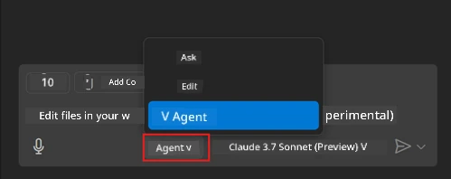
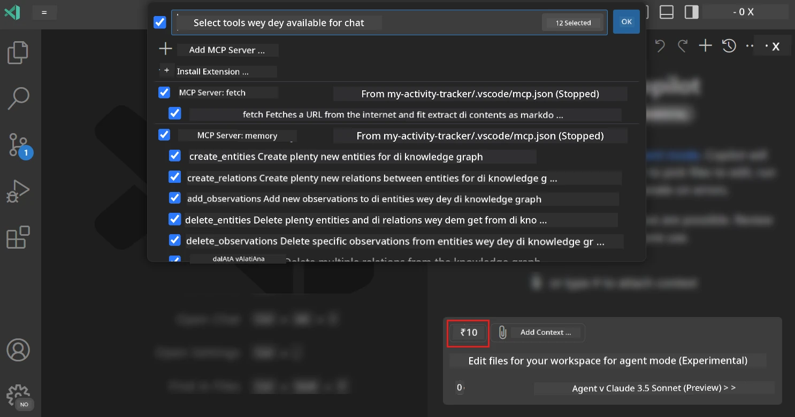
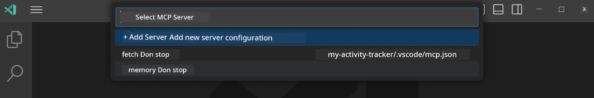
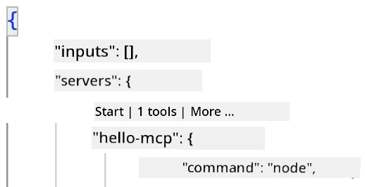
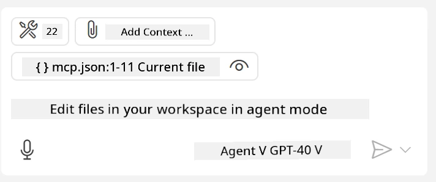
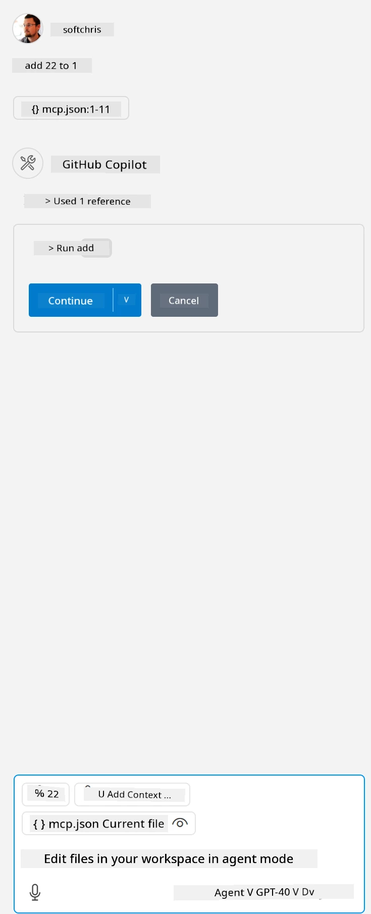

# How to use one server from GitHub Copilot Agent mode

Visual Studio Code and GitHub Copilot fit act as client wey go consume MCP Server. Why you go wan do am you fit ask? E mean say any feature wey MCP Server get, you fit now use am from inside your IDE. Imagine say you add for example GitHub's MCP server, e go allow you control GitHub with prompts instead make you dey type specific commands for terminal. Or imagine any kain thing wey fit improve your developer experience wey you go control by natural language. Now you don dey see di win no?

## Overview

This lesson dey show how to use Visual Studio Code and GitHub Copilot's Agent mode as client for your MCP Server.

## Learning Objectives

By the end of this lesson, you go fit:

- Consume an MCP Server via Visual Studio Code.
- Run capabilities like tools via GitHub Copilot.
- Configure Visual Studio Code to find and manage your MCP Server.

## Usage

You fit control your MCP server for two different ways:

- User interface, you go see how dem dey do am later for this chapter.
- Terminal, e possible to control tins from the terminal using the `code` executable:

  To add an MCP server to your user profile, use the --add-mcp command line option, and provide the JSON server configuration in the form {\"name\":\"server-name\",\"command\":...}.

  ```
  code --add-mcp "{\"name\":\"my-server\",\"command\": \"uvx\",\"args\": [\"mcp-server-fetch\"]}"
  ```

### Screenshots





Make we yarn more about how we dey use the visual interface for the next sections.

## Approach

Na so we go take approach am for high level:

- Configure a file to find our MCP Server.
- Start up/Connect to that server make e list im capabilities.
- Use those capabilities through GitHub Copilot Chat interface.

Beta, now we don understand the flow, make we try use MCP Server through Visual Studio Code with small exercise.

## Exercise: Consuming a server

For this exercise, we go configure Visual Studio Code to find your MCP server so e fit dey used from GitHub Copilot Chat interface.

### -0- Prestep, enable MCP Server discovery

You fit need enable discovery of MCP Servers.

1. Go to `File -> Preferences -> Settings` in Visual Studio Code.

1. Search for "MCP" and enable `chat.mcp.discovery.enabled` in the settings.json file.

### -1- Create config file

Start by creating config file for your project root, you go need file wey dem go call MCP.json and place am for folder wey dem dey call .vscode. E suppose look like so:

```text
.vscode
|-- mcp.json
```

Next, make we see how we fit add server entry.

### -2- Configure a server

Add the following content to *mcp.json*:

```json
{
    "inputs": [],
    "servers": {
       "hello-mcp": {
           "command": "node",
           "args": [
               "build/index.js"
           ]
       }
    }
}
```

Na simple example wey show how to start server wey dem write for Node.js, for other runtimes point out the correct command to start the server using `command` and `args`.

### -3- Start the server

Now wey you don add the entry, make we start the server:

1. Locate your entry for *mcp.json* and make sure say you see the "play" icon:

    

1. Click the "play" icon, you go see the tools icon inside GitHub Copilot Chat dey show more available tools. If you click the tools icon, you go see list of registered tools. You fit check/uncheck each tool depending if you want GitHub Copilot to use dem as context:

  

1. To run tool, type prompt wey you sabi say e go match description of one of your tools, for example prompt like "add 22 to 1":

  

  You go see response wey go talk 23.

## Assignment

Try add server entry to your *mcp.json* file and make sure say you fit start/stop the server. Make sure say you fit also communicate with the tools for your server via GitHub Copilot Chat interface.

## Solution

[Solution](./solution/README.md)

## Key Takeaways

Wetin you go carry from this chapter na the following:

- Visual Studio Code na beta client wey allow you consume plenty MCP Servers and their tools.
- GitHub Copilot Chat interface na how you dey interact with the servers.
- You fit ask the user for inputs like API keys wey fit pass go the MCP Server when you dey configure the server entry in *mcp.json* file.

## Samples

- [Java Calculator](../samples/java/calculator/README.md)
- [.NET Calculator](../../../../03-GettingStarted/samples/csharp)
- [JavaScript Calculator](../samples/javascript/README.md)
- [TypeScript Calculator](../samples/typescript/README.md)
- [Python Calculator](../../../../03-GettingStarted/samples/python)

## Additional Resources

- [Visual Studio docs](https://code.visualstudio.com/docs/copilot/chat/mcp-servers)

## What's Next

- Next: [Creating a stdio Server](../05-stdio-server/README.md)

---

<!-- CO-OP TRANSLATOR DISCLAIMER START -->
**Disclaimer**:
Dis document don translate wit AI translation service [Co-op Translator](https://github.com/Azure/co-op-translator). Even tho we dey try make am correct, abeg make you know say automated translation fit get errors or mistakes. Di original document for dia own language na im be di correct source. For important info, make person wey sabi human translation do am. We no go responsible for any misunderstanding or wrong understanding wey fit happen because of dis translation.
<!-- CO-OP TRANSLATOR DISCLAIMER END -->