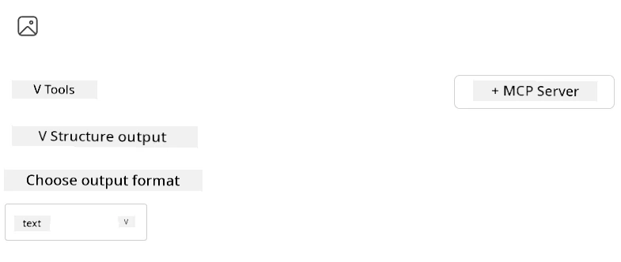
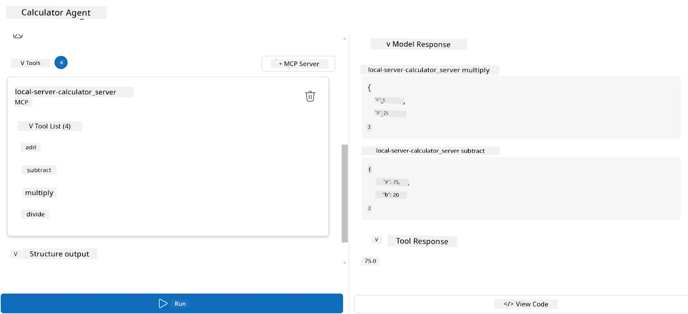

# How to use a server with Microsoft Foundry Toolkit for Visual Studio Code

When you dey build AI agent, e no be only to sabi produce correct responses; e still suppose get power to take action. Na there Model Context Protocol (MCP) come in. MCP dey make am easy for agents to access external tools and services for one consistent way. Think am like you dey plug your agent into toolbox wey e for actually use.

Make we talk say you connect agent to your calculator MCP server. Suddenly, your agent fit do math operations just by receiving prompt like “What’s 47 times 89?”—no need to hardcode logic or build custom APIs.

## Overview

Dis lesson go show how to connect calculator MCP server to agent with
[Microsoft Foundry Toolkit for Visual Studio Code](https://aka.ms/AIToolkit),
make your agent fit perform math operations through normal language.

Microsoft Foundry Toolkit dey simplify how you go develop and test generative
AI applications with local and cloud-hosted models.

*Note*: The Toolkit currently supports Python and TypeScript MCP templates.

## Learning Objectives

By the end of this lesson, you go fit:

- Use an MCP server with Microsoft Foundry Toolkit.
- Configure agent make e fit discover and utilize tools wey the MCP server provide.
- Use MCP tools via normal (natural) language.

## Approach

Na so we go take approach am for high level:

- Create an agent and define im system prompt.
- Create a MCP server wey get calculator tools.
- Connect the Agent Builder to the MCP server.
- Test how the agent go call tools via normal language.

Okay, now we don understand di flow, make we configure AI agent make e fit use external tools through MCP to boost im capabilities!

## Prerequisites

- [Visual Studio Code](https://code.visualstudio.com/)
- [Microsoft Foundry Toolkit for Visual Studio Code](https://aka.ms/AIToolkit)

## Exercise: Consuming a server

> [!WARNING]
> Note for macOS Users. We dey investigate one issue wey dey affect dependency installation on macOS. Because of this, macOS users no go fit finish this tutorial now. We go update the instructions once we get fix. Thank you for your patience and understanding!

For this exercise, you go build, run, and improve AI agent wey get tools from
one MCP server inside Visual Studio Code using Microsoft Foundry Toolkit.

### -0- Prestep, add a Microsoft Foundry GPT-5.1 deployment

Create Microsoft Foundry resource, deploy **GPT-5.1**, and add the deployment
to **My Models**. Check the
[model retirement schedule](https://learn.microsoft.com/azure/foundry/openai/concepts/model-retirement-schedule)
when you dey choose deployment.

1. Open **Microsoft Foundry Toolkit** from the **Activity Bar**.
1. In the **Catalog** section, select **Models** to open the **Model Catalog**. Selecting **Models** opens the **Model Catalog** in a new editor tab.
1. Connect your Microsoft Foundry project and select your **GPT-5.1** deployment.
1. Click **+ Add** to add the deployment to your **My Models** list.
1. In the **Activity Bar**, confirm say the deployment don show for the list.

### -1- Create an agent

The **Agent (Prompt) Builder** dey make you create and customize your own AI-powered agents. For this section, you go create new agent and assign model wey go power the conversation.

1. Open **Microsoft Foundry Toolkit** from the **Activity Bar**.
1. In the **Tools** section, select **Agent (Prompt) Builder**. Selecting **Agent (Prompt) Builder** go open the **Agent (Prompt) Builder** in a new editor tab.
1. Click the **+ New Agent** button. The extension go launch setup wizard through the **Command Palette**.
1. Enter the name **Calculator Agent** and press **Enter**.
1. In the **Agent (Prompt) Builder**, select your **GPT-5.1** Foundry deployment.

### -2- Create a system prompt for the agent

Now we don scaffold the agent, time don reach to define im personality and purpose. For this section, you go use the **Generate system prompt** feature to describe how the agent suppose behave—in this case, calculator agent—and make the model write the system prompt for you.

1. For the **Prompts** section, click the **Generate system prompt** button. This button go open the prompt builder wey use AI to generate system prompt for the agent.
1. In the **Generate a prompt** window, enter the following: `You are a helpful and efficient math assistant. When given a problem involving basic arithmetic, you respond with the correct result.`
1. Click the **Generate** button. Notification go show for bottom-right corner say the system prompt dey generate. When prompt generation don finish, the prompt go appear for the **System prompt** field of the **Agent (Prompt) Builder**.
1. Review the **System prompt** and modify if you need.

### -3- Create a MCP server

Now we don define your agent's system prompt—wey dey guide im behavior and responses—time don reach to give the agent practical capabilities. For this section, you go create calculator MCP server wey get tools to do addition, subtraction, multiplication, and division. This server go make your agent fit do real-time math operations when person use natural language prompts.



Microsoft Foundry Toolkit get templates for creating MCP servers.
We go use the Python template for the calculator MCP server.

*Note*: The Toolkit currently supports Python and TypeScript MCP templates.

1. In the **Tools** section of the **Agent (Prompt) Builder**, click the **+ MCP Server** button. The extension go launch setup wizard through the **Command Palette**.
1. Select **+ Add Server**.
1. Select **Create a New MCP Server**.
1. Select **python-weather** as the template.
1. Select **Default folder** to save the MCP server template.
1. Enter the following name for the server: **Calculator**
1. New Visual Studio Code window go open. Select **Yes, I trust the authors**.
1. Using the terminal (**Terminal** > **New Terminal**), create a virtual environment: `python -m venv .venv`
1. Using the terminal, activate the virtual environment:
    1. Windows - `.venv\Scripts\activate`
    1. macOS/Linux - `source .venv/bin/activate`
1. Using the terminal, install the dependencies: `pip install -e .[dev]`
1. In the **Explorer** view of the **Activity Bar**, expand the **src** directory and select **server.py** to open the file in the editor.
1. Replace the code in the **server.py** file with the following and save:

    ```python
    """
    Sample MCP Calculator Server implementation in Python.

    
    This module demonstrates how to create a simple MCP server with calculator tools
    that can perform basic arithmetic operations (add, subtract, multiply, divide).
    """
    
    from mcp.server.fastmcp import FastMCP
    
    server = FastMCP("calculator")
    
    @server.tool()
    def add(a: float, b: float) -> float:
        """Add two numbers together and return the result."""
        return a + b
    
    @server.tool()
    def subtract(a: float, b: float) -> float:
        """Subtract b from a and return the result."""
        return a - b
    
    @server.tool()
    def multiply(a: float, b: float) -> float:
        """Multiply two numbers together and return the result."""
        return a * b
    
    @server.tool()
    def divide(a: float, b: float) -> float:
        """
        Divide a by b and return the result.
        
        Raises:
            ValueError: If b is zero
        """
        if b == 0:
            raise ValueError("Cannot divide by zero")
        return a / b
    ```

### -4- Run the agent with the calculator MCP server

Now wey your agent don get tools, time don reach to use dem! For this section, you go submit prompts to the agent to test and confirm whether the agent go use the correct tool from the calculator MCP server.



You go run the calculator MCP server for your local dev machine through the **Agent Builder** as the MCP client.

1. Press `F5` to start debugging the MCP server. The **Agent (Prompt) Builder** go open in a new editor tab. Server status go dey visible for the terminal.
1. In the **User prompt** field of the **Agent (Prompt) Builder**, enter the following prompt: `I bought 3 items priced at $25 each, and then used a $20 discount. How much did I pay?`
1. Click the **Run** button to generate the agent's response.
1. Review the agent output. The model suppose conclude say you pay **$55**.
1. Here na breakdown of wetin suppose happen:
    - The agent go select the **multiply** and **subtract** tools to help for the calculation.
    - The respective `a` and `b` values go set for the **multiply** tool.
    - The respective `a` and `b` values go set for the **subtract** tool.
    - The response from each tool go dey provided in the respective **Tool Response**.
    - The final output from the model go dey provided in the final **Model Response**.
1. Submit more prompts to further test the agent. You fit modify the existing prompt in the **User prompt** field by clicking inside the field and replacing the current prompt.
1. When you done testing the agent, you fit stop the server from the **terminal** by pressing **CTRL/CMD+C** to quit.

## Assignment

Try add one more tool entry to your **server.py** file (for example: return the square root of a number). Submit extra prompts wey go require the agent to use your new tool (or the tools wey dey already). Make sure you restart the server so the new tools go load.

## Solution

[Solution](./solution/README.md)

## Key Takeaways

Wetin we take learn for this chapter na the following:

- Microsoft Foundry Toolkit fit consume MCP servers and their tools.
- You fit add new tools to MCP servers, so the agent fit get more capabilities as requirements change.
- Microsoft Foundry Toolkit include MCP server templates to help create custom tools.

## Additional Resources

- [Microsoft Foundry Toolkit documentation](https://aka.ms/AIToolkit/doc)

## What's Next
- Next: [Testing & Debugging](../08-testing/README.md)

---

<!-- CO-OP TRANSLATOR DISCLAIMER START -->
**Disclaimer**:
Dis document don translate wit AI translation service [Co-op Translator](https://github.com/Azure/co-op-translator). Even tho we dey try make am correct, abeg make you know say automated translation fit get errors or mistakes. Di original document for dia own language na im be di correct source. For important info, make person wey sabi human translation do am. We no go responsible for any misunderstanding or wrong understanding wey fit happen because of dis translation.
<!-- CO-OP TRANSLATOR DISCLAIMER END -->