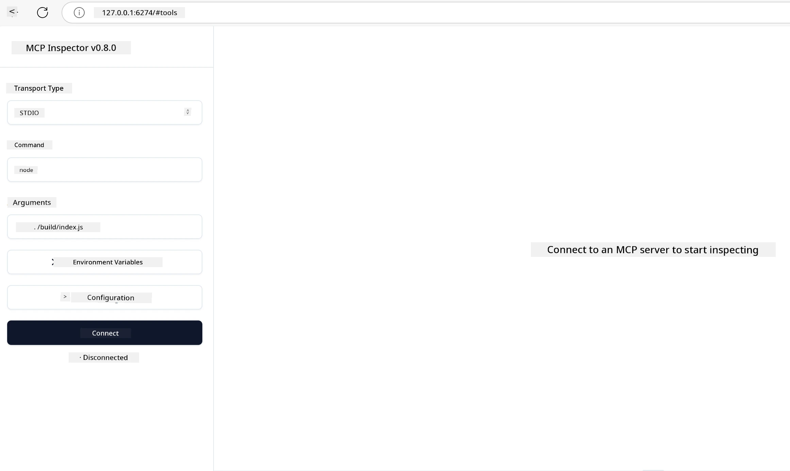

## Testing na Debugging

Bifo you start to test your MCP server, e important make you sabi di tools wey dey and di best practices for debugging. Correct testing go make sure say your server dey behave as e suppose and e go help you quick find and fix wahala. Di next section go explain recommended approaches to validate your MCP implementation.

## Overview

Dis lesson dey show how to choose di correct testing approach and di most effective testing tool.

## Learning Objectives

By di end of dis lesson, you go fit:

- Talk about different ways wey you fit use test.
- Use different tools to test your code well-well.


## Testing MCP Servers

MCP get tools wey go help you test and debug your servers:

- **MCP Inspector**: Na command-line tool wey you fit run both as a CLI tool and as a visual tool.
- **Manual testing**: You fit use tool like curl to run web requests, but any tool wey fit run HTTP go work.
- **Unit testing**: E possible to use your preferred testing framework to test di features of both server and client.

### Using MCP Inspector

We don describe how to use this tool for previous lessons but make we yan small for high level. Na Node.js dem build di tool and you fit use am by calling di `npx` executable wey go download and install di tool temporarily then e go clean up after e don finish to run your request.

The [MCP Inspector](https://github.com/modelcontextprotocol/inspector) go help you:

- **Discover Server Capabilities**: E go automatically detect available resources, tools, and prompts
- **Test Tool Execution**: Try different parameters and see responses as dem dey come
- **View Server Metadata**: Check server info, schemas, and configurations

A typical run of the tool dey look like this:

```bash
npx @modelcontextprotocol/inspector node build/index.js
```

Di command wey show pass go start an MCP and its visual interface and go launch a local web interface for your browser. You fit expect to see dashboard wey display your registered MCP servers, their available tools, resources, and prompts. The interface make you fit interactively test tool execution, inspect server metadata, and view real-time responses, making am easier to validate and debug your MCP server implementations.

Na so e fit be: 

You fit also run this tool in CLI mode; for that case you add `--cli` attribute. Na example below show how to run the tool in "CLI" mode wey go list all the tools on the server:

```sh
npx @modelcontextprotocol/inspector --cli node build/index.js --method tools/list
```

### Manual Testing

Aside from running the inspector tool to test server capabilities, another way na to run a client wey fit use HTTP, for example curl.

With curl, you fit test MCP servers directly using HTTP requests:

```bash
# Example: Test server metadata
curl http://localhost:3000/v1/metadata

# Example: Execute a tool
curl -X POST http://localhost:3000/v1/tools/execute \
  -H "Content-Type: application/json" \
  -d '{"name": "calculator", "parameters": {"expression": "2+2"}}'
```

From the curl example, you use a POST request to invoke a tool with a payload wey get the tool's name and its parameters. Use the approach wey fit you best. CLI tools generally dey faster to use and dem fit be scripted which fit useful for CI/CD environment.

### Unit Testing

Create unit tests for your tools and resources make sure say dem dey work as e suppose. Here na some example testing code.

```python
import pytest

from mcp.server.fastmcp import FastMCP
from mcp.shared.memory import (
    create_connected_server_and_client_session as create_session,
)

# Mark the whole module for async tests
pytestmark = pytest.mark.anyio


async def test_list_tools_cursor_parameter():
    """Test that the cursor parameter is accepted for list_tools.

    Note: FastMCP doesn't currently implement pagination, so this test
    only verifies that the cursor parameter is accepted by the client.
    """

 server = FastMCP("test")

    # Create a couple of test tools
    @server.tool(name="test_tool_1")
    async def test_tool_1() -> str:
        """First test tool"""
        return "Result 1"

    @server.tool(name="test_tool_2")
    async def test_tool_2() -> str:
        """Second test tool"""
        return "Result 2"

    async with create_session(server._mcp_server) as client_session:
        # Test without cursor parameter (omitted)
        result1 = await client_session.list_tools()
        assert len(result1.tools) == 2

        # Test with cursor=None
        result2 = await client_session.list_tools(cursor=None)
        assert len(result2.tools) == 2

        # Test with cursor as string
        result3 = await client_session.list_tools(cursor="some_cursor_value")
        assert len(result3.tools) == 2

        # Test with empty string cursor
        result4 = await client_session.list_tools(cursor="")
        assert len(result4.tools) == 2
    
```

Di code wey pass do di following things:

- E dey use pytest framework wey make you fit create tests as functions and use assert statements.
- E create an MCP Server wey get two different tools.
- E use `assert` statement to check say certain conditions don fulfill.

Make you check di [full file here](https://github.com/modelcontextprotocol/python-sdk/blob/main/tests/client/test_list_methods_cursor.py)

With di file wey show above, you fit test your own server to make sure say capabilities don get created as dem suppose.

All major SDKs get similar testing sections so you fit adjust am to your chosen runtime.

## Samples 

- [Java Calculator](../samples/java/calculator/README.md)
- [.NET Calculator](../../../../03-GettingStarted/samples/csharp)
- [JavaScript Calculator](../samples/javascript/README.md)
- [TypeScript Calculator](../samples/typescript/README.md)
- [Python Calculator](../../../../03-GettingStarted/samples/python) 

## Additional Resources

- [Python SDK](https://github.com/modelcontextprotocol/python-sdk)

## Wetin Next

- Next: [Deployment](../09-deployment/README.md)

---

<!-- CO-OP TRANSLATOR DISCLAIMER START -->
**Disclaimer**:
Dis document don translate wit AI translation service [Co-op Translator](https://github.com/Azure/co-op-translator). Even tho we dey try make am correct, abeg make you know say automated translation fit get errors or mistakes. Di original document for dia own language na im be di correct source. For important info, make person wey sabi human translation do am. We no go responsible for any misunderstanding or wrong understanding wey fit happen because of dis translation.
<!-- CO-OP TRANSLATOR DISCLAIMER END -->