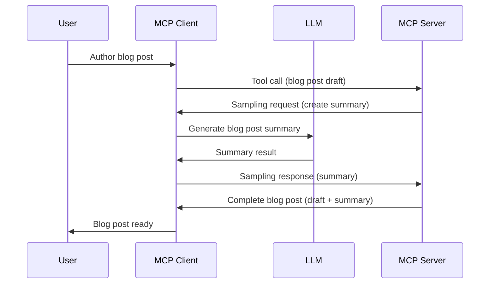

> [!WARNING]
> Sampling don dey deprecated for MCP `2026-07-28`. Dis lesson dey retained for
> legacy implementations. New servers suppose integrate directly wit an LLM
> provider API.

# Sampling - delegate features to di Client

> Sampling still dey for the `2026-07-28` specification for compatibility and fit
> eligible for removal for the first revision wey dem go release on or after July 28,
> 2027. Examples for dis lesson fit use SDK APIs wey implement `2025-11-25`.
> See [Wetin don change for MCP: The 2026-07-28 Specification](../../01-CoreConcepts/mcp-2026-07-28.md).

For legacy implementations, Sampling make MCP server fit request help from an LLM
managed by the client. For new implementations, call the chosen LLM provider
directly instead.

Make we explore some use cases and how to build a solution wey involve sampling.

## Overview

For dis lesson, we go focus on explaining when and where to use Sampling and how to configure am.

## Learning Objectives

For dis chapter, we go:

- Explain wetin Sampling be and when to use am.
- Show how to configure Sampling for MCP.
- Show examples of Sampling as e dey work.

## What is Sampling and why use it?

Sampling na advanced feature wey dey work like this:



### Sampling request

Ok, now we don get one high-level view of a realistic scenario, make we yarn about the sampling request wey the server go send back to the client. This na how such request fit look for JSON-RPC format:

```json
{
  "jsonrpc": "2.0",
  "id": 1,
  "method": "sampling/createMessage",
  "params": {
    "messages": [
      {
        "role": "user",
        "content": {
          "type": "text",
          "text": "Create a blog post summary of the following blog post: <BLOG POST>"
        }
      }
    ],
    "modelPreferences": {
      "hints": [
        {
          "name": "gpt-5.1"
        }
      ],
      "intelligencePriority": 0.8,
      "speedPriority": 0.5
    },
    "systemPrompt": "You are a helpful assistant.",
    "maxTokens": 100
  }
}
```

Some things dey here wey worth to call out:

- Prompt, under content -> text, na our prompt wey be instruction for the LLM to summarize blog post content.

- **modelPreferences**. Dis section na preference, na recommendation of which configuration to use with the LLM. The user fit choose whether to follow these recommendations or change dem. For dis case, e get recommendations on which model to use and speed and intelligence priority.
- **systemPrompt**, dis na your normal system prompt wey dey give your LLM personality and contain guidance instructions.
- **maxTokens**, dis na another property wey dey tell how many tokens dem recommend to use for dis task.

### Sampling response

This response na wetin the MCP Client go end up sending back to the MCP Server and na result of the client calling the LLM — dem go wait for that response then construct this message. This na how e fit look for JSON-RPC:

```json
{
  "jsonrpc": "2.0",
  "id": 1,
  "result": {
    "role": "assistant",
    "content": {
      "type": "text",
      "text": "Here's your abstract <ABSTRACT>"
    },
    "model": "gpt-5.1",
    "stopReason": "endTurn"
  }
}
```

The response na abstract of the blog post as e bin request. The client
selected the active `gpt-5.1` deployment from the server's model preference;
model preferences na recommendations, so the client fit choose another active
deployment when required.

Ok, now that we don understand the main flow, and one useful task to use am for "blog post creation + abstract", make we see wetin we need to do to make am work.

### Message types

Sampling messages no dey limited to just text; you fit also send images and audio. Here how the JSON-RPC go differ:

**Text**

```json
{
  "type": "text",
  "text": "The message content"
}
```

**Image content**

```json
{
  "type": "image",
  "data": "base64-encoded-image-data",
  "mimeType": "image/jpeg"
}
```

**Audio content**

```json
{
  "type": "audio",
  "data": "base64-encoded-audio-data",
  "mimeType": "audio/wav"
}
```

> NOTE: For current status and migration guidance, check the
> [deprecated Sampling documentation](https://modelcontextprotocol.io/specification/2026-07-28/client/sampling).

## How to Configure Sampling in di Client

> Note: if you just dey build a server only, you no need to do much here.

For client, you go need specify the following feature like so:

```json
{
  "capabilities": {
    "sampling": {}
  }
}
```

This one go get picked up when your chosen client initializes with the server.

## Example of Sampling in Action - Create a Blog Post

Make we code a sampling server together, we go need to do the following:

1. Create one tool for the Server.
1. Di tool suppose create a sampling request
1. Tool should wait for the client's sampling request to be answered.
1. Then the tool go produce the result.

Make we see the code step by step:

### -1- Create the tool

**python**

```python
@mcp.tool()
async def create_blog(title: str, content: str, ctx: Context[ServerSession, None]) -> str:
    """Create a blog post and generate a summary"""

```

### -2- Create a sampling request

Add dis code to your tool:

**python**

```python
post = BlogPost(
        id=len(posts) + 1,
        title=title,
        content=content,
        abstract=""
    )

prompt = f"Create an abstract of the following blog post: title: {title} and draft: {content} "

result = await ctx.session.create_message(
        messages=[
            SamplingMessage(
                role="user",
                content=TextContent(type="text", text=prompt),
            )
        ],
        max_tokens=100,
)

```

### -3- Wait for the response and return response

**python**

```python
post.abstract = result.content.text

posts.append(post)

# return the complete product
return json.dumps({
    "id": post.title,
    "abstract": post.abstract
})
```

### -4- Full code

**python**

```python
from starlette.applications import Starlette
from starlette.routing import Mount, Host

from mcp.server.fastmcp import Context, FastMCP

from mcp.server.session import ServerSession
from mcp.types import SamplingMessage, TextContent

import json


from uuid import uuid4
from typing import List
from pydantic import BaseModel


mcp = FastMCP("Blog post generator")

# app = FastAPI()

posts = []

class BlogPost(BaseModel):
    id: int
    title: str
    content: str
    abstract: str

posts: List[BlogPost] = []

@mcp.tool()
async def create_blog(title: str, content: str, ctx: Context[ServerSession, None]) -> str:
    """Create a blog post and generate a summary"""

    post = BlogPost(
        id=len(posts) + 1,
        title=title,
        content=content,
        abstract=""
    )

    prompt = f"Create an abstract of the following blog post: title: {title} and draft: {content} "

    result = await ctx.session.create_message(
        messages=[
            SamplingMessage(
                role="user",
                content=TextContent(type="text", text=prompt),
            )
        ],
        max_tokens=100,
    )

    post.abstract = result.content.text

    posts.append(post)

    # return the complete blog post
    return json.dumps({
        "id": post.title,
        "abstract": post.abstract
    })

if __name__ == "__main__":
    print("Starting server...")
    # mcp.run()
    mcp.run(transport="streamable-http")

# run app with: python server.py
```

### -5- Testing it in Visual Studio Code

To test this one in Visual Studio Code, do the following:

1. Start di server in terminal
1. Add am to *mcp.json* (and make sure e don start) e.g something like so:

   ```json
   "servers": {
      "blog-server": {
        "type": "http",
        "url": "http://localhost:8000/mcp"
      }
   }
   ```

1. Type a prompt:

   ```text
   create a blog post named "Where Python comes from", the content is "Python is actually named after Monty Python Flying Circus"
   ```

1. Allow sampling to happen. First time you test this you go see an extra dialog wey you must accept, then you go see the normal dialog wey go ask you to run a tool

1. Inspect results. You go see the results well rendered for GitHub Copilot Chat but you fit also inspect the raw JSON response.

**Bonus**. Visual Studio Code tooling get better support for sampling. You fit configure Sampling access on your installed server by navigating to it like so:

1. Navigate to the extension section.
1. Select the cog icon for your installed server in the "MCP SERVERS - INSTALLED" section.
1 Select "Configure Model Access", here you fit select which Models GitHub Copilot is allowed to use when performing sampling. You fit also see all sampling requests wey don happen lately by selecting "Show Sampling requests".

## Assignment

For this assignment, you go build small different Sampling — namely a sampling integration wey support generating product description. Na your scenario be this:

**Scenario**: The back-office worker for an e-commerce need help; e dey take too long to generate product descriptions. Therefore, you go build a solution wey fit call tool "create_product" with "title" and "keywords" as arguments and e suppose produce a complete product including a "description" field wey the client's LLM go populate.

TIP: use wetin you learn earlier to construct this server and its tool using a sampling request.

## Solution

[Solution](./solution/README.md)

## Key Takeaways

Sampling na powerful feature wey allow the server to delegate tasks to the client when e need help from an LLM.

## What's Next

- [Chapter 4 - Practical implementation](../../04-PracticalImplementation/README.md)

---

<!-- CO-OP TRANSLATOR DISCLAIMER START -->
**Disclaimer**:
Dis document don translate wit AI translation service [Co-op Translator](https://github.com/Azure/co-op-translator). Even tho we dey try make am correct, abeg make you know say automated translation fit get errors or mistakes. Di original document for dia own language na im be di correct source. For important info, make person wey sabi human translation do am. We no go responsible for any misunderstanding or wrong understanding wey fit happen because of dis translation.
<!-- CO-OP TRANSLATOR DISCLAIMER END -->