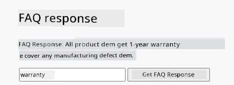
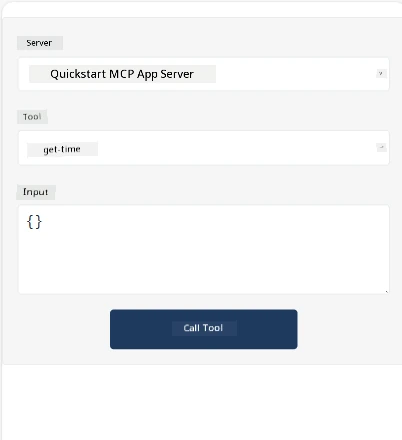
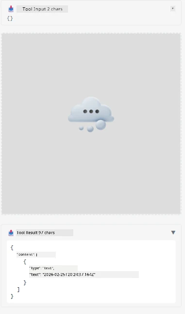

Dis na sample wey dey show how MCP App dey work

## Install 

1. Go to *mcp-app* folder
1. Run `npm install`, dis go install frontend and backend dependencies

Make sure backend dey compile by running:

```sh
npx tsc --noEmit
```

No output suppose show if everything dey fine.

## Run backend

> Dis go need small extra work if you dey on a Windows machine because the MCP Apps solution dey use `concurrently` library wey e run and you go need find replacement for am. Na dis line for *package.json* dey cause wahala on the MCP App:

```json
"start": "concurrently \"cross-env NODE_ENV=development INPUT=mcp-app.html vite build --watch\" \"tsx watch main.ts\""
```

Dis app get two parts: one na backend, the other na host.

Start the backend like dis:

```sh
npm start
```

Dis suppose shart the backend on `http://localhost:3001/mcp`. 

> Note, if you dey in a Codespace, you fit need set port visibility to public. Make sure say you fit reach the endpoint for the browser through https://<name of Codespace>.app.github.dev/mcp

## Choice -1 Test di app for Visual Studio Code

If you wan test di solution for Visual Studio Code, do dis:

- Add a server entry to `mcp.json` like dis:

    ```json
    {
        "servers": {
            "my-mcp-server-7178eca7": {
                "url": "http://localhost:3001/mcp",
                "type": "http"
            }
        },
        "inputs": []
    }
    ```

1. Click the "start" button inside *mcp.json*
1. Make sure say chat window dey open and type `get-faq`, you go see result like dis:

    

## Choice -2- Test di app with a host

The repo <https://github.com/modelcontextprotocol/ext-apps> get several different hosts wey you fit use to test your MVP Apps. 

We go present you with two different options here:

### Local machine

- Navigate to *ext-apps* after you don clone the repo.

- Install dependencies

   ```sh
   npm install
   ```

- In another terminal window, go to *ext-apps/examples/basic-host*

    > if you dey in a Codespace, you need to navigate to serve.ts and line 27 and replace http://localhost:3001/mcp with your Codespace URL for the backend, so for example https://psychic-xylophone-657rpjgvxpc5g64-3001.app.github.dev/mcp

- Run the host:

    ```sh
    npm start
    ```

    This suppose connect the host with backend and you go see the app dey run like dis:

    

### Codespace

E go take small extra work to make a Codespace environment work. To use a host through Codespace: 

- Go to the *ext-apps* directory and navigate to *examples/basic-host*. 
- Run `npm install` to install the dependencies
- Run `npm start` to start the host.

## Test out the app

Try di app like dis:

- Select "Call Tool" button and you go see the results like dis:

    

Great, everything dey work.

---

<!-- CO-OP TRANSLATOR DISCLAIMER START -->
**Disclaimer**:
Dis document don translate wit AI translation service [Co-op Translator](https://github.com/Azure/co-op-translator). Even tho we dey try make am correct, abeg make you know say automated translation fit get errors or mistakes. Di original document for dia own language na im be di correct source. For important info, make person wey sabi human translation do am. We no go responsible for any misunderstanding or wrong understanding wey fit happen because of dis translation.
<!-- CO-OP TRANSLATOR DISCLAIMER END -->