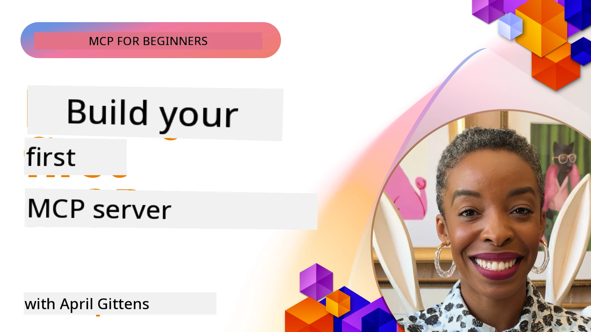

## How you go start  

_(Click di image wey dey above to watch di video for dis lesson)_

Dis section get plenty lessons:

- **1 Your first server**, for dis first lesson, you go learn how to create your first server and inspect am with di inspector tool, na valuable way to test an debug your server, [to the lesson](01-first-server/README.md)

- **2 Client**, for dis lesson, you go learn how to write client wey fit connect to your server, [to the lesson](02-client/README.md)

- **3 Client with LLM**, betta way to write client na to add an LLM so e fit "negotiate" wit your server on wetin to do, [to the lesson](03-llm-client/README.md)

- **4 Consuming a server GitHub Copilot Agent mode in Visual Studio Code**. For here, we dey look how to run our MCP Server from inside Visual Studio Code, [to the lesson](04-vscode/README.md)

- **5 stdio Transport Server** stdio transport na di recommended standard for local MCP server-to-client communication, e dey provide secure subprocess-based communication with built-in process isolation [to the lesson](05-stdio-server/README.md)

- **6 HTTP Streaming with MCP (Streamable HTTP)**. Learn about di standard
	remote transport in [MCP Specification 2026-07-28](https://modelcontextprotocol.io/specification/2026-07-28/basic/transports/streamable-http),
	plus di legacy session-based implementation wey dem retain for di lesson.
	[to the lesson](06-http-streaming/README.md)

- **7 Using Microsoft Foundry Toolkit for Visual Studio Code** to use and test your MCP clients and servers [in this lesson](07-aitk/README.md)

- **8 Testing**. For here we go focus on how we fit test our server and client in different ways, [to the lesson](08-testing/README.md)

- **9 Deployment**. Dis chapter go look at different ways to deploy your MCP solutions, [to the lesson](09-deployment/README.md)

- **10 Advanced server usage**. Dis chapter dey cover advanced server usage, [to the lesson](./10-advanced/README.md)

- **11 Auth**. Dis chapter show how to add simple auth, from Basic Auth to using JWT an RBAC. We dey encourage make you start here den check Advanced Topics for Chapter 5 an do extra security hardening via recommendations for Chapter 2, [to the lesson](./11-simple-auth/README.md)

- **12 MCP Hosts**. Configure an use popular MCP host clients like Claude Desktop, Cursor, Cline, and Windsurf. Learn transport types an troubleshooting, [to the lesson](./12-mcp-hosts/README.md)

- **13 MCP Inspector**. Debug an test your MCP servers interactively using di MCP Inspector tool. Learn how to troubleshoot tools, resources, an protocol messages, [to the lesson](./13-mcp-inspector/README.md)

- **14 Sampling**. Learn di legacy Sampling primitive for `2025-11-25` and
	how to migrate new designs to direct LLM provider integration. Sampling dey
	deprecated in MCP `2026-07-28`. [to the lesson](./14-sampling/README.md)

- **15 MCP Apps**. Build MCP Servers wey still dey reply with UI instructions, [to the lesson](./15-mcp-apps/README.md)

The Model Context Protocol (MCP) na open protocol wey standardize how applications dey provide context to LLMs. Think of MCP like USB-C port for AI applications - e dey provide one standardized way to connect AI models to different data sources and tools.

## Wetin you go sabi

By di end of dis lesson, you go fit:

- Fit set up development environments for MCP for C#, Java, Python, TypeScript, and JavaScript
- Fit build an deploy basic MCP servers wit custom features (resources, prompts, and tools)
- Create host applications wey dey connect to MCP servers
- Test an debug MCP implementations
- Understand common setup wahala and how to solve dem
- Connect your MCP implementations to popular LLM services

## How to Set Up Your MCP Environment

Before you begin working with MCP, e important make you prepare your development environment an understand di basic workflow. Dis section go guide you through di initial setup steps to make sure say you start MCP without wahala.

### Wetin you need

Before you start MCP development, make sure say you get:

- **Development Environment**: For di language wey you choose (C#, Java, Python, TypeScript, or JavaScript)
- **IDE/Editor**: Visual Studio, Visual Studio Code, IntelliJ, Eclipse, PyCharm, or any modern code editor
- **Package Managers**: NuGet, Maven/Gradle, pip, or npm/yarn
- **API Keys**: For any AI services wey you plan to use for your host applications

### Official SDKs

For di chapters wey dey come you go see solutions wey dem build using Python, TypeScript,
Java and .NET. Here na di official SDKs.

SDK support for MCP `2026-07-28` dey roll out independently by language.
Before you run an example, check di package version and di SDK's release notes
for supported protocol revisions. See di
[official SDK list](https://modelcontextprotocol.io/docs/sdk):
- [C# SDK](https://github.com/modelcontextprotocol/csharp-sdk) - Dem maintain am together with Microsoft
- [Java SDK](https://github.com/modelcontextprotocol/java-sdk) - Dem maintain am together with Spring AI
- [TypeScript SDK](https://github.com/modelcontextprotocol/typescript-sdk) - Na di official TypeScript implementation
- [Python SDK](https://github.com/modelcontextprotocol/python-sdk) - Na di official Python implementation (FastMCP)
- [Kotlin SDK](https://github.com/modelcontextprotocol/kotlin-sdk) - Na di official Kotlin implementation
- [Swift SDK](https://github.com/modelcontextprotocol/swift-sdk) - Dem maintain am together with Loopwork AI
- [Rust SDK](https://github.com/modelcontextprotocol/rust-sdk) - Na di official Rust implementation
- [Go SDK](https://github.com/modelcontextprotocol/go-sdk) - Na di official Go implementation

## Key Takeaways

- Setting up MCP development environment dey straightforward if you use language-specific SDKs
- To build MCP servers you go create an register tools with clear schemas
- MCP clients connect to servers an models to use extended capabilities
- Testing an debugging na important for reliable MCP implementations
- Deployment options dey from local development to cloud-based solutions

## Practicing

We get set of samples wey dey complement di exercises wey you go see for all chapters for dis section. Additionally, each chapter get dia own exercises an assignments

- [Java Calculator](./samples/java/calculator/README.md)
- [.NET Calculator](../../../03-GettingStarted/samples/csharp)
- [JavaScript Calculator](./samples/javascript/README.md)
- [TypeScript Calculator](./samples/typescript/README.md)
- [Python Calculator](../../../03-GettingStarted/samples/python)

## Additional Resources

- [Build Agents using Model Context Protocol on Azure](https://learn.microsoft.com/azure/developer/ai/intro-agents-mcp)
- [Remote MCP with Azure Container Apps (Node.js/TypeScript/JavaScript)](https://learn.microsoft.com/samples/azure-samples/mcp-container-ts/mcp-container-ts/)
- [.NET OpenAI MCP Agent](https://learn.microsoft.com/samples/azure-samples/openai-mcp-agent-dotnet/openai-mcp-agent-dotnet/)

## What's next

Start with di first lesson: [Creating your first MCP Server](01-first-server/README.md)

Once you don finish dis module, continue to: [Module 4: Practical Implementation](../04-PracticalImplementation/README.md)

---

<!-- CO-OP TRANSLATOR DISCLAIMER START -->
**Disclaimer**:
Dis document don translate wit AI translation service [Co-op Translator](https://github.com/Azure/co-op-translator). Even tho we dey try make am correct, abeg make you know say automated translation fit get errors or mistakes. Di original document for dia own language na im be di correct source. For important info, make person wey sabi human translation do am. We no go responsible for any misunderstanding or wrong understanding wey fit happen because of dis translation.
<!-- CO-OP TRANSLATOR DISCLAIMER END -->