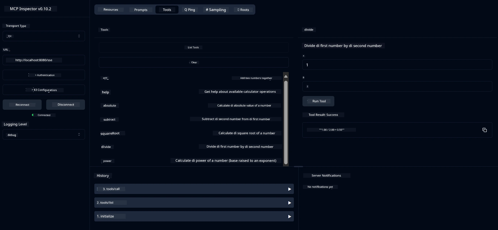

# Baisik Kalkuleita MCP Savais

> [!NOTE]
> Dis sample dey use di old HTTP+SSE transport an e dey target an SDK wey dey compatible
> with MCP `2025-11-25`. New remote servers suppose use `2026-07-28` Streamable
> HTTP support.

Dis service dey provide baisik kalkuleita operations through di Model Context Protocol (MCP) using Spring Boot wit WebFlux transport. E design as simple example for beginners wey dey learn about MCP implementations.

For more info, see the [MCP Server Boot Starter](https://docs.spring.io/spring-ai/reference/api/mcp/mcp-server-boot-starter-docs.html) reference documentation.

## Overview

Di service dey showcase:
- Support for SSE (Server-Sent Events)
- Automatic tool registration using Spring AI's `@Tool` annotation
- Baisik kalkuleita functions:
  - Addition, subtraction, multiplication, division
  - Power calculation and square root
  - Modulus (remainder) and absolute value
  - Help function for operation descriptions

## Features

Dis kalkuleita service get di following capabilities:

1. **Basic Arithmetic Operations**:
   - Addition of two numbers
   - Subtraction of one number from another
   - Multiplication of two numbers
   - Division of one number by another (with zero division check)

2. **Advanced Operations**:
   - Power calculation (raising a base to an exponent)
   - Square root calculation (with negative number check)
   - Modulus (remainder) calculation
   - Absolute value calculation

3. **Help System**:
   - Built-in help function wey dey explain all available operations

## Using the Service

Di service dey expose di following API endpoints through di MCP protocol:

- `add(a, b)`: Add two numbers together
- `subtract(a, b)`: Subtract the second number from the first
- `multiply(a, b)`: Multiply two numbers
- `divide(a, b)`: Divide the first number by the second (with zero check)
- `power(base, exponent)`: Calculate the power of a number
- `squareRoot(number)`: Calculate the square root (with negative number check)
- `modulus(a, b)`: Calculate the remainder when dividing
- `absolute(number)`: Calculate the absolute value
- `help()`: Get information about available operations

## Test Client

Simple test client dey included for the `com.microsoft.mcp.sample.client` package. The `SampleCalculatorClient` class dey demonstrate di available operations of di calculator service.

## Using the LangChain4j Client

Di project include one LangChain4j example client for
`com.microsoft.mcp.sample.client.LangChain4jClient` wey dey show how to
integrate di calculator service wit a Microsoft Foundry model.

### Prerequisites

1. Make a Microsoft Foundry resource an deploy an active model like
   `gpt-5.1`.
2. Set di model endpoint, API key, and deployment name:

   ```bash
   export AZURE_OPENAI_ENDPOINT="https://<resource-name>.openai.azure.com"
   export AZURE_OPENAI_API_KEY="<api-key>"
   export AZURE_OPENAI_DEPLOYMENT="gpt-5.1"
   ```

3. Check di
   [Microsoft Foundry model retirement schedule](https://learn.microsoft.com/azure/foundry/openai/concepts/model-retirement-schedule)
   before you select deployment.
4. Make sure di calculator server dey run on `localhost:8080`.

### Running the LangChain4j Client

Dis example dey demonstrate:
- Connecting to the calculator MCP server via SSE transport
- Using LangChain4j to create a chat bot wey go leverage calculator operations
- Integrating with a deployed Microsoft Foundry model

Di client go send di following sample queries to show functionality:
1. Calculating the sum of two numbers
2. Finding the square root of a number
3. Getting help information about available calculator operations

Run di example an check di console output make you see how di AI model dey use di calculator tools to respond to queries.

### Microsoft Foundry Model Configuration

Di LangChain4j client dey use di Azure OpenAI v1-compatible endpoint wey
Microsoft Foundry expose:

```java
String endpoint = System.getenv("AZURE_OPENAI_ENDPOINT");
ChatLanguageModel model = OpenAiOfficialChatModel.builder()
   .baseUrl(endpoint.replaceAll("/+$", "") + "/openai/v1/")
   .apiKey(System.getenv("AZURE_OPENAI_API_KEY"))
   .isAzure(true)
   .modelName(System.getenv().getOrDefault("AZURE_OPENAI_DEPLOYMENT", "gpt-5.1"))
    .timeout(Duration.ofSeconds(60))
    .build();
```

`AZURE_OPENAI_DEPLOYMENT` must match di name wey dem assign wen dem deploy di model,
deployed, which may differ from the underlying model name.

## Dependencies

Di project need di following key dependencies:

```xml
<!-- For MCP Server -->
<dependency>
    <groupId>org.springframework.ai</groupId>
    <artifactId>spring-ai-starter-mcp-server-webflux</artifactId>
</dependency>

<!-- For LangChain4j integration -->
<dependency>
    <groupId>dev.langchain4j</groupId>
    <artifactId>langchain4j-mcp</artifactId>
    <version>${langchain4j.version}</version>
</dependency>

<!-- For Microsoft Foundry's OpenAI-compatible endpoint -->
<dependency>
    <groupId>dev.langchain4j</groupId>
   <artifactId>langchain4j-open-ai-official</artifactId>
    <version>${langchain4j.version}</version>
</dependency>
```

## Building the Project

Build di project using Maven:
```bash
./mvnw clean install -DskipTests
```

## Running the Server

### Using Java

```bash
java -jar target/calculator-server-0.0.1-SNAPSHOT.jar
```

### Using MCP Inspector

MCP Inspector na helpful tool for interacting wit MCP services. To use am wit dis calculator service:

1. **Install and run MCP Inspector** for new terminal window:
   ```bash
   npx @modelcontextprotocol/inspector
   ```

2. **Access the web UI** by clicking di URL wey di app display (typically http://localhost:6274)

3. **Configure the connection**:
   - Set di transport type to "SSE"
   - Set di URL to your running server's SSE endpoint: `http://localhost:8080/sse`
   - Click "Connect"

4. **Use the tools**:
   - Click "List Tools" to see available calculator operations
   - Select a tool and click "Run Tool" to execute an operation



### Using Docker

Di project include one Dockerfile for containerized deployment:

1. **Build the Docker image**:
   ```bash
   docker build -t calculator-mcp-service .
   ```

2. **Run the Docker container**:
   ```bash
   docker run -p 8080:8080 calculator-mcp-service
   ```

This go do:
- Build a multi-stage Docker image with Maven 3.9.9 and Eclipse Temurin 24 JDK
- Create an optimized container image
- Expose the service on port 8080
- Start the MCP calculator service inside the container

You fit access di service at `http://localhost:8080` once di container dey run.

## Troubleshooting

### Common Model Connection Issues

1. **Authentication errors**: Confirm `AZURE_OPENAI_API_KEY` belong to di
   resource identified by `AZURE_OPENAI_ENDPOINT`.
2. **Deployment not found**: Confirm `AZURE_OPENAI_DEPLOYMENT` exactly matches
   di deployment name for Microsoft Foundry.
3. **Rate limiting**: Check di deployment quota an retry after di interval
   wey di service return.

For more help, see di
[LangChain4j documentation](https://github.com/langchain4j/langchain4j) and
[Microsoft Foundry documentation](https://learn.microsoft.com/azure/ai-foundry/).

---

<!-- CO-OP TRANSLATOR DISCLAIMER START -->
**Disclaimer**:
Dis document don translate wit AI translation service [Co-op Translator](https://github.com/Azure/co-op-translator). Even tho we dey try make am correct, abeg make you know say automated translation fit get errors or mistakes. Di original document for dia own language na im be di correct source. For important info, make person wey sabi human translation do am. We no go responsible for any misunderstanding or wrong understanding wey fit happen because of dis translation.
<!-- CO-OP TRANSLATOR DISCLAIMER END -->