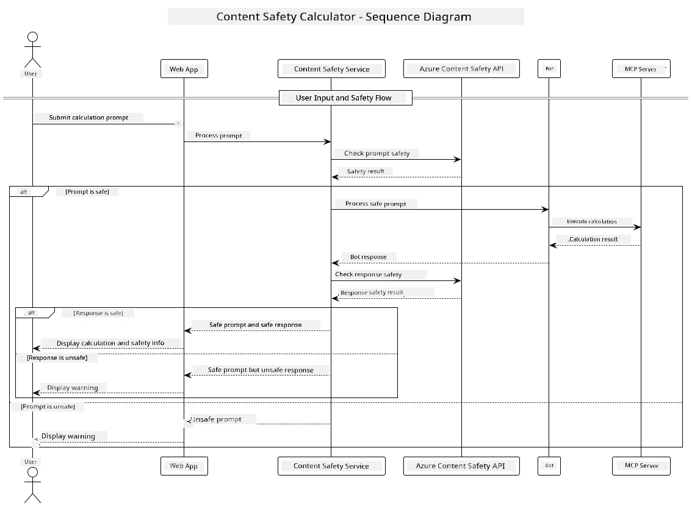

## System Architecture

Dis project dey show one web application wey dey use content safety check before e pass user prompts go calculator service via Model Context Protocol (MCP).



### How E Dey Work

1. **User Input**: Di user go put calculation prompt for di web interface
2. **Content Safety Screening (Input)**: Dem go analyze di prompt with Azure Content Safety API
3. **Safety Decision (Input)**:
   - If di content safe (severity < 2 for all categories), e go continue go calculator
   - If dem flag di content as fit harm, di process go stop and e go return warning
4. **Calculator Integration**: Safe content dem go process with LangChain4j wey dey talk to MCP calculator server
5. **Content Safety Screening (Output)**: Dem go analyze di bot response with Azure Content Safety API
6. **Safety Decision (Output)**:
   - If di bot response safe, dem go show am to di user
   - If dem flag di bot response as fit harm, dem go replace am with warning
7. **Response**: Results (if safe) go show to di user together with both safety analyses

## Using Model Context Protocol (MCP) with Calculator Services

Dis project dey show how to use Model Context Protocol (MCP) to call calculator MCP services from LangChain4j. Di implementation dey use local MCP server wey dey run for port 8080 to provide calculator operations.

### How to Set Up Azure Content Safety Service

Before you fit use di content safety features, you need create Azure Content Safety service resource:

1. Sign in to the [Azure Portal](https://portal.azure.com)
2. Click "Create a resource" and search for "Content Safety"
3. Select "Content Safety" and click "Create"
4. Put a unique name for your resource
5. Choose your subscription and resource group (or create a new one)
6. Choose a supported region (check [Region availability](https://azure.microsoft.com/en-us/global-infrastructure/services/?products=cognitive-services) for details)
7. Choose appropriate pricing tier
8. Click "Create" to deploy the resource
9. After deployment don complete, click "Go to resource"
10. For the left pane, under "Resource Management", select "Keys and Endpoint"
11. Copy one of the keys and the endpoint URL to use in the next step

### Configuring Environment Variables

Set the Microsoft Foundry model endpoint, API key, and deployment name:
```sh
export AZURE_OPENAI_ENDPOINT="https://<resource-name>.openai.azure.com"
export AZURE_OPENAI_API_KEY="<api-key>"
export AZURE_OPENAI_DEPLOYMENT="gpt-5.1"
```

For content safety features, set:
```sh
export CONTENT_SAFETY_ENDPOINT=<your_content_safety_endpoint>
export CONTENT_SAFETY_KEY=<your_content_safety_key>
```

Dis environment variables dey used by di application to authenticate with di Azure Content Safety service. If dem no set these variables, di app go use placeholder values for demo, but di content safety features no go work properly.

### Starting the Calculator MCP Server

Before you run the client, you must start di calculator MCP server in SSE mode on localhost:8080.

## Project Description

Dis project dey show how dem integrate Model Context Protocol (MCP) with LangChain4j to call calculator services. Key features include:

- Using MCP to connect to calculator service for basic math operations
- Dual-layer content safety checking for both user prompts and bot responses
- Integration with a deployed Microsoft Foundry model via LangChain4j
- Using Server-Sent Events (SSE) for MCP transport

## Content Safety Integration

Di project get comprehensive content safety features to make sure say both user inputs and system responses no get harmful content:

1. **Input Screening**: All user prompts dem go analyze for harmful content categories like hate speech, violence, self-harm, and sexual content before processing.

2. **Output Screening**: Even if una dey use potentially uncensored models, di system go check all generated responses through same content safety filters before e show them to di user.

Dis dual-layer approach dey make sure say di system remain safe no matter which AI model dem dey use, protecting users from harmful inputs and potentially problematic AI-generated outputs.

## Web Client

Di application get user-friendly web interface wey allow users interact with di Content Safety Calculator system:

### Web Interface Features

- Simple, intuitive form wey user fit enter calculation prompts
- Dual-layer content safety validation (input and output)
- Real-time feedback about prompt and response safety
- Color-coded safety indicators to make am easy to interpret
- Clean, responsive design wey dey work for different devices
- Example safe prompts wey go guide users

### Using the Web Client

1. Start the application:
   ```sh
   mvn spring-boot:run
   ```

2. Open your browser and go to `http://localhost:8087`

3. Put calculation prompt for di provided text area (e.g., "Calculate the sum of 24.5 and 17.3")

4. Click "Submit" to process your request

5. View the results, wey go include:
   - Content safety analysis of your prompt
   - The calculated result (if prompt safe)
   - Content safety analysis of the bot's response
   - Any safety warnings if either input or output get flagged

Di web client go automatically handle both content safety verification processes, making sure all interactions safe and appropriate no matter which AI model dem dey use.

---

<!-- CO-OP TRANSLATOR DISCLAIMER START -->
**Disclaimer**:
Dis document don translate wit AI translation service [Co-op Translator](https://github.com/Azure/co-op-translator). Even tho we dey try make am correct, abeg make you know say automated translation fit get errors or mistakes. Di original document for dia own language na im be di correct source. For important info, make person wey sabi human translation do am. We no go responsible for any misunderstanding or wrong understanding wey fit happen because of dis translation.
<!-- CO-OP TRANSLATOR DISCLAIMER END -->