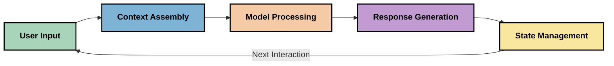
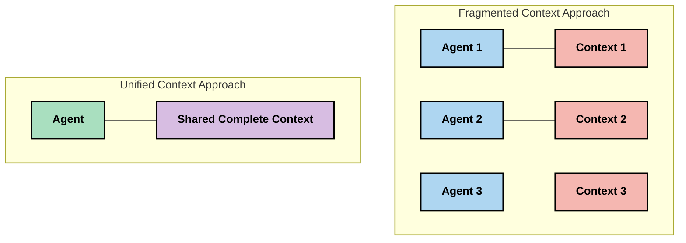
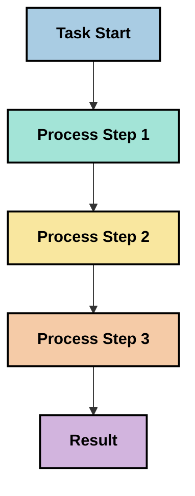
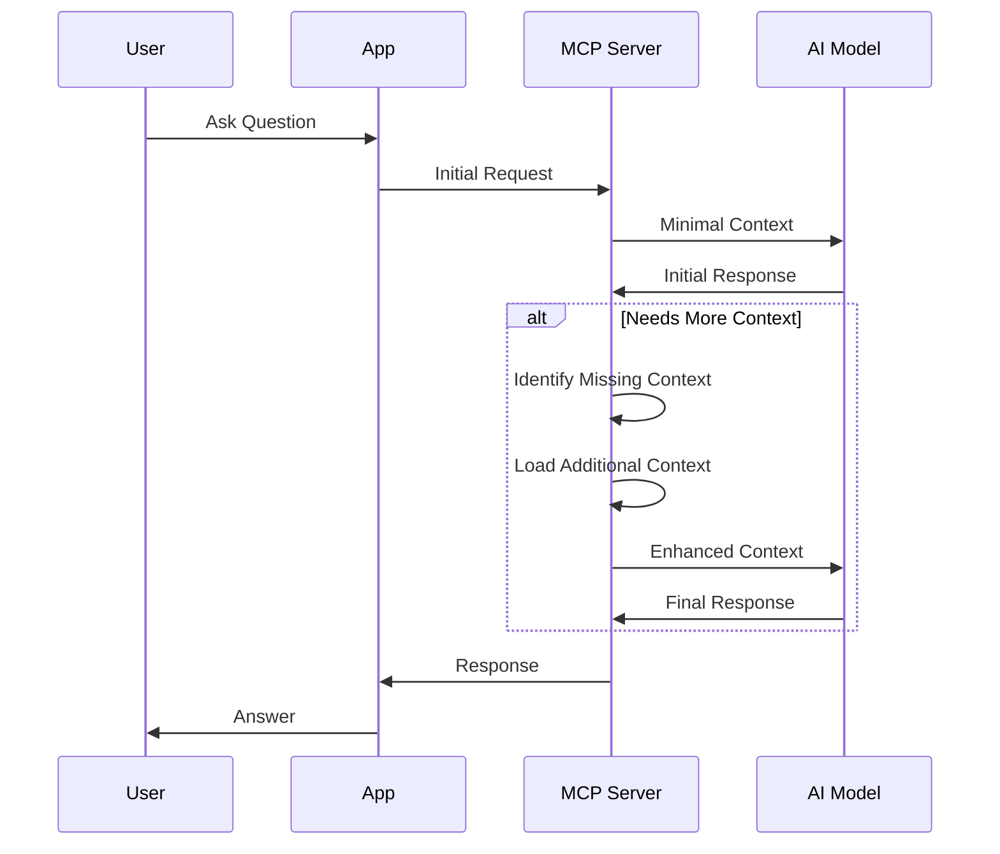
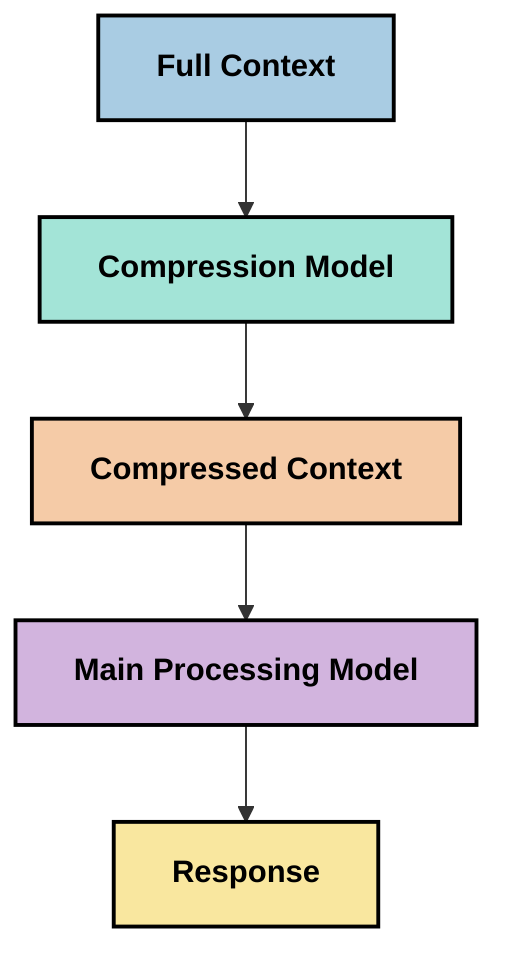
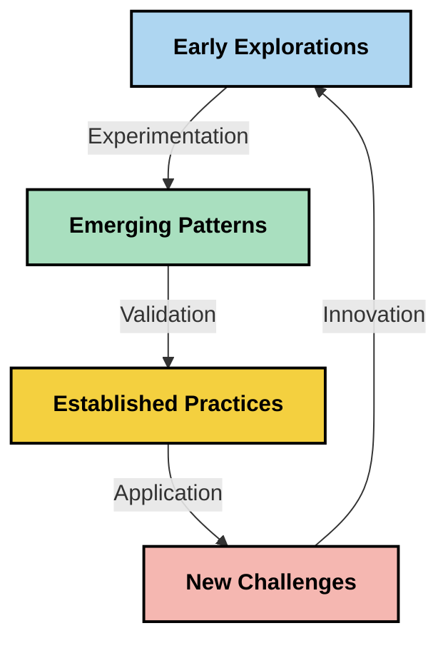

# Context Engineering: Na New Concept Wey Dey for MCP Ecosystem

## Wetin E Mean

Context engineering na new idea for di AI space wey dey look how information dey structured, delivered, and maintained during interactions between clients and AI services. As the Model Context Protocol (MCP) ecosystem dey evolve, to sabi how to manage context well dey important. This module dey introduce di concept of context engineering and go explore how e fit take apply for MCP implementations.

## Wetin You Go Learn

When you finish dis module, you go fit:

- Understand di new concept of context engineering and wetin e fit do for MCP applications
- Identify main wahala dem for context management wey MCP protocol dey try solve
- Explore techniques wey fit make model performance beta through better context handling
- Consider approaches to measure and evaluate how context dey effective
- Apply these new ideas to make AI experiences better with di MCP framework

## Intro to Context Engineering

Context engineering na new idea wey dey focus on intentional design and management of how information dey flow between users, applications, and AI models. No be like established fields like prompt engineering; context engineering still dey get definition from practitioners as dem dey try solve di special challenges of giving AI models di correct information at di correct time.

As large language models (LLMs) don dey evolve, e don clear say context matter wella. The quality, relevance, and structure of di context wey we provide dey directly affect model outputs. Context engineering dey explore dis relationship and dey try develop principles for effective context management.

> "By 2025, di models wey dey there go dey extremely intelligent. But even di smartest human no go fit do dia work well without di context of wetin dem dey ask dem to do... 'Context engineering' na di next level of prompt engineering. Na about to make dis automatic for a dynamic system." — Walden Yan, Cognition AI

Context engineering fit include:

1. **Context Selection**: To determine which information dey relevant for a given task
2. **Context Structuring**: To organize information make model fit understand pass
3. **Context Delivery**: To optimize how and when information dey sent to models
4. **Context Maintenance**: To manage state and how context dey change over time
5. **Context Evaluation**: To measure and improve how effective di context be

These areas dey specially relevant to di MCP ecosystem, wey dey provide one standardized way for applications to give context to LLMs.


## Di Context Journey Perspective

One way to visualize context engineering na to trace di journey wey information dey take through an MCP system:



### Key Stages in di Context Journey:

1. **User Input**: Raw information from di user (text, images, documents)
2. **Context Assembly**: To combine user input with system context, conversation history, and other retrieved information
3. **Model Processing**: Di AI model dey process di assembled context
4. **Response Generation**: Di model dey produce outputs based on di context wey dem give
5. **State Management**: Di system go update im internal state based on di interaction

This perspective dey show how context dey dynamic for AI systems and e dey raise important questions about how best to manage information for each stage.

## Emerging Principles in Context Engineering

As the field of context engineering take shape, some early principles dey begin to show from practitioners. These principles fit help inform MCP implementation choices:

### Principle 1: Share Context Completely

Context suppose dey shared completely between all parts of a system instead of being scattered across multiple agents or processes. When context dey distributed, decisions made in one part of the system fit conflict with those made elsewhere.



For MCP applications, dis dey suggest design systems where context go flow smoothly through the whole pipeline instead of being compartmentalized.

### Principle 2: Recognize That Actions Carry Implicit Decisions

Every action wey model take get implicit decisions about how e go interpret di context. When multiple components act on different contexts, these implicit decisions fit conflict, leading to inconsistent outcomes.

This principle get important implications for MCP applications:
- Make una prefer linear processing for complex tasks pass parallel execution wey get fragmented context
- Make sure say all decision points get access to di same contextual information
- Design systems wey later steps fit see the full context of earlier decisions

### Principle 3: Balance Context Depth with Window Limitations

As conversations and processes dey long, context windows go eventually overflow. Effective context engineering dey find ways to manage dis tension between comprehensive context and technical limitations.

Potential approaches wey dem dey explore include:
- Context compression wey dey keep essential information but reduce token usage
- Progressive loading of context based on wetin relevant to current needs
- Summarization of previous interactions while e dey preserve key decisions and facts

## Context Challenges and MCP Protocol Design

The Model Context Protocol (MCP) dem design am with awareness of di special challenges of context management. To understand these challenges go help explain key parts of di MCP protocol design:


### Challenge 1: Context Window Limitations
Most AI models get fixed context window sizes, wey limit how much information dem fit process at once.

**MCP Design Response:** 
- The protocol dey support structured, resource-based context wey fit be referenced efficiently
- Resources fit be paginated and loaded progressively

### Challenge 2: Relevance Determination
To decide which information be most relevant to include for context dey hard.

**MCP Design Response:**
- Flexible tooling dey allow dynamic retrieval of information based on need
- Structured prompts dey enable consistent context organization

### Challenge 3: Context Persistence
To manage state across interactions need careful tracking of context.

**MCP Design Response:**
- Standardized session management
- Clearly defined interaction patterns for context evolution

### Challenge 4: Multi-Modal Context
Different types of data (text, images, structured data) need different handling.

**MCP Design Response:**
- Protocol design dey accommodate various content types
- Standardized representation of multi-modal information

### Challenge 5: Security and Privacy
Context many times get sensitive information wey must protected.

**MCP Design Response:**
- Clear boundaries between client and server responsibilities
- Local processing options to minimize data exposure

To understand these challenges and how MCP dey address dem go give foundation to explore more advanced context engineering techniques.

## Emerging Context Engineering Approaches

As di field of context engineering dey develop, some promising approaches dey emerge. These represent current thinking instead of established best practices, and dem go likely change as we get more experience with MCP implementations.

### 1. Single-Threaded Linear Processing

Different from multi-agent architectures wey distribute context, some practitioners don find say single-threaded linear processing dey produce more consistent results. This one align with di principle of keeping context unified.



Even though this approach fit look less efficient than parallel processing, e often produce more coherent and reliable results because every step dey build on complete understanding of earlier decisions.

### 2. Context Chunking and Prioritization

To break large contexts into manageable pieces and prioritize wetin most important.

```python
# Conceptual Example: Context Chunking and Prioritization
def process_with_chunked_context(documents, query):
    # 1. Break documents into smaller chunks
    chunks = chunk_documents(documents)
    
    # 2. Calculate relevance scores for each chunk
    scored_chunks = [(chunk, calculate_relevance(chunk, query)) for chunk in chunks]
    
    # 3. Sort chunks by relevance score
    sorted_chunks = sorted(scored_chunks, key=lambda x: x[1], reverse=True)
    
    # 4. Use the most relevant chunks as context
    context = create_context_from_chunks([chunk for chunk, score in sorted_chunks[:5]])
    
    # 5. Process with the prioritized context
    return generate_response(context, query)
```

Di concept above dey show how we fit break large documents into manageable pieces and pick only di most relevant parts for context. This approach fit help work inside context window limitations while still use large knowledge bases.

### 3. Progressive Context Loading

To load context progressively as e needed instead of all at once.



Progressive context loading dey start with minimal context and e expand only when necessary. This fit reduce token usage wella for simple queries while still fit handle complex questions.

### 4. Context Compression and Summarization

To reduce context size while make sure essential information still dey.



Context compression dey focus on:
- Remove redundant information
- Summarize long content
- Extract key facts and details
- Preserve critical context elements
- Optimize for token efficiency

This approach fit be especially valuable to keep long conversations inside context windows or to process large documents efficiently. Some practitioners dey use specialized models specially for context compression and summarization of conversation history.


## Exploratory Context Engineering Considerations

As we explore di emerging field of context engineering, some considerations worth to keep in mind when you dey work with MCP implementations. These no be prescriptive best practices but areas wey fit give improvements for your specific use case.

### Think About Your Context Goals

Before you implement complex context management solutions, talk clear wetin you dey try achieve:
- Which specific information di model need to succeed?
- Which information be essential and which be supplementary?
- Wetin be your performance constraints (latency, token limits, costs)?

### Explore Layered Context Approaches

Some practitioners dey find success when dem arrange context in conceptual layers:
- **Core Layer**: Essential information wey di model always need
- **Situational Layer**: Context wey specific to di current interaction
- **Supporting Layer**: Additional information wey fit help
- **Fallback Layer**: Information wey dem go access only when e needed

### Investigate Retrieval Strategies

How effective your context go dey often depend on how you dey retrieve information:
- Semantic search and embeddings to find conceptually relevant information
- Keyword-based search for specific factual details
- Hybrid approaches wey combine multiple retrieval methods
- Metadata filtering to narrow scope based on categories, dates, or sources

### Experiment with Context Coherence

How you structure and flow your context fit affect model comprehension:
- Group related information together
- Use consistent formatting and organization
- Keep logical or chronological ordering where appropriate
- Avoid contradictory information

### Weigh the Tradeoffs of Multi-Agent Architectures

Even though multi-agent architectures popular for many AI frameworks, dem get big challenges for context management:
- Context fragmentation fit lead to inconsistent decisions across agents
- Parallel processing fit introduce conflicts wey hard to reconcile
- Communication overhead between agents fit cancel performance gains
- Complex state management dey needed to maintain coherence

For many cases, single-agent approach wey get comprehensive context management fit give more reliable results pass multiple specialized agents wey get fragmented context.

### Develop Evaluation Methods

To improve context engineering over time, think how you go measure success:
- A/B testing different context structures
- Monitor token usage and response times
- Track user satisfaction and task completion rates
- Analyze when and why context strategies fail

These considerations na active areas wey people dey explore for context engineering. As the field mature, more clear patterns and practices go likely show.

## Measuring Context Effectiveness: An Evolving Framework

As context engineering dey show, practitioners don begin explore how we fit measure im effectiveness. No standard framework yet, but different metrics dey wey dem dey consider to help guide future work.

### Potential Measurement Dimensions


#### 1. Input Efficiency Considerations

- **Context-to-Response Ratio**: How much context dey needed compared to response size?
- **Token Utilization**: Which percentage of the provided context tokens dey seem to influence the response?
- **Context Reduction**: How well fit we compress raw information?

#### 2. Performance Considerations

- **Latency Impact**: How context management dey affect response time?
- **Token Economy**: We dey optimize token usage well?
- **Retrieval Precision**: How relevant be di retrieved information?
- **Resource Utilization**: Which computational resources dey required?

#### 3. Quality Considerations

- **Response Relevance**: How well di response address di query?
- **Factual Accuracy**: Context management dey improve factual correctness?
- **Consistency**: Responses dey consistent across similar queries?
- **Hallucination Rate**: Better context dey reduce model hallucinations?

#### 4. User Experience Considerations

- **Follow-up Rate**: How often users need clarification?
- **Task Completion**: Users dey successfully accomplish their goals?
- **Satisfaction Indicators**: How users rate dia experience?

### Exploratory Approaches to Measurement

When you dey experiment with context engineering for MCP implementations, consider these exploratory approaches:

1. **Baseline Comparisons**: Establish baseline with simple context approaches before testing more sophisticated methods

2. **Incremental Changes**: Change one aspect of context management at a time to isolate its effects

3. **User-Centered Evaluation**: Combine quantitative metrics with qualitative user feedback

4. **Failure Analysis**: Examine cases where context strategies fail to understand potential improvements

5. **Multi-Dimensional Assessment**: Consider trade-offs between efficiency, quality, and user experience

This experimental, multi-faceted approach to measurement dey align with di emerging nature of context engineering.

## Closing Thoughts

Context engineering na new area wey people dey explore and e fit turn out to be central to effective MCP applications. If you think well about how information dey flow through your system, you fit create AI experiences wey dey more efficient, accurate, and valuable to users.

Di techniques and approaches wey dis module outline na early thinking for dis space, no be established practices. Context engineering fit develop into a more defined discipline as AI capabilities evolve and our understanding deepen. For now, experimentation plus careful measurement dey look like di most productive approach.

## Potential Future Directions

Di field of context engineering still dey for early stages, but some promising directions dey emerge:

- Context engineering principles fit get big impact for model performance, efficiency, user experience, and reliability
- Single-threaded approaches with comprehensive context management fit do pass multi-agent architectures for many use cases
- Specialized context compression models fit become standard components for AI pipelines
- The tension between context completeness and token limitations go likely drive innovation for context handling
- As models go dey more capable for efficient human-like communication, true multi-agent collaboration fit become more viable
- MCP implementations fit evolve to standardize context management patterns wey go emerge from current experimentation



## Resources

### Official MCP Resources
- [Model Context Protocol Website](https://modelcontextprotocol.io/)
- [Model Context Protocol Specification](https://github.com/modelcontextprotocol/modelcontextprotocol)
- [MCP Documentation](https://modelcontextprotocol.io/docs)
- [MCP C# SDK](https://github.com/modelcontextprotocol/csharp-sdk)
- [MCP Python SDK](https://github.com/modelcontextprotocol/python-sdk)
- [MCP TypeScript SDK](https://github.com/modelcontextprotocol/typescript-sdk)
- [MCP Inspector](https://github.com/modelcontextprotocol/inspector) - Tool wey dey test di visual tins for MCP servers

### Context Engineering Atikuls
- [Don't Build Multi-Agents: Principles of Context Engineering](https://cognition.ai/blog/dont-build-multi-agents) - Walden Yan insight dem on context engineering prinsipol
- [A Practical Guide to Building Agents](https://cdn.openai.com/business-guides-and-resources/a-practical-guide-to-building-agents.pdf) - OpenAI guide on how to design agents wey dey work well
- [Building Effective Agents](https://www.anthropic.com/engineering/building-effective-agents) - Anthropic way to develop agents

### Related Research
- [Dynamic Retrieval Augmentation for Large Language Models](https://arxiv.org/abs/2310.01487) - Research wey dey look dynamic retrieval approaches
- [Lost in the Middle: How Language Models Use Long Contexts](https://arxiv.org/abs/2307.03172) - Important research about how context dey processed
- [Hierarchical Text-Conditioned Image Generation with CLIP Latents](https://arxiv.org/abs/2204.06125) - DALL-E 2 paper wey get insight on how to structure context
- [Exploring the Role of Context in Large Language Model Architectures](https://aclanthology.org/2023.findings-emnlp.124/) - Recent research about how context dey handled
- [Multi-Agent Collaboration: A Survey](https://arxiv.org/abs/2304.03442) - Research about multi-agent systems and di challenges dem

### Additional Resources
- [Context Window Optimization Techniques](https://learn.microsoft.com/en-us/azure/ai-services/openai/concepts/context-window)
- [Advanced RAG Techniques](https://www.microsoft.com/en-us/research/blog/retrieval-augmented-generation-rag-and-frontier-models/)
- [Semantic Kernel Documentation](https://github.com/microsoft/semantic-kernel)
- [Microsoft Foundry Toolkit for Visual Studio Code](https://github.com/microsoft/vscode-ai-toolkit)

## Wetin dey next 

- [5.15 MCP Custom Transport](../mcp-transport/README.md)

---

<!-- CO-OP TRANSLATOR DISCLAIMER START -->
**Disclaimer**:
Dis document don translate wit AI translation service [Co-op Translator](https://github.com/Azure/co-op-translator). Even tho we dey try make am correct, abeg make you know say automated translation fit get errors or mistakes. Di original document for dia own language na im be di correct source. For important info, make person wey sabi human translation do am. We no go responsible for any misunderstanding or wrong understanding wey fit happen because of dis translation.
<!-- CO-OP TRANSLATOR DISCLAIMER END -->