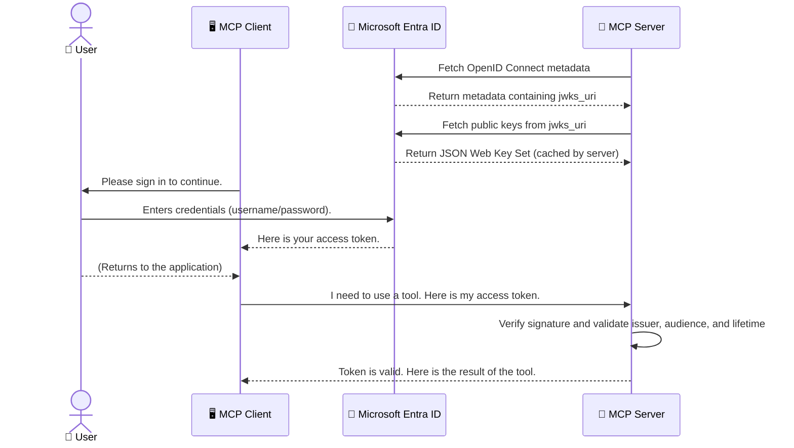

# How to keep AI workflows safe: Entra ID Authentication for Model Context Protocol Servers

> [!NOTE]
> Di remote server code for dis lesson dey protect legacy `/sse` and `/message`
> endpoints and targets MCP `2025-11-25`. Make sure say you keep im identity and token-validation
> practices, but use a `2026-07-28`-compatible Streamable HTTP transport for new
> implementations.

## Intro
To secure your Model Context Protocol (MCP) server na as important as lock front door for your house. If you leave your MCP server open e fit expose your tools and data to people wey no get permission, wey fit cause security breaches. Microsoft Entra ID na solid cloud-based identity and access management solution wey dey help make sure say only authorized users and applications fit interact with your MCP server. For this section, you go learn how to protect your AI workflows using Entra ID authentication.

## Wetin you go learn
By the end of this section, you go fit:

- Understand why e important to secure MCP servers.
- Explain the basics of Microsoft Entra ID and OAuth 2.0 authentication.
- Know the difference between public and confidential clients.
- Implement Entra ID authentication for both local (public client) and remote (confidential client) MCP server scenarios.
- Follow security best practices when you dey develop AI workflows.

## Security and MCP

Like how you no go leave the front door of your house unlocked, you no suppose leave your MCP server open make anybody fit access am. To secure your AI workflows na necessary if you wan build robust, trustworthy, and safe applications. Dis chapter go introduce you to how to use Microsoft Entra ID to secure your MCP servers, make sure say only authorized users and applications fit interact with your tools and data.

## Why Security Matter for MCP Servers

Imagine say your MCP server get tool wey fit send emails or access customer database. If server no secure, anybody fit use that tool, and dat fit lead to unauthorized data access, spam, or other bad activities.

If you put authentication, you dey make sure say every request to your server dey verified, and you confirm the identity of the user or application wey dey make the request. Na the first and most critical step to secure your AI workflows.

## Introduction to Microsoft Entra ID

[**Microsoft Entra ID**](https://adoption.microsoft.com/microsoft-security/entra/) na cloud-based identity and access management service. Make you think am like universal security guard for your applications. E dey handle the complex process of verifying user identities (authentication) and of determining wetin dem fit do (authorization).

If you use Entra ID, you fit:

- Make users fit sign in securely.
- Protect your APIs and services.
- Manage access policies from one central location.

For MCP servers, Entra ID dey provide a robust and trusted solution to manage who fit access your server's capabilities.

---

## Understanding the Magic: How Entra ID Authentication Dey Work

Entra ID dey use open standards like **OAuth 2.0** to handle authentication. Even though the details fit complex, the main idea simple and you fit understand am with one analogy.

### A Gentle Introduction to OAuth 2.0: The Valet Key

Make you think of OAuth 2.0 like valet service for your car. When you reach restaurant, you no go give valet your master key. Instead, you go give a **valet key** wey get limited permissions—e fit start the car and lock the doors, but e no fit open the trunk or the glove compartment.

For this analogy:

- **You** na **User**.
- **Your car** na **MCP Server** wit im valuable tools and data.
- **The Valet** na **Microsoft Entra ID**.
- **The Parking Attendant** na **MCP Client** (the application wey dey try access the server).
- **The Valet Key** na **Access Token**.

The access token na secure string of text wey the MCP client dey receive from Entra ID after you sign in. The client then go present this token to the MCP server with every request. The server fit verify the token to make sure say the request legit and the client get the necessary permissions, all without ever needing to handle your actual credentials (like your password).

### The Authentication Flow

Na so di process dey work for practice:



The MCP server does not call Entra ID to validate each access token. It
cryptographically verifies the JWT signature with Entra ID's cached public key
and validates the token's claims, including its issuer, audience, and lifetime.
The server reads `jwks_uri` from the OpenID Connect metadata, fetches the public
keys from that URI, and refreshes them periodically to handle key rotation. Use
a supported token validation library rather than implementing this logic
yourself. For more info, see
[Validate tokens in the Microsoft identity platform](https://learn.microsoft.com/entra/identity-platform/access-tokens#validate-tokens).

### Introducing the Microsoft Authentication Library (MSAL)

Before we dive into the code, e important make we introduce one key component wey you go see for the examples: the **Microsoft Authentication Library (MSAL)**.

MSAL na library wey Microsoft develop wey dey make am much easier for developers to handle authentication. Instead make you write all the complex code to handle security tokens, manage sign-ins, and refresh sessions, MSAL dey do the heavy lifting.

We recommend make you use library like MSAL because:

- **It's Secure:** E dey implement industry-standard protocols and security best practices, wey dey reduce the risk of vulnerabilities for your code.
- **It Simplifies Development:** E dey abstract away the complexity of the OAuth 2.0 and OpenID Connect protocols, so you fit add strong authentication to your application with just few lines of code.
- **It's Maintained:** Microsoft dey actively maintain and update MSAL to handle new security threats and platform changes.

MSAL supports many languages and application frameworks, including .NET, JavaScript/TypeScript, Python, Java, Go, and mobile platforms like iOS and Android. This means you fit use the same consistent authentication patterns across your entire technology stack.

To learn more about MSAL, you fit check out the official [MSAL overview documentation](https://learn.microsoft.com/entra/identity-platform/msal-overview).

---

## Securing Your MCP Server with Entra ID: A Step-by-Step Guide

Now, make we waka through how to secure a local MCP server (one wey dey communicate over `stdio`) using Entra ID. This example dey use a **public client**, wey good for applications wey dey run on a user's machine, like desktop app or local development server.

### Scenario 1: Securing a Local MCP Server (with a Public Client)

For this scenario, we go look at MCP server wey dey run locally, dey communicate over `stdio`, and dey use Entra ID to authenticate the user before e allow access to its tools. The server go get one tool wey fetch the user's profile information from the Microsoft Graph API.

#### 1. Setting Up the Application in Entra ID

Before you write any code, you need to register your application in Microsoft Entra ID. This one dey tell Entra ID about your application and give am permission to use the authentication service.

1. Go to the **[Microsoft Entra portal](https://entra.microsoft.com/)**.
2. Go to **App registrations** and click **New registration**.
3. Give your application a name (e.g., "My Local MCP Server").
4. For **Supported account types**, select **Accounts in this organizational directory only**.
5. You fit leave the **Redirect URI** blank for this example.
6. Click **Register**.

When you don register, note down the **Application (client) ID** and **Directory (tenant) ID**. You go need these for your code.

#### 2. The Code: A Breakdown

Make we look at the key parts of the code wey handle authentication. The full code for this example dey for the [Entra ID - Local - WAM](https://github.com/Azure-Samples/mcp-auth-servers/tree/main/src/entra-id-local-wam) folder of the [mcp-auth-servers GitHub repository](https://github.com/Azure-Samples/mcp-auth-servers).

**`AuthenticationService.cs`**

Dis class dey responsible for handling the interaction with Entra ID.

- **`CreateAsync`**: Dis method dey initialize the `PublicClientApplication` from the MSAL (Microsoft Authentication Library). E configure with your application's `clientId` and `tenantId`.
- **`WithBroker`**: Dis one enable the use of a broker (like the Windows Web Account Manager), wey provide more secure and seamless single sign-on experience.
- **`AcquireTokenAsync`**: Na the core method. E first go try get token silently (meaning the user no go need sign in again if dem already get a valid session). If silent token no fit acquire, e go prompt the user to sign in interactively.

```csharp
// Simplified for clarity
public static async Task<AuthenticationService> CreateAsync(ILogger<AuthenticationService> logger)
{
    var msalClient = PublicClientApplicationBuilder
        .Create(_clientId) // Your Application (client) ID
        .WithAuthority(AadAuthorityAudience.AzureAdMyOrg)
        .WithTenantId(_tenantId) // Your Directory (tenant) ID
        .WithBroker(new BrokerOptions(BrokerOptions.OperatingSystems.Windows))
        .Build();

    // ... cache registration ...

    return new AuthenticationService(logger, msalClient);
}

public async Task<string> AcquireTokenAsync()
{
    try
    {
        // Try silent authentication first
        var accounts = await _msalClient.GetAccountsAsync();
        var account = accounts.FirstOrDefault();

        AuthenticationResult? result = null;

        if (account != null)
        {
            result = await _msalClient.AcquireTokenSilent(_scopes, account).ExecuteAsync();
        }
        else
        {
            // If no account, or silent fails, go interactive
            result = await _msalClient.AcquireTokenInteractive(_scopes).ExecuteAsync();
        }

        return result.AccessToken;
    }
    catch (Exception ex)
    {
        _logger.LogError(ex, "An error occurred while acquiring the token.");
        throw; // Optionally rethrow the exception for higher-level handling
    }
}
```

**`Program.cs`**

Na here MCP server dey set up and the authentication service dey integrated.

- **`AddSingleton<AuthenticationService>`**: Dis dey register the `AuthenticationService` with the dependency injection container, so e fit be used by other parts of the application (like our tool).
- **`GetUserDetailsFromGraph` tool**: Dis tool need instance of `AuthenticationService`. Before e do anything, e go call `authService.AcquireTokenAsync()` to get a valid access token. If authentication successful, e go use the token to call the Microsoft Graph API and fetch the user's details.

```csharp
// Simplified for clarity
[McpServerTool(Name = "GetUserDetailsFromGraph")]
public static async Task<string> GetUserDetailsFromGraph(
    AuthenticationService authService)
{
    try
    {
        // This will trigger the authentication flow
        var accessToken = await authService.AcquireTokenAsync();

        // Use the token to create a GraphServiceClient
        var graphClient = new GraphServiceClient(
            new BaseBearerTokenAuthenticationProvider(new TokenProvider(authService)));

        var user = await graphClient.Me.GetAsync();

        return System.Text.Json.JsonSerializer.Serialize(user);
    }
    catch (Exception ex)
    {
        return $"Error: {ex.Message}";
    }
}
```

#### 3. How Everything Dey Work Together

1. When the MCP client try use the `GetUserDetailsFromGraph` tool, the tool first go call `AcquireTokenAsync`.
2. `AcquireTokenAsync` go trigger the MSAL library to check for a valid token.
3. If no token dey, MSAL, through the broker, go prompt the user to sign in with their Entra ID account.
4. After the user sign in, Entra ID go issue an access token.
5. The tool receive the token and use am to make a secure call to the Microsoft Graph API.
6. The user's details go return to the MCP client.

This process make sure say only authenticated users fit use the tool, so e effectively secure your local MCP server.

### Scenario 2: Securing a Remote MCP Server (with a Confidential Client)

When your MCP server dey run for remote machine (like cloud server) and dey communicate over protocol like HTTP Streaming, the security requirements go different. For this case, you suppose use a **confidential client** and the **Authorization Code Flow**. Dis one more secure because the application's secrets no dey exposed to the browser.

This example dey use a TypeScript-based MCP server wey dey use Express.js to handle HTTP requests.

#### 1. Setting Up the Application in Entra ID

The setup for Entra ID similar to the public client, but with one key difference: you need to create a **client secret**.

1. Go to the **[Microsoft Entra portal](https://entra.microsoft.com/)**.
2. In your app registration, go to the **Certificates & secrets** tab.
3. Click **New client secret**, give it a description, and click **Add**.
4. **Important:** Copy the secret value immediately. You no go fit see am again.
5. You also need to configure a **Redirect URI**. Go to the **Authentication** tab, click **Add a platform**, select **Web**, and enter the redirect URI for your application (e.g., `http://localhost:3001/auth/callback`).

> **⚠️ Important Security Note:** For production applications, Microsoft strongly recommends using **secretless authentication** methods such as **Managed Identity** or **Workload Identity Federation** instead of client secrets. Client secrets fit cause security risks because dem fit be exposed or compromised. Managed identities na more secure approach because dem remove the need to store credentials inside your code or configuration.
>
> For more info about managed identities and how to implement dem, see the [Managed identities for Azure resources overview](https://learn.microsoft.com/entra/identity/managed-identities-azure-resources/overview).

#### 2. The Code: A Breakdown

This example dey use session-based approach. When the user authenticate, the server dey store the access token and refresh token in a session and give the user a session token. This session token then dey used for subsequent requests. The full code for this example dey for the [Entra ID - Confidential client](https://github.com/Azure-Samples/mcp-auth-servers/tree/main/src/entra-id-cca-session) folder of the [mcp-auth-servers GitHub repository](https://github.com/Azure-Samples/mcp-auth-servers).

**`Server.ts`**

Dis file dey set up the Express server and the MCP transport layer.

- **`requireBearerAuth`**: Dis na middleware wey protect the `/sse` and `/message` endpoints. E check for a valid bearer token in the `Authorization` header of the request.
- **`EntraIdServerAuthProvider`**: Dis na custom class wey implement the `McpServerAuthorizationProvider` interface. E dey responsible for handling the OAuth 2.0 flow.
- **`/auth/callback`**: Dis endpoint dey handle the redirect from Entra ID after the user don authenticate. E exchange the authorization code for an access token and a refresh token.

```typescript
// Simplified for clarity
const app = express();
const { server } = createServer();
const provider = new EntraIdServerAuthProvider();

// Protect the SSE endpoint
app.get("/sse", requireBearerAuth({
  provider,
  requiredScopes: ["User.Read"]
}), async (req, res) => {
  // ... connect to the transport ...
});

// Protect the message endpoint
app.post("/message", requireBearerAuth({
  provider,
  requiredScopes: ["User.Read"]
}), async (req, res) => {
  // ... handle the message ...
});

// Handle the OAuth 2.0 callback
app.get("/auth/callback", (req, res) => {
  provider.handleCallback(req.query.code, req.query.state)
    .then(result => {
      // ... handle success or failure ...
    });
});
```

**`Tools.ts`**

Dis file dey define di tools wey di MCP server dey provide. Di `getUserDetails` tool similar to di one for di previous example, but e dey get di access token from di session.

```typescript
// Simplified for clarity
server.setRequestHandler(CallToolRequestSchema, async (request) => {
  const { name } = request.params;
  const context = request.params?.context as { token?: string } | undefined;
  const sessionToken = context?.token;

  if (name === ToolName.GET_USER_DETAILS) {
    if (!sessionToken) {
      throw new AuthenticationError("Authentication token is missing or invalid. Ensure the token is provided in the request context.");
    }

    // Get the Entra ID token from the session store
    const tokenData = tokenStore.getToken(sessionToken);
    const entraIdToken = tokenData.accessToken;

    const graphClient = Client.init({
      authProvider: (done) => {
        done(null, entraIdToken);
      }
    });

    const user = await graphClient.api('/me').get();

    // ... return user details ...
  }
});
```

**`auth/EntraIdServerAuthProvider.ts`**

Dis class dey handle di logic for:

- Redirect di user go Entra ID sign-in page.
- Exchange di authorization code for access token.
- Store di tokens inside `tokenStore`.
- Refresh di access token when e expire.

#### 3. How E All Dey Work Together

1. When user first try connect to di MCP server, di `requireBearerAuth` middleware go see say dem no get valid session and go redirect dem go Entra ID sign-in page.
2. Di user go sign in wit dia Entra ID account.
3. Entra ID go redirect di user back to di `/auth/callback` endpoint wit an authorization code.
4. Di server go exchange di code for access token and refresh token, store dem, and create session token wey dem go send to di client.
5. Di client fit now use dis session token for di `Authorization` header for all future requests to di MCP server.
6. When `getUserDetails` tool get call, e go use di session token to find di Entra ID access token, then use am to call Microsoft Graph API.

Dis flow more complex pass di public client flow, but e dey required for internet-facing endpoints. Since remote MCP servers dey accessible over di public internet, dem need stronger security measures to protect against unauthorized access and possible attacks.


## Best Security Practices

- **Always use HTTPS**: Encrypt di communication between di client and di server to protect tokens from being intercepted.
- **Implement Role-Based Access Control (RBAC)**: No just check *if* user don authenticate; check *wetin* dem authorized to do. You fit define roles in Entra ID and check for dem in your MCP server.
- **Monitor and audit**: Log all authentication events so you fit detect and respond to suspicious activity.
- **Handle rate limiting and throttling**: Microsoft Graph and other APIs implement rate limiting to prevent abuse. Implement exponential backoff and retry logic in your MCP server to gracefully handle HTTP 429 (Too Many Requests) responses. Consider caching data wey you access often to reduce API calls.
- **Secure token storage**: Store access tokens and refresh tokens well safe. For local applications, use di system's secure storage mechanisms. For server applications, consider using encrypted storage or secure key management services like Azure Key Vault.
- **Token expiration handling**: Access tokens get limited lifetime. Implement automatic token refresh using refresh tokens to maintain seamless user experience without requiring re-authentication.
- **Consider using Azure API Management**: While implementing security directly in your MCP server gives you fine-grained control, API Gateways like Azure API Management fit handle many of these security concerns automatically, including authentication, authorization, rate limiting, and monitoring. Dey provide a centralized security layer wey sit between your clients and your MCP servers. For more details on using API Gateways with MCP, see our [Azure API Management Your Auth Gateway For MCP Servers](https://techcommunity.microsoft.com/blog/integrationsonazureblog/azure-api-management-your-auth-gateway-for-mcp-servers/4402690).


##  Key Takeaways

- Securing your MCP server na important to protect your data and tools.
- Microsoft Entra ID dey provide strong and scalable solution for authentication and authorization.
- Use a **public client** for local applications and a **confidential client** for remote servers.
- The **Authorization Code Flow** na di most secure option for web applications.


## Exercise

1. Think about MCP server wey you fit build. E go be local server or remote server?
2. Based on your answer, you go use public or confidential client?
3. Which permission your MCP server go request to perform actions against Microsoft Graph?


## Hands-on Exercises

### Exercise 1: Register an Application in Entra ID
Navigate to the Microsoft Entra portal.
Register a new application for your MCP server.
Record the Application (client) ID and Directory (tenant) ID.

### Exercise 2: Secure a Local MCP Server (Public Client)
- Follow di code example to integrate MSAL (Microsoft Authentication Library) for user authentication.
- Test di authentication flow by calling di MCP tool wey fetch user details from Microsoft Graph.

### Exercise 3: Secure a Remote MCP Server (Confidential Client)
- Register a confidential client in Entra ID and create a client secret.
- Configure your Express.js MCP server to use di Authorization Code Flow.
- Test di protected endpoints and confirm token-based access.

### Exercise 4: Apply Security Best Practices
- Enable HTTPS for your local or remote server.
- Implement role-based access control (RBAC) in your server logic.
- Add token expiration handling and secure token storage.

## Resources

1. **MSAL Overview Documentation**  
   Learn how di Microsoft Authentication Library (MSAL) dey enable secure token acquisition across platforms:  
   [MSAL Overview on Microsoft Learn](https://learn.microsoft.com/en-gb/entra/msal/overview)

2. **Azure-Samples/mcp-auth-servers GitHub Repository**  
   Reference implementations of MCP servers wey dey demonstrate authentication flows:  
   [Azure-Samples/mcp-auth-servers on GitHub](https://github.com/Azure-Samples/mcp-auth-servers)

3. **Managed Identities for Azure Resources Overview**  
   Understand how to eliminate secrets by using system- or user-assigned managed identities:  
   [Managed Identities Overview on Microsoft Learn](https://learn.microsoft.com/en-us/entra/identity/managed-identities-azure-resources/)

4. **Azure API Management: Your Auth Gateway for MCP Servers**  
   A deep dive into using APIM as a secure OAuth2 gateway for MCP servers:  
   [Azure API Management Your Auth Gateway For MCP Servers](https://techcommunity.microsoft.com/blog/integrationsonazureblog/azure-api-management-your-auth-gateway-for-mcp-servers/4402690)

5. **Microsoft Graph Permissions Reference**  
   Comprehensive list of delegated and application permissions for Microsoft Graph:  
   [Microsoft Graph Permissions Reference](https://learn.microsoft.com/zh-tw/graph/permissions-reference)


## Learning Outcomes
After you finish dis section, you go fit:

- Explain why authentication important for MCP servers and AI workflows.
- Set up and configure Entra ID authentication for both local and remote MCP server scenarios.
- Choose di correct client type (public or confidential) based on how your server go deploy.
- Implement secure coding practices, including token storage and role-based authorization.
- Protect your MCP server and im tools from unauthorized access with confidence.

## What's next 

- [5.13 Model Context Protocol (MCP) Integration with Microsoft Foundry](../mcp-foundry-agent-integration/README.md)

---

<!-- CO-OP TRANSLATOR DISCLAIMER START -->
**Disclaimer**:
Dis document don translate wit AI translation service [Co-op Translator](https://github.com/Azure/co-op-translator). Even tho we dey try make am correct, abeg make you know say automated translation fit get errors or mistakes. Di original document for dia own language na im be di correct source. For important info, make person wey sabi human translation do am. We no go responsible for any misunderstanding or wrong understanding wey fit happen because of dis translation.
<!-- CO-OP TRANSLATOR DISCLAIMER END -->