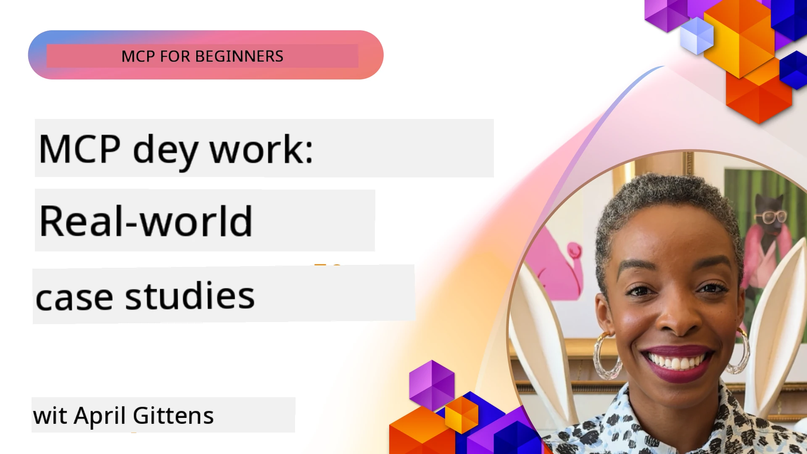

# MCP Wey Dey Work: Real-Life Case Studies

_(Click di picture wey dey up so make you watch di video for dis lesson)_

Model Context Protocol (MCP) don dey change how AI applications dey take interact wit data, tools, and services. Dis section dey present real-life case studies wey show practical uses of MCP for different enterprise situations.

## Wetin E Be

Dis section dey show clear examples of MCP implementations, and dey highlight how organizations dey use dis protocol to solve complex business wahala. If you check these case studies, you go sabi how MCP dey flexible, how e fit scale, and di practical benefits wey e get for real-world situations.

## Main Tin Wey You Go Learn

If you examine these case studies, you go:

- Understand how MCP fit take solve specific business problems
- Learn different patterns wey dem dey use to integrate systems and different architecture approaches
- Know di best practices for implementing MCP for enterprise environments
- Get insight into di challenges and di solutions wey people meet for real-life implementations
- Identify chances to apply similar patterns for your own projects

## Case Studies Wey Dem Feature

### 1. [Azure AI Travel Agents – Reference Implementation](./travelagentsample.md)

Dis case study dey examine Microsoft full reference solution wey dey show how to build multi-agent, AI-powered travel planning app using MCP, Azure OpenAI, and Azure AI Search. Di project dey showcase:

- Multi-agent coordination through MCP
- Enterprise data integration with Azure AI Search
- Secure, scalable architecture using Azure services
- Extensible tooling with reusable MCP components
- Conversational user experience powered by Azure OpenAI

Di architecture and implementation details dey give important insight for how to build complex, multi-agent systems weh MCP dey use as di coordination layer.

### 2. [Updating Azure DevOps Items from YouTube Data](./UpdateADOItemsFromYT.md)

Dis case study show practical use of MCP for automating workflow processes. E show how MCP tools fit:

- Extract data from online platforms (YouTube)
- Update work items in Azure DevOps systems
- Create repeatable automation workflows
- Integrate data across different systems

Dis example dey show how even small MCP implementations fit bring big efficiency gains by automating routine tasks and improving data consistency across systems.

### 3. [Real-Time Documentation Retrieval with MCP](./docs-mcp/README.md)

Dis case study go guide you on how to connect Python console client to MCP server to retrieve and log real-time, context-aware Microsoft documentation. You go learn how to:

- Connect to an MCP server using a Python client and di official MCP SDK
- Use streaming HTTP clients for efficient, real-time data retrieval
- Call documentation tools on the server and log responses straight to di console
- Integrate up-to-date Microsoft documentation into your workflow without comot for terminal

Di chapter get hands-on assignment, minimal working code sample, and links to more resources for deeper learning. See di full walkthrough and code for how MCP fit change documentation access and developer productivity for console-based environments.

### 4. [Interactive Study Plan Generator Web App with MCP](./docs-mcp/README.md)

Dis case study dey show how to build interactive web app using Chainlit and MCP to generate personalized study plans for any topic. Users fit give subject (like "AI-900 certification") and study duration (e.g., 8 weeks), and di app go give week-by-week breakdown of recommended content. Chainlit dey enable conversational chat interface, make di experience engaging and adaptive.

- Conversational web app powered by Chainlit
- User-driven prompts for topic and duration
- Week-by-week content recommendations using MCP
- Real-time, adaptive responses in a chat interface

Di project dey show how conversational AI and MCP fit join to create dynamic, user-driven educational tools for modern web.

### 5. [In-Editor Docs with MCP Server in VS Code](./docs-mcp/README.md)

Dis case study dey show how you fit bring Microsoft Learn Docs comot directly inside your VS Code environment using MCP server—no need to dey switch browser tabs again! You go see how to:

- Instantly search and read docs inside VS Code using di MCP panel or command palette
- Reference documentation and insert links directly into your README or course markdown files
- Use GitHub Copilot and MCP together for seamless, AI-powered documentation and code workflows
- Validate and enhance your documentation with real-time feedback and Microsoft-sourced accuracy
- Integrate MCP with GitHub workflows for continuous documentation validation

Di implementation include:

- Example `.vscode/mcp.json` configuration for easy setup
- Screenshot-based walkthroughs of di in-editor experience
- Tips for combining Copilot and MCP to get maximum productivity

Dis scenario good for course authors, documentation writers, and developers wey wan remain focused for their editor while dem dey work with docs, Copilot, and validation tools—all powered by MCP.

### 6. [APIM MCP Server Creation](./apimsample.md)

Dis case study give step-by-step guide on how to create MCP server using Azure API Management (APIM). E cover:

- Setting up an MCP server in Azure API Management
- Exposing API operations as MCP tools
- Configuring policies for rate limiting and security
- Testing the MCP server using Visual Studio Code and GitHub Copilot

Dis example show how to leverage Azure capabilities to create robust MCP server wey fit use for different applications, and e go enhance integration of AI systems with enterprise APIs.

### 7. [GitHub MCP Registry — Accelerating Agentic Integration](https://github.com/mcp)

Dis case study dey examine how GitHub MCP Registry, wey dem launch for September 2025, dey tackle big wahala for AI ecosystem: di scattered discovery and deployment of MCP servers.

#### Overview
Di **MCP Registry** solve di pain wey dey because MCP servers scatter for different repositories and registries, wey before dey make integration slow and full of errors. These servers dey enable AI agents to interact with external systems like APIs, databases, and documentation sources.

#### Problem Statement
Developers wey dey build agentic workflows face plenty challenges:
- **Poor discoverability** of MCP servers across different platforms
- **Redundant setup questions** scattered across forums and documentation
- **Security risks** from unverified and untrusted sources
- **Lack of standardization** in server quality and compatibility

#### Solution Architecture
GitHub MCP Registry centralize trusted MCP servers with key features:
- **One-click install** integration via VS Code for easier setup
- **Signal-over-noise sorting** by stars, activity, and community validation
- **Direct integration** with GitHub Copilot and other MCP-compatible tools
- **Open contribution model** wey allow both community and enterprise partners to contribute

#### Business Impact
Di registry don bring measurable improvements:
- **Faster onboarding** for developers using tools like di Microsoft Learn MCP Server, wey dey stream official documentation directly into agents
- **Improved productivity** via specialized servers like `github-mcp-server`, wey enable natural language GitHub automation (PR creation, CI reruns, code scanning)
- **Stronger ecosystem trust** through curated listings and transparent configuration standards

#### Strategic Value
For practitioners wey specialize for agent lifecycle management and reproducible workflows, di MCP Registry dey provide:
- **Modular agent deployment** capabilities with standardized components
- **Registry-backed evaluation pipelines** for consistent testing and validation
- **Cross-tool interoperability** wey make integration smooth across different AI platforms

Dis case study show say MCP Registry no be only directory—e be foundational platform for scalable, real-world model integration and agentic system deployment.

### 8. [Publishing to Social Networks from an Agent](./publora-social-publishing.md)

Dis case study waka through one **write-capable remote MCP server** — server wey tools fit do irreversible actions for user behalf — using social publishing as example. Agent go draft post, human go approve am, and server go schedule am across networks.

Di interesting part na di design constraints wey publishing dey force, and dem apply to any server wey dey write instead of just read:

- **Open discovery, authenticated execution** — `tools/list` fit answer without credentials so registries and clients fit introspect, while every `tools/call` need token and otherwise go return `401` with a `WWW-Authenticate` header
- **OAuth registration without an out-of-band step** — dynamic client registration today, with Client ID Metadata Documents as di direction wey di `2026-07-28` specification dey point to
- **Tool annotations** (`readOnlyHint`, `destructiveHint`, `idempotentHint`) wey clients go use to decide wetin to confirm — hints not enforcement, and na wetin connector directories dey expect for review
- **Un-inventable identifiers**, so if person hallucinate value e go fail loudly instead of make system act on plausible-looking one
- **Idempotency keys on di post-creating tools**, so agent runtime retry no go create duplicate publication
- **A no-op target described in di tool schema** wey dey exercise di full write path but no go publish anything, for reviewers and CI

Di chapter close with short checklist wey you fit use for server wey you dey build.

## Conclusion

These eight detailed case studies show di wide flexibility and practical uses of Model Context Protocol across different real-world situations. From complex multi-agent travel planning systems and enterprise API management to smoother documentation workflows and di important GitHub MCP Registry, these examples show how MCP dey give standardized, scalable way to connect AI systems with tools, data, and services to deliver real value.

Di case studies cover plenty dimensions of MCP implementation:
- **Enterprise Integration**: Azure API Management and Azure DevOps automation
- **Multi-Agent Orchestration**: Travel planning with coordinated AI agents
- **Developer Productivity**: VS Code integration and real-time documentation access
- **Ecosystem Development**: GitHub MCP Registry as foundational platform
- **Educational Applications**: Interactive study plan generators and conversational interfaces

If you study these implementations, you go gain important insight into:
- **Architectural patterns** for different scales and use cases
- **Implementation strategies** wey balance functionality with maintainability
- **Security and scalability** considerations for production deployments
- **Best practices** for MCP server development and client integration
- **Ecosystem thinking** for building interconnected AI-powered solutions

These examples together show say MCP no be only theory but na mature, production-ready protocol wey fit enable practical solutions to complex business challenges. Whether you dey build small automation tools or sophisticated multi-agent systems, di patterns and approaches wey dem show here go give solid foundation for your own MCP projects.

## Additional Resources

- [Azure AI Travel Agents GitHub Repository](https://github.com/Azure-Samples/azure-ai-travel-agents)
- [Azure DevOps MCP Tool](https://github.com/microsoft/azure-devops-mcp)
- [Playwright MCP Tool](https://github.com/microsoft/playwright-mcp)
- [Microsoft Docs MCP Server](https://github.com/MicrosoftDocs/mcp)
- [GitHub MCP Registry — Accelerating Agentic Integration](https://github.com/mcp)
- [MCP Community Examples](https://github.com/microsoft/mcp)

## Wetin Next

- Previous: [Module 8: Best Practices](../08-BestPractices/README.md)
- Next: [Module 10: Streamlining AI Workflows: Building an MCP Server with Microsoft Foundry Toolkit](../10-StreamliningAIWorkflowsBuildingAnMCPServerWithAIToolkit/README.md)

---

<!-- CO-OP TRANSLATOR DISCLAIMER START -->
**Disclaimer**:
Dis document don translate wit AI translation service [Co-op Translator](https://github.com/Azure/co-op-translator). Even tho we dey try make am correct, abeg make you know say automated translation fit get errors or mistakes. Di original document for dia own language na im be di correct source. For important info, make person wey sabi human translation do am. We no go responsible for any misunderstanding or wrong understanding wey fit happen because of dis translation.
<!-- CO-OP TRANSLATOR DISCLAIMER END -->