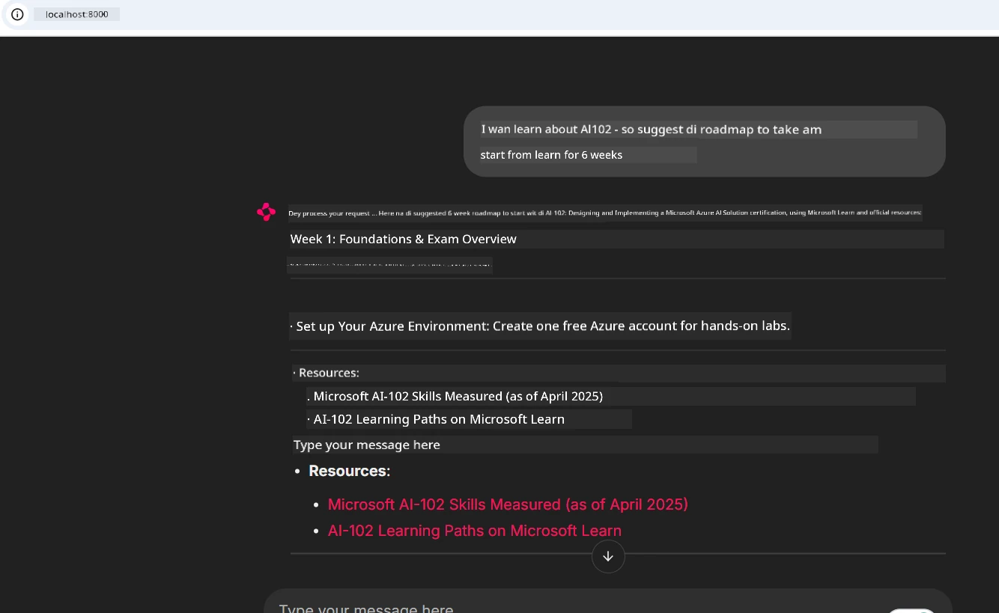
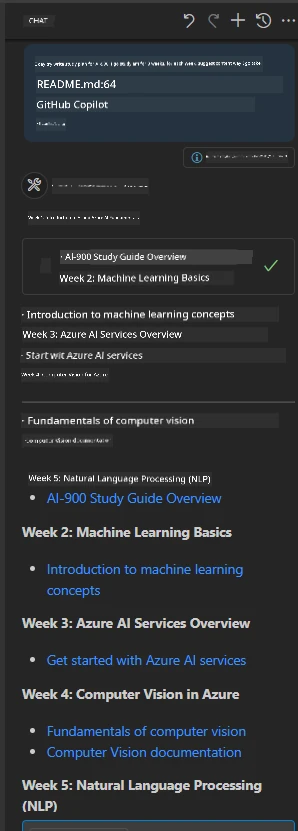

# Case Study: How you fit connect to the Microsoft Learn Docs MCP Server from a client

You don don ever dey juggle between documentation sites, Stack Overflow, and gbege search engine tabs, while you dey try solve one problem for your code? Maybe you dey use second moni just for docs, or you dey always alt-tab between your IDE and browser. E no go beta if you fit bring the documentation inside your workflow—integrate am for your apps, your IDE, or even your custom tools? For this case study, we go show how to do exactly that by connecting directly to the Microsoft Learn Docs MCP server from your own client application.

## Overview

Modern development no just be to write code—na to find the correct information for the correct time. Documentation dey everywhere, but e rare to dey where you need am most: inside your tools and workflows. If you integrate documentation retrieval straight into your applications, you fit save time, reduce context switching, and boost productivity. For this section, we go show how to connect client to the Microsoft Learn Docs MCP server, so you fit access real-time, context-aware documentation without comot your app.

We go waka you through the process to establish connection, send request, and handle streaming responses well. This approach no only dey streamline your workflow but e open door to build smarter, more helpful developer tools.

## Learning Objectives

Why we dey do this? Because the best developer experiences na the ones wey dey remove friction. Imagine world where your code editor, chatbot, or web app fit answer your documentation questions quick, using the latest content from Microsoft Learn. By the end of this chapter, you go sabi how to:

- Understand the basics of MCP server-client communication for documentation
- Implement a console or web application to connect to the Microsoft Learn Docs MCP server
- Use streaming HTTP clients for real-time documentation retrieval
- Log and interpret documentation responses in your application

You go see how these skills fit help you build tools wey no just reactive, but truly interactive and context-aware.

## Scenario 1 - Real-Time Documentation Retrieval with MCP

For this scenario, we go show how to connect client to the Microsoft Learn Docs MCP server, so you fit access real-time, context-aware documentation without comot your app.

Make we put am for practice. Your task na to write app wey go connect to the Microsoft Learn Docs MCP server, invoke the `microsoft_docs_search` tool, and log the streaming response to the console.

### Why this approach?
Because na the foundation for building more advanced integrations—whether you want power chatbot, IDE extension, or web dashboard.

You go find the code and instructions for this scenario for the [`solution`](./solution/README.md) folder inside this case study. The steps go guide you through how to set up the connection:
- Use the official MCP SDK and streamable HTTP client for connection
- Call the `microsoft_docs_search` tool with a query parameter to retrieve documentation
- Implement proper logging and error handling
- Create an interactive console interface to allow users to enter multiple search queries

This scenario show how to:
- Connect to the Docs MCP server
- Send a query
- Parse and print the results

This na how e fit look when you run the solution:

```
Prompt> What is Azure Key Vault?
Answer> Azure Key Vault is a cloud service for securely storing and accessing secrets. ...
```

Below na minimal sample solution. The full code and details dey for the solution folder.

<details>
<summary>Python</summary>

```python
import asyncio
from mcp.client.streamable_http import streamablehttp_client
from mcp import ClientSession

async def main():
    async with streamablehttp_client("https://learn.microsoft.com/api/mcp") as (read_stream, write_stream, _):
        async with ClientSession(read_stream, write_stream) as session:
            await session.initialize()
            result = await session.call_tool("microsoft_docs_search", {"query": "Azure Functions best practices"})
            print(result.content)

if __name__ == "__main__":
    asyncio.run(main())
```

- For the complete implementation and logging, see [`scenario1.py`](../../../../09-CaseStudy/docs-mcp/solution/python/scenario1.py).
- For installation and usage instructions, see the [`README.md`](./solution/python/README.md) file in the same folder.
</details>


## Scenario 2 - Interactive Study Plan Generator Web App with MCP

For this scenario, you go learn how to integrate Docs MCP into web development project. The goal na to enable users to search Microsoft Learn documentation directly from web interface, make documentation dey instantly accessible inside your app or site.

You go see how to:
- Set up a web app
- Connect to the Docs MCP server
- Handle user input and display results

This na how e fit look when you run the solution:

```
User> I want to learn about AI102 - so suggest the roadmap to get it started from learn for 6 weeks

Assistant> Here’s a detailed 6-week roadmap to start your preparation for the AI-102: Designing and Implementing a Microsoft Azure AI Solution certification, using official Microsoft resources and focusing on exam skills areas:

---
## Week 1: Introduction & Fundamentals
- **Understand the Exam**: Review the [AI-102 exam skills outline](https://learn.microsoft.com/en-us/credentials/certifications/exams/ai-102/).
- **Set up Azure**: Sign up for a free Azure account if you don't have one.
- **Learning Path**: [Introduction to Azure AI services](https://learn.microsoft.com/en-us/training/modules/intro-to-azure-ai/)
- **Focus**: Get familiar with Azure portal, AI capabilities, and necessary tools.

....more weeks of the roadmap...

Let me know if you want module-specific recommendations or need more customized weekly tasks!
```

Below na minimal sample solution. The full code and details dey for the solution folder.



<details>
<summary>Python (Chainlit)</summary>

Chainlit na framework for building conversational AI web apps. E dey make am easy to create interactive chatbots and assistants wey fit call MCP tools and display results for real time. E good for rapid prototyping and user-friendly interfaces.

```python
import chainlit as cl
import requests

MCP_URL = "https://learn.microsoft.com/api/mcp"

@cl.on_message
def handle_message(message):
    query = {"question": message}
    response = requests.post(MCP_URL, json=query)
    if response.ok:
        result = response.json()
        cl.Message(content=result.get("answer", "No answer found.")).send()
    else:
        cl.Message(content="Error: " + response.text).send()
```

- For the complete implementation, see [`scenario2.py`](../../../../09-CaseStudy/docs-mcp/solution/python/scenario2.py).
- For setup and running instructions, see the [`README.md`](./solution/python/README.md).
</details>


## Scenario 3: In-Editor Docs with MCP Server in VS Code

If you want make Microsoft Learn Docs dey direct inside your VS Code (no need to dey switch browser tabs), you fit use the MCP server for your editor. This one allow you to:
- Search and read docs in VS Code without leaving your coding environment.
- Reference documentation and insert links directly into your README or course files.
- Leverage GitHub Copilot and MCP together for one smooth, AI-powered documentation workflow.

**You'll see how to:**
- Add a valid `.vscode/mcp.json` file to your workspace root (see example below).
- Open the MCP panel or use the command palette in VS Code to search and insert docs.
- Reference documentation directly in your markdown files as you dey work.
- Combine this workflow with GitHub Copilot for even greater productivity.

Here na example of how to set up the MCP server in VS Code:

```json
{
  "servers": {
    "LearnDocsMCP": {
      "url": "https://learn.microsoft.com/api/mcp"
    }
  }
}
```

</details>

> For detailed walkthrough with screenshots and step-by-step guide, see [`README.md`](./solution/scenario3/README.md).



This approach good for anybody wey dey build technical courses, dey write documentation, or dey develop code wey need frequent reference.

## Key Takeaways

Integrating documentation direct into your tools no be only convenience—na game changer for productivity. If you connect to the Microsoft Learn Docs MCP server from your client, you fit:

- Eliminate context switching between your code and documentation
- Retrieve up-to-date, context-aware docs in real time
- Build smarter, more interactive developer tools

These skills go help you create solutions wey no only efficient, but sef sweet to use.

## Additional Resources

To deepen your understanding, make you explore these official resources:

- [Microsoft Learn Docs MCP Server (GitHub)](https://github.com/MicrosoftDocs/mcp)
- [Get started with Azure MCP Server (mcp-python)](https://learn.microsoft.com/en-us/azure/developer/azure-mcp-server/get-started#create-the-python-app)
- [What is the Azure MCP Server?](https://learn.microsoft.com/en-us/azure/developer/azure-mcp-server/)
- [Model Context Protocol (MCP) Introduction](https://modelcontextprotocol.io/introduction)
- [Add plugins from a MCP Server (Python)](https://learn.microsoft.com/en-us/semantic-kernel/concepts/plugins/adding-mcp-plugins)

## What's Next

- Back to: [Case Studies Overview](../README.md)
- Continue to: [Module 10: Streamlining AI Workflows with Microsoft Foundry Toolkit](../../10-StreamliningAIWorkflowsBuildingAnMCPServerWithAIToolkit/README.md)

---

<!-- CO-OP TRANSLATOR DISCLAIMER START -->
**Disclaimer**:
Dis document don translate wit AI translation service [Co-op Translator](https://github.com/Azure/co-op-translator). Even tho we dey try make am correct, abeg make you know say automated translation fit get errors or mistakes. Di original document for dia own language na im be di correct source. For important info, make person wey sabi human translation do am. We no go responsible for any misunderstanding or wrong understanding wey fit happen because of dis translation.
<!-- CO-OP TRANSLATOR DISCLAIMER END -->