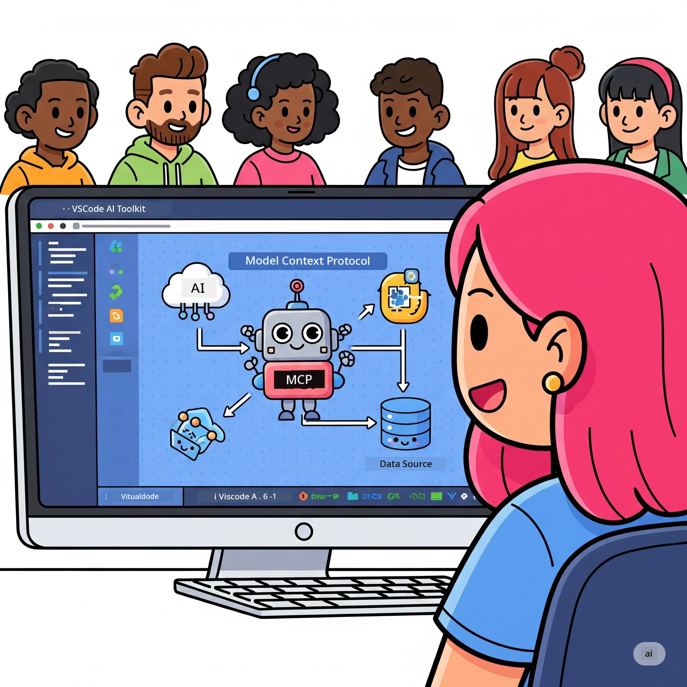
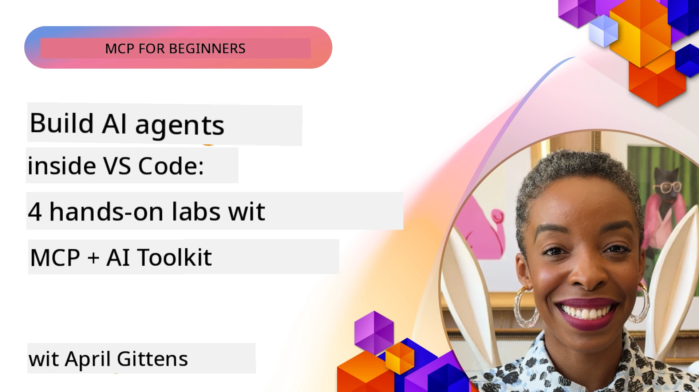

# Make AI Workflows Simple: Build MCP Server wit Microsoft Foundry Toolkit

## 🎯  Wetin Dis Paper Mean

_(Click the image above to view video of this lesson)_

Welcome to the **Model Context Protocol (MCP) Workshop**! Dis na full hands-on workshop wey join two latest technologies to change how people dey build AI apps:

> **Compatibility note:** the workshop code was built and tested with MCP
> `2025-11-25`, as shown by the badge above. Use the
> [current `2026-07-28` specification](https://modelcontextprotocol.io/specification/2026-07-28/)
> for new protocol implementations and review SDK release notes before
> migrating the labs.

- **🔗 Model Context Protocol (MCP)**: Na open standard wey make AI tools and external data dem connect without wahala
- **🛠️ Microsoft Foundry Toolkit Extension for VS Code**: Microsoft powerful extension wey dey for AI development

### 🎓 Wetin You Go Learn

By the end of dis workshop, you go sabi how to build intelligent apps wey link AI models with real-world tools and services. From automatic testing to custom API integrations, you go get practical skills to solve complex business wahala.

## 🏗️ Technology Stack

### 🔌 Model Context Protocol (MCP)

MCP na **"USB-C for AI"** - one universal standard wey connect AI models to external tools and data sources.

**✨ Key Features:**

- 🔄 **Standardized Integration**: Universal interface for AI-tool connections
- 🏛️ **Flexible Architecture**: Local & remote servers via stdio/SSE transport
- 🧰 **Rich Ecosystem**: Tools, prompts, and resources inside one protocol
- 🔒 **Enterprise-Ready**: Built-in security and reliability

**🎯 Why MCP Matter:**
E be like how USB-C take stop cable gbege — MCP dey remove wahala wey dey for AI integrations. One protocol, plenty possibilities.

### 🤖 Microsoft Foundry Toolkit Extension for VS Code

Microsoft main extension for AI development wey turn VS Code to strong AI tool.

**🚀 Core Capabilities:**

- 📦 **Model Catalog**: Access models from Azure AI, GitHub, Hugging Face, Ollama
- ⚡ **Local Inference**: ONNX-optimized CPU/GPU/NPU execution
- 🏗️ **Agent Builder**: Visual AI agent development with MCP integration
- 🎭 **Multi-Modal**: Text, vision, and structured output support

**💡 Development Benefits:**

- Zero-config model deployment
- Visual prompt engineering
- Real-time testing playground
- Seamless MCP server integration

## 📚 Learning Journey

### [🚀 Module 1: Microsoft Foundry Toolkit Fundamentals](./lab1/README.md)

**Duration**: 15 minutes

- 🛠️ Install and configure Microsoft Foundry Toolkit for VS Code
- 🗂️ Explore the Model Catalog (100+ models from GitHub, ONNX, OpenAI, Anthropic, Google)
- 🎮 Master the Interactive Playground for real-time model testing
- 🤖 Build your first AI agent with Agent Builder
- 📊 Evaluate model performance with built-in metrics (F1, relevance, similarity, coherence)
- ⚡ Learn batch processing and multi-modal support capabilities

**🎯 Learning Outcome**: Create a functional AI agent and sabi well how Microsoft Foundry Toolkit dey work

### [🌐 Module 2: MCP with Microsoft Foundry Toolkit Fundamentals](./lab2/README.md)

**Duration**: 20 minutes

- 🧠 Master Model Context Protocol (MCP) architecture and concepts
- 🌐 Explore Microsoft's MCP server ecosystem
- 🤖 Build a browser automation agent using Playwright MCP server
- 🔧 Integrate MCP servers with Microsoft Foundry Toolkit Agent Builder
- 📊 Configure and test MCP tools inside your agents
- 🚀 Export and deploy MCP-powered agents for production use

**🎯 Learning Outcome**: Deploy AI agent wey get external tools through MCP

### [🔧 Module 3: Advanced MCP Development with Microsoft Foundry Toolkit](./lab3/README.md)

**Duration**: 20 minutes

- 💻 Create custom MCP servers using Microsoft Foundry Toolkit
- 🐍 Configure and use the latest MCP Python SDK (v1.9.3)
- 🔍 Set up and use MCP Inspector for debugging
- 🛠️ Build a Weather MCP Server with professional debugging workflows
- 🧪 Debug MCP servers in both Agent Builder and Inspector environments

**🎯 Learning Outcome**: Develop and debug custom MCP servers with modern tooling

### [🐙 Module 4: Practical MCP Development - Custom GitHub Clone Server](./lab4/README.md)

**Duration**: 30 minutes

- 🏗️ Build real-world GitHub Clone MCP Server for development workflows
- 🔄 Implement smart repository cloning with validation and error handling
- 📁 Create intelligent directory management and VS Code integration
- 🤖 Use GitHub Copilot Agent Mode with custom MCP tools
- 🛡️ Apply production-ready reliability and cross-platform compatibility

**🎯 Learning Outcome**: Deploy production-ready MCP server wey go make real development workflows easier

## 💡 Real-World Applications & Impact

### 🏢 Enterprise Use Cases

#### 🔄 DevOps Automation

Transform your development workflow with intelligent automation:

- **Smart Repository Management**: AI-driven code review and merge decisions
- **Intelligent CI/CD**: Automated pipeline optimization based on code changes
- **Issue Triage**: Automatic bug classification and assignment

#### 🧪 Quality Assurance Revolution

Make testing pass beta level with AI automation:

- **Intelligent Test Generation**: Automatically create comprehensive test suites
- **Visual Regression Testing**: AI-powered UI change detection
- **Performance Monitoring**: Find and solve issues before dem turn big problem

#### 📊 Data Pipeline Intelligence

Build smarter data processing workflows:

- **Adaptive ETL Processes**: Self-optimizing data transformations
- **Anomaly Detection**: Real-time data quality monitoring
- **Intelligent Routing**: Smart data flow management

#### 🎧 Customer Experience Enhancement

Create better customer interactions:

- **Context-Aware Support**: AI agents wey fit use customer history
- **Proactive Issue Resolution**: Predict problems and fix am before e scatter
- **Multi-Channel Integration**: One consistent AI experience across platforms

## 🛠️ Prerequisites & Setup

### 💻 System Requirements

| Component | Requirement | Notes |
|-----------|-------------|-------|
| **Operating System** | Windows 10+, macOS 10.15+, Linux | Any modern OS |
| **Visual Studio Code** | Latest stable version | Required for Microsoft Foundry Toolkit |
| **Node.js** | v18.0+ and npm | For MCP server development |
| **Python** | 3.10+ | Optional for Python MCP servers |
| **Memory** | 8GB RAM minimum | 16GB recommended for local models |

### 🔧 Development Environment

#### Recommended VS Code Extensions

- **Microsoft Foundry Toolkit** (ms-windows-ai-studio.windows-ai-studio)
- **Python** (ms-python.python)
- **Python Debugger** (ms-python.debugpy)
- **GitHub Copilot** (GitHub.copilot) - Optional but helpful

#### Optional Tools

- **uv**: Modern Python package manager
- **MCP Inspector**: Visual debugging tool for MCP servers
- **Playwright**: For web automation examples

## 🎖️ Learning Outcomes & Certification Path

### 🏆 Skill Mastery Checklist

By completing this workshop, you go achieve mastery for:

#### 🎯 Core Competencies

- [ ] **MCP Protocol Mastery**: Deep understanding of architecture and implementation patterns
- [ ] **Microsoft Foundry Toolkit Proficiency**: Expert-level usage of Microsoft Foundry Toolkit for rapid development
- [ ] **Custom Server Development**: Build, deploy, and maintain production MCP servers
- [ ] **Tool Integration Excellence**: Seamlessly connect AI with existing development workflows
- [ ] **Problem-Solving Application**: Use the skills you learn to solve real business problems

#### 🔧 Technical Skills

- [ ] Set up and configure Microsoft Foundry Toolkit in VS Code
- [ ] Design and implement custom MCP servers
- [ ] Integrate Microsoft Foundry models with MCP architecture
- [ ] Build automated testing workflows with Playwright
- [ ] Deploy AI agents for production use
- [ ] Debug and optimize MCP server performance

#### 🚀 Advanced Capabilities

- [ ] Architect enterprise-scale AI integrations
- [ ] Implement security best practices for AI applications
- [ ] Design scalable MCP server architectures
- [ ] Create custom tool chains for specific domains
- [ ] Mentor others for AI-native development

## 📖 Additional Resources

- [MCP Specification (2026-07-28)](https://modelcontextprotocol.io/specification/2026-07-28/)
- [Microsoft Foundry Toolkit GitHub Repository](https://github.com/microsoft/vscode-ai-toolkit)
- [Sample MCP Servers Collection](https://github.com/modelcontextprotocol/servers)
- [Best Practices Guide](https://modelcontextprotocol.io/docs/best-practices)
- [OWASP MCP Top 10](https://microsoft.github.io/mcp-azure-security-guide/mcp/) - Security best practices

---

**🚀 You ready make you change how you dey build AI development workflow?**

Make we build the future of intelligent applications together with MCP and Microsoft Foundry Toolkit!

## Wetin Next Be

Continue to: [Module 11: MCP Server Hands-On Labs](../11-MCPServerHandsOnLabs/README.md)

---

<!-- CO-OP TRANSLATOR DISCLAIMER START -->
**Disclaimer**:
Dis document don translate wit AI translation service [Co-op Translator](https://github.com/Azure/co-op-translator). Even tho we dey try make am correct, abeg make you know say automated translation fit get errors or mistakes. Di original document for dia own language na im be di correct source. For important info, make person wey sabi human translation do am. We no go responsible for any misunderstanding or wrong understanding wey fit happen because of dis translation.
<!-- CO-OP TRANSLATOR DISCLAIMER END -->