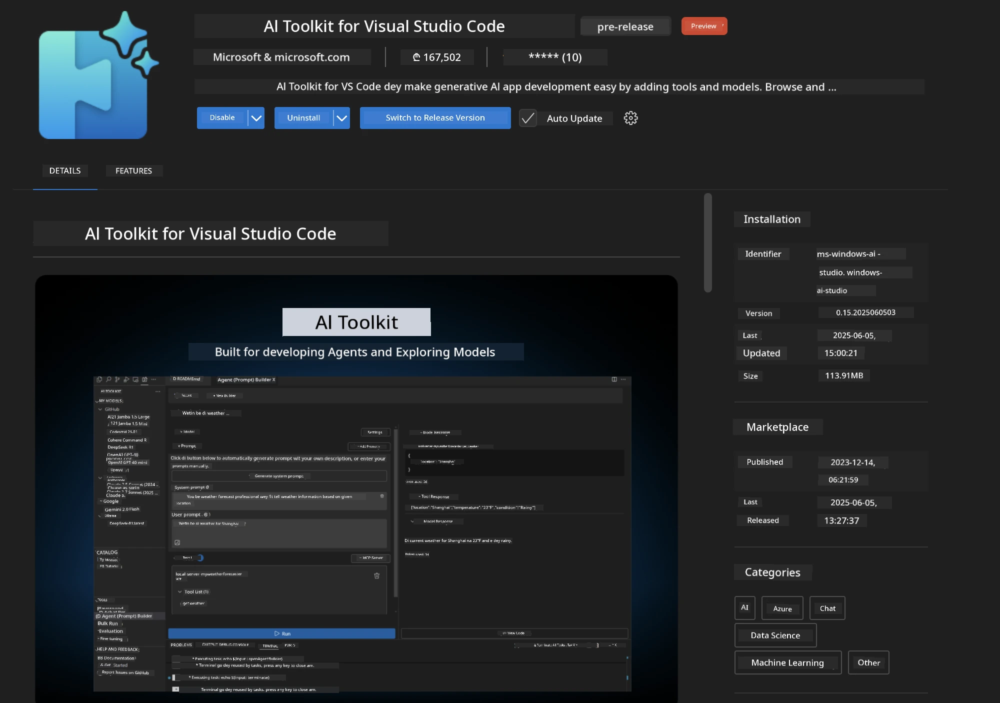
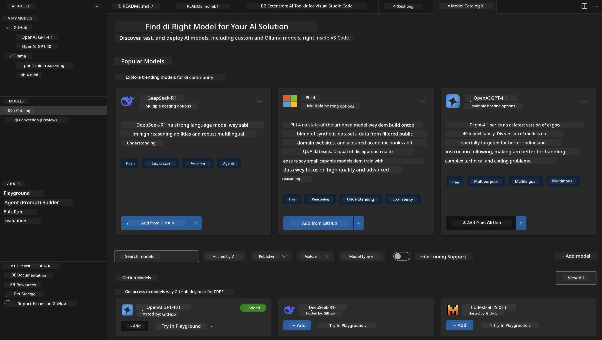
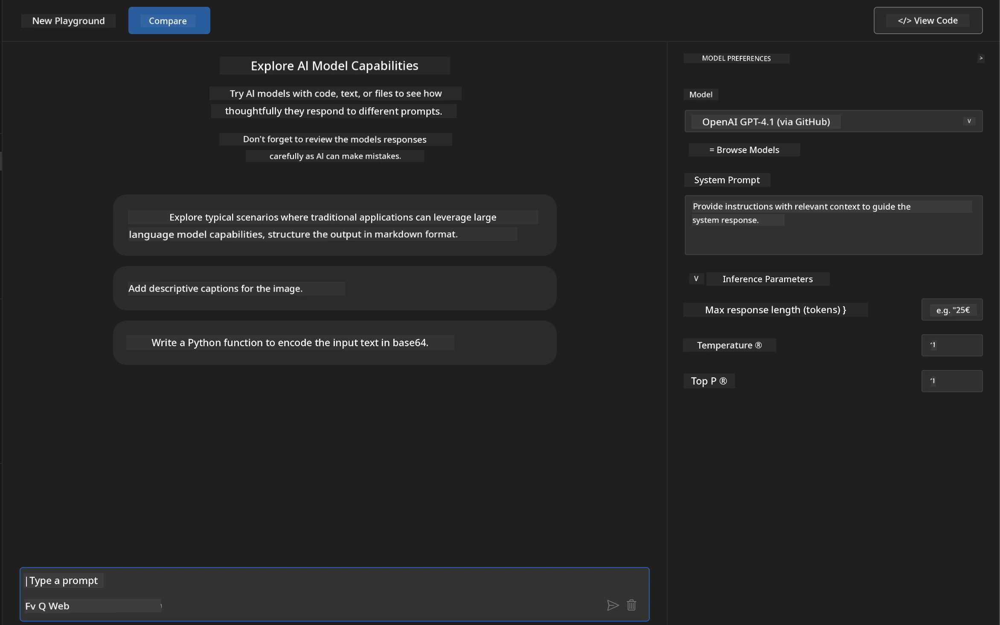
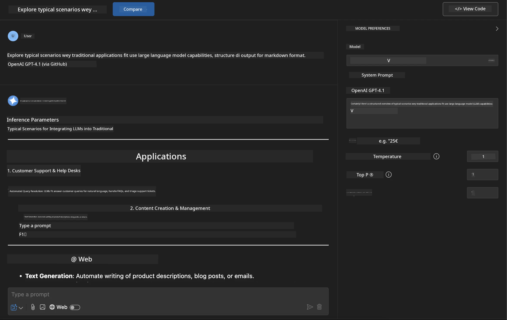
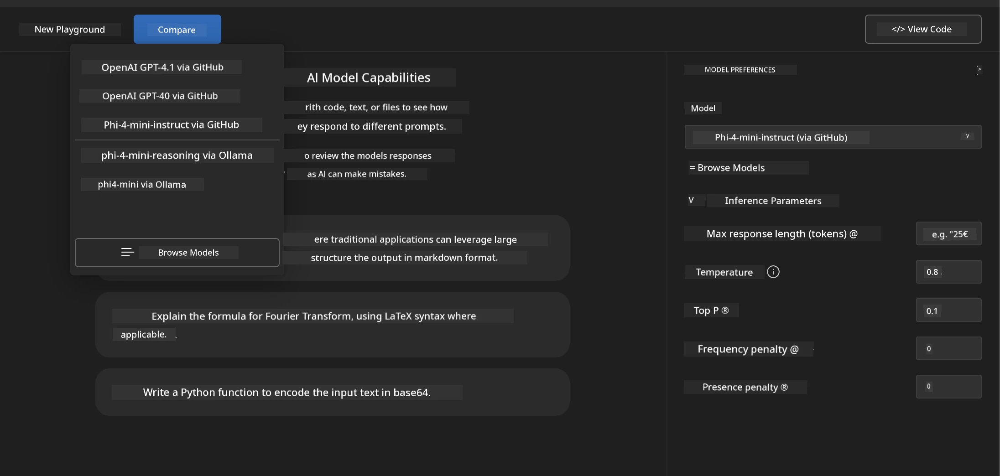
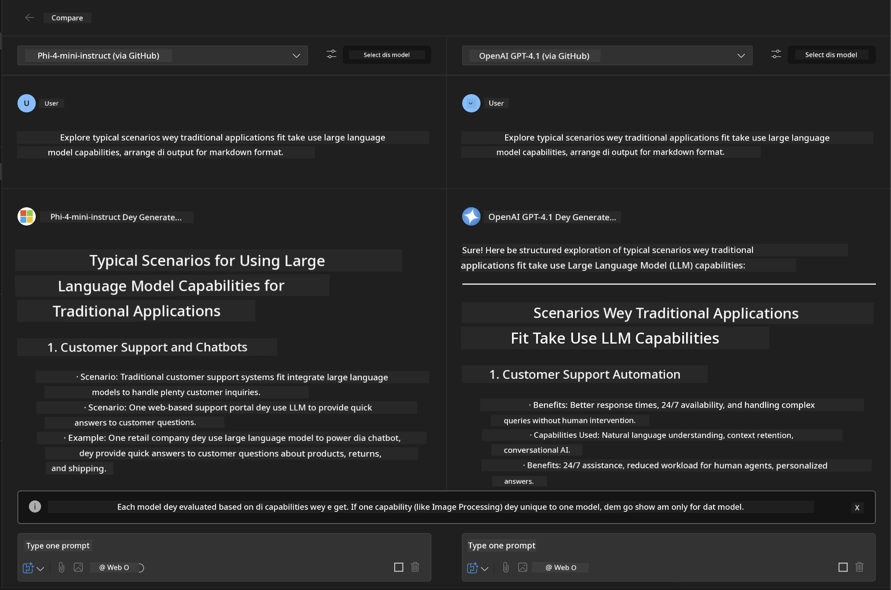
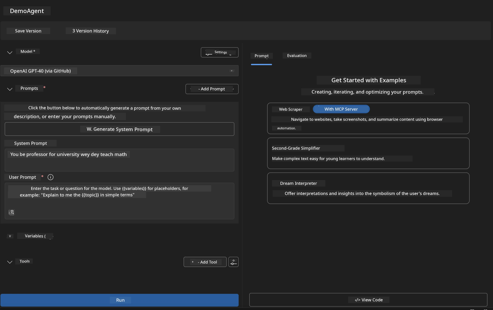
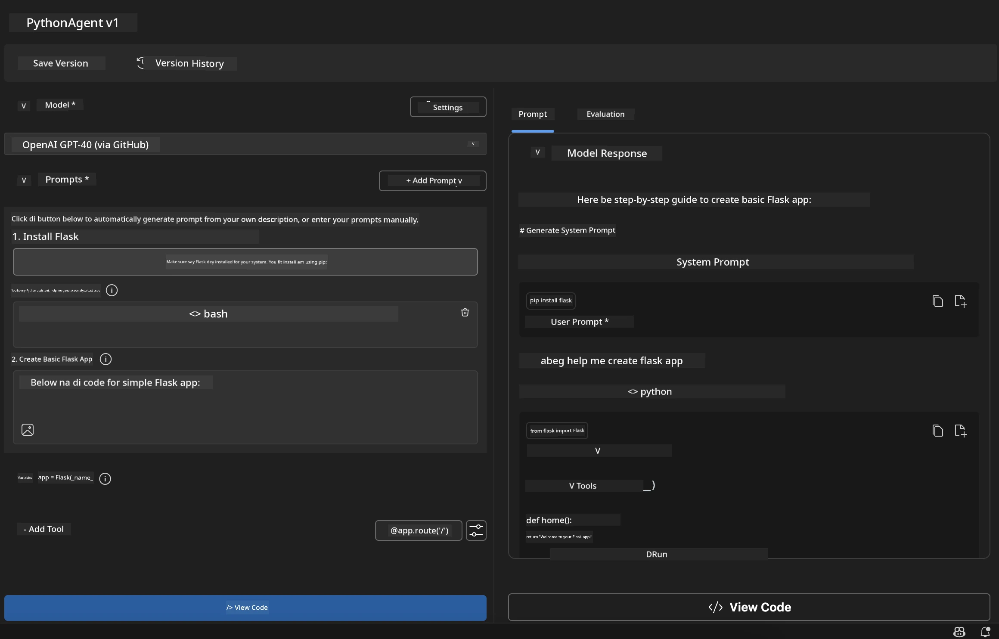

# 🚀 Module 1: Microsoft Foundry Toolkit Basics

[]()
[]()
[]()

## 📋 Wetin You Go Learn

By di end of dis module, you go fit:
- ✅ Install an set up Microsoft Foundry Toolkit Extension for VS Code
- ✅ Find waka inside di Model Catalog an sabi different model sources
- ✅ Use di Playground to test models an try different tin dem
- ✅ Create custom AI agents wit Agent Builder
- ✅ Compare how models dey perform from different providers
- ✅ Use beta-beta practices for prompt engineering

## 🧠 Intro to Microsoft Foundry Toolkit

Di **Microsoft Foundry Toolkit Extension for VS Code** na Microsoft extension wey turn VS Code to one full AI development environment. E bridge di gap between AI research an wetin developers fit use for real life, make generative AI easy for developers of all levels.

### 🌟 Main Tin Dem E Fit Do

| Feature | Description | Use Case |
|---------|-------------|----------|
| **🗂️ Model Catalog** | Access 100+ models from GitHub, ONNX, OpenAI, Anthropic, Google | Model discovery and selection |
| **🔌 BYOM Support** | Integrate your own models (local/remote) | Custom model deployment |
| **🎮 Interactive Playground** | Real-time model testing with chat interface | Rapid prototyping and testing |
| **📎 Multi-Modal Support** | Handle text, images, and attachments | Complex AI applications |
| **⚡ Batch Processing** | Run multiple prompts simultaneously | Efficient testing workflows |
| **📊 Model Evaluation** | Built-in metrics (F1, relevance, similarity, coherence) | Performance assessment |

### 🎯 Why Microsoft Foundry Toolkit Matter

- **🚀 Faster Development**: From idea reach prototype fast
- **🔄 One Workflow**: One interface for many AI providers
- **🧪 Easy Experiment**: Compare models without wahala setup
- **📈 Production Ready**: Make e easy to move from prototype to deployment

## 🛠️ Wetin You Need & How To Set Up

### 📦 Install Microsoft Foundry Toolkit Extension

**Step 1: Open Extensions Marketplace**
1. Open Visual Studio Code
2. Go to di Extensions view (`Ctrl+Shift+X` or `Cmd+Shift+X`)
3. Search for "Microsoft Foundry Toolkit"

**Step 2: Choose Your Version**
- **🟢 Release**: Use dis one for production
- **🔶 Pre-release**: Early access to new features

**Step 3: Install and Activate**



### ✅ Verification Checklist
- [ ] Microsoft Foundry Toolkit icon dey for VS Code sidebar
- [ ] Extension don enable an dey active
- [ ] No installation errors for output panel

## 🧪 Hands-on Exercise 1: Explore Microsoft Foundry Models

**🎯 Objective**: Make you sabi Model Catalog an test your first AI model

### 📊 Step 1: Enter di Model Catalog

Di Model Catalog na your gate to di AI ecosystem. E gather models from different providers, make am easy to find an compare options.

**🔍 How to Navigate:**

Click on **MODELS - Catalog** for Microsoft Foundry Toolkit sidebar



**💡 Pro Tip**: Look for models wey get di capabilities wey match your use case (fòr example, code generation, creative writing, analysis).

> [!NOTE]
> GitHub Models bin retire for July 30, 2026. Use Microsoft Foundry model
> deployment an authenticate with Microsoft Entra ID or an Azure API key.

### 🚀 Step 2: Add an Configure Your First Model

**Model Selection Strategy:**
- **GPT-5.1**: Recommended general-purpose model for tool use and reasoning
- **Phi-4-mini**: Small, fast responses for simple tasks

**🔧 Configuration Process:**
1. Select **OpenAI GPT-5.1** from di catalog
2. Click **Add to My Models** - dis go register di model for use
3. Choose **Try in Playground** to open di testing environment
4. Wait make model initialize (first-time setup fit take small time)



**⚙️ Wetin Model Parameters Mean:**
- **Temperature**: Controls creativity (0 = deterministic, 1 = creative)
- **Max Tokens**: Maximum response length
- **Top-p**: Nucleus sampling for response diversity

### 🎯 Step 3: Master di Playground Interface

Di Playground na your AI lab to experiment. Na so you take maximize am:

**🎨 Prompt Engineering Best Practices:**
1. **Be Specific**: Clear, detailed instructions dey give better results
2. **Provide Context**: Put relevant background information
3. **Use Examples**: Show di model wetin you want wit examples
4. **Iterate**: Improve prompts based on initial results

**🧪 Testing Scenarios:**
```markdown
# Example 1: Code Generation
"Write a Python function that calculates the factorial of a number using recursion. Include error handling and docstrings."

# Example 2: Creative Writing
"Write a professional email to a client explaining a project delay, maintaining a positive tone while being transparent about challenges."

# Example 3: Data Analysis
"Analyze this sales data and provide insights: [paste your data]. Focus on trends, anomalies, and actionable recommendations."
```



### 🏆 Challenge Exercise: Compare Model Performance

**🎯 Goal**: Compare different models using same prompts to see their strengths

**📋 Instructions:**
1. Add **Phi-4-mini** to your workspace
2. Use the same prompt for both GPT-5.1 and Phi-4-mini



3. Compare response quality, speed, and accuracy
4. Write down wetin you find for results section



**💡 Key Insights to Find:**
- When to use LLM vs SLM
- Cost vs. performance trade-offs
- Special capabilities wey different models get

## 🤖 Hands-on Exercise 2: Build Custom Agents wit Agent Builder

**🎯 Objective**: Create special AI agents wey fit do particular tasks an workflows

### 🏗️ Step 1: Wetin Agent Builder Be

Agent Builder na where Microsoft Foundry Toolkit show beta. E allow you build purpose-built AI assistants wey join power of large language models with custom instructions, specific parameters, an specialized knowledge.

**🧠 Agent Architecture Parts:**
- **Core Model**: Di foundation LLM (GPT-5.1, Phi, etc.)
- **System Prompt**: Define agent personality an behaviour
- **Parameters**: Fine-tuned settings for better performance
- **Tools Integration**: Connect to external APIs an MCP services
- **Memory**: Conversation context an session persistence



### ⚙️ Step 2: Deep Dive into Agent Configuration

**🎨 How to Create Better System Prompts:**
```markdown
# Template Structure:
## Role Definition
You are a [specific role] with expertise in [domain].

## Capabilities
- List specific abilities
- Define scope of knowledge
- Clarify limitations

## Behavior Guidelines
- Response style (formal, casual, technical)
- Output format preferences
- Error handling approach

## Examples
Provide 2-3 examples of ideal interactions
```

*Of course, you fit still use Generate System Prompt make AI help you generate an optimize prompts*

**🔧 Parameter Optimization:**
| Parameter | Recommended Range | Use Case |
|-----------|------------------|----------|
| **Temperature** | 0.1-0.3 | Technical/factual responses |
| **Temperature** | 0.7-0.9 | Creative/brainstorming tasks |
| **Max Tokens** | 500-1000 | Concise responses |
| **Max Tokens** | 2000-4000 | Detailed explanations |

### 🐍 Step 3: Practical Exercise - Python Programming Agent

**🎯 Mission**: Create one Python coding assistant wey get special skills

**📋 Configuration Steps:**

1. **Model Selection**: Pick **Claude 3.5 Sonnet** (good well for code)

2. **System Prompt Design**:
```markdown
# Python Programming Expert Agent

## Role
You are a senior Python developer with 10+ years of experience. You excel at writing clean, efficient, and well-documented Python code.

## Capabilities
- Write production-ready Python code
- Debug complex issues
- Explain code concepts clearly
- Suggest best practices and optimizations
- Provide complete working examples

## Response Format
- Always include docstrings
- Add inline comments for complex logic
- Suggest testing approaches
- Mention relevant libraries when applicable

## Code Quality Standards
- Follow PEP 8 style guidelines
- Use type hints where appropriate
- Handle exceptions gracefully
- Write readable, maintainable code
```

3. **Parameter Configuration**:
   - Temperature: 0.2 (for consistent, reliable code)
   - Max Tokens: 2000 (detailed explanations)
   - Top-p: 0.9 (balanced creativity)



### 🧪 Step 4: Test Your Python Agent

**Test Scenarios:**
1. **Basic Function**: "Create a function to find prime numbers"
2. **Complex Algorithm**: "Implement a binary search tree with insert, delete, and search methods"
3. **Real-world Problem**: "Build a web scraper that handles rate limiting and retries"
4. **Debugging**: "Fix this code [paste buggy code]"

**🏆 Success Criteria:**
- ✅ Code run without errors
- ✅ Get proper documentation
- ✅ Follow Python best practices
- ✅ Give clear explanations
- ✅ Suggest improvements

## 🎓 Module 1 Wrap-Up & Next Steps

### 📊 Small Knowledge Check

Test if you sabi:
- [ ] You fit explain difference between models for catalog?
- [ ] You don successfully create an test custom agent?
- [ ] You sabi how to optimize parameters for different use cases?
- [ ] You fit design effective system prompts?

### 📚 Extra Resources

- **Microsoft Foundry Toolkit Documentation**: [Official Microsoft Docs](https://github.com/microsoft/vscode-ai-toolkit)
- **Prompt Engineering Guide**: [Best Practices](https://platform.openai.com/docs/guides/prompt-engineering)
- **Models in Microsoft Foundry Toolkit**: [Models in Develpment](https://github.com/microsoft/vscode-ai-toolkit/blob/main/doc/models.md)

**🎉 Congrats!** You don master di fundamentals of Microsoft Foundry Toolkit an ready to build more advanced AI apps!

### 🔜 Go to Next Module

Ready for more advanced things? Go to **[Module 2: MCP with Microsoft Foundry Toolkit Fundamentals](../lab2/README.md)** where you go learn how to:
- Connect your agents to external tools using Model Context Protocol (MCP)
- Build browser automation agents with Playwright
- Integrate MCP servers with your Microsoft Foundry Toolkit agents
- Supercharge your agents wit external data an capabilities

---

<!-- CO-OP TRANSLATOR DISCLAIMER START -->
**Disclaimer**:
Dis document don translate wit AI translation service [Co-op Translator](https://github.com/Azure/co-op-translator). Even tho we dey try make am correct, abeg make you know say automated translation fit get errors or mistakes. Di original document for dia own language na im be di correct source. For important info, make person wey sabi human translation do am. We no go responsible for any misunderstanding or wrong understanding wey fit happen because of dis translation.
<!-- CO-OP TRANSLATOR DISCLAIMER END -->