# 🌐 Module 2: MCP with Microsoft Foundry Toolkit Fundamentals


## 📋 Learning Objectives

By the end of this module, you will be able to:

- ✅ Sabi Model Context Protocol (MCP) architecture an wetin e dey give
- ✅ Explore Microsoft's MCP server ecosystem
- ✅ Connect MCP servers wit Microsoft Foundry Toolkit Agent Builder
- ✅ Build a working browser automation agent using Playwright MCP
- ✅ Configure an test MCP tools inside your agents
- ✅ Export an deploy MCP-powered agents for production

## 🎯 Building on Module 1

In Module 1, we mastered Microsoft Foundry Toolkit basics and created our
first Python Agent. Now we'll **supercharge** your agents by connecting them
to external tools and services through the revolutionary
**Model Context Protocol (MCP)**.

Think of this as upgrading from a basic calculator to a full computer. Your AI
agents will gain the ability to:

- 🌐 Browse an interact wit websites
- 📁 Open an change files
- 🔧 Connect wit enterprise systems
- 📊 Handle real-time data from APIs

## 🧠 Wetin Model Context Protocol (MCP) be

### 🔍 Wetin MCP be?

Model Context Protocol (MCP) na the **"USB-C for AI applications"**: na open
standard wey dey connect Large Language Models (LLMs) to external tools, data
sources, and services. Just like USB-C wey get one universal connector, MCP
dey reduce AI integration wahala through one standardized protocol.

### 🎯 The Problem MCP Solves

**Before MCP:**

- 🔧 You go dey do custom integration for each tool
- 🔄 Vendor lock-in wey dey from proprietary solutions
- 🔒 Security vulnerabilities wey dey from ad-hoc connections
- ⏱️ E fit take months to build basic integrations

**With MCP:**

- ⚡ Plug-and-play tool integration
- 🔄 Vendor-agnostic architecture
- 🛡️ Built-in security best practices
- 🚀 E go take minutes to add new capabilities

### 🏗️ MCP Architecture Deep Dive

MCP dey follow client-server architecture wey dey create secure, scalable ecosystem:

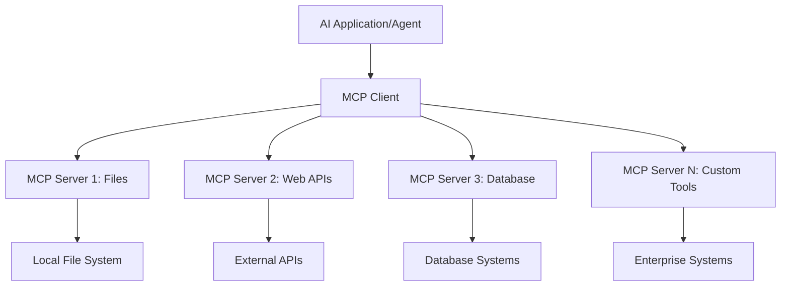

**🔧 Core Components:**

| Component | Wetin e dey do | Example dem |
| --------- | ---- | -------- |
| **MCP Hosts** | Dey use MCP services | VS Code, Foundry Toolkit |
| **MCP Clients** | Dey handle protocol connections | Built into hosts |
| **MCP Servers** | Dey provide capabilities | Playwright, Files, Azure, GitHub |
| **Transport Layer** | Dey connect clients and servers | stdio, HTTP, WebSockets |

## 🏢 Microsoft's MCP Server Ecosystem

Microsoft dey lead di MCP ecosystem wit plenty enterprise-grade servers wey
dey solve real-world business needs.

### 🌟 Featured Microsoft MCP Servers

#### 1. ☁️ Azure MCP Server

**🔗 Repository**: [azure/azure-mcp](https://github.com/azure/azure-mcp)
**🎯 Purpose**: Comprehensive Azure resource management wit AI integration

**✨ Key Features:**

- Declarative infrastructure provisioning
- Real-time resource monitoring
- Cost optimization recommendations
- Security compliance checking

**🚀 Use Cases:**

- Infrastructure-as-Code wit AI help
- Automated resource scaling
- Cloud cost optimization
- DevOps workflow automation

#### 2. 📊 Microsoft Dataverse MCP

**📚 Documentation**: [Microsoft Dataverse Integration](https://go.microsoft.com/fwlink/?linkid=2320176)
**🎯 Purpose**: Natural language interface for business data

**✨ Key Features:**

- Natural language database queries
- Business context understanding
- Custom prompt templates
- Enterprise data governance

**🚀 Use Cases:**

- Business intelligence reporting
- Customer data analysis
- Sales pipeline insights
- Compliance data queries

#### 3. 🌐 Playwright MCP Server

**🔗 Repository**: [microsoft/playwright-mcp](https://github.com/microsoft/playwright-mcp)
**🎯 Purpose**: Browser automation an web interaction capabilities

**✨ Key Features:**

- Cross-browser automation (Chrome, Firefox, Safari)
- Intelligent element detection
- Screenshot an PDF generation
- Network traffic monitoring

**🚀 Use Cases:**

- Automated testing workflows
- Web scraping an data extraction
- UI/UX monitoring
- Competitive analysis automation

#### 4. 📁 Files MCP Server

**🔗 Repository**: [microsoft/files-mcp-server](https://github.com/microsoft/files-mcp-server)
**🎯 Purpose**: Intelligent file system operations

**✨ Key Features:**

- Declarative file management
- Content synchronization
- Version control integration
- Metadata extraction

**🚀 Use Cases:**

- Documentation management
- Code repository organization
- Content publishing workflows
- Data pipeline file handling

#### 5. 📝 MarkItDown MCP Server

**🔗 Repository**: [microsoft/markitdown](https://github.com/microsoft/markitdown)
**🎯 Purpose**: Advanced Markdown processing an manipulation

**✨ Key Features:**

- Rich Markdown parsing
- Format conversion (MD ↔ HTML ↔ PDF)
- Content structure analysis
- Template processing

**🚀 Use Cases:**

- Technical documentation workflows
- Content management systems
- Report generation
- Knowledge base automation

#### 6. 📈 Clarity MCP Server

**📦 Package**: [@microsoft/clarity-mcp-server](https://www.npmjs.com/package/@microsoft/clarity-mcp-server)
**🎯 Purpose**: Web analytics an user behavior insights

**✨ Key Features:**

- Heatmap data analysis
- User session recordings
- Performance metrics
- Conversion funnel analysis

**🚀 Use Cases:**

- Website optimization
- User experience research
- A/B testing analysis
- Business intelligence dashboards

### 🌍 Community Ecosystem

Beyond Microsoft's servers, the MCP ecosystem includes:

- **🐙 GitHub MCP**: Repository management an code analysis
- **🗄️ Database MCPs**: PostgreSQL, MySQL, MongoDB integrations
- **☁️ Cloud Provider MCPs**: AWS, GCP, Digital Ocean tools
- **📧 Communication MCPs**: Slack, Teams, Email integrations

## 🛠️ Hands-On Lab: Building a Browser Automation Agent

**🎯 Project Goal**: Create intelligent browser automation agent using
Playwright MCP server wey fit navigate websites, extract information, an
perform complex web interactions.

### 🚀 Phase 1: Agent Foundation Setup

#### Step 1: Initialize Your Agent

1. **Open Microsoft Foundry Toolkit Agent Builder**
2. **Create New Agent** with the following configuration:
   - **Name**: `BrowserAgent`
   - **Model**: Choose GPT-5.1. See the
      [Microsoft Foundry model retirement schedule](https://learn.microsoft.com/azure/foundry/openai/concepts/model-retirement-schedule)
      for current model lifecycle information.

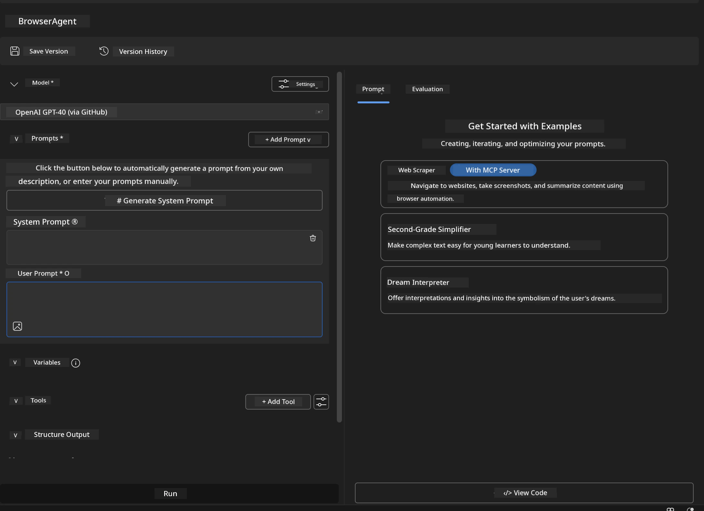

### 🔧 Phase 2: MCP Integration Workflow

#### Step 3: Add MCP Server Integration

1. **Navigate to Tools Section** in Agent Builder
2. **Click "Add Tool"** to open the integration menu
3. **Select "MCP Server"** from available options

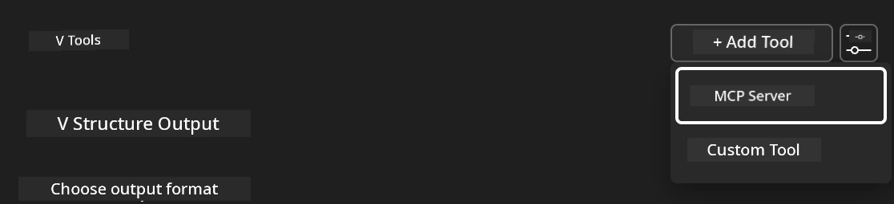

**🔍 Understanding Tool Types:**

- **Built-in Tools**: Pre-configured Microsoft Foundry Toolkit functions
- **MCP Servers**: External service integrations
- **Custom APIs**: Your own service endpoints
- **Function Calling**: Direct model function access

#### Step 4: MCP Server Selection

1. **Choose "MCP Server"** option to proceed
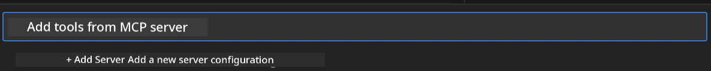

2. **Browse MCP Catalog** to explore available integrations
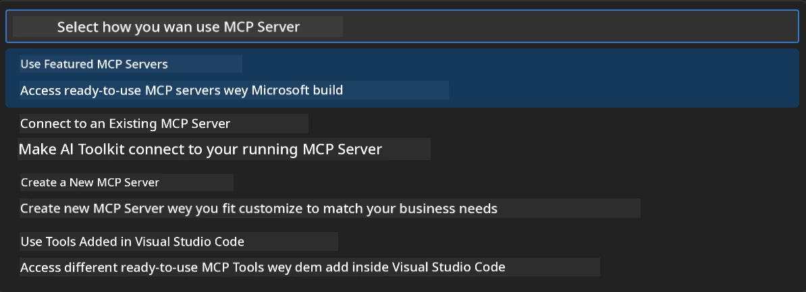

### 🎮 Phase 3: Playwright MCP Configuration

#### Step 5: Select and Configure Playwright

1. **Click "Use Featured MCP Servers"** to access Microsoft's verified servers
2. **Select "Playwright"** from the featured list
3. **Accept Default MCP ID** or customize for your environment

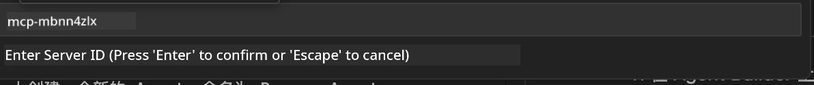

#### Step 6: Enable Playwright Capabilities

**🔑 Critical Step**: Select **ALL** available Playwright methods for maximum functionality

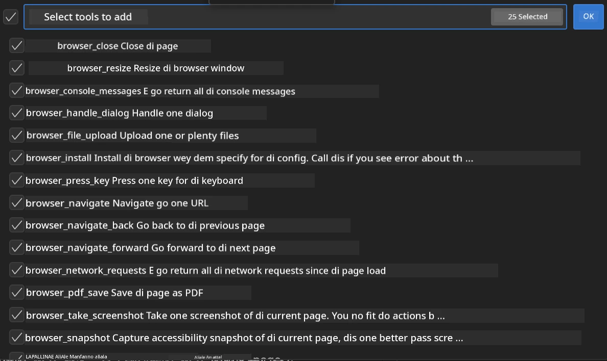

**🛠️ Essential Playwright Tools:**

- **Navigation**: `goto`, `goBack`, `goForward`, `reload`
- **Interaction**: `click`, `fill`, `press`, `hover`, `drag`
- **Extraction**: `textContent`, `innerHTML`, `getAttribute`
- **Validation**: `isVisible`, `isEnabled`, `waitForSelector`
- **Capture**: `screenshot`, `pdf`, `video`
- **Network**: `setExtraHTTPHeaders`, `route`, `waitForResponse`

#### Step 7: Verify Integration Success

**✅ Success Indicators:**

- All tools show for Agent Builder interface
- No error messages for the integration panel
- Playwright server status show "Connected"

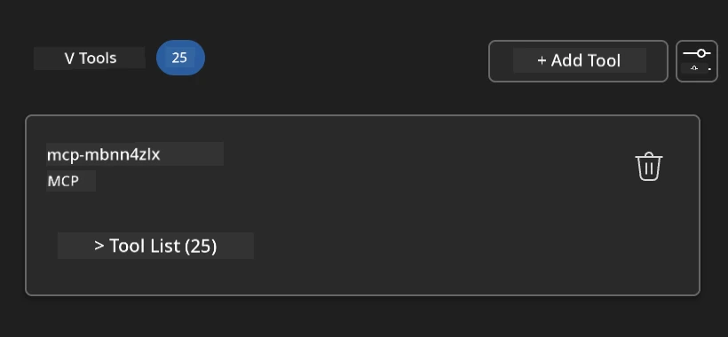

**🔧 Troubleshooting Common Issues:**

- **Connection Failed**: Check internet connectivity an firewall settings
- **Missing Tools**: Make sure say you select all capabilities during setup
- **Permission Errors**: Verify VS Code get the necessary system permissions

### 🎯 Phase 4: Advanced Prompt Engineering

#### Step 8: Design Intelligent System Prompts

Create sophisticated prompts wey go use Playwright full capabilities:

```markdown
# Web Automation Expert System Prompt

## Core Identity
You are an advanced web automation specialist with deep expertise in browser
automation, web scraping, and user experience analysis. You have access to
Playwright tools for comprehensive browser control.

## Capabilities & Approach
### Navigation Strategy
- Always start with screenshots to understand page layout
- Use semantic selectors (text content, labels) when possible
- Implement wait strategies for dynamic content
- Handle single-page applications (SPAs) effectively

### Error Handling
- Retry failed operations with exponential backoff
- Provide clear error descriptions and solutions
- Suggest alternative approaches when primary methods fail
- Always capture diagnostic screenshots on errors

### Data Extraction
- Extract structured data in JSON format when possible
- Provide confidence scores for extracted information
- Validate data completeness and accuracy
- Handle pagination and infinite scroll scenarios

### Reporting
- Include step-by-step execution logs
- Provide before/after screenshots for verification
- Suggest optimizations and alternative approaches
- Document any limitations or edge cases encountered

## Ethical Guidelines
- Respect robots.txt and rate limiting
- Avoid overloading target servers
- Only extract publicly available information
- Follow website terms of service
```

#### Step 9: Create Dynamic User Prompts

Design prompts wey show different capabilities:

**🌐 Web Analysis Example:**

```markdown
Navigate to github.com/kinfey and provide a comprehensive analysis including:
1. Repository structure and organization
2. Recent activity and contribution patterns  
3. Documentation quality assessment
4. Technology stack identification
5. Community engagement metrics
6. Notable projects and their purposes

Include screenshots at key steps and provide actionable insights.
```

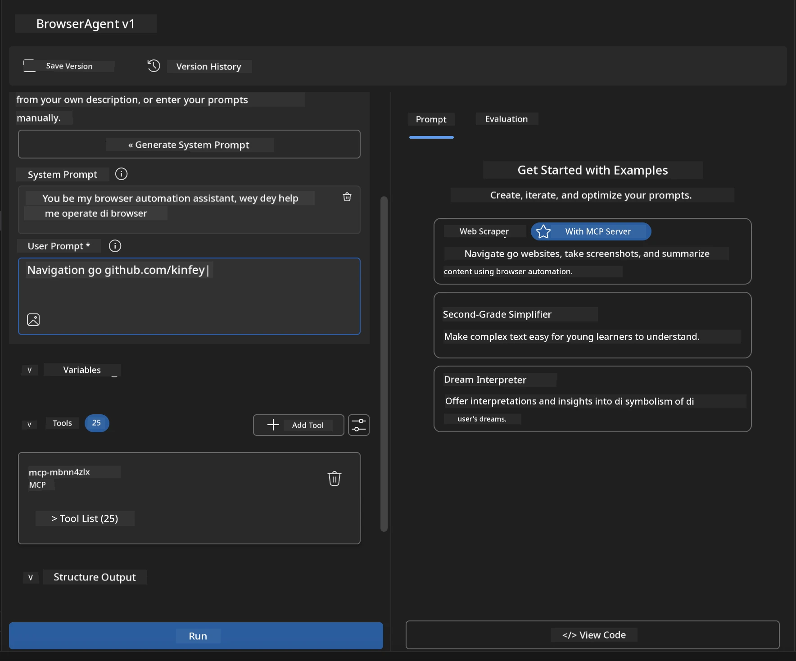

### 🚀 Phase 5: Execution and Testing

#### Step 10: Execute Your First Automation

1. **Click "Run"** to launch the automation sequence
2. **Monitor Real-time Execution**:
   - Chrome browser go launch automatically
   - Agent go navigate to target website
   - Screenshots go capture each major step
   - Analysis results go stream for real-time

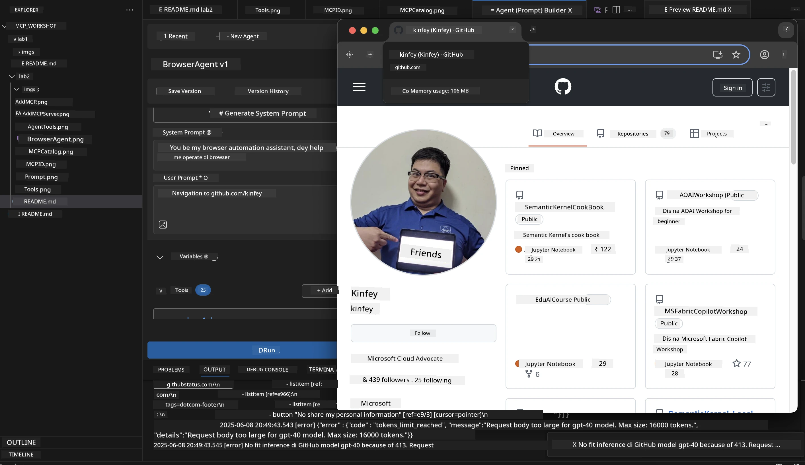

#### Step 11: Analyze Results and Insights

Review comprehensive analysis for Agent Builder's interface:

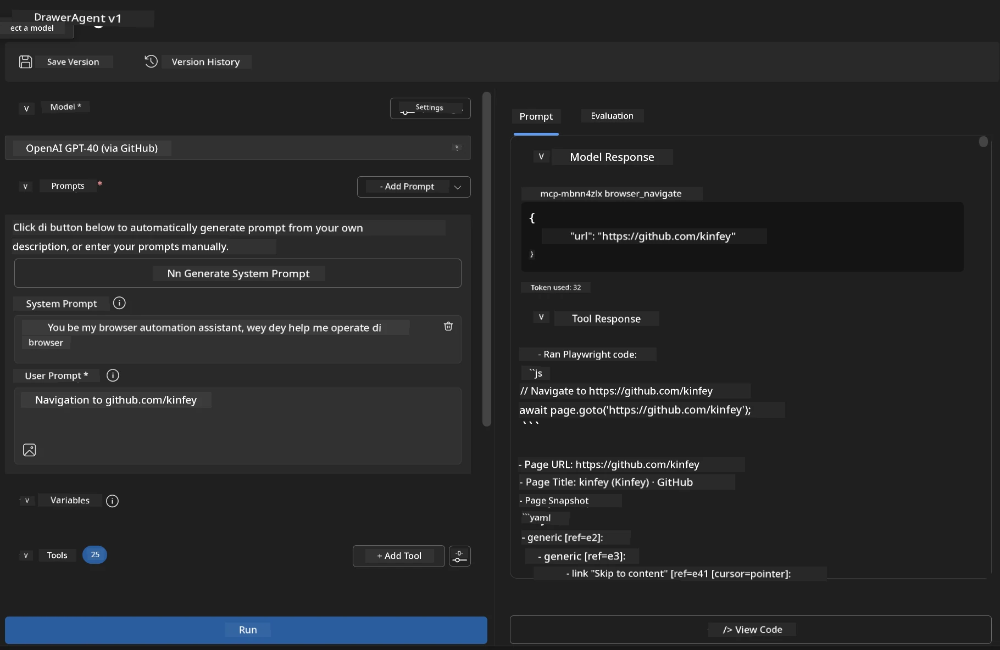

### 🌟 Phase 6: Advanced Capabilities and Deployment

#### Step 12: Export and Production Deployment

Agent Builder dey support plenty deployment options:

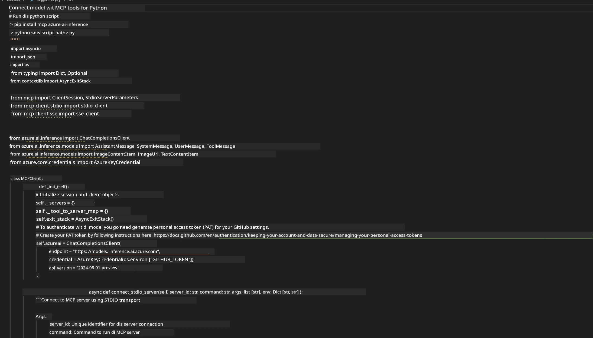

## 🎓 Module 2 Summary & Next Steps

### 🏆 Achievement Unlocked: MCP Integration Master

**✅ Skills Mastered:**

- [ ] Sabi MCP architecture an wetin e dey give
- [ ] Navigate Microsoft's MCP server ecosystem
- [ ] Integrate Playwright MCP wit Microsoft Foundry Toolkit
- [ ] Build advanced browser automation agents
- [ ] Advanced prompt engineering for web automation

### 📚 Additional Resources

- **🔗 MCP Specification**: [Official Protocol Documentation](https://modelcontextprotocol.io/)
- **🛠️ Playwright API**: [Complete Method Reference](https://playwright.dev/docs/api/class-playwright)
- **🏢 Microsoft MCP Servers**:
   [Enterprise Integration Guide](https://github.com/microsoft/mcp-servers)
- **🌍 Community Examples**: [MCP Server Gallery](https://github.com/modelcontextprotocol/servers)

**🎉 Congratulations!** You don finish learn MCP integration an fit
now build production-ready AI agents wit external tool capabilities!

### 🔜 Continue to Next Module

Ready to take your MCP skills to the next level? Proceed to
**[Module 3: Advanced MCP Development with Microsoft Foundry Toolkit](../lab3/README.md)**
where you'll learn how to:

- Create your own custom MCP servers
- Configure an use the latest MCP Python SDK
- Set up the MCP Inspector for debugging
- Master advanced MCP server development workflows
- Build a Weather MCP Server from scratch

---

<!-- CO-OP TRANSLATOR DISCLAIMER START -->
**Disclaimer**:
Dis document don translate wit AI translation service [Co-op Translator](https://github.com/Azure/co-op-translator). Even tho we dey try make am correct, abeg make you know say automated translation fit get errors or mistakes. Di original document for dia own language na im be di correct source. For important info, make person wey sabi human translation do am. We no go responsible for any misunderstanding or wrong understanding wey fit happen because of dis translation.
<!-- CO-OP TRANSLATOR DISCLAIMER END -->