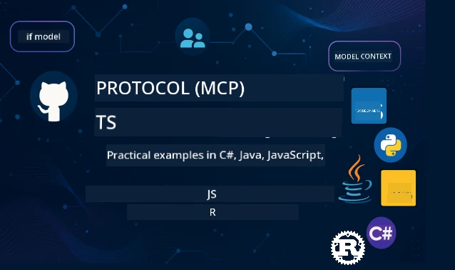

 

[](https://GitHub.com/microsoft/mcp-for-beginners/graphs/contributors)
[](https://GitHub.com/microsoft/mcp-for-beginners/issues)
[](https://GitHub.com/microsoft/mcp-for-beginners/pulls)
[](http://makeapullrequest.com)
[](https://mcptoplist.com/server/mcp.so%2Fmcp-for-beginners%2Fmicrosoft)

[](https://GitHub.com/microsoft/mcp-for-beginners/watchers)
[](https://GitHub.com/microsoft/mcp-for-beginners/fork)
[](https://GitHub.com/microsoft/mcp-for-beginners/stargazers)


[](https://discord.gg/nTYy5BXMWG)

Follow dis steps to start using these resources:
1. **Fork di Repository**: Click [](https://GitHub.com/microsoft/mcp-for-beginners/fork)
2. **Clone di Repository**:   `git clone https://github.com/microsoft/mcp-for-beginners.git`
3. **Join Di** [](https://discord.gg/nTYy5BXMWG)


### 🌐 Multi-Language Support

#### Translations maintained with [Co-op Translator](https://github.com/Azure/co-op-translator)

<!-- CO-OP TRANSLATOR LANGUAGES TABLE START -->
[Arabic](../ar/README.md) | [Bengali](../bn/README.md) | [Bulgarian](../bg/README.md) | [Burmese (Myanmar)](../my/README.md) | [Chinese (Simplified)](../zh-CN/README.md) | [Chinese (Traditional, Hong Kong)](../zh-HK/README.md) | [Chinese (Traditional, Macau)](../zh-MO/README.md) | [Chinese (Traditional, Taiwan)](../zh-TW/README.md) | [Croatian](../hr/README.md) | [Czech](../cs/README.md) | [Danish](../da/README.md) | [Dutch](../nl/README.md) | [Estonian](../et/README.md) | [Finnish](../fi/README.md) | [French](../fr/README.md) | [German](../de/README.md) | [Greek](../el/README.md) | [Hebrew](../he/README.md) | [Hindi](../hi/README.md) | [Hungarian](../hu/README.md) | [Indonesian](../id/README.md) | [Italian](../it/README.md) | [Japanese](../ja/README.md) | [Kannada](../kn/README.md) | [Khmer](../km/README.md) | [Korean](../ko/README.md) | [Lithuanian](../lt/README.md) | [Malay](../ms/README.md) | [Malayalam](../ml/README.md) | [Manipuri (Meitei Mayek)](../mni/README.md) | [Marathi](../mr/README.md) | [Nepali](../ne/README.md) | [Nigerian Pidgin](./README.md) | [Norwegian](../no/README.md) | [Persian (Farsi)](../fa/README.md) | [Polish](../pl/README.md) | [Portuguese (Brazil)](../pt-BR/README.md) | [Portuguese (Portugal)](../pt-PT/README.md) | [Punjabi (Gurmukhi)](../pa/README.md) | [Romanian](../ro/README.md) | [Russian](../ru/README.md) | [Serbian (Cyrillic)](../sr/README.md) | [Slovak](../sk/README.md) | [Slovenian](../sl/README.md) | [Spanish](../es/README.md) | [Swahili](../sw/README.md) | [Swedish](../sv/README.md) | [Tagalog (Filipino)](../tl/README.md) | [Tamil](../ta/README.md) | [Telugu](../te/README.md) | [Thai](../th/README.md) | [Turkish](../tr/README.md) | [Ukrainian](../uk/README.md) | [Urdu](../ur/README.md) | [Vietnamese](../vi/README.md)

> **Prefer to Clone Locally?**
>
> Dis repository get 50+ language translations wey dey increase download size well. If you wan clone without translations, use sparse checkout:
>
> **Bash / macOS / Linux:**
> ```bash
> git clone --filter=blob:none --sparse https://github.com/microsoft/mcp-for-beginners.git
> cd mcp-for-beginners
> git sparse-checkout set --no-cone '/*' '!translations' '!translated_images'
> ```
>
> **CMD (Windows):**
> ```cmd
> git clone --filter=blob:none --sparse https://github.com/microsoft/mcp-for-beginners.git
> cd mcp-for-beginners
> git sparse-checkout set --no-cone "/*" "!translations" "!translated_images"
> ```
>
> Dis one go give you everything wey you need to finish the course with much faster download.
<!-- CO-OP TRANSLATOR LANGUAGES TABLE END -->

# 🚀 Model Context Protocol (MCP) Curriculum for Beginners

## **Learn MCP with Hands-on Code Examples in C#, Java, JavaScript, Rust, Python, and TypeScript**

## 🧠 Overview of the Model Context Protocol Curriculum
Welcome to your waka into the Model Context Protocol! If you ever dey wonder how AI applications dey communicate with different tools and services, you go soon discover the better solution wey dey change how developers dey build intelligent systems.

Think of MCP as universal translator for AI applications - just like how USB ports make you fit connect any device to your computer, MCP make AI models fit connect to any tool or service in one standard way. Whether you dey build your first chatbot or you dey work on complex AI workflows, to sabi MCP go give you power to create more capable and flexible applications.

This curriculum dey designed with patience and care for your learning waka. We go start with simple concepts wey you don sabi and slowly build your skills through hands-on practice for your favorite programming language. Every step get clear explanations, practical examples, and plenty encouragement along the way.

By the time you finish this waka, you go get confidence to build your own MCP servers, integrate dem with popular AI platforms, and understand how this technology dey reshape the future of AI development. Make we begin this exciting adventure together!

### Official Documentation and Specifications

Di current protocol revision na **MCP Specification 2026-07-28**. Di MCP
specification dey use date-based versioning (YYYY-MM-DD format) to make protocol
compatibility explicit.

> **Version note:** dis curriculum dey teach the current `2026-07-28`
> concepts, including stateless requests, the Extensions framework, and the
> deprecation of Roots, Sampling, and Logging. Some hands-on examples remain
> explicitly versioned to `2025-11-25` while SDK support catches up. See
> [What's Changed in MCP: The 2026-07-28 Specification](./01-CoreConcepts/mcp-2026-07-28.md)
> for the changes and migration guidance.

These resources go dey more valuable as your understanding grow, but no need to pressure yourself to read everything at once. Start with the areas wey interest you most!
- 📘 [MCP Documentation](https://modelcontextprotocol.io/) – Na di resource wey you go use for step-by-step tutorials and user guides. Di documentation dey write for beginners, with clear examples wey you fit follow at your own pace.
- 📜 [MCP Specification](https://modelcontextprotocol.io/specification/2026-07-28) – Think of dis as your full reference manual. As you dey go through the curriculum, you go dey come back here to check specific details and explore advanced features.
- 📜 [MCP Specification Versioning](https://modelcontextprotocol.io/specification/versioning) – This one get information about protocol version history and how MCP dey use date-based versioning (YYYY-MM-DD format).
- 🧑‍💻 [MCP GitHub Repository](https://github.com/modelcontextprotocol) – Here you go find SDKs, tools, and code samples for different programming languages. Na treasure trove of practical examples and ready-to-use components.
- 🌐 [MCP Community](https://github.com/orgs/modelcontextprotocol/discussions) – Join other learners and experienced developers for discussions about MCP. Na supportive community wey questions dey welcome and knowledge dey shared freely.
  
## Wetin You Go Learn

By the end of this curriculum, you go feel confident and excited about your new abilities. Here be wetin you go achieve:

• **Understand MCP fundamentals**: You go sabi wetin the Model Context Protocol be and why e dey change how AI applications dey work together, with analogies and examples wey make sense.

• **Build your first MCP server**: You go create a working MCP server for your preferred programming language, start with simple examples and grow your skills step by step.

• **Connect AI models to real tools**: You go learn how to bridge the gap between AI models and actual services, give your applications powerful new capabilities.

• **Implement security best practices**: You go understand how to keep your MCP implementations safe and secure, protect both your applications and your users.

• **Deploy with confidence**: You go sabi how to carry your MCP projects from development to production, with practical deployment strategies wey work for the real world.

• **Join the MCP community**: You go become part of a growing community of developers wey dey shape the future of AI application development. 

## Essential Background

Before we dive into MCP specifics, make we make sure you comfortable with some basic concepts. No worry if you no be expert - we go explain everything you need as we go!

### Understanding Protocols (Di Foundation)

Think of a protocol like rules for a conversation. When you call friend, una dey know say una go greet ("hello") when una pick, take turns to talk, and say "goodbye" when una done. Computer programs need similar rules so dem fit communicate well.

MCP na protocol - na set of agreed rules wey help AI models and applications get productive "conversations" with tools and services. Same way conversation rules dey make human communication smooth, MCP make AI application communication more reliable and powerful.

### Client-Server Relationships (How Programs Dey Work Together)

You dey already use client-server relationships every day! When you use web browser (the client) to visit website, you dey connect to web server wey go send you the page content. The browser sabi how to ask for information, and the server sabi how to respond.

For MCP, e same relationship: AI models act as clients wey dey request information or actions, while MCP servers provide those capabilities. E be like having helpful assistant (the server) wey AI fit ask to perform specific tasks.

### Why Standardization Matters (Making Things Work Together)

Imagine if every car maker use different shape gas pump - you go need different adapter for each car! Standardization mean make people agree on common approach so things fit work together smoothly.

MCP dey provide this standardization for AI applications. Instead of every AI model needing custom code to work with every tool, MCP create one universal way for dem to communicate. This one mean developers fit build tools once and make dem work with many different AI systems.

## 🧭 Your Learning Path Overview

Your MCP waka arranged well to build your confidence and skills step by step. Each phase go introduce new concepts while e still dey reinforce wetin you don learn.

### 🌱 Foundation Phase: Understand di Basics (Modules 0-2)

Na here your adventure begin! We go introduce MCP concepts with familiar analogies and simple examples. You go understand wetin MCP be, why e dey, and how e take fit into the bigger world of AI development.

• **Module 0 - Introduction to MCP**: We go start by exploring wetin MCP be and why e important for modern AI applications. You go see real-world examples of MCP for action and understand how e solve common problems wey developers dey face.

• **Module 1 - Core Concepts Explained**: For here you go learn the essential building blocks of MCP. We go use plenty analogies and visual examples to make sure these concepts feel natural and easy to understand.

• **Module 2 - Security in MCP**: Security fit sound intimidating, but we go show you how MCP get built-in safety features and teach you best practices wey go protect your applications from the start.

### 🔨 Building Phase: Creating Your First Implementations (Module 3)

Now the real fun don begin! You go get hands-on experience building actual MCP servers and clients. No worry - we go start simple and guide you through every step.

Dis module get plenty hands-on guides wey go make you practice for the programming language wey you prefer. You go create your first server, build a client wey go connect to am, and even integrate wit popular development tools like VS Code.

Every guide get complete code examples, troubleshooting tips, and explanations why we dey make specific design choices. By the end of this phase, you go get working MCP implementations wey you go proud of!

### 🚀 Growing Phase: Advanced Concepts and Real-World Application (Modules 4-5)

When you don master the basics, you ready to explore more sophisticated MCP features. We go cover practical implementation strategies, debugging techniques, and advanced topics like multi-modal AI integration.

You go also learn how to scale your MCP implementations for production use and integrate wit cloud platforms like Azure. These modules go prepare you to build MCP solutions wey fit handle real-world demands.

### 🌟 Mastery Phase: Community and Specialization (Modules 6-11)

The final phase focus on how to join the MCP community and specialize for areas wey interest you pass. You go learn how to contribute to open-source MCP projects, implement advanced authentication patterns, and build complete database-integrated solutions.

Module 11 deserve special mention - na full 13-lab hands-on learning path wey go teach you how to build production-ready MCP servers wit PostgreSQL integration. E be like capstone project wey join everything wey you don learn!

### 📚 Complete Curriculum Structure

| Module | Topic | Description | Link |
|--------|-------|-------------|------|
| **Module 0-3: Fundamentals** | | | |
| 00 | Introduction to MCP | Overview of the Model Context Protocol and wetin e mean for AI pipelines | [Read more](./00-Introduction/README.md) |
| 01 | Core Concepts Explained | In-depth exploration of core MCP concepts | [Read more](./01-CoreConcepts/README.md) |
| 1.1 | What's Changed in MCP (2026-07-28) | Stateless protocol, Extensions framework, and feature deprecations in the current specification | [Guide](./01-CoreConcepts/mcp-2026-07-28.md) |
| 02 | Security in MCP | Security threats and best practices | [Read more](./02-Security/README.md) |
| 2.1 | CIMD and DCR Authorization | Compare preferred CIMD registration with deprecated DCR fallback using a protected MCP server | [Sample](./02-Security/samples/cimd-dcr-auth/README.md) |
| 03 | Getting Started with MCP | Environment setup, basic servers/clients, integration | [Read more](./03-GettingStarted/README.md) |
| **Module 3: Building Your First Server & Client** | | | |
| 3.1 | First Server | Create your first MCP server | [Guide](./03-GettingStarted/01-first-server/README.md) |
| 3.2 | First Client | Develop a basic MCP client | [Guide](./03-GettingStarted/02-client/README.md) |
| 3.3 | Client with LLM | Integrate large language models | [Guide](./03-GettingStarted/03-llm-client/README.md) |
| 3.4 | VS Code Integration | Consume MCP servers in VS Code | [Guide](./03-GettingStarted/04-vscode/README.md) |
| 3.5 | stdio Server | Create servers using stdio transport | [Guide](./03-GettingStarted/05-stdio-server/README.md) |
| 3.6 | HTTP Streaming | Implement HTTP streaming in MCP | [Guide](./03-GettingStarted/06-http-streaming/README.md) |
| 3.7 | Microsoft Foundry Toolkit | Use Microsoft Foundry Toolkit with MCP | [Guide](./03-GettingStarted/07-aitk/README.md) |
| 3.8 | Testing | Test your MCP server implementation | [Guide](./03-GettingStarted/08-testing/README.md) |
| 3.9 | Deployment | Deploy MCP servers to production | [Guide](./03-GettingStarted/09-deployment/README.md) |
| 3.10 | Advanced server usage | Use advanced servers for advanced feature usage and improved architecture | [Guide](./03-GettingStarted/10-advanced/README.md) |
| 3.11 | Simple auth | A chapter wey show you auth from the beginning and RBAC | [Guide](./03-GettingStarted/11-simple-auth/README.md) |
| 3.12 | MCP Hosts | Configure Claude Desktop, Cursor, Cline, and other MCP hosts | [Guide](./03-GettingStarted/12-mcp-hosts/README.md) |
| 3.13 | MCP Inspector | Debug and test MCP servers with the Inspector tool | [Guide](./03-GettingStarted/13-mcp-inspector/README.md) |
| 3.14 | Sampling | Use sampling to collaborate with the client | [Guide](./03-GettingStarted/14-sampling/README.md) |
| 3.15 | MCP Apps | Build MCP Apps | [Guide](./03-GettingStarted/15-mcp-apps/README.md) |
| **Module 4-5: Practical & Advanced** | | | |
| 04 | Practical Implementation | SDKs, debugging, testing, reusable prompt templates | [Read more](./04-PracticalImplementation/README.md) |
| 4.1 | Pagination | Handle large result sets with cursor-based pagination | [Guide](./04-PracticalImplementation/pagination/README.md) |
| 05 | Advanced Topics in MCP | Multi-modal AI, scaling, enterprise use | [Read more](./05-AdvancedTopics/README.md) |
| 5.1 | Azure Integration | MCP Integration with Azure | [Guide](./05-AdvancedTopics/mcp-integration/README.md) |
| 5.2 | Multi-modality | Working with multiple modalities | [Guide](./05-AdvancedTopics/mcp-multi-modality/README.md) |
| 5.3 | OAuth2 Demo | Implement OAuth2 authentication | [Guide](./05-AdvancedTopics/mcp-oauth2-demo/README.md) |
| 5.4 | Root Contexts | Understand and implement root contexts | [Guide](./05-AdvancedTopics/mcp-root-contexts/README.md) |
| 5.5 | Routing | MCP routing strategies | [Guide](./05-AdvancedTopics/mcp-routing/README.md) |
| 5.6 | Sampling | Sampling techniques in MCP | [Guide](./05-AdvancedTopics/mcp-sampling/README.md) |
| 5.7 | Scaling | Scale MCP implementations | [Guide](./05-AdvancedTopics/mcp-scaling/README.md) |
| 5.8 | Security | Advanced security considerations | [Guide](./05-AdvancedTopics/mcp-security/README.md) |
| 5.9 | Web Search | Implement web search capabilities | [Guide](./05-AdvancedTopics/web-search-mcp/README.md) |
| 5.10 | Realtime Streaming | Build realtime streaming functionality | [Guide](./05-AdvancedTopics/mcp-realtimestreaming/README.md) |
| 5.11 | Realtime Search | Implement realtime search | [Guide](./05-AdvancedTopics/mcp-realtimesearch/README.md) |
| 5.12 | Entra ID Auth | Authentication with Microsoft Entra ID | [Guide](./05-AdvancedTopics/mcp-security-entra/README.md) |
| 5.13 | Foundry Integration | Integrate with Microsoft Foundry | [Guide](./05-AdvancedTopics/mcp-foundry-agent-integration/README.md) |
| 5.14 | Context Engineering | Techniques for effective context engineering | [Guide](./05-AdvancedTopics/mcp-contextengineering/README.md) |
| 5.15 | MCP Custom Transport | Custom Transport implementations | [Guide](./05-AdvancedTopics/mcp-transport/README.md) |
| 5.16 | Protocol Features | Progress notifications, cancellation, resource templates | [Guide](./05-AdvancedTopics/mcp-protocol-features/README.md) |
| 5.17 | Adversarial Multi-Agent Reasoning | Two agents argue opposite sides using shared MCP tools, evaluated by a judge agent | [Guide](./05-AdvancedTopics/mcp-adversarial-agents/README.md) |
| **Module 6-10: Community & Best Practices** | | | |
| 06 | Community Contributions | How to contribute to the MCP ecosystem | [Guide](./06-CommunityContributions/README.md) |
| 07 | Insights from Early Adoption | Real-world implementation stories | [Guide](./07-LessonsfromEarlyAdoption/README.md) |
| 08 | Best Practices for MCP | Performance, fault-tolerance, resilience | [Guide](./08-BestPractices/README.md) |
| 09 | MCP Case Studies | Practical implementation examples | [Guide](./09-CaseStudy/README.md) |
| 10 | Hands-on Workshop | Building an MCP Server with Microsoft Foundry Toolkit | [Lab](./10-StreamliningAIWorkflowsBuildingAnMCPServerWithAIToolkit/README.md) |
| **Module 11: MCP Server Hands On Lab** | | | |
| 11 | MCP Server Database Integration | Comprehensive 13-lab hands-on learning path for PostgreSQL integration | [Labs](./11-MCPServerHandsOnLabs/README.md) |
| 11.1 | Introduction | Overview of MCP with database integration and retail analytics use case | [Lab 00](./11-MCPServerHandsOnLabs/00-Introduction/README.md) |
| 11.2 | Core Architecture | Understanding MCP server architecture, database layers, and security patterns | [Lab 01](./11-MCPServerHandsOnLabs/01-Architecture/README.md) |
| 11.3 | Security & Multi-Tenancy | Row Level Security, authentication, and multi-tenant data access | [Lab 02](./11-MCPServerHandsOnLabs/02-Security/README.md) |
| 11.4 | Environment Setup | Setting up development environment, Docker, Azure resources | [Lab 03](./11-MCPServerHandsOnLabs/03-Setup/README.md) |
| 11.5 | Database Design | PostgreSQL setup, retail schema design, and sample data | [Lab 04](./11-MCPServerHandsOnLabs/04-Database/README.md) |
| 11.6 | MCP Server Implementation | Building the FastMCP server with database integration | [Lab 05](./11-MCPServerHandsOnLabs/05-MCP-Server/README.md) |
| 11.7 | Tool Development | Creating database query tools and schema introspection | [Lab 06](./11-MCPServerHandsOnLabs/06-Tools/README.md) |
| 11.8 | Semantic Search | Implementing vector embeddings with Azure OpenAI and pgvector | [Lab 07](./11-MCPServerHandsOnLabs/07-Semantic-Search/README.md) |
| 11.9 | Testing & Debugging | Testing strategies, debugging tools, and validation approaches | [Lab 08](./11-MCPServerHandsOnLabs/08-Testing/README.md) |
| 11.10 | VS Code Integration | Configuring VS Code MCP integration and AI Chat usage | [Lab 09](./11-MCPServerHandsOnLabs/09-VS-Code/README.md) |
| 11.11 | Deployment Strategies | Docker deployment, Azure Container Apps, and scaling considerations | [Lab 10](./11-MCPServerHandsOnLabs/10-Deployment/README.md) |
| 11.12 | Monitoring | Application Insights, logging, performance monitoring | [Lab 11](./11-MCPServerHandsOnLabs/11-Monitoring/README.md) |
| 11.13 | Best Practices | Performance optimization, security hardening, and production tips | [Lab 12](./11-MCPServerHandsOnLabs/12-Best-Practices/README.md) |
| **Module 12: MCP Tooling** | | | |
| 12.1 | Tooling | MCP usage in Copilot App | [ Guide ](./12-tooling/README.md) |

### 💻 Sample Code Projects

One of the most exciting parts of learning MCP na to see your code skills dey grow step by step. We design our code examples to start simple and turn more sophisticated as your understanding deep. This na how we introduce concepts - with code wey easy to understand but wey show real MCP principles, you go sabi not only wetin the code dey do, but why e arrange like dat and how e take fit inside bigger MCP applications.

#### Basic MCP Calculator Samples

| Language | Description | Link |
|----------|-------------|------|
| C# | MCP Server Example | [View Code](./03-GettingStarted/samples/csharp/README.md) |
| Java | MCP Calculator | [View Code](./03-GettingStarted/samples/java/calculator/README.md) |
| JavaScript | MCP Demo | [View Code](./03-GettingStarted/samples/javascript/README.md) |
| Python | MCP Server | [View Code](../../03-GettingStarted/samples/python/mcp_calculator_server.py) |
| TypeScript | MCP Example | [View Code](./03-GettingStarted/samples/typescript/README.md) |
| Rust | MCP Example | [View Code](./03-GettingStarted/samples/rust/README.md) |

#### Advanced MCP Implementations

| Language | Description | Link |
|----------|-------------|------|
| C# | Advanced Sample | [View Code](./04-PracticalImplementation/samples/csharp/README.md) |
| Java with Spring | Container App Example | [View Code](./04-PracticalImplementation/samples/java/containerapp/README.md) |
| JavaScript | Advanced Sample | [View Code](./04-PracticalImplementation/samples/javascript/README.md) |
| Python | Complex Implementation | [View Code](./04-PracticalImplementation/samples/python/README.md) |
| TypeScript | Container Sample | [View Code](./04-PracticalImplementation/samples/typescript/README.md) |


## 🎯 Prerequisites for Learning MCP

To get the most out of this curriculum, you suppose get:

- Basic knowledge of programming for at least one of these languages: C#, Java, JavaScript, Python, or TypeScript
- Understanding of client-server model and APIs
- Familiarity with REST and HTTP concepts
- (Optional) Background in AI/ML concepts

- Join our community discussions for support

## 📚 Study Guide & Resources

This repository get plenty resources wey go help you navigate and learn well:

### Study Guide

A comprehensive [Study Guide](./study_guide.md) dey available to help you navigate this repository well. Dis visual curriculum map show how all the topics connect and give guidance on how to use the sample projects well. E especially helpful if you be visual learner wey like to see the big picture.

The guide includes:
- Visual curriculum map wey dey show all topics wey e cover
- Full breakdown of every repository section
- Guide on how to use di sample projects
- Suggested learning paths for different skill levels
- Extra resources wey go complement your learning journey

### Changelog

We dey maintain a detailed [Changelog](./changelog.md) wey dey track all major updates to the curriculum materials, so you fit stay up-to-date with the latest improvements and additions.
- New content wey dem add
- Structural changes
- Feature improvements
- Documentation updates

## 🛠️ How to Use This Curriculum Effectively

Every lesson for dis guide get:

1. Clear explanation dem of MCP concepts  
2. Live code examples for different languages  
3. Exercises wey go make you build real MCP applications  
4. Extra resources for learners wey don dey advanced

## 🎓 Your MCP Journey Begins

Congrats! You don just take the first step for one exciting journey wey go expand your programming skills and put you for the frontline of AI development.

### What You've Already Accomplished

As you don read this introduction, you don start to build your MCP knowledge foundation. You sabi wetin MCP be, why e matter, and how this curriculum go support your learning journey. Na big achievement and na di beginning of your expertise for dis important technology.

### The Adventure Ahead

As you dey move through the modules, remember say every expert be once beginner. The concepts wey fit seem complex now go become second nature as you practice and apply dem. Each small step dey build powerful capabilities wey go help you for your development career.

### Your Support Network

You dey join community of learners and experts wey get passion for MCP and wey ready to help others succeed. Whether you stuck on one coding challenge or you dey excited to share breakthrough, the community dey here to support your journey.

If you get stuck or get any questions about building AI apps, join fellow learners and experienced developers for discussions about MCP. Na supportive community wey questions dey welcome and knowledge dey shared freely.

[](https://discord.gg/nTYy5BXMWG)

If you get product feedback or errors while you dey build, visit:

[](https://aka.ms/foundry/forum)

### Ready to Begin?

Your MCP adventure start now! Begin with Module 0 to dive into your first hands-on MCP experiences, or check the sample projects to see wetin you go dey build. Remember - every expert start for the same place wey you de now, and with patience and practice, you go surprise yourself with wetin you fit achieve.

Welcome to the world of Model Context Protocol development. Make we build something correct together!

## 🤝 Contributing to the Learning Community

This curriculum dey grow stronger when learners like you contribute! Whether you dey fix typo, suggest clearer explanation, or add new example, your contributions dey help other beginners succeed.

Thanks to Microsoft Valued Professional [Shivam Goyal](https://www.linkedin.com/in/shivam2003/) for contributing code samples.

The contribution process dey designed to be welcoming and supportive. Most contributions go require Contributor License Agreement (CLA), but the automated tools go guide you through the process smoothly.

## 📜 Open Source Learning

This whole curriculum dey available under the MIT [LICENSE](../../LICENSE), meaning you fit use, modify, and share am freely. This one support our mission to make MCP knowledge accessible to developers everywhere.
## 🤝 Contribution Guidelines

This project dey welcome contributions and suggestions.  Most contributions go require say you agree to a
Contributor License Agreement (CLA) wey declare say you get the right to, and actually do, grant us
the rights to use your contribution. For details, visit <https://cla.opensource.microsoft.com>.

When you submit a pull request, CLA bot go automatically determine whether you need to provide
a CLA and decorate the PR appropriately (e.g., status check, comment). Just follow the instructions
provided by the bot. You go only need to do this once across all repos wey dey use our CLA.

This project don adopt the [Microsoft Open Source Code of Conduct](https://opensource.microsoft.com/codeofconduct/).
For more information see the [Code of Conduct FAQ](https://opensource.microsoft.com/codeofconduct/faq/) or
contact [opencode@microsoft.com](mailto:opencode@microsoft.com) if you get any additional questions or comments.

---

*You ready to start your MCP journey? Start with [Module 00 - Introduction to MCP](./00-Introduction/README.md) and take your first steps into the world of Model Context Protocol development!*


## 🎒 Other Courses
Our team dey produce other courses! Check dem out:

<!-- CO-OP TRANSLATOR OTHER COURSES START -->
### LangChain
[](https://aka.ms/langchain4j-for-beginners)
[](https://aka.ms/langchainjs-for-beginners?WT.mc_id=m365-94501-dwahlin)
[](https://github.com/microsoft/langchain-for-beginners?WT.mc_id=m365-94501-dwahlin)
---

### Azure / Edge / MCP / Agents
[](https://github.com/microsoft/AZD-for-beginners?WT.mc_id=academic-105485-koreyst)
[](https://github.com/microsoft/edgeai-for-beginners?WT.mc_id=academic-105485-koreyst)
[](https://github.com/microsoft/mcp-for-beginners?WT.mc_id=academic-105485-koreyst)
[](https://github.com/microsoft/ai-agents-for-beginners?WT.mc_id=academic-105485-koreyst)

---
 
### Generative AI Series
[](https://github.com/microsoft/generative-ai-for-beginners?WT.mc_id=academic-105485-koreyst)
[-9333EA?style=for-the-badge&labelColor=E5E7EB&color=9333EA)](https://github.com/microsoft/Generative-AI-for-beginners-dotnet?WT.mc_id=academic-105485-koreyst)
[-C084FC?style=for-the-badge&labelColor=E5E7EB&color=C084FC)](https://github.com/microsoft/generative-ai-for-beginners-java?WT.mc_id=academic-105485-koreyst)
[-E879F9?style=for-the-badge&labelColor=E5E7EB&color=E879F9)](https://github.com/microsoft/generative-ai-with-javascript?WT.mc_id=academic-105485-koreyst)

---
 
### Core Learning
[](https://aka.ms/ml-beginners?WT.mc_id=academic-105485-koreyst)
[](https://aka.ms/datascience-beginners?WT.mc_id=academic-105485-koreyst)
[](https://aka.ms/ai-beginners?WT.mc_id=academic-105485-koreyst)
[](https://github.com/microsoft/Security-101?WT.mc_id=academic-96948-sayoung)
[](https://aka.ms/webdev-beginners?WT.mc_id=academic-105485-koreyst)
[](https://aka.ms/iot-beginners?WT.mc_id=academic-105485-koreyst)
[](https://github.com/microsoft/xr-development-for-beginners?WT.mc_id=academic-105485-koreyst)

---
 
### Copilot Series
[](https://aka.ms/GitHubCopilotAI?WT.mc_id=academic-105485-koreyst)
[](https://github.com/microsoft/mastering-github-copilot-for-dotnet-csharp-developers?WT.mc_id=academic-105485-koreyst)
[](https://github.com/microsoft/CopilotAdventures?WT.mc_id=academic-105485-koreyst)
<!-- CO-OP TRANSLATOR OTHER COURSES END -->

---

<!-- CO-OP TRANSLATOR DISCLAIMER START -->
**Disclaimer**:
Dis document don translate wit AI translation service [Co-op Translator](https://github.com/Azure/co-op-translator). Even tho we dey try make am correct, abeg make you know say automated translation fit get errors or mistakes. Di original document for dia own language na im be di correct source. For important info, make person wey sabi human translation do am. We no go responsible for any misunderstanding or wrong understanding wey fit happen because of dis translation.
<!-- CO-OP TRANSLATOR DISCLAIMER END -->