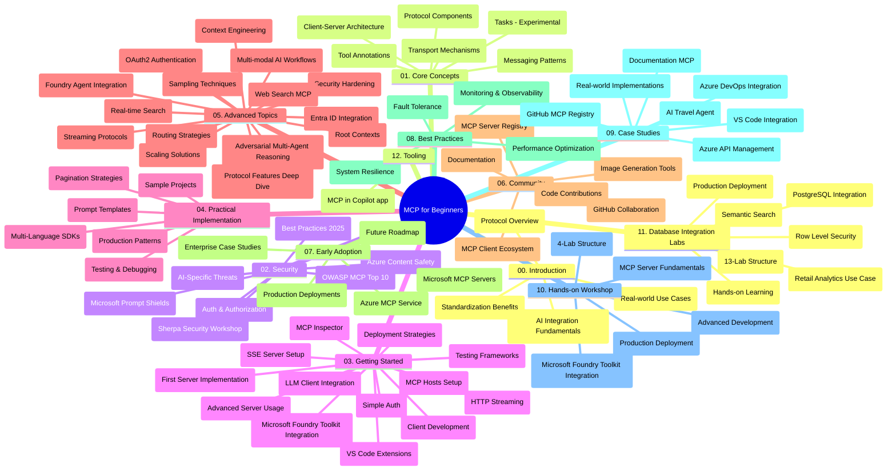

# Model Context Protocol (MCP) for Beginners - Study Guide

Dis study guide dey give small summary of wetin dey inside di repository and di content for di "Model Context Protocol (MCP) for Beginners" curriculum. Use dis guide to sabi how to waka for di repo quick and make beta use of di resources wey dey.

## Repository Overview

Di Model Context Protocol (MCP) na standard waya wey dem dey take make AI models and client applications dey communicate. Anthropic start am, but now di MCP community dey maintain am for di official GitHub organization. Dis repository get full curriculum with hands-on code examples for C#, Java, JavaScript, Python, and TypeScript, wey dem design for AI developers, system architects, and software engineers.

## Visual Curriculum Map

## Repository Structure

Di repository organize into twelve main sections, each one dey focus for different parts of MCP:

1. **Introduction (00-Introduction/)**
   - Overview of the Model Context Protocol
   - Why standardization matters in AI pipelines
   - Practical use cases and benefits

2. **Core Concepts (01-CoreConcepts/)**
   - Client-server architecture
   - Key protocol components
   - Messaging patterns in MCP
   - Current specification: [Wetin don change for MCP: The 2026-07-28 Specification](./01-CoreConcepts/mcp-2026-07-28.md) — di stateless protocol core, Extensions framework, and Roots/Sampling/Logging deprecations

3. **Security (02-Security/)**
   - Security threats for MCP-based systems
   - Best practices to secure implementations
   - Authentication and authorization strategies
   - Hands-on [CIMD and DCR authorization sample](./02-Security/samples/cimd-dcr-auth/README.md)
   - **Comprehensive Security Documentation**:
     - MCP Security Best Practices
     - Azure Content Safety Implementation Guide
     - MCP Security Controls and Techniques
     - MCP Best Practices Quick Reference
   - **Key Security Topics**:
     - Prompt injection and tool poisoning attacks
     - Session hijacking and confused deputy problems
     - Token passthrough vulnerabilities
     - Excessive permissions and access control
     - Supply chain security for AI components
     - Microsoft Prompt Shields integration

4. **Getting Started (03-GettingStarted/)**
   - Environment setup and configuration
   - Creating basic MCP servers and clients
   - Integration with existing applications
   - Includes sections for:
     - First server implementation
     - Client development
     - LLM client integration
     - VS Code integration
     - Server-Sent Events (SSE) server
     - Advanced server usage
     - HTTP streaming
    - Microsoft Foundry Toolkit integration
     - Testing strategies
     - Deployment guidelines

5. **Practical Implementation (04-PracticalImplementation/)**
   - Using SDKs across different programming languages
   - Debugging, testing, and validation techniques
   - Crafting reusable prompt templates and workflows
   - Sample projects with implementation examples

6. **Advanced Topics (05-AdvancedTopics/)**
   - Context engineering techniques
   - Foundry agent integration
   - Multi-modal AI workflows 
   - OAuth2 authentication demos
   - Real-time search capabilities
   - Real-time streaming
   - Root contexts implementation
   - Routing strategies
   - Sampling techniques
   - Scaling approaches
   - Security considerations
   - Entra ID security integration
   - Web search integration
   - Adversarial multi-agent reasoning (debate patterns)

7. **Community Contributions (06-CommunityContributions/)**
   - How to contribute code and documentation
   - Collaborating via GitHub
   - Community-driven enhancements and feedback
   - Using various MCP clients (Claude Desktop, Cline, VSCode)
   - Working with popular MCP servers including image generation

8. **Lessons from Early Adoption (07-LessonsfromEarlyAdoption/)**
   - Real-world implementations and success stories
   - Building and deploying MCP-based solutions
   - Trends and future roadmap
   - **Microsoft MCP Servers Guide**: Complete guide to 10 production-ready Microsoft MCP servers including:
     - Microsoft Learn Docs MCP Server
     - Azure MCP Server (15+ specialized connectors)
     - GitHub MCP Server
     - Azure DevOps MCP Server
     - MarkItDown MCP Server
     - SQL Server MCP Server
     - Playwright MCP Server
     - Dev Box MCP Server
     - Microsoft Foundry MCP Server
     - Microsoft 365 Agents Toolkit MCP Server

9. **Best Practices (08-BestPractices/)**
   - Performance tuning and optimization
   - Designing fault-tolerant MCP systems
   - Testing and resilience strategies

10. **Case Studies (09-CaseStudy/)**
    - **Seven comprehensive case studies** wey show how MCP fit work for different kin situations:
    - **Azure AI Travel Agents**: Multi-agent orchestration with Azure OpenAI and AI Search
    - **Azure DevOps Integration**: Automating workflow processes with YouTube data updates
    - **Real-Time Documentation Retrieval**: Python console client with streaming HTTP
    - **Interactive Study Plan Generator**: Chainlit web app with conversational AI
    - **In-Editor Documentation**: VS Code integration with GitHub Copilot workflows
    - **Azure API Management**: Enterprise API integration with MCP server creation
    - **GitHub MCP Registry**: Ecosystem development and agentic integration platform
    - Implementation examples wey cover enterprise integration, developer productivity, and ecosystem development

11. **Hands-on Workshop (10-StreamliningAIWorkflowsBuildingAnMCPServerWithAIToolkit/)**
    - Complete hands-on workshop wey join MCP with Microsoft Foundry Toolkit
    - Building intelligent applications wey connect AI models to real-world tools
    - Practical modules wey cover fundamentals, custom server development, and production deployment strategies
    - **Lab Structure**:
      - Lab 1: MCP Server Fundamentals
      - Lab 2: Advanced MCP Server Development
      - Lab 3: Microsoft Foundry Toolkit Integration
      - Lab 4: Production Deployment and Scaling
    - Lab-based learning approach with step-by-step instructions

12. **MCP Server Database Integration Labs (11-MCPServerHandsOnLabs/)**
    - **Complete 13-lab learning path** for building production-ready MCP servers with PostgreSQL integration
    - **Real-world retail analytics implementation** using the Zava Retail use case
    - **Enterprise-grade patterns** including Row Level Security (RLS), semantic search, and multi-tenant data access
    - **Complete Lab Structure**:
      - **Labs 00-03: Foundations** - Introduction, Architecture, Security, Environment Setup
      - **Labs 04-06: Building the MCP Server** - Database Design, MCP Server Implementation, Tool Development
      - **Labs 07-09: Advanced Features** - Semantic Search, Testing & Debugging, VS Code Integration
      - **Labs 10-12: Production & Best Practices** - Deployment, Monitoring, Optimization
    - **Technologies Covered**: FastMCP framework, PostgreSQL, Azure OpenAI, Azure Container Apps, Application Insights
    - **Learning Outcomes**: Production-ready MCP servers, database integration patterns, AI-powered analytics, enterprise security

13. **Tooling (12-tooling/)**
    - Learn how to use MCP in Copilot app and other tools

## Additional Resources

Di repository still get supporting resources:

- **Images folder**: Contains diagrams and illustrations wey dem use for di curriculum
- **Translations**: Multi-language support with automated translations of documentation
- **Official MCP Resources**:
  - [MCP Documentation](https://modelcontextprotocol.io/)
  - [MCP Specification](https://modelcontextprotocol.io/specification/2026-07-28/)
  - [MCP GitHub Repository](https://github.com/modelcontextprotocol)

## How to Use This Repository

1. **Sequential Learning**: Follow di chapters for order (00 through 11) if you want structured learning.
2. **Language-Specific Focus**: If you dey interested for one programming language, check di samples directories for implementations for di language wey you like.
3. **Practical Implementation**: Start for di "Getting Started" section to set up your environment and build your first MCP server and client.
4. **Advanced Exploration**: When you don sabi di basics, enter di advanced topics to expand your knowledge.
5. **Community Engagement**: Join di MCP community for GitHub discussions and Discord channels to connect with experts and other developers.

## MCP Clients and Tools

Di curriculum cover different MCP clients and tools:

1. **Official Clients**:
   - Visual Studio Code 
   - MCP in Visual Studio Code
   - Claude Desktop
   - Claude in VSCode 
   - Claude API

2. **Community Clients**:
   - Cline (terminal-based)
   - Cursor (code editor)
   - ChatMCP
   - Windsurf

3. **MCP Management Tools**:
   - MCP CLI
   - MCP Manager
   - MCP Linker
   - MCP Router

## Popular MCP Servers

Di repository show different MCP servers, including:

1. **Official Microsoft MCP Servers**:
   - Microsoft Learn Docs MCP Server
   - Azure MCP Server (15+ specialized connectors)
   - GitHub MCP Server
   - Azure DevOps MCP Server
   - MarkItDown MCP Server
   - SQL Server MCP Server
   - Playwright MCP Server
   - Dev Box MCP Server
   - Microsoft Foundry MCP Server
   - Microsoft 365 Agents Toolkit MCP Server

2. **Official Reference Servers**:
   - Filesystem
   - Fetch
   - Memory
   - Sequential Thinking

3. **Image Generation**:
   - Azure OpenAI DALL-E 3
   - Stable Diffusion WebUI
   - Replicate

4. **Development Tools**:
   - Git MCP
   - Terminal Control
   - Code Assistant

5. **Specialized Servers**:
   - Salesforce
   - Microsoft Teams
   - Jira & Confluence

## Contributing

Dis repository dey welcome contributions from di community. See di Community Contributions section for how to contribute well to di MCP ecosystem.

----

*Dis study guide last update na September 9, 2026. E reflect MCP
Specification `2026-07-28`, di current protocol revision. Some hands-on
examples still get explicit version `2025-11-25` while dia SDKs and tools
dey adopt di stateless protocol APIs.*

---

<!-- CO-OP TRANSLATOR DISCLAIMER START -->
**Disclaimer**:
Dis document don translate wit AI translation service [Co-op Translator](https://github.com/Azure/co-op-translator). Even tho we dey try make am correct, abeg make you know say automated translation fit get errors or mistakes. Di original document for dia own language na im be di correct source. For important info, make person wey sabi human translation do am. We no go responsible for any misunderstanding or wrong understanding wey fit happen because of dis translation.
<!-- CO-OP TRANSLATOR DISCLAIMER END -->