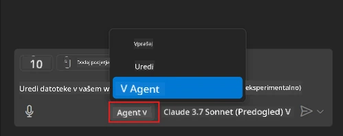
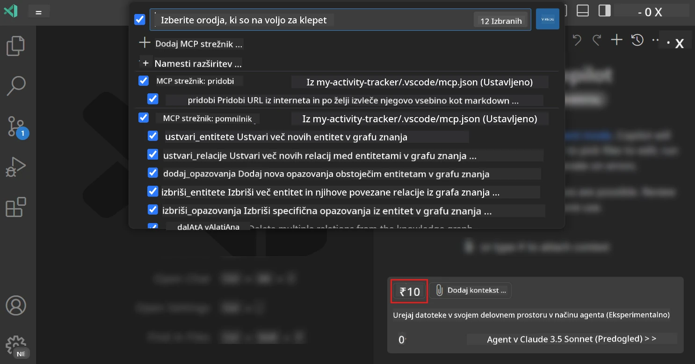
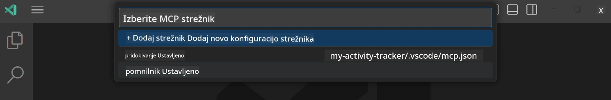
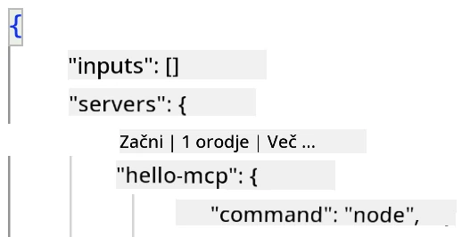
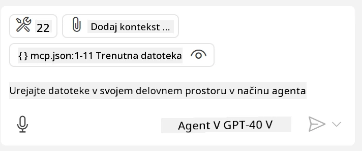
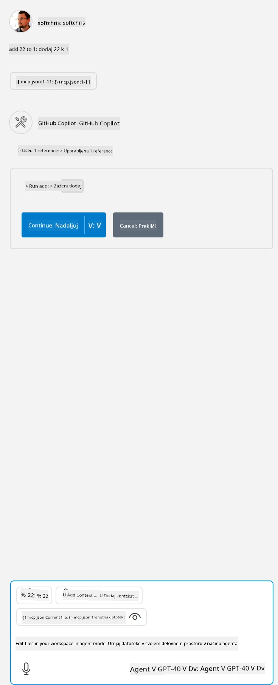

# Poraba strežnika iz načina GitHub Copilot Agent

Visual Studio Code in GitHub Copilot lahko delujeta kot odjemalec in porabita MCP strežnik. Zakaj bi to želeli narediti, se sprašujete? No, to pomeni, da lahko funkcije, ki jih ima MCP strežnik, zdaj uporabljate znotraj vašega IDE. Predstavljajte si, da dodate na primer GitHubov MCP strežnik, kar bi omogočilo upravljanje GitHuba preko pozivov namesto tipkanja specifičnih ukazov v terminalu. Ali pa si predstavljajte karkoli, kar bi lahko izboljšalo vašo razvojno izkušnjo, vse nadzorovano z naravnim jezikom. Zdaj vidite prednosti, kajne?

## Pregled

Ta lekcija opisuje, kako uporabljati Visual Studio Code in način GitHub Copilot Agent kot odjemalca za vaš MCP strežnik.

## Cilji učenja

Do konca te lekcije boste sposobni:

- Porabiti MCP strežnik preko Visual Studio Code.
- Zaženite zmogljivosti, kot so orodja, prek GitHub Copilot.
- Konfigurirati Visual Studio Code, da najde in upravlja vaš MCP strežnik.

## Uporaba

Vaš MCP strežnik lahko nadzorujete na dva različna načina:

- Uporabniški vmesnik, kasneje v tem poglavju boste videli, kako se to naredi.
- Terminal, možno je upravljati stvari iz terminala z izvršljivo datoteko `code`:

  Za dodajanje MCP strežnika v vaš uporabniški profil uporabite ukazno možnost --add-mcp in zagotovite JSON konfiguracijo strežnika v obliki {\"name\":\"server-name\",\"command\":...}.

  ```
  code --add-mcp "{\"name\":\"my-server\",\"command\": \"uvx\",\"args\": [\"mcp-server-fetch\"]}"
  ```

### Posnetki zaslona





V nadaljevanju podrobneje razpravljajmo o tem, kako uporabljati vizualni vmesnik.

## Pristop

Tukaj je, kako se moramo na to gledati na visoki ravni:

- Konfigurirati datoteko, ki bo poiskala naš MCP strežnik.
- Zažene se/poveže na omenjeni strežnik, da našteje njegove zmogljivosti.
- Te zmogljivosti uporabi prek vmesnika GitHub Copilot Chat.

Odlično, zdaj ko razumemo potek, poskusimo skozi vajo uporabiti MCP strežnik preko Visual Studio Code.

## Vaja: Poraba strežnika

V tej vaji bomo konfigurirali Visual Studio Code, da najde vaš MCP strežnik, tako da ga bo mogoče uporabljati prek vmesnika GitHub Copilot Chat.

### -0- Predkorak, omogočite odkrivanje MCP strežnikov

Morda boste morali omogočiti odkrivanje MCP strežnikov.

1. Pojdite na `File -> Preferences -> Settings` v Visual Studio Code.

1. Poiščite "MCP" in omogočite `chat.mcp.discovery.enabled` v datoteki settings.json.

### -1- Ustvarite konfiguracijsko datoteko

Začnite z ustvarjanjem konfiguracijske datoteke v korenu vašega projekta, potrebovali boste datoteko po imenu MCP.json, ki jo postavite v mapo .vscode. Morala bi izgledati takole:

```text
.vscode
|-- mcp.json
```

Nato poglejmo, kako dodati vnos strežnika.

### -2- Konfigurirajte strežnik

Dodajte naslednjo vsebino v *mcp.json*:

```json
{
    "inputs": [],
    "servers": {
       "hello-mcp": {
           "command": "node",
           "args": [
               "build/index.js"
           ]
       }
    }
}
```

Zgornji primer prikazuje, kako preprosto zagnati strežnik, napisan v Node.js; za druge izvajalne okolje navedite ustrezen ukaz za zagon strežnika z uporabo `command` in `args`.

### -3- Zaženite strežnik

Zdaj, ko ste dodali vnos, zaženite strežnik:

1. Poiščite vaš vnos v *mcp.json* in se prepričajte, da najdete ikono "predvajaj":

    

1. Kliknite ikono "predvajaj", morali bi videti, kako se v ikoni orodij v GitHub Copilot Chat poveča število razpoložljivih orodij. Če kliknete to ikono orodij, boste videli seznam registriranih orodij. Vsako orodje lahko vklopite/izklopite glede na to, ali želite, da ga GitHub Copilot uporablja kot kontekst:

  

1. Za zagon orodja vtipkajte poziv, za katerega veste, da se ujema z opisom enega od vaših orodij, na primer poziv, kot je "add 22 to 1":

  

  Videli bi odgovor z vrednostjo 23.

## Naloga

Poskusite dodati vnos strežnika v vašo datoteko *mcp.json* in se prepričajte, da lahko zaženete/ustavite strežnik. Preverite tudi, če lahko komunicirate z orodji na vašem strežniku prek vmesnika GitHub Copilot Chat.

## Rešitev

[Rešitev](./solution/README.md)

## Glavne ugotovitve

Glavne ugotovitve iz tega poglavja so naslednje:

- Visual Studio Code je odličen odjemalec, ki vam omogoča uporabo več MCP strežnikov in njihovih orodij.
- Vmesnik GitHub Copilot Chat je način, kako komunicirate s strežniki.
- Uporabnika lahko pozovete za vnose, kot so API ključi, ki jih lahko posredujete MCP strežniku pri konfiguriranju vnosa strežnika v datoteko *mcp.json*.

## Primeri

- [Java Kalkulator](../samples/java/calculator/README.md)
- [.NET Kalkulator](../../../../03-GettingStarted/samples/csharp)
- [JavaScript Kalkulator](../samples/javascript/README.md)
- [TypeScript Kalkulator](../samples/typescript/README.md)
- [Python Kalkulator](../../../../03-GettingStarted/samples/python)

## Dodatni viri

- [Dokumentacija Visual Studio](https://code.visualstudio.com/docs/copilot/chat/mcp-servers)

## Kaj sledi

- Naslednje: [Ustvarjanje stdio strežnika](../05-stdio-server/README.md)

---

<!-- CO-OP TRANSLATOR DISCLAIMER START -->
**Omejitev odgovornosti**:
Ta dokument je bil preveden z uporabo AI prevajalske storitve [Co-op Translator](https://github.com/Azure/co-op-translator). Čeprav si prizadevamo za natančnost, vas prosimo, da upoštevate, da avtomatizirani prevodi lahko vsebujejo napake ali netočnosti. Izvirni dokument v njegovem izvirnem jeziku je treba obravnavati kot avtoritativni vir. Za kritične informacije je priporočljiv strokovni človeški prevod. Ne odgovarjamo za morebitna nesporazume ali napačne interpretacije, ki izhajajo iz uporabe tega prevoda.
<!-- CO-OP TRANSLATOR DISCLAIMER END -->