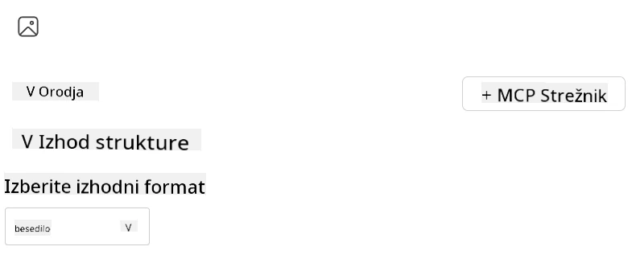
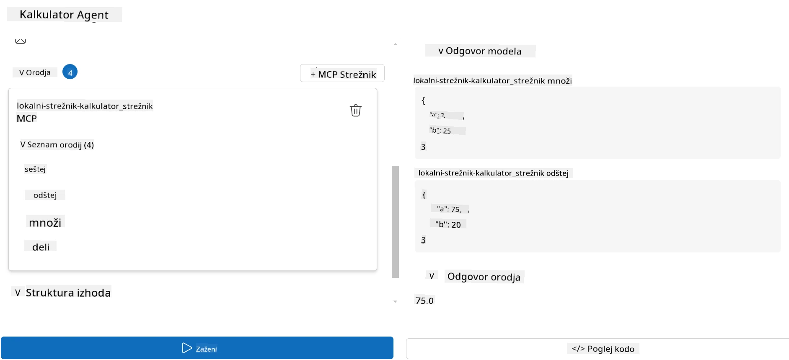

# Uporaba strežnika z Microsoft Foundry Toolkit za Visual Studio Code

Ko ustvarjate AI agenta, ne gre zgolj za generiranje pametnih odgovorov; gre tudi za to, da agentu omogočite, da sprejema ukrepe. Tu pride v poštev Model Context Protocol (MCP). MCP agentom omogoča enostaven dostop do zunanjih orodij in storitev na dosleden način. Lahko si ga predstavljate kot priključitev vašega agenta na orodjarno, ki jo lahko *dejansko* uporablja.

Recimo, da povežete agenta s strežnikom MCP za kalkulator. Nenadoma lahko vaš agent izvaja matematične operacije le z prejemanjem poziva, kot je »Koliko je 47 krat 89?« — brez potrebe po trdo kodiranju logike ali ustvarjanju lastnih API-jev.

## Pregled

Ta lekcija pokriva, kako povezati strežnik MCP kalkulatorja z agentom s pomočjo
[Microsoft Foundry Toolkit za Visual Studio Code](https://aka.ms/AIToolkit),
kar omogoča vašemu agentu, da izvaja matematične operacije preko naravnega jezika.

Microsoft Foundry Toolkit poenostavlja razvoj in testiranje generativnih
AI aplikacij z modeli, gostovanimi lokalno in v oblaku.

*Opomba*: Orodje trenutno podpira Python in TypeScript predloge MCP.

## Cilji učenja

Do konca te lekcije boste lahko:

- Uporabljali strežnik MCP z Microsoft Foundry Toolkit.
- Konfigurirali agentovo nastavitev, da ji omogočite odkrivanje in uporabo orodij, ki jih zagotavlja strežnik MCP.
- Uporabljali orodja MCP preko naravnega jezika.

## Pristop

Tako se bomo tega lotili na splošno:

- Ustvarite agenta in določite njegov sistemski poziv.
- Ustvarite strežnik MCP z orodji kalkulatorja.
- Povežite Agent Builder s strežnikom MCP.
- Preizkusite klic orodij agenta preko naravnega jezika.

Odlično, zdaj ko razumemo postopek, konfigurirajmo AI agenta, da lahko preko MCP uporablja zunanja orodja in tako nadgradi svoje zmogljivosti!

## Predpogoji

- [Visual Studio Code](https://code.visualstudio.com/)
- [Microsoft Foundry Toolkit za Visual Studio Code](https://aka.ms/AIToolkit)

## Vaja: Uporaba strežnika

> [!WARNING]
> Opomba za uporabnike macOS. Trenutno preiskujemo težavo, ki vpliva na namestitev odvisnosti na macOS. Zaradi tega trenutno uporabniki macOS ne bodo mogli dokončati te vadnice. Navodila bomo posodobili takoj, ko bo na voljo rešitev. Hvala za vašo potrpežljivost in razumevanje!

V tej vaji boste zgradili, zagnali in izboljšali AI agenta z orodji
s strežnika MCP znotraj Visual Studio Code z uporabo Microsoft Foundry Toolkit.

### -0- Predhodni korak, dodajte razmestitev Microsoft Foundry GPT-5.1

Ustvarite vir Microsoft Foundry, razmestite **GPT-5.1** in dodajte razmestitev
med **Moji modeli**. Preglejte
[urnik upokojitve modelov](https://learn.microsoft.com/azure/foundry/openai/concepts/model-retirement-schedule)
pri izbiri razmestitve.

1. Odprite **Microsoft Foundry Toolkit** iz **Vrstice dejavnosti**.
1. V razdelku **Katalog** izberite **Modeli** za odprtje **Kataloga modelov**. Izbira **Modeli** odpre **Katalog modelov** v novi zavihek urejevalnika.
1. Povežite svoj Microsoft Foundry projekt in izberite svojo **GPT-5.1** razmestitev.
1. Kliknite **+ Dodaj** za dodajanje razmestitve na vaš seznam **Moji modeli**.
1. V **Vrstici dejavnosti** potrdite, da se razmestitev pojavlja na seznamu.

### -1- Ustvarite agenta

Zmogljivost **Agent (Prompt) Builder** vam omogoča ustvarjanje in prilagajanje lastnih agentov, ki temeljijo na umetni inteligenci. V tem razdelku boste ustvarili novega agenta in mu dodelili model za pogovor.

1. Odprite **Microsoft Foundry Toolkit** iz **Orodne vrstice**.
1. V razdelku **Orodja** izberite **Agent (Prompt) Builder**. Izbira **Agent (Prompt) Builder** odpre urejevalnik **Agent (Prompt) Builder** na novem zavihku urejevalnika.
1. Kliknite na gumb **+ Nov agent**. Razširitev bo s pomočjo **Ukazne palete** zagnala čarovnika za nastavitev.
1. Vnesite ime **Calculator Agent** in pritisnite **Enter**.
1. V urejevalniku **Agent (Prompt) Builder** izberite vaše nameščeno okolje **GPT-5.1** Foundry.

### -2- Ustvarite sistemski poziv za agenta

Ko je agent osnovan, je čas, da določite njegovo osebnost in namen. V tem razdelku boste uporabili funkcijo **Ustvari sistemski poziv**, ki bo opisala želeno vedenje agenta — v tem primeru agenta kalkulatorja — in model bo sam ustvaril sistemski poziv za vas.

1. V razdelku **Pozivi** kliknite gumb **Ustvari sistemski poziv**. Ta gumb odpre graditelja pozivov, ki uporablja umetno inteligenco za ustvarjanje sistemskega poziva za agenta.
1. V oknu **Ustvari poziv** vnesite naslednje: `You are a helpful and efficient math assistant. When given a problem involving basic arithmetic, you respond with the correct result.`
1. Kliknite gumb **Ustvari**. V spodnjem desnem kotu se bo prikazalo obvestilo, da se sistemski poziv ustvarja. Ko bo postopek zaključen, se bo poziv pojavil v polju **Sistemski poziv** v **Agent (Prompt) Builder**.
1. Preglejte **Sistemski poziv** in ga po potrebi prilagodite.

### -3- Ustvarite MCP strežnik

Zdaj, ko ste definirali sistemski poziv svojega agenta — ki usmerja njegovo vedenje in odzive — je čas, da agenta opremite s praktičnimi zmogljivostmi. V tem razdelku boste ustvarili MCP strežnik kalkulatorja z orodji za izvajanje seštevanja, odštevanja, množenja in deljenja. Ta strežnik bo agentu omogočil izvajanje matematičnih operacij v realnem času, kot odgovor na pozive v naravnem jeziku.



Microsoft Foundry Toolkit vključuje predloge za ustvarjanje MCP strežnikov. Mi bomo
uporabili predlogo za Python za MCP strežnik kalkulatorja.

*Opomba*: Toolkit trenutno podpira predloge MCP v Pythonu in TypeScriptu.

1. V razdelku **Orodja** urejevalnika **Agent (Prompt) Builder** kliknite gumb **+ MCP Server**. Razširitev bo zagnala čarovnika za nastavitev preko **Ukazne palete**.
1. Izberite **+ Dodaj strežnik**.
1. Izberite **Ustvari nov MCP strežnik**.
1. Izberite **python-weather** kot predlogo.
1. Izberite **Privzeta mapa** za shranjevanje predloge MCP strežnika.
1. Vnesite naslednje ime za strežnik: **Calculator**
1. Odprlo se bo novo okno Visual Studio Code. Izberite **Da, zaupam avtorjem**.
1. V terminalu (**Terminal** > **Nov terminal**) ustvarite virtualno okolje: `python -m venv .venv`
1. V terminalu aktivirajte virtualno okolje:
    1. Windows - `.venv\Scripts\activate`
    1. macOS/Linux - `source .venv/bin/activate`
1. V terminalu namestite odvisnosti: `pip install -e .[dev]`
1. V pogledu **Raziskovalec** na **Vrstici dejavnosti** razširite imenik **src** in izberite **server.py**, da odprete datoteko v urejevalniku.
1. Zamenjajte kodo v datoteki **server.py** z naslednjo in shranite:

    ```python
    """
    Sample MCP Calculator Server implementation in Python.

    
    This module demonstrates how to create a simple MCP server with calculator tools
    that can perform basic arithmetic operations (add, subtract, multiply, divide).
    """
    
    from mcp.server.fastmcp import FastMCP
    
    server = FastMCP("calculator")
    
    @server.tool()
    def add(a: float, b: float) -> float:
        """Add two numbers together and return the result."""
        return a + b
    
    @server.tool()
    def subtract(a: float, b: float) -> float:
        """Subtract b from a and return the result."""
        return a - b
    
    @server.tool()
    def multiply(a: float, b: float) -> float:
        """Multiply two numbers together and return the result."""
        return a * b
    
    @server.tool()
    def divide(a: float, b: float) -> float:
        """
        Divide a by b and return the result.
        
        Raises:
            ValueError: If b is zero
        """
        if b == 0:
            raise ValueError("Cannot divide by zero")
        return a / b
    ```

### -4- Zaženite agenta s strežnikom kalkulatorja MCP

Zdaj, ko ima vaš agent orodja, je čas, da jih uporabite! V tem razdelku boste agentu poslali pozive, da boste preizkusili in potrdili, ali agent uporablja ustrezno orodje s strežnika kalkulatorja MCP.



Strežnik kalkulatorja MCP boste zagnali na svojem lokalnem razvojniškem računalniku preko **Agent Builder** kot MCP odjemalec.

1. Pritisnite `F5` za začetek odpravljanja napak strežnika MCP. **Agent (Prompt) Builder** se bo odprl v novi zavihek urejevalnika. Status strežnika je viden v terminalu.
1. V polje **User prompt** v **Agent (Prompt) Builder** vnesite naslednji poziv: `I bought 3 items priced at $25 each, and then used a $20 discount. How much did I pay?`
1. Kliknite gumb **Run**, da ustvarite odgovor agenta.
1. Preglejte izhod agenta. Model naj bi zaključil, da ste plačali **55 $**.
1. Tukaj je pregled, kaj bi se moralo zgoditi:
    - Agent izbere orodji **multiply** in **subtract**, da pomaga pri izračunu.
    - Za orodje **multiply** so dodeljene ustrezne vrednosti `a` in `b`.
    - Za orodje **subtract** so dodeljene ustrezne vrednosti `a` in `b`.
    - Odgovor vsakega orodja je podan v ustreznem **Tool Response**.
    - Končni izhod modela je v končnem **Model Response**.
1. Pošljite dodatne pozive za nadaljnje testiranje agenta. Obstoječi poziv v polju **User prompt** lahko spremenite tako, da kliknete vanj in zamenjate obstoječi poziv.
1. Ko končate s testiranjem agenta, lahko strežnik ustavite prek **terminala** z vnosom **CTRL/CMD+C** za izhod.

## Naloga

Poskusite dodati dodatni vnos orodja v vašo datoteko **server.py** (npr.: vrne kvadratni koren števila). Pošljite dodatne pozive, ki bi zahtevali, da agent uporabi vaše novo orodje (ali obstoječa orodja). Prepričajte se, da ste znova zagnali strežnik za nalaganje novo dodanih orodij.

## Rešitev

[Rešitev](./solution/README.md)

## Ključni ugotovitve

Ugotovitve iz tega poglavja so naslednje:

- Microsoft Foundry Toolkit lahko uporablja strežnike MCP in njihova orodja.
- Novim orodjem lahko razširite zmožnosti agenta s strežniki MCP, da izpolnijo razvijajoče se zahteve.
- Microsoft Foundry Toolkit vključuje predloge strežnikov MCP za ustvarjanje prilagojenih orodij.

## Dodatni viri

- [Dokumentacija Microsoft Foundry Toolkit](https://aka.ms/AIToolkit/doc)

## Kaj sledi
- Naslednje: [Testiranje in odpravljanje napak](../08-testing/README.md)

---

<!-- CO-OP TRANSLATOR DISCLAIMER START -->
**Omejitev odgovornosti**:
Ta dokument je bil preveden z uporabo AI prevajalske storitve [Co-op Translator](https://github.com/Azure/co-op-translator). Čeprav si prizadevamo za natančnost, vas prosimo, da upoštevate, da avtomatizirani prevodi lahko vsebujejo napake ali netočnosti. Izvirni dokument v njegovem izvirnem jeziku je treba obravnavati kot avtoritativni vir. Za kritične informacije je priporočljiv strokovni človeški prevod. Ne odgovarjamo za morebitna nesporazume ali napačne interpretacije, ki izhajajo iz uporabe tega prevoda.
<!-- CO-OP TRANSLATOR DISCLAIMER END -->