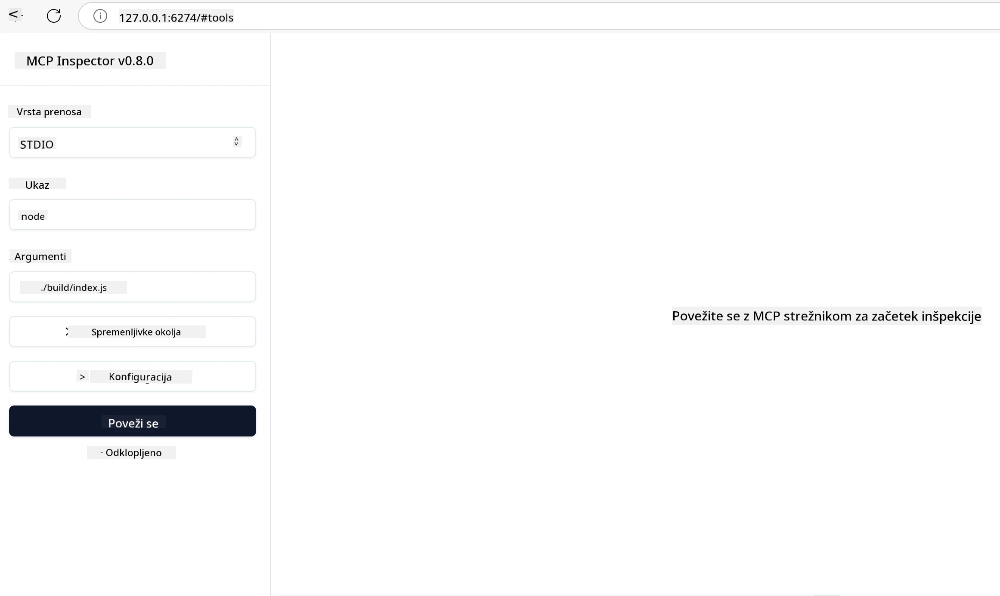

## Testiranje in odpravljanje napak

Preden začnete s testiranjem svojega MCP strežnika, je pomembno razumeti razpoložljiva orodja in najboljše prakse za odpravljanje napak. Učinkovito testiranje zagotavlja, da se vaš strežnik obnaša tako, kot je pričakovano, in vam pomaga hitro identificirati in odpraviti težave. Naslednji odsek opisuje priporočene pristope za preverjanje vaše MCP implementacije.

## Pregled

Ta lekcija zajema, kako izbrati pravi pristop k testiranju in najučinkovitejše orodje za testiranje.

## Cilji učenja

Do konca te lekcije boste znali:

- Opisati različne pristope k testiranju.
- Uporabiti različna orodja za učinkovito testiranje vaše kode.


## Testiranje MCP strežnikov

MCP nudi orodja, ki vam pomagajo testirati in odpravljati napake vaših strežnikov:

- **MCP Inspector**: Orodje v ukazni vrstici, ki ga lahko zaženete kot CLI orodje ali kot vizualno orodje.
- **Ročno testiranje**: Lahko uporabite orodje, kot je curl, za izvajanje spletnih zahtevkov, vendar bo vsako orodje, ki podpira HTTP, ustrezalo.
- **Enotsko testiranje**: Možno je uporabiti vašo priljubljeno testno ogrodje za testiranje funkcij tako strežnika kot odjemalca.

### Uporaba MCP Inspector

Uporabo tega orodja smo opisali v prejšnjih lekcijah, a ga na kratko povzemimo na visoki ravni. To je orodje zgrajeno v Node.js in ga lahko uporabljate z zagonom izvršljive datoteke `npx`, ki bo začasno prenesla in namestila orodje ter se samodejno odstranila, ko bo obdelala vaš zahtevek.

[MCP Inspector](https://github.com/modelcontextprotocol/inspector) vam pomaga:

- **Odkriti zmogljivosti strežnika**: Samodejno zaznajte razpoložljive vire, orodja in pozive
- **Testirati izvajanje orodja**: Preizkusite različne parametre in spremljajte odzive v realnem času
- **Ogledati metapodatke strežnika**: Preučite informacije o strežniku, sheme in konfiguracije

Tipičen zagon orodja izgleda tako:

```bash
npx @modelcontextprotocol/inspector node build/index.js
```

Zgornji ukaz zažene MCP in njegovo vizualno vmesnik ter odpre lokalni spletni vmesnik v vašem brskalniku. Pričakujete lahko prikaz nadzorne plošče z vašimi registriranimi MCP strežniki, njihovimi razpoložljivimi orodji, viri in pozivi. Vmesnik omogoča interaktivno testiranje izvajanja orodja, pregled metapodatkov strežnika in ogled odzivov v realnem času, kar olajša preverjanje in odpravljanje napak v vaših MCP strežniških implementacijah.

Tako lahko izgleda: 

To orodje lahko zaženete tudi v CLI načinu, za kar dodate atribut `--cli`. Tukaj je primer zagona orodja v načinu "CLI", ki izpiše vsa orodja na strežniku:

```sh
npx @modelcontextprotocol/inspector --cli node build/index.js --method tools/list
```

### Ročno testiranje

Poleg zagona orodja inspector za testiranje zmogljivosti strežnika je drug podoben pristop zagon odjemalca, ki zna uporabiti HTTP, na primer curl.

S curl lahko neposredno testirate MCP strežnike z uporabo HTTP zahtev:

```bash
# Example: Test server metadata
curl http://localhost:3000/v1/metadata

# Example: Execute a tool
curl -X POST http://localhost:3000/v1/tools/execute \
  -H "Content-Type: application/json" \
  -d '{"name": "calculator", "parameters": {"expression": "2+2"}}'
```

Kot lahko vidite iz zgornje uporabe curl, uporabite POST zahtevo za klic orodja s prenosom, ki vsebuje ime orodja in njegove parametre. Uporabite pristop, ki vam najbolj ustreza. CLI orodja so na splošno hitrejša za uporabo in omogočajo skriptno izvajanje, kar je lahko koristno v CI/CD okolju.

### Enotsko testiranje

Ustvarite enote testov za vaša orodja in vire, da zagotovite, da delujejo kot je pričakovano. Tukaj je nekaj vzorčne kode za testiranje.

```python
import pytest

from mcp.server.fastmcp import FastMCP
from mcp.shared.memory import (
    create_connected_server_and_client_session as create_session,
)

# Mark the whole module for async tests
pytestmark = pytest.mark.anyio


async def test_list_tools_cursor_parameter():
    """Test that the cursor parameter is accepted for list_tools.

    Note: FastMCP doesn't currently implement pagination, so this test
    only verifies that the cursor parameter is accepted by the client.
    """

 server = FastMCP("test")

    # Create a couple of test tools
    @server.tool(name="test_tool_1")
    async def test_tool_1() -> str:
        """First test tool"""
        return "Result 1"

    @server.tool(name="test_tool_2")
    async def test_tool_2() -> str:
        """Second test tool"""
        return "Result 2"

    async with create_session(server._mcp_server) as client_session:
        # Test without cursor parameter (omitted)
        result1 = await client_session.list_tools()
        assert len(result1.tools) == 2

        # Test with cursor=None
        result2 = await client_session.list_tools(cursor=None)
        assert len(result2.tools) == 2

        # Test with cursor as string
        result3 = await client_session.list_tools(cursor="some_cursor_value")
        assert len(result3.tools) == 2

        # Test with empty string cursor
        result4 = await client_session.list_tools(cursor="")
        assert len(result4.tools) == 2
    
```

Zgornja koda naredi naslednje:

- Uporablja ogrodje pytest, ki omogoča ustvarjanje testov kot funkcij in uporabo assert izjav.
- Ustvari MCP strežnik z dvema različnima orodjema.
- Uporablja izjavo `assert`, da preveri, ali so izpolnjeni določeni pogoji.

Oglejte si [celotno datoteko tukaj](https://github.com/modelcontextprotocol/python-sdk/blob/main/tests/client/test_list_methods_cursor.py)

Glede na zgornjo datoteko lahko testirate svoj strežnik, da zagotovite pravilno ustvarjene zmožnosti.

Vsi glavni SDK-ji imajo podobne razdelke za testiranje, tako da jih lahko prilagodite svojemu izbranemu času izvajanja.

## Primeri

- [Java kalkulator](../samples/java/calculator/README.md)
- [.NET kalkulator](../../../../03-GettingStarted/samples/csharp)
- [JavaScript kalkulator](../samples/javascript/README.md)
- [TypeScript kalkulator](../samples/typescript/README.md)
- [Python kalkulator](../../../../03-GettingStarted/samples/python) 

## Dodatni viri

- [Python SDK](https://github.com/modelcontextprotocol/python-sdk)

## Kaj sledi

- Naslednje: [Namestitev](../09-deployment/README.md)

---

<!-- CO-OP TRANSLATOR DISCLAIMER START -->
**Omejitev odgovornosti**:
Ta dokument je bil preveden z uporabo AI prevajalske storitve [Co-op Translator](https://github.com/Azure/co-op-translator). Čeprav si prizadevamo za natančnost, vas prosimo, da upoštevate, da avtomatizirani prevodi lahko vsebujejo napake ali netočnosti. Izvirni dokument v njegovem izvirnem jeziku je treba obravnavati kot avtoritativni vir. Za kritične informacije je priporočljiv strokovni človeški prevod. Ne odgovarjamo za morebitna nesporazume ali napačne interpretacije, ki izhajajo iz uporabe tega prevoda.
<!-- CO-OP TRANSLATOR DISCLAIMER END -->