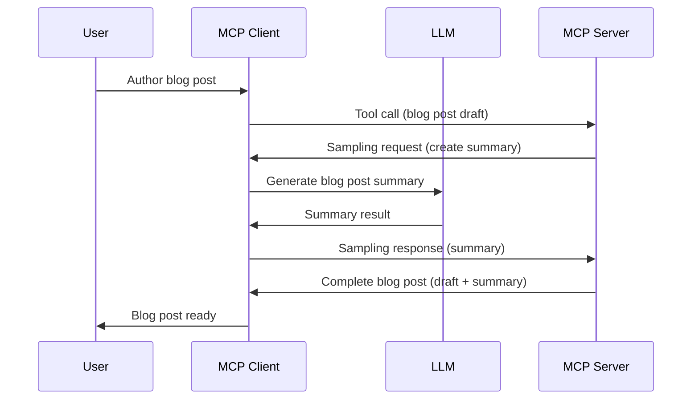

> [!WARNING]
> Vzorcevanje je v MCP `2026-07-28` zastarelo. Ta lekcija je ohranjena za
> starejše izvedbe. Novi strežniki naj se neposredno povežejo z LLM
> ponudnikovo API.

# Vzorcevanje - delegiranje funkcij klientu

> Vzorcevanje ostaja v specifikaciji `2026-07-28` zaradi združljivosti in je
> primerno za odstranitev v prvi reviziji, izdani na ali po 28. juliju
> 2027. Primeri v tej lekciji lahko uporabljajo SDK API-je, ki izvajajo `2025-11-25`.
> Glej [Kaj se je spremenilo v MCP: Specifikacija 2026-07-28](../../01-CoreConcepts/mcp-2026-07-28.md).

V starih izvedbah omogoča Vzorcevanje strežnik MCP, da zaprosi za pomoč LLM,
ki ga upravlja klient. Pri novih izvedbah pokličite izbranega ponudnika LLM
neposredno.

Raziščimo nekaj primerov uporabe in kako zgraditi rešitev, ki vključuje vzorcevanje.

## Pregled

V tej lekciji se osredotočamo na pojasnitev kdaj in kje uporabiti vzorcevanje ter kako ga konfigurirati.

## Cilji učenja

V tej poglavju bomo:

- Pojasnili, kaj je vzorcevanje in kdaj ga uporabiti.
- Pokazali kako konfigurirati vzorcevanje v MCP.
- Podali primere uporabe vzorcevanja v praksi.

## Kaj je vzorcevanje in zakaj ga uporabiti?

Vzorcevanje je napredna funkcija, ki deluje na naslednji način:



### Zahteva za vzorcevanje

V redu, zdaj imamo splošni pogled na verodostojen scenarij, poglejmo zahtevo za vzorcevanje, ki jo strežnik pošlje klientu. Tako izgleda taka zahteva v formatu JSON-RPC:

```json
{
  "jsonrpc": "2.0",
  "id": 1,
  "method": "sampling/createMessage",
  "params": {
    "messages": [
      {
        "role": "user",
        "content": {
          "type": "text",
          "text": "Create a blog post summary of the following blog post: <BLOG POST>"
        }
      }
    ],
    "modelPreferences": {
      "hints": [
        {
          "name": "gpt-5.1"
        }
      ],
      "intelligencePriority": 0.8,
      "speedPriority": 0.5
    },
    "systemPrompt": "You are a helpful assistant.",
    "maxTokens": 100
  }
}
```

V tem primeru je nekaj stvari vrednih omeniti:

- Spodbuda, pod content -> text, je naša spodbuda, ki je navodilo LLM za povzema vsebino bloga.

- **modelPreferences**. Ta razdelek je pravzaprav želja, priporočilo o konfiguraciji, ki naj se uporablja z LLM. Uporabnik lahko izbere, ali bo upošteval ta priporočila ali jih spremenil. V tem primeru so priporočila glede modela, hitrosti in prioritete inteligence.
- **systemPrompt**, to je običajna sistemska spodbuda, ki vašemu LLM daje osebnost in vsebuje navodila.
- **maxTokens**, to je še ena lastnost, ki določa, koliko žetonov je priporočljivo uporabiti za to nalogo.

### Odgovor na vzorcevanje

Ta odgovor je tisto, kar MCP klient na koncu pošlje nazaj MCP strežniku in je rezultat klientovega klica LLM, počakajte na ta odgovor in nato sestavite to sporočilo. Tako izgleda v JSON-RPC:

```json
{
  "jsonrpc": "2.0",
  "id": 1,
  "result": {
    "role": "assistant",
    "content": {
      "type": "text",
      "text": "Here's your abstract <ABSTRACT>"
    },
    "model": "gpt-5.1",
    "stopReason": "endTurn"
  }
}
```

Odgovor je povzetek blog posta, kot je bilo zahtevano. Klient
je izbral aktivno `gpt-5.1` izvedbo iz strežnikove preference modela;
preference modela so priporočila, zato lahko klient izbere drugo aktivno
izvedbo, če je potrebno.

V redu, zdaj ko razumemo glavni potek in uporabno nalogo za "ustvarjanje blog posta + povzetek", poglejmo, kaj moramo storiti, da to deluje.

### Vrste sporočil

Sporočila za vzorcevanje niso omejena samo na besedilo, lahko pa pošljete tudi slike in zvok. Tako JSON-RPC izgleda drugače:

**Besedilo**

```json
{
  "type": "text",
  "text": "The message content"
}
```

**Vsebina slike**

```json
{
  "type": "image",
  "data": "base64-encoded-image-data",
  "mimeType": "image/jpeg"
}
```

**Vsebina avdia**

```json
{
  "type": "audio",
  "data": "base64-encoded-audio-data",
  "mimeType": "audio/wav"
}
```

> NOTE: Za trenutni status in smernice za migracijo glejte
> [zastarelo dokumentacijo za vzorcevanje](https://modelcontextprotocol.io/specification/2026-07-28/client/sampling).

## Kako konfigurirati vzorcevanje v klientu

> Opomba: če gradite samo strežnik, tukaj ne potrebujete veliko storiti.

V klientu morate funkcijo določiti takole:

```json
{
  "capabilities": {
    "sampling": {}
  }
}
```

To se bo nato zaznalo, ko se vaš izbrani klient inicializira s strežnikom.

## Primer vzorcevanja v praksi - ustvarjanje blog posta

Skupaj napišimo vzorčni strežnik, potrebno bo narediti naslednje:

1. Ustvarite orodje na strežniku.
1. Orodje naj ustvari zahtevo za vzorcevanje
1. Orodje naj počaka na odgovor na klientovo zahtevo za vzorcevanje.
1. Nato naj se ustvari rezultat orodja.

Poglejmo kodo korak za korakom:

### -1- Ustvari orodje

**python**

```python
@mcp.tool()
async def create_blog(title: str, content: str, ctx: Context[ServerSession, None]) -> str:
    """Create a blog post and generate a summary"""

```

### -2- Ustvari zahtevo za vzorcevanje

Razširite orodje s sledečo kodo:

**python**

```python
post = BlogPost(
        id=len(posts) + 1,
        title=title,
        content=content,
        abstract=""
    )

prompt = f"Create an abstract of the following blog post: title: {title} and draft: {content} "

result = await ctx.session.create_message(
        messages=[
            SamplingMessage(
                role="user",
                content=TextContent(type="text", text=prompt),
            )
        ],
        max_tokens=100,
)

```

### -3- Počakaj na odgovor in vrni odgovor

**python**

```python
post.abstract = result.content.text

posts.append(post)

# return the complete product
return json.dumps({
    "id": post.title,
    "abstract": post.abstract
})
```

### -4- Celotna koda

**python**

```python
from starlette.applications import Starlette
from starlette.routing import Mount, Host

from mcp.server.fastmcp import Context, FastMCP

from mcp.server.session import ServerSession
from mcp.types import SamplingMessage, TextContent

import json


from uuid import uuid4
from typing import List
from pydantic import BaseModel


mcp = FastMCP("Blog post generator")

# app = FastAPI()

posts = []

class BlogPost(BaseModel):
    id: int
    title: str
    content: str
    abstract: str

posts: List[BlogPost] = []

@mcp.tool()
async def create_blog(title: str, content: str, ctx: Context[ServerSession, None]) -> str:
    """Create a blog post and generate a summary"""

    post = BlogPost(
        id=len(posts) + 1,
        title=title,
        content=content,
        abstract=""
    )

    prompt = f"Create an abstract of the following blog post: title: {title} and draft: {content} "

    result = await ctx.session.create_message(
        messages=[
            SamplingMessage(
                role="user",
                content=TextContent(type="text", text=prompt),
            )
        ],
        max_tokens=100,
    )

    post.abstract = result.content.text

    posts.append(post)

    # return the complete blog post
    return json.dumps({
        "id": post.title,
        "abstract": post.abstract
    })

if __name__ == "__main__":
    print("Starting server...")
    # mcp.run()
    mcp.run(transport="streamable-http")

# run app with: python server.py
```

### -5- Testiranje v Visual Studio Code

Za testiranje v Visual Studio Code naredite naslednje:

1. Zaženite strežnik v terminalu
1. Dodajte ga v *mcp.json* (in zagotovite, da je zagnan), na primer takole:

   ```json
   "servers": {
      "blog-server": {
        "type": "http",
        "url": "http://localhost:8000/mcp"
      }
   }
   ```

1. Vnesite spodbudo:

   ```text
   create a blog post named "Where Python comes from", the content is "Python is actually named after Monty Python Flying Circus"
   ```

1. Omogočite vzorcevanje. Prvič, ko to preizkusite, boste prejeli dodatno pogovorno okno, ki ga boste morali potrditi, nato se bo prikazalo običajno okno, ki vas bo prosilo za zagon orodja.

1. Preglejte rezultate. Rezultate boste videli lepo prikazane v GitHub Copilot Chatu, lahko pa tudi pregledate surovi JSON odgovor.

**Bonus**. Orodja Visual Studio Code imajo odlično podporo za vzorcevanje. Dostop do vzorcevanja na vašem nameščenem strežniku lahko konfigurirate tako:

1. Pojdite v razdelek z razširitvami.
1. Izberite ikono zobnika za vaš nameščeni strežnik v razdelku "MCP SERVERS - INSTALLED".
1 Izberite "Configure Model Access", tukaj lahko izberete, katere modele sme GitHub Copilot uporabiti med vzorcevanjem. Prav tako lahko vidite vse zahteve za vzorcevanje nazadnje izvršene tako, da izberete "Show Sampling requests".

## Naloga

V tej nalogi boste zgradili malo drugačno vzorecavanje, namreč integracijo vzorcevanja, ki podpira generiranje opisa izdelka. Tukaj je vaš scenarij:

**Scenarij**: Delo v upravi e-trgovine vzame preveč časa za izdelavo opisov izdelkov. Zato boste zgradili rešitev, kjer pokličete orodje "create_product" s parametri "title" in "keywords" in naj bi proizvedlo celoten izdelek vključno z "description" poljem, ki ga napolni LLM klienta.

NAMIG: uporabite, kar ste se naučili prej za konstrukcijo tega strežnika in njegovega orodja z uporabo zahteve za vzorcevanje.

## Rešitev

[Rešitev](./solution/README.md)

## Ključne točke

Vzorcevanje je zmogljiva funkcija, ki omogoča strežniku, da oddelegira naloge klientu, kadar potrebuje pomoč LLM.

## Kaj sledi

- [Poglavje 4 - Praktična izvedba](../../04-PracticalImplementation/README.md)

---

<!-- CO-OP TRANSLATOR DISCLAIMER START -->
**Omejitev odgovornosti**:
Ta dokument je bil preveden z uporabo AI prevajalske storitve [Co-op Translator](https://github.com/Azure/co-op-translator). Čeprav si prizadevamo za natančnost, vas prosimo, da upoštevate, da avtomatizirani prevodi lahko vsebujejo napake ali netočnosti. Izvirni dokument v njegovem izvirnem jeziku je treba obravnavati kot avtoritativni vir. Za kritične informacije je priporočljiv strokovni človeški prevod. Ne odgovarjamo za morebitna nesporazume ali napačne interpretacije, ki izhajajo iz uporabe tega prevoda.
<!-- CO-OP TRANSLATOR DISCLAIMER END -->