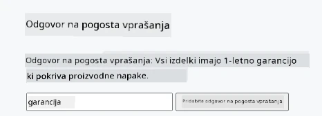
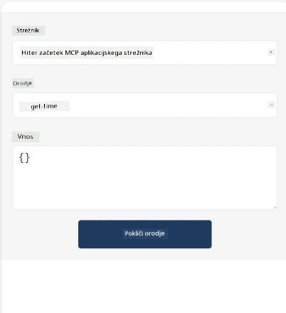
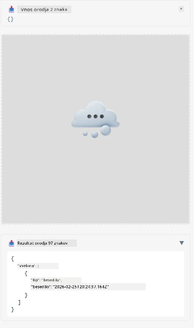

Tukaj je primer, ki prikazuje MCP aplikacijo

## Namestitev 

1. Pomaknite se do mape *mcp-app*
1. Zaženite `npm install`, s čimer boste namestili odvisnosti za frontend in backend

Preverite, ali se backend prevede, tako da zaženete:

```sh
npx tsc --noEmit
```

Če je vse v redu, izhoda ne bi smelo biti.

## Zaženi backend

> To zahteva nekaj dodatnega dela, če uporabljate Windows napravo, saj MCP Apps rešitev uporablja knjižnico `concurrently`, za katero morate najti nadomestilo. Tu je problematična vrstica iz *package.json* v MCP aplikaciji:

```json
"start": "concurrently \"cross-env NODE_ENV=development INPUT=mcp-app.html vite build --watch\" \"tsx watch main.ts\""
```

Ta aplikacija ima dva dela, backend del in gostiteljski del.

Zaženite backend z ukazom:

```sh
npm start
```

S tem bi moral backend začeti na `http://localhost:3001/mcp`.

> Opomba, če ste v Codespace okolju, boste morda morali nastaviti vidnost vrat na javno. Preverite, ali lahko dostopate do končne točke v brskalniku prek https://<name Codespace>.app.github.dev/mcp

## Možnost -1 Preizkus aplikacije v Visual Studio Code

Za testiranje rešitve v Visual Studio Code naredite naslednje:

- Dodajte zapis strežnika v `mcp.json` na naslednji način:

    ```json
    {
        "servers": {
            "my-mcp-server-7178eca7": {
                "url": "http://localhost:3001/mcp",
                "type": "http"
            }
        },
        "inputs": []
    }
    ```

1. Kliknite na gumb "start" v *mcp.json*
1. Prepričajte se, da je odprto okno klepeta in vpišite `get-faq`, videli boste rezultat, kot je ta:

    

## Možnost -2- Testiranje aplikacije s gostiteljem

Repo <https://github.com/modelcontextprotocol/ext-apps> vsebuje več različnih gostiteljev, ki jih lahko uporabite za testiranje vaših MVP aplikacij.

Tukaj vam predstavljamo dve različni možnosti:

### Lokalna naprava

- Po kloniranju repozitorija se pomaknite do *ext-apps*.

- Namestite odvisnosti

   ```sh
   npm install
   ```

- V ločenem oknu terminala se pomaknite do *ext-apps/examples/basic-host*

    > Če ste v Codespace-u, pojdite v serve.ts in na vrstico 27 ter nadomestite http://localhost:3001/mcp z vašo Codespace URL za backend, na primer https://psychic-xylophone-657rpjgvxpc5g64-3001.app.github.dev/mcp

- Zaženite gostitelja:

    ```sh
    npm start
    ```

    S tem naj bi gostitelj povezal backend, aplikacijo pa videli, kot je prikazano:

    

### Codespace

Delo v Codespace okolju zahteva nekaj dodatnega dela. Če želite uporabiti gostitelja prek Codespace:

- Poglejte v mapo *ext-apps* in pojdite do *examples/basic-host*. 
- Za namestitev odvisnosti zaženite `npm install`
- Za zagon gostitelja zaženite `npm start`.

## Preizkusite aplikacijo

Poskusite aplikacijo na naslednji način:

- Izberite gumb "Call Tool" in videli boste rezultate, kot so ti:

    

Odlično, vse deluje.

---

<!-- CO-OP TRANSLATOR DISCLAIMER START -->
**Omejitev odgovornosti**:
Ta dokument je bil preveden z uporabo AI prevajalske storitve [Co-op Translator](https://github.com/Azure/co-op-translator). Čeprav si prizadevamo za natančnost, vas prosimo, da upoštevate, da avtomatizirani prevodi lahko vsebujejo napake ali netočnosti. Izvirni dokument v njegovem izvirnem jeziku je treba obravnavati kot avtoritativni vir. Za kritične informacije je priporočljiv strokovni človeški prevod. Ne odgovarjamo za morebitna nesporazume ali napačne interpretacije, ki izhajajo iz uporabe tega prevoda.
<!-- CO-OP TRANSLATOR DISCLAIMER END -->