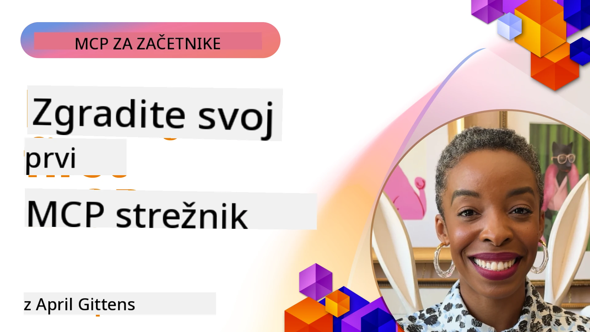

## Začetek  

_(Kliknite zgornjo sliko za ogled videa te lekcije)_

Ta razdelek vsebuje več lekcij:

- **1 Vaš prvi strežnik**, v tej prvi lekciji se boste naučili, kako ustvariti svoj prvi strežnik in ga pregledati z orodjem inspector, dragocen način za testiranje in odpravljanje napak vašega strežnika, [do lekcije](01-first-server/README.md)

- **2 Odjemalec**, v tej lekciji se boste naučili, kako napisati odjemalca, ki se lahko poveže z vašim strežnikom, [do lekcije](02-client/README.md)

- **3 Odjemalec z LLM**, še boljši način pisanja odjemalca je dodajanje LLM, da lahko "pogaja" z vašim strežnikom o tem, kaj narediti, [do lekcije](03-llm-client/README.md)

- **4 Poraba načina agenta GitHub Copilot strežnika v Visual Studio Code**. Tukaj si ogledujemo izvajanje našega MCP strežnika znotraj Visual Studio Code, [do lekcije](04-vscode/README.md)

- **5 stdio Transport Server** stdio transport je priporočeni standard za lokalno komunikacijo med MCP strežnikom in odjemalcem, zagotavlja varno komunikacijo med podprocesi z vgrajeno izolacijo procesov [do lekcije](05-stdio-server/README.md)

- **6 HTTP pretakanje z MCP (Streamable HTTP)**. Spoznajte standardni
	oddaljeni transport v [MCP specifikaciji 2026-07-28](https://modelcontextprotocol.io/specification/2026-07-28/basic/transports/streamable-http),
	ter staro sejo temelječo implementacijo, ki ostaja v lekciji.
	[do lekcije](06-http-streaming/README.md)

- **7 Uporaba Microsoft Foundry Toolkit za Visual Studio Code** za porabo in testiranje vaših MCP odjemalcev in strežnikov [v tej lekciji](07-aitk/README.md)

- **8 Testiranje**. Tukaj se bomo posebej osredotočili, kako lahko na različne načine testiramo naš strežnik in odjemalca, [do lekcije](08-testing/README.md)

- **9 Implementacija**. Ta poglavje se osredotoča na različne načine uvajanja vaših MCP rešitev, [do lekcije](09-deployment/README.md)

- **10 Napredna uporaba strežnika**. Ta poglavje zajema napredno uporabo strežnika, [do lekcije](./10-advanced/README.md)

- **11 Avtentikacija**. To poglavje opisuje, kako dodati preprosto avtentikacijo, od Basic Auth do uporabe JWT in RBAC. Priporočamo, da začnete tukaj in nato nadaljujete s Naprednimi temami v poglavju 5 ter dodatnim varnostnim utrjevanjem po priporočilih v poglavju 2, [do lekcije](./11-simple-auth/README.md)

- **12 MCP Gostitelji**. Konfigurirajte in uporabljajte priljubljene MCP gostiteljske odjemalce, vključno z Claude Desktop, Cursor, Cline in Windsurf. Spoznajte tipe transporta in odpravljanje težav, [do lekcije](./12-mcp-hosts/README.md)

- **13 MCP Inspector**. Odpravljajte napake in testirajte svoj MCP strežnik interaktivno z orodjem MCP Inspector. Naučite se odpravljanja težav z orodji, viri in sporočili protokola, [do lekcije](./13-mcp-inspector/README.md)

- **14 Sampling**. Spoznajte zastarelo Sampling primitivno za `2025-11-25` in
	kako migrirati nove zasnove v neposredno integracijo ponudnika LLM. Sampling je
	opravičen v MCP `2026-07-28`. [do lekcije](./14-sampling/README.md)

- **15 MCP Aplikacije**. Gradite MCP strežnike, ki prav tako odgovarjajo z UI navodili, [do lekcije](./15-mcp-apps/README.md)

Protokol konteksta modela (MCP) je odprt protokol, ki standardizira, kako aplikacije zagotavljajo kontekst LLM. Pomislite na MCP kot na USB-C priključek za AI aplikacije - omogoča standardiziran način povezave AI modelov z različnimi podatkovnimi viri in orodji.

## Cilji učenja

Do konca te lekcije boste znali:

- Nastaviti razvojna okolja za MCP v C#, Java, Python, TypeScript in JavaScript
- Graditi in uvajati osnovne MCP strežnike s prilagojenimi funkcijami (viri, pozivi in orodja)
- Ustvariti gostiteljske aplikacije, ki se povezujejo na MCP strežnike
- Testirati in odpravljati napake MCP implementacij
- Razumeti pogoste izzive nastavitve in njihove rešitve
- Povezati svoje MCP implementacije s priljubljenimi LLM storitvami

## Nastavitev vašega MCP okolja

Preden začnete delati z MCP, je pomembno pripraviti svoje razvojno okolje in razumeti osnovni potek dela. Ta razdelek vas bo vodil skozi začetne korake nastavitve, da zagotovite nemoten začetek z MCP.

### Pogoji

Preden se poglobite v razvoj MCP, zagotovite, da imate:

- **Razvojno okolje**: za izbrani jezik (C#, Java, Python, TypeScript ali JavaScript)
- **IDE/Urejevalnik**: Visual Studio, Visual Studio Code, IntelliJ, Eclipse, PyCharm ali kateri koli sodoben urejevalnik kode
- **Upravitelji paketov**: NuGet, Maven/Gradle, pip ali npm/yarn
- **API ključi**: za katere koli AI storitve, ki jih nameravate uporabljati v svojih gostiteljskih aplikacijah

### Uradne SDK-je

V prihajajočih poglavjih boste videli rešitve, zgrajene z uporabo Python, TypeScript,
Java in .NET. Tukaj so uradne SDK-je.

Podpora SDK za MCP `2026-07-28` se uvaja neodvisno po jezikih.
Pred zagonom primera preverite različico paketa in opombe k izidu
SDK za podprte različice protokola. Oglejte si
[uradni seznam SDK](https://modelcontextprotocol.io/docs/sdk):
- [C# SDK](https://github.com/modelcontextprotocol/csharp-sdk) - Vzdrževan v sodelovanju z Microsoftom
- [Java SDK](https://github.com/modelcontextprotocol/java-sdk) - Vzdrževan v sodelovanju s Spring AI
- [TypeScript SDK](https://github.com/modelcontextprotocol/typescript-sdk) - Uradna implementacija za TypeScript
- [Python SDK](https://github.com/modelcontextprotocol/python-sdk) - Uradna Python implementacija (FastMCP)
- [Kotlin SDK](https://github.com/modelcontextprotocol/kotlin-sdk) - Uradna Kotlin implementacija
- [Swift SDK](https://github.com/modelcontextprotocol/swift-sdk) - Vzdrževan v sodelovanju z Loopwork AI
- [Rust SDK](https://github.com/modelcontextprotocol/rust-sdk) - Uradna Rust implementacija
- [Go SDK](https://github.com/modelcontextprotocol/go-sdk) - Uradna Go implementacija

## Ključne ugotovitve

- Nastavitev MCP razvojnega okolja je enostavna z jezikovno specifičnimi SDK-ji
- Gradnja MCP strežnikov vključuje ustvarjanje in registracijo orodij z jasnimi shemami
- MCP odjemalci se povezujejo s strežniki in modeli za uporabo razširjenih zmogljivosti
- Testiranje in odpravljanje napak sta ključna za zanesljive MCP implementacije
- Možnosti uvajanja segajo od lokalnega razvoja do rešitev v oblaku

## Vaje

Imamo nabor primerov, ki dopolnjujejo vaje, ki jih boste videli v vseh poglavjih tega razdelka. Poleg tega ima vsako poglavje svoje vaje in naloge

- [Java kalkulator](./samples/java/calculator/README.md)
- [.NET kalkulator](../../../03-GettingStarted/samples/csharp)
- [JavaScript kalkulator](./samples/javascript/README.md)
- [TypeScript kalkulator](./samples/typescript/README.md)
- [Python kalkulator](../../../03-GettingStarted/samples/python)

## Dodatni viri

- [Zgradite agente z uporabo Model Context Protocol na Azure](https://learn.microsoft.com/azure/developer/ai/intro-agents-mcp)
- [Oddaljeni MCP z Azure Container Apps (Node.js/TypeScript/JavaScript)](https://learn.microsoft.com/samples/azure-samples/mcp-container-ts/mcp-container-ts/)
- [.NET OpenAI MCP agent](https://learn.microsoft.com/samples/azure-samples/openai-mcp-agent-dotnet/openai-mcp-agent-dotnet/)

## Kaj sledi

Začnite s prvo lekcijo: [Ustvarjanje vašega prvega MCP strežnika](01-first-server/README.md)

Ko zaključite ta modul, nadaljujte z: [Modul 4: Praktična implementacija](../04-PracticalImplementation/README.md)

---

<!-- CO-OP TRANSLATOR DISCLAIMER START -->
**Omejitev odgovornosti**:
Ta dokument je bil preveden z uporabo AI prevajalske storitve [Co-op Translator](https://github.com/Azure/co-op-translator). Čeprav si prizadevamo za natančnost, vas prosimo, da upoštevate, da avtomatizirani prevodi lahko vsebujejo napake ali netočnosti. Izvirni dokument v njegovem izvirnem jeziku je treba obravnavati kot avtoritativni vir. Za kritične informacije je priporočljiv strokovni človeški prevod. Ne odgovarjamo za morebitna nesporazume ali napačne interpretacije, ki izhajajo iz uporabe tega prevoda.
<!-- CO-OP TRANSLATOR DISCLAIMER END -->