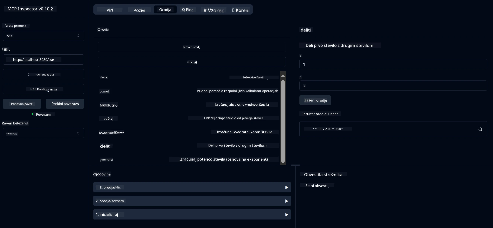

# Osnovna storitev kalkulatorja MCP

> [!NOTE]
> Ta primer uporablja zastareli prenos HTTP+SSE in cilja na SDK, združljiv
> z MCP `2025-11-25`. Novi oddaljeni strežniki naj uporabljajo `2026-07-28` Streamable
> HTTP podporo.

Ta storitev nudi osnovne operacije kalkulatorja prek Model Context Protocol (MCP) z uporabo Spring Boot in WebFlux prenosa. Namenjena je kot enostaven primer za začetnike, ki se učijo o implementacijah MCP.

Za več informacij si oglejte referenčno dokumentacijo [MCP Server Boot Starter](https://docs.spring.io/spring-ai/reference/api/mcp/mcp-server-boot-starter-docs.html).

## Pregled

Storitve prikazuje:
- Podporo za SSE (Server-Sent Events)
- Samodejno registracijo orodij z uporabo anotacije Spring AI `@Tool`
- Osnovne funkcije kalkulatorja:
  - Seštevanje, odštevanje, množenje, deljenje
  - Izračun potenc in kvadratni koren
  - Modulo (ostanek) in absolutna vrednost
  - Pomožna funkcija za opise operacij

## Značilnosti

Ta storitev kalkulatorja ponuja naslednje zmogljivosti:

1. **Osnovne aritmetične operacije**:
   - Seštevanje dveh števil
   - Odštevanje enega števila od drugega
   - Množenje dveh števil
   - Deljenje enega števila z drugim (s preverjanjem deljenja z nič)

2. **Napredne operacije**:
   - Izračun potenc (potenciranje baze z eksponentom)
   - Izračun kvadratnega korena (s preverjanjem negativnih števil)
   - Izračun modulo (ostanka pri deljenju)
   - Izračun absolutne vrednosti

3. **Pomožni sistem**:
   - Vgrajena pomožna funkcija, ki razloži vse razpoložljive operacije

## Uporaba storitve

Storitve izpostavi naslednje API končne točke prek MCP protokola:

- `add(a, b)`: Dodaj dve številki skupaj
- `subtract(a, b)`: Odštej drugo število od prvega
- `multiply(a, b)`: Pomnoži dve številki
- `divide(a, b)`: Deli prvo število z drugim (s preverjanjem ničelnega deljenja)
- `power(base, exponent)`: Izračunaj potenco števila
- `squareRoot(number)`: Izračunaj kvadratni koren (s preverjanjem negativnih števil)
- `modulus(a, b)`: Izračunaj ostanek pri deljenju
- `absolute(number)`: Izračunaj absolutno vrednost
- `help()`: Pridobi informacije o razpoložljivih operacijah

## Preizkusni odjemalec

Enostaven preizkusni odjemalec je vključен v paket `com.microsoft.mcp.sample.client`. Razred `SampleCalculatorClient` demonstrira razpoložljive operacije storitve kalkulatorja.

## Uporaba LangChain4j odjemalca

Projekt vključuje primer odjemalca LangChain4j v
`com.microsoft.mcp.sample.client.LangChain4jClient`, ki prikazuje, kako
integrirati storitev kalkulatorja z Microsoft Foundry modelom.

### Predpogoji

1. Ustvarite Microsoft Foundry virov in namestite aktiven model, kot je
   `gpt-5.1`.
2. Nastavite konec modela, API ključ in ime namestitve:

   ```bash
   export AZURE_OPENAI_ENDPOINT="https://<resource-name>.openai.azure.com"
   export AZURE_OPENAI_API_KEY="<api-key>"
   export AZURE_OPENAI_DEPLOYMENT="gpt-5.1"
   ```

3. Preverite
   [Microsoft Foundry model retirement schedule](https://learn.microsoft.com/azure/foundry/openai/concepts/model-retirement-schedule)
   pred izbiro namestitve.
4. Poskrbite, da strežnik kalkulatorja teče na `localhost:8080`.

### Zagon LangChain4j odjemalca

Ta primer prikazuje:
- Povezavo na strežnik MCP kalkulatorja preko SSE prenosa
- Uporabo LangChain4j za ustvarjanje klepetalnega bota, ki uporablja kalkulatorjske operacije
- Integracijo z nameščenim Microsoft Foundry modelom

Odjemalec pošlje naslednje vzorčne poizvedbe za demonstracijo funkcionalnosti:
1. Izračun seštevka dveh števil
2. Iskanje kvadratnega korena števila
3. Pridobitev pomožnih informacij o razpoložljivih kalkulatorskih operacijah

Zaženite primer in preverite izpis v konzoli, kako AI model uporablja kalkulatorjske funkcije za odziv na poizvedbe.

### Konfiguracija Microsoft Foundry modela

LangChain4j odjemalec uporablja zaključek Azure OpenAI v1, ki ga izpostavlja
Microsoft Foundry:

```java
String endpoint = System.getenv("AZURE_OPENAI_ENDPOINT");
ChatLanguageModel model = OpenAiOfficialChatModel.builder()
   .baseUrl(endpoint.replaceAll("/+$", "") + "/openai/v1/")
   .apiKey(System.getenv("AZURE_OPENAI_API_KEY"))
   .isAzure(true)
   .modelName(System.getenv().getOrDefault("AZURE_OPENAI_DEPLOYMENT", "gpt-5.1"))
    .timeout(Duration.ofSeconds(60))
    .build();
```

`AZURE_OPENAI_DEPLOYMENT` mora ustrezati imenu, dodeljenemu ob
namestitvi modela, ki se lahko razlikuje od osnovnega imena modela.

## Odvisnosti

Projekt zahteva naslednje ključne odvisnosti:

```xml
<!-- For MCP Server -->
<dependency>
    <groupId>org.springframework.ai</groupId>
    <artifactId>spring-ai-starter-mcp-server-webflux</artifactId>
</dependency>

<!-- For LangChain4j integration -->
<dependency>
    <groupId>dev.langchain4j</groupId>
    <artifactId>langchain4j-mcp</artifactId>
    <version>${langchain4j.version}</version>
</dependency>

<!-- For Microsoft Foundry's OpenAI-compatible endpoint -->
<dependency>
    <groupId>dev.langchain4j</groupId>
   <artifactId>langchain4j-open-ai-official</artifactId>
    <version>${langchain4j.version}</version>
</dependency>
```

## Gradnja projekta

Projekt zgradite z uporabo Maven:
```bash
./mvnw clean install -DskipTests
```

## Zagon strežnika

### Uporaba Jave

```bash
java -jar target/calculator-server-0.0.1-SNAPSHOT.jar
```

### Uporaba MCP Inspectorja

MCP Inspector je koristno orodje za interakcijo s MCP storitvami. Za uporabo s to kalkulatorsko storitvijo:

1. **Namestite in zaženite MCP Inspector** v novi terminalski seji:
   ```bash
   npx @modelcontextprotocol/inspector
   ```

2. **Dostopajte do spletnega vmesnika** s klikom na URL, ki ga prikaže aplikacija (ponavadi http://localhost:6274)

3. **Konfigurirajte povezavo**:
   - Nastavite tip prenosa na "SSE"
   - Nastavite URL do SSE končne točke vašega delujočega strežnika: `http://localhost:8080/sse`
   - Kliknite "Connect"

4. **Uporabite orodja**:
   - Kliknite "List Tools" za ogled razpoložljivih operacij kalkulatorja
   - Izberite orodje in kliknite "Run Tool" za izvedbo operacije



### Uporaba Dockerja

Projekt vključuje Dockerfile za kontejnersko namestitev:

1. **Zgradite Docker sliko**:
   ```bash
   docker build -t calculator-mcp-service .
   ```

2. **Zaženite Docker kontejner**:
   ```bash
   docker run -p 8080:8080 calculator-mcp-service
   ```

To bo:
- Zgradilo večstopenjsko Docker sliko z Maven 3.9.9 in Eclipse Temurin 24 JDK
- Ustvarilo optimizirano kontejnersko sliko
- Izpostavilo storitev na vratih 8080
- Zagnalo MCP kalkulatorsko storitev znotraj kontejnerja

Do storitve lahko dostopate na `http://localhost:8080`, ko je kontejner zagnan.

## Odpravljanje težav

### Pogoste težave s povezavo modela

1. **Napake pri preverjanju pristnosti**: Preverite, da `AZURE_OPENAI_API_KEY` pripada
   viru, določenemu z `AZURE_OPENAI_ENDPOINT`.
2. **Namestitev ni najdena**: Preverite, da `AZURE_OPENAI_DEPLOYMENT` natančno ustreza
   imenu namestitve v Microsoft Foundry.
3. **Omejevanje hitrosti**: Preverite kvoto namestitve in poskusite znova po obdobju,
   ki ga vrne storitev.

Za dodatno pomoč glejte
[LangChain4j dokumentacijo](https://github.com/langchain4j/langchain4j) in
[Microsoft Foundry dokumentacijo](https://learn.microsoft.com/azure/ai-foundry/).

---

<!-- CO-OP TRANSLATOR DISCLAIMER START -->
**Omejitev odgovornosti**:
Ta dokument je bil preveden z uporabo AI prevajalske storitve [Co-op Translator](https://github.com/Azure/co-op-translator). Čeprav si prizadevamo za natančnost, vas prosimo, da upoštevate, da avtomatizirani prevodi lahko vsebujejo napake ali netočnosti. Izvirni dokument v njegovem izvirnem jeziku je treba obravnavati kot avtoritativni vir. Za kritične informacije je priporočljiv strokovni človeški prevod. Ne odgovarjamo za morebitna nesporazume ali napačne interpretacije, ki izhajajo iz uporabe tega prevoda.
<!-- CO-OP TRANSLATOR DISCLAIMER END -->