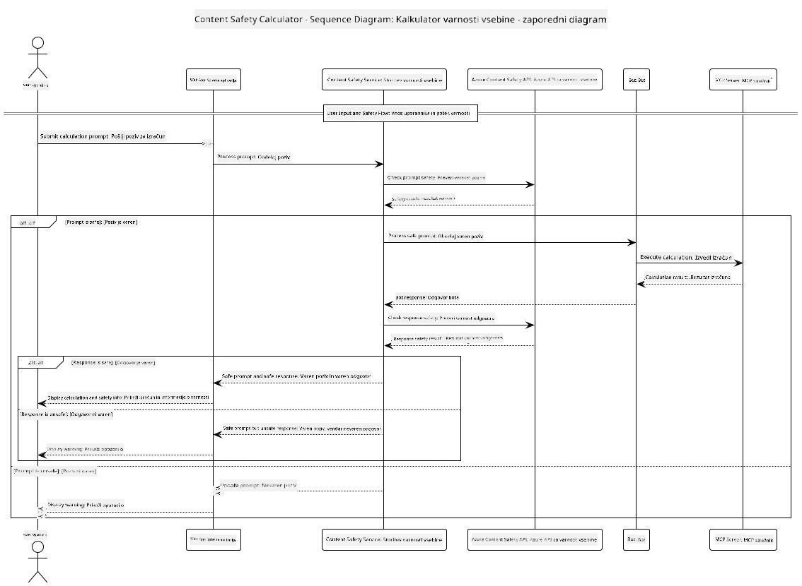

## Arhitektura sistema

Ta projekt prikazuje spletno aplikacijo, ki uporablja preverjanje varnosti vsebine, preden posreduje uporabniške pozive kalkulatorju preko Model Context Protocol (MCP).



### Kako deluje

1. **Uporabniški vnos**: Uporabnik v spletni vmesnik vnese poziv za izračun
2. **Preverjanje varnosti vsebine (vnos)**: Poziv analizira Azure Content Safety API
3. **Odločitev o varnosti (vnos)**:
   - Če je vsebina varna (resnost < 2 v vseh kategorijah), se nadaljuje do kalkulatorja
   - Če je vsebina označena kot potencialno škodljiva, postopek ustavi in prikaže opozorilo
4. **Integracija kalkulatorja**: Varna vsebina se obdeluje z LangChain4j, ki komunicira s strežnikom MCP kalkulatorja
5. **Preverjanje varnosti vsebine (izhod)**: Odgovor bota analizira Azure Content Safety API
6. **Odločitev o varnosti (izhod)**:
   - Če je odgovor bota varen, se prikaže uporabniku
   - Če je odgovor bota označen kot potencialno škodljiv, ga nadomesti opozorilo
7. **Odgovor**: Rezultati (če so varni) se prikažejo uporabniku skupaj z obema analizama varnosti

## Uporaba Model Context Protocol (MCP) s kalkulatorskimi storitvami

Ta projekt prikazuje, kako uporabiti Model Context Protocol (MCP) za klic MCP storitev kalkulatorja iz LangChain4j. Implementacija uporablja lokalni MCP strežnik, ki teče na vratih 8080 za zagotavljanje kalkulatorskih operacij.

### Nastavitev storitve Azure Content Safety

Pred uporabo funkcij varnosti vsebine morate ustvariti vir Azure Content Safety:

1. Prijavite se v [Azure Portal](https://portal.azure.com)
2. Kliknite "Create a resource" in poiščite "Content Safety"
3. Izberite "Content Safety" in kliknite "Create"
4. Vnesite edinstveno ime za vaš vir
5. Izberite naročnino in skupino virov (ali ustvarite novo)
6. Izberite podprto regijo (podrobnosti preverite na [Region availability](https://azure.microsoft.com/en-us/global-infrastructure/services/?products=cognitive-services))
7. Izberite ustrezno cenovno stopnjo
8. Kliknite "Create" za namestitev vira
9. Ko je namestitev končana, kliknite "Go to resource"
10. V levem panelu, pod "Resource Management", izberite "Keys and Endpoint"
11. Kopirajte enega od ključev in URL končne točke za naslednji korak

### Konfiguracija okoljskih spremenljivk

Nastavite končno točko modela Microsoft Foundry, API ključ in ime namestitve:
```sh
export AZURE_OPENAI_ENDPOINT="https://<resource-name>.openai.azure.com"
export AZURE_OPENAI_API_KEY="<api-key>"
export AZURE_OPENAI_DEPLOYMENT="gpt-5.1"
```

Za funkcije varnosti vsebine nastavite:
```sh
export CONTENT_SAFETY_ENDPOINT=<your_content_safety_endpoint>
export CONTENT_SAFETY_KEY=<your_content_safety_key>
```

Te okoljske spremenljivke aplikacija uporablja za avtentikacijo s storitvijo Azure Content Safety. Če niso nastavljene, bo aplikacija uporabila nadomestne vrednosti za demonstracijo, vendar funkcije varnosti vsebine ne bodo delovale pravilno.

### Zagon MCP strežnika kalkulatorja

Pred zagonom odjemalca morate zagnati MCP strežnik kalkulatorja v SSE načinu na localhost:8080.

## Opis projekta

Ta projekt prikazuje integracijo Model Context Protocol (MCP) z LangChain4j za klic kalkulatorskih storitev. Ključne značilnosti vključujejo:

- Uporabo MCP za povezavo s kalkulatorsko storitvijo za osnovne matematične operacije
- Dvojno plast preverjanja varnosti vsebine na uporabniške pozive in botove odgovore
- Integracijo z nameščenim modelom Microsoft Foundry preko LangChain4j
- Uporabo Server-Sent Events (SSE) za MCP transport

## Integracija varnosti vsebine

Projekt vključuje obsežne funkcije varnosti vsebine, ki zagotavljajo, da so tako uporabniški vnosi kot odzivi sistema brez škodljive vsebine:

1. **Preverjanje vnosa**: Vsi uporabniški pozivi se analizirajo glede škodljivih vsebinskih kategorij kot so sovražni govor, nasilje, samopoškodbe in spolna vsebina pred obdelavo.

2. **Preverjanje izhoda**: Tudi pri uporabi potencialno necenzuriranih modelov sistem preveri vse generirane odgovore skozi iste filtre varnosti vsebine pred prikazom uporabniku.

Ta dvojna plast zagotavlja, da sistem ostane varen ne glede na uporabljeni AI model, tako da varuje uporabnike pred škodljivimi vnosi in potencialno problematičnimi AI-generiranimi izhodi.

## Spletni odjemalec

Aplikacija vključuje uporabniku prijazen spletni vmesnik, ki omogoča interakcijo s sistemom Content Safety Calculator:

### Značilnosti spletnega vmesnika

- Preprost, intuitiven obrazec za vnos izračunskih pozivov
- Dvojno preverjanje varnosti vsebine (vnos in izhod)
- Povratna informacija v realnem času o varnosti poziva in odgovora
- Barvno označeni varnostni indikatorji za lažje razumevanje
- Čist, odziven dizajn, ki deluje na različnih napravah
- Primeri varnih pozivov za usmerjanje uporabnikov

### Uporaba spletnega odjemalca

1. Zaženite aplikacijo:
   ```sh
   mvn spring-boot:run
   ```

2. Odprite brskalnik in pojdite na `http://localhost:8087`

3. Vnesite izračunski poziv na za to predvideno besedilno območje (npr. "Izračunaj vsoto 24.5 in 17.3")

4. Kliknite "Submit", da obdelate zahtevo

5. Ogledate si lahko rezultate, ki vključujejo:
   - Analizo varnosti vsebine vašega poziva
   - Izračunani rezultat (če je poziv bil varen)
   - Analizo varnosti vsebine odgovora bota
   - Morebitna varnostna opozorila, če je bil vnos ali izhod označen

Spletni odjemalec samodejno upravlja oba postopka preverjanja varnosti vsebine, kar zagotavlja, da so vse interakcije varne in primerne, ne glede na to, kateri AI model se uporablja.

---

<!-- CO-OP TRANSLATOR DISCLAIMER START -->
**Omejitev odgovornosti**:
Ta dokument je bil preveden z uporabo AI prevajalske storitve [Co-op Translator](https://github.com/Azure/co-op-translator). Čeprav si prizadevamo za natančnost, vas prosimo, da upoštevate, da avtomatizirani prevodi lahko vsebujejo napake ali netočnosti. Izvirni dokument v njegovem izvirnem jeziku je treba obravnavati kot avtoritativni vir. Za kritične informacije je priporočljiv strokovni človeški prevod. Ne odgovarjamo za morebitna nesporazume ali napačne interpretacije, ki izhajajo iz uporabe tega prevoda.
<!-- CO-OP TRANSLATOR DISCLAIMER END -->