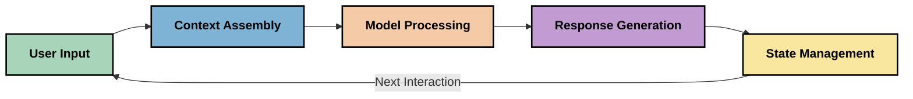
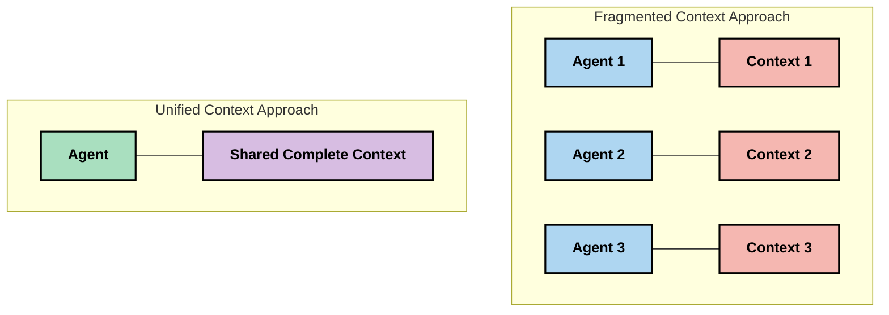
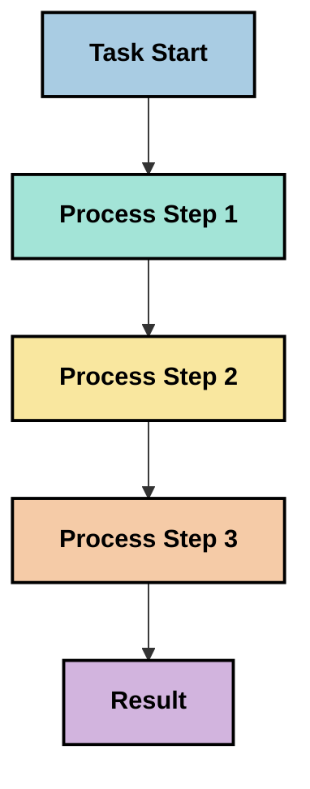
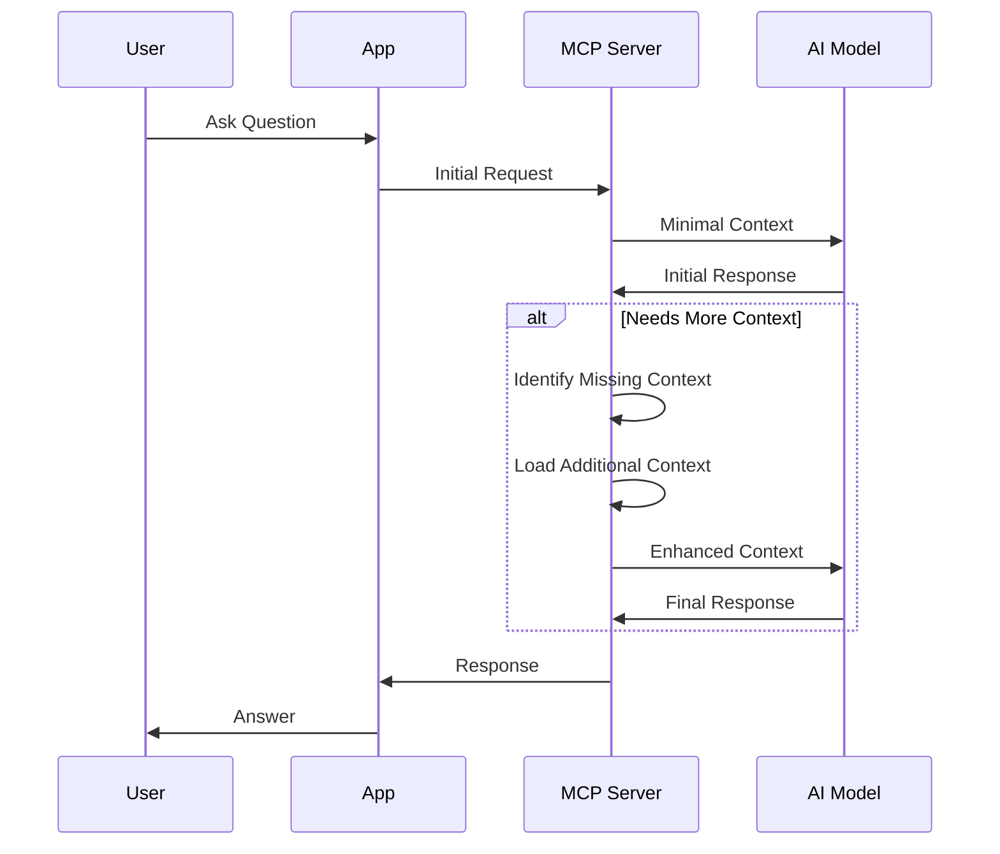
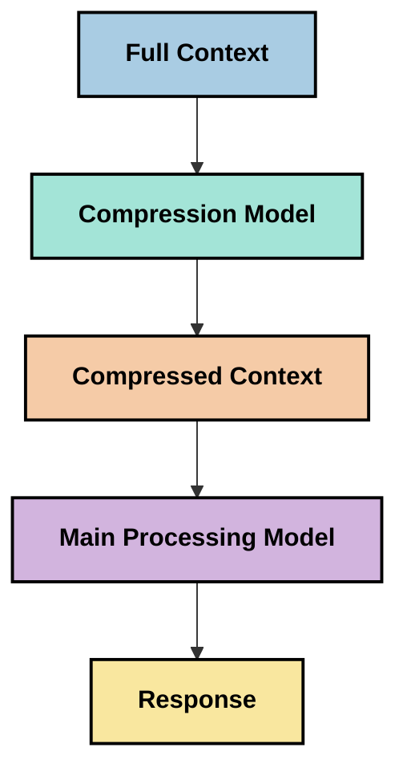
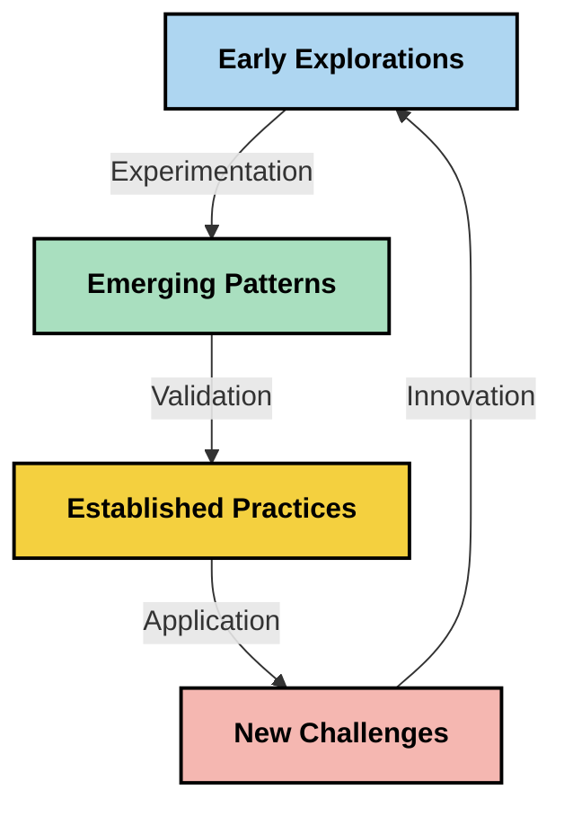

# Kontekstno inženirstvo: Pojavljajoči se koncept v MCP ekosistemu

## Pregled

Kontekstno inženirstvo je nov koncept na področju umetne inteligence, ki raziskuje, kako je informacija strukturirana, dostavljena in vzdrževana skozi interakcije med odjemalci in storitvami umetne inteligence. Ko se ekosistem Model Context Protocol (MCP) razvija, postaja razumevanje učinkovitega upravljanja konteksta vse pomembnejše. Ta modul uvaja koncept kontekstnega inženirstva ter raziskuje njegove možne uporabe v implementacijah MCP.

## Cilji učenja

Do konca tega modula boste sposobni:

- Razumeti nastajajoči koncept kontekstnega inženirstva in njegovo potencialno vlogo v aplikacijah MCP
- Identificirati ključne izzive v upravljanju konteksta, ki jih obravnava zasnova protokola MCP
- Raziskati tehnike za izboljšanje zmogljivosti modela z boljšim ravnanjem s kontekstom
- Razmisliti o pristopih za merjenje in ocenjevanje učinkovitosti konteksta
- Uporabiti te nastajajoče koncepte za izboljšanje AI izkušenj prek okvirja MCP

## Uvod v kontekstno inženirstvo

Kontekstno inženirstvo je nastajajoči koncept, osredotočen na namerno oblikovanje in upravljanje pretoka informacij med uporabniki, aplikacijami in AI modeli. V nasprotju z uveljavljenimi področji, kot je prompt engineering, kontekstno inženirstvo še vedno oblikujejo praktiki, ki delajo na reševanju edinstvenih izzivov zagotavljanja pravih informacij AI modelom ob pravem času.

Z razvojem velikih jezikovnih modelov (LLM) postaja pomen konteksta vse bolj očiten. Kakovost, relevantnost in struktura konteksta, ki ga zagotovimo, neposredno vpliva na izhodne rezultate modela. Kontekstno inženirstvo raziskuje to razmerje in išče načela za učinkovito upravljanje konteksta.

> "Leta 2025 so modeli izjemno inteligentni. Toda niti najbolj pameten človek ne bo mogel učinkovito opravljati svojega dela brez konteksta tega, kar ga prosijo, da naredi... 'Kontekstno inženirstvo' je naslednja stopnja prompt engineeringa. Gre za to, da se to izvaja samodejno v dinamičnem sistemu." — Walden Yan, Cognition AI

Kontekstno inženirstvo lahko zajema:

1. **Izbor konteksta**: Določanje, katere informacije so relevantne za določeno nalogo
2. **Strukturiranje konteksta**: Organizacija informacij za maksimiranje razumevanja modela
3. **Dostava konteksta**: Optimizacija kako in kdaj se informacije pošiljajo modelom
4. **Vzdrževanje konteksta**: Upravljanje stanja in razvoja konteksta skozi čas
5. **Ocenjevanje konteksta**: Merjenje in izboljševanje učinkovitosti konteksta

Ta področja so posebej pomembna za MCP ekosistem, ki zagotavlja standardiziran način za aplikacije, da zagotovijo kontekst LLM-om.


## Perspektiva poti konteksta

Ena od možnosti za vizualizacijo kontekstnega inženirstva je slediti poti, po kateri informacija potuje skozi MCP sistem:



### Ključne faze poti konteksta:

1. **Vnos uporabnika**: Surove informacije od uporabnika (besedilo, slike, dokumenti)
2. **Sestavljanje konteksta**: Združevanje uporabniškega vnosa s kontekstom sistema, zgodovino pogovora in drugimi pridobljenimi informacijami
3. **Obdelava modela**: AI model obdela sestavljeni kontekst
4. **Generiranje odgovora**: Model ustvari izhode na podlagi zagotovljenega konteksta
5. **Upravljanje stanja**: Sistem posodablja svoj notranji status na podlagi interakcije

Ta perspektiva poudarja dinamično naravo konteksta v AI sistemih in odpira pomembna vprašanja o najboljšem upravljanju informacij v vsaki fazi.

## Nastajajoča načela kontekstnega inženirstva

Kot se področje kontekstnega inženirstva oblikuje, nekatera zgodnja načela izhajajo iz praktikantov. Ta načela lahko pomagajo usmerjati izbire pri implementaciji MCP:

### Načelo 1: Delite kontekst v celoti

Kontekst naj bo razdeljen v celoti med vse komponente sistema, namesto da je razdrobljen med različne agente ali procese. Ko je kontekst razdeljen, se lahko odločitve na enem delu sistema spopadajo z drugimi.



V MCP aplikacijah to nakazuje zasnovo sistemov, kjer kontekst teče nemoteno skozi celoten proces namesto da bi bil razdeljen na ločene dele.

### Načelo 2: Prepoznajte, da dejanja nosijo implicitne odločitve

Vsako dejanje modela vključuje implicitne odločitve o tem, kako interpretirati kontekst. Ko več komponent deluje na različnih kontekstih, se lahko te implicitne odločitve spopadajo, kar vodi do nedoslednih izidov.

To načelo ima pomembne posledice za MCP aplikacije:
- Raje linearno obdelavo zapletenih nalog kot vzporedno izvajanje s fragmentiranim kontekstom
- Zagotoviti, da imajo vse odločevalne točke dostop do enakih kontekstualnih informacij
- Zasnovati sisteme, kjer kasnejši koraki vidijo celoten kontekst prej sprejetih odločitev

### Načelo 3: Uravnotežite globino konteksta z omejitvami okna

Ko najine in procesi rastejo, okna konteksta nazadnje prelivajo. Učinkovito kontekstno inženirstvo raziskuje pristope za obvladovanje tega napetostnega razmerja med celovitim kontekstom in tehničnimi omejitvami.

Možni raziskovani pristopi vključujejo:
- Kompresijo konteksta, ki ohranja bistvene informacije in zmanjšuje število tokenov
- Postopno nalaganje konteksta glede na relevantnost do trenutnih potreb
- Povzemanje prejšnjih interakcij ob ohranjanju ključnih odločitev in dejstev

## Izzivi konteksta in zasnova protokola MCP

Model Context Protocol (MCP) je bil zasnovan ob zavedanju edinstvenih izzivov upravljanja konteksta. Razumevanje teh izzivov pomaga pojasniti ključne vidike zasnove protokola MCP:


### Izziv 1: Omejitve okna konteksta
Večina AI modelov ima fiksno velikost okna konteksta, kar omejuje količino informacij, ki jih lahko obdelajo naenkrat.

**Odgovor zasnove MCP:** 
- Protokol podpira strukturiran, na virih temelječ kontekst, ki ga je mogoče učinkovito referencirati
- Viri se lahko paginirajo in nalagajo postopoma

### Izziv 2: Določanje relevantnosti
Določanje, katere informacije so najbolj relevantne za vključitev v kontekst, je težavno.

**Odgovor zasnove MCP:**
- Prilagodljiva orodja omogočajo dinamičen priklic informacij glede na potrebo
- Strukturirani pozivi omogočajo dosledno organizacijo konteksta

### Izziv 3: Ohranitev konteksta
Upravljanje stanja skozi interakcije zahteva skrbno spremljanje konteksta.

**Odgovor zasnove MCP:**
- Standardizirano upravljanje sej
- Jasno opredeljeni vzorci interakcij za razvoj konteksta

### Izziv 4: Večmodalni kontekst
Različne vrste podatkov (besedilo, slike, strukturirani podatki) zahtevajo različno ravnanje.

**Odgovor zasnove MCP:**
- Zasnova protokola omogoča različne tipe vsebin
- Standardizirana predstavitev večmodalnih informacij

### Izziv 5: Varnost in zasebnost
Kontekst pogosto vsebuje občutljive informacije, ki jih je treba zaščititi.

**Odgovor zasnove MCP:**
- Jasne meje med odgovornostmi odjemalca in strežnika
- Lokalni procesni možnosti za zmanjšanje izpostavljenosti podatkov

Razumevanje teh izzivov in načina, kako jih MCP rešuje, zagotavlja podlago za raziskovanje naprednejših tehnik kontekstnega inženirstva.

## Nastajajoči pristopi v kontekstnem inženirstvu

Ko se področje kontekstnega inženirstva razvija, nastajajo številni obetavni pristopi. Ti predstavljajo trenutna razmišljanja in ne uveljavljenih najboljših praks, ki se bodo verjetno razvijale z daljšim izkušnjami z implementacijami MCP.

### 1. Enovito linearno procesiranje

V nasprotju z večagentnimi arhitekturami, ki razdeljujejo kontekst, nekateri praktiki ugotavljajo, da enovito linearno procesiranje daje bolj dosledne rezultate. To sovpada z načelom ohranjanja enotnega konteksta.



Čeprav je ta pristop morda manj učinkovit kot vzporedna obdelava, pogosto daje bolj koherentne in zanesljive rezultate, ker vsak korak gradi na popolnem razumevanju prejšnjih odločitev.

### 2. Razbijanje in prioritetno razvrščanje konteksta

Razbijanje velikih kontekstov na obvladljive dele in prednostno obravnavanje najpomembnejšega.

```python
# Conceptual Example: Context Chunking and Prioritization
def process_with_chunked_context(documents, query):
    # 1. Break documents into smaller chunks
    chunks = chunk_documents(documents)
    
    # 2. Calculate relevance scores for each chunk
    scored_chunks = [(chunk, calculate_relevance(chunk, query)) for chunk in chunks]
    
    # 3. Sort chunks by relevance score
    sorted_chunks = sorted(scored_chunks, key=lambda x: x[1], reverse=True)
    
    # 4. Use the most relevant chunks as context
    context = create_context_from_chunks([chunk for chunk, score in sorted_chunks[:5]])
    
    # 5. Process with the prioritized context
    return generate_response(context, query)
```

Koncept zgoraj prikazuje, kako bi lahko razbili velike dokumente na obvladljive dele in izbrali samo najbolj relevantne dele za kontekst. Ta pristop lahko pomaga delovati znotraj omejitev oken konteksta, hkrati pa izkorišča velike baze znanja.

### 3. Postopno nalaganje konteksta

Nalaganje konteksta postopoma po potrebi, namesto vsega naenkrat.



Postopno nalaganje konteksta se začne z minimalnim kontekstom in se širi le, ko je to potrebno. To lahko znatno zmanjša uporabo tokenov pri enostavnih poizvedbah ob ohranjanju zmožnosti obdelave zapletenih vprašanj.

### 4. Kompresija in povzemanje konteksta

Zmanjševanje velikosti konteksta ob ohranjanju bistvenih informacij.



Kompresija konteksta se osredotoča na:
- Odstranjevanje odvečnih informacij
- Povzemanje dolge vsebine
- Izpostavljanje ključnih dejstev in podrobnosti
- Ohranjanje kritičnih elementov konteksta
- Optimizacijo za učinkovitost tokenov

Ta pristop je lahko posebno dragocen za vzdrževanje dolgih pogovorov znotraj oken konteksta ali za učinkovito obdelavo velikih dokumentov. Nekateri praktiki uporabljajo specializirane modele posebej za kompresijo konteksta in povzemanje zgodovine pogovora.


## Premisleki ob raziskovanju kontekstnega inženirstva

Ko raziskujemo nastajajoče področje kontekstnega inženirstva, je vredno upoštevati več premislekov pri delu z implementacijami MCP. Ti niso predpisane najboljše prakse, temveč področja raziskovanja, ki lahko prinesejo izboljšave v vašem specifičnem primeru uporabe.

### Razmislite o ciljih vašega konteksta

Pred uvedbo kompleksnih rešitev za upravljanje konteksta jasno izrazite, kaj želite doseči:
- Katere specifične informacije model potrebuje za uspeh?
- Katere informacije so bistvene in katere le dodatne?
- Kakšne so vaše omejitve zmogljivosti (zakasnitev, omejitve tokenov, stroški)?

### Raziskujte slojevite pristope konteksta

Nekateri praktiki uspešno uporabljajo kontekst razvrščen v konceptualne plasti:
- **Jedrna plast**: Bistvene informacije, ki jih model vedno potrebuje
- **Situacijska plast**: Kontekst specifičen za trenutno interakcijo
- **Podporna plast**: Dodatne informacije, ki so lahko koristne
- **Rezervna plast**: Informacije, do katerih se dostopa le, ko so potrebne

### Preučujte strategije pridobivanja informacij

Učinkovitost vašega konteksta pogosto temelji na tem, kako pridobivate informacije:
- Semantično iskanje in embeddingi za iskanje konceptualno relevantnih informacij
- Iskanje po ključnih besedah za specifične dejanske podrobnosti
- Hibridni pristopi, ki kombinirajo več metod pridobivanja
- Filtriranje metapodatkov za ožji obseg glede na kategorije, datume ali vire

### Eksperimentirajte s koherenco konteksta

Struktura in tok vašega konteksta lahko vplivata na razumevanje modela:
- Združevanje povezanih informacij
- Uporaba dosledne oblike in organizacije
- Ohranjanje logičnega ali kronološkega vrstnega reda, kjer je primerno
- Izogibanje nasprotujočim si informacijam

### Premislite o kompromisih večagentnih arhitektur

Čeprav so večagentne arhitekture priljubljene v mnogih AI okvirjih, prinašajo pomembne izzive pri upravljanju konteksta:
- Fragmentacija konteksta lahko vodi do nedoslednih odločitev med agenti
- Vzporedna obdelava lahko povzroči konflikte, ki jih je težko uskladiti
- Komunikacijska obremenitev med agenti lahko zmanjša pridobljene zmogljivosti
- Za ohranjanje koherence je potrebna kompleksna uprava stanja

V mnogih primerih lahko enostopenjski pristop z obsežnim upravljanjem konteksta daje bolj zanesljive rezultate kot več specializiranih agentov z razdrobljenim kontekstom.

### Razvijajte metode ocenjevanja

Za izboljšanje kontekstnega inženirstva skozi čas razmislite, kako boste merili uspeh:
- A/B testiranje različnih struktur konteksta
- Spremljanje uporabe tokenov in časov odziva
- Sledenje zadovoljstvu uporabnikov in stopnjam dokončanja nalog
- Analiza, kdaj in zakaj strategije konteksta odpovejo

Ti premisleki predstavljajo aktivna raziskovalna področja v prostoru kontekstnega inženirstva. Ko se področje razvija, bodo verjetno nastali bolj opredeljeni vzorci in prakse.

## Merjenje učinkovitosti konteksta: Razvijajoči se okvir

Kot se kontekstno inženirstvo uveljavlja kot koncept, praktiki začenjajo raziskovati, kako bi lahko merili njegovo učinkovitost. Uveljavljenega okvira še ni, ampak se razmišljajo različni metrični pristopi, ki bi lahko usmerjali prihodnje delo.

### Možne dimenzije merjenja


#### 1. Premisleki o učinkovitosti vnosa

- **Razmerje konteksta in odgovora**: Koliko konteksta je potrebnega glede na velikost odgovora?
- **Izraba tokenov**: Kolikšen odstotek uporabljenih kontekstnih tokenov vpliva na odgovor?
- **Zmanjševanje konteksta**: Kako učinkovito lahko stisnemo surove informacije?

#### 2. Premisleki o zmogljivosti

- **Vpliv zakasnitve**: Kako upravljanje konteksta vpliva na čas odziva?
- **Ekonomija tokenov**: Ali učinkovito optimiziramo uporabo tokenov?
- **Natančnost pridobivanja**: Kako relevantne so pridobljene informacije?
- **Uporaba virov**: Koliko računalniških virov je potrebnih?

#### 3. Premisleki o kakovosti

- **Relevantnost odgovora**: Kako dobro odgovor naslavlja poizvedbo?
- **Dejanska točnost**: Ali upravljanje konteksta izboljša dejansko pravilnost?
- **Doslednost**: Ali so odgovori dosledni pri podobnih poizvedbah?
- **Stopnja halucinacij**: Ali boljši kontekst zmanjša halucinacije modela?

#### 4. Premisleki o uporabniški izkušnji

- **Stopnja nadaljnjega povpraševanja**: Kako pogosto uporabniki potrebujejo pojasnila?
- **Dokončanje nalog**: Ali uporabniki uspešno dosežejo svoje cilje?
- **Kazalniki zadovoljstva**: Kako uporabniki ocenjujejo svojo izkušnjo?

### Raziskovalni pristopi k merjenju

Pri eksperimentiranju s kontekstnim inženirstvom v MCP implementacijah upoštevajte te raziskovalne pristope:

1. **Primerjave izhodišča**: Uredite izhodišče z enostavnimi pristopi konteksta, preden preizkusite bolj sofisticirane metode

2. **Postopne spremembe**: Spreminjajte en vidik upravljanja konteksta naenkrat, da izolirate njegove učinke

3. **Uporabniku usmerjena ocena**: Združite kvantitativne metrike z kvalitativnimi povratnimi informacijami uporabnikov

4. **Analiza neuspehov**: Preučite primere, kjer strategije konteksta odpovejo, da razumete možne izboljšave

5. **Večdimenzijska ocena**: Upoštevajte kompromise med učinkovitostjo, kakovostjo in uporabniško izkušnjo

Ta eksperimentalni, večplasten pristop k merjenju sovpada z nastajajočo naravo kontekstnega inženirstva.

## Zaključne misli

Kontekstno inženirstvo je nastajajoče področje raziskovanja, ki bi se lahko izkazalo za osrednjega za učinkovite MCP aplikacije. Z premišljenim upoštevanjem, kako informacije tečejo skozi vaš sistem, lahko ustvarite AI izkušnje, ki so bolj učinkovite, natančne in dragocene za uporabnike.

Te tehnike in pristopi, predstavljeni v tem modulu, predstavljajo zgodnja razmišljanja v tem prostoru in ne uveljavljene prakse. Kontekstno inženirstvo se lahko razvije v bolj definirano disciplino, ko se zmogljivosti AI izboljšujejo in naše razumevanje poglablja. Za zdaj se zdi, da je eksperimentiranje v kombinaciji s skrbnim merjenjem najučinkovitejši pristop.

## Možne prihodnje smeri

Področje kontekstnega inženirstva je še v zgodnjih fazah, vendar nastajajo številne obetavne smeri:

- Načela kontekstnega inženirstva lahko pomembno vplivajo na zmogljivost modela, učinkovitost, uporabniško izkušnjo in zanesljivost
- Enoviti pristopi z obsežnim upravljanjem konteksta lahko prekašajo večagentne arhitekture v mnogih primerih uporabe
- Specializirani modeli za kompresijo konteksta lahko postanejo standardni sestavni deli AI procesov
- Napetost med celovitostjo konteksta in omejitvami tokenov bo verjetno spodbujala inovacije v upravljanju konteksta
- Ko modeli postanejo bolj sposobni učinkovite človeške komunikacije, bo morda prava večagentna sodelovanja postala bolj izvedljiva
- Implementacije MCP se lahko razvijejo za standardizacijo vzorcev upravljanja konteksta, ki izhajajo iz trenutnih eksperimentov



## Viri

### Uradni viri MCP
- [Model Context Protocol Website](https://modelcontextprotocol.io/)
- [Model Context Protocol Specification](https://github.com/modelcontextprotocol/modelcontextprotocol)
- [MCP Dokumentacija](https://modelcontextprotocol.io/docs)
- [MCP C# SDK](https://github.com/modelcontextprotocol/csharp-sdk)
- [MCP Python SDK](https://github.com/modelcontextprotocol/python-sdk)
- [MCP TypeScript SDK](https://github.com/modelcontextprotocol/typescript-sdk)
- [MCP Inspector](https://github.com/modelcontextprotocol/inspector) - Orodje za vizualno testiranje MCP strežnikov

### Članki o kontekstnem inženirstvu
- [Ne gradite večagentnih sistemov: načela kontekstnega inženirstva](https://cognition.ai/blog/dont-build-multi-agents) - Walden Yanovi vpogledi o načelih kontekstnega inženirstva
- [Praktični vodič za gradnjo agentov](https://cdn.openai.com/business-guides-and-resources/a-practical-guide-to-building-agents.pdf) - OpenAI-jev vodič za učinkovito zasnovo agentov
- [Gradnja učinkovitih agentov](https://www.anthropic.com/engineering/building-effective-agents) - Anthropicov pristop k razvoju agentov

### Povezana raziskava
- [Dinamična izboljšava pridobivanja za velike jezikovne modele](https://arxiv.org/abs/2310.01487) - Raziskava o dinamičnih pristopih pridobivanja
- [Izgubljeni sredi: kako jezikovni modeli uporabljajo dolge kontekste](https://arxiv.org/abs/2307.03172) - Pomembna raziskava o vzorcih obdelave konteksta
- [Hierarhična generacija slik pogojena na besedilu z uporabo CLIP latentnih vektorjev](https://arxiv.org/abs/2204.06125) - DALL-E 2 članek z vpogledi v strukturiranje konteksta
- [Raziskovanje vloge konteksta v arhitekturah velikih jezikovnih modelov](https://aclanthology.org/2023.findings-emnlp.124/) - Nedavna raziskava o ravnanju s kontekstom
- [Sodelovanje več agentov: pregled](https://arxiv.org/abs/2304.03442) - Raziskava o sistemih z več agenti in njihovih izzivih

### Dodatni viri
- [Tehnike optimizacije kontekstnega okna](https://learn.microsoft.com/en-us/azure/ai-services/openai/concepts/context-window)
- [Napredne RAG tehnike](https://www.microsoft.com/en-us/research/blog/retrieval-augmented-generation-rag-and-frontier-models/)
- [Dokumentacija Semantic Kernel](https://github.com/microsoft/semantic-kernel)
- [Microsoft Foundry orodjarna za Visual Studio Code](https://github.com/microsoft/vscode-ai-toolkit)

## Kaj sledi

- [5.15 MCP Prilagojen transport](../mcp-transport/README.md)

---

<!-- CO-OP TRANSLATOR DISCLAIMER START -->
**Omejitev odgovornosti**:
Ta dokument je bil preveden z uporabo AI prevajalske storitve [Co-op Translator](https://github.com/Azure/co-op-translator). Čeprav si prizadevamo za natančnost, vas prosimo, da upoštevate, da avtomatizirani prevodi lahko vsebujejo napake ali netočnosti. Izvirni dokument v njegovem izvirnem jeziku je treba obravnavati kot avtoritativni vir. Za kritične informacije je priporočljiv strokovni človeški prevod. Ne odgovarjamo za morebitna nesporazume ali napačne interpretacije, ki izhajajo iz uporabe tega prevoda.
<!-- CO-OP TRANSLATOR DISCLAIMER END -->