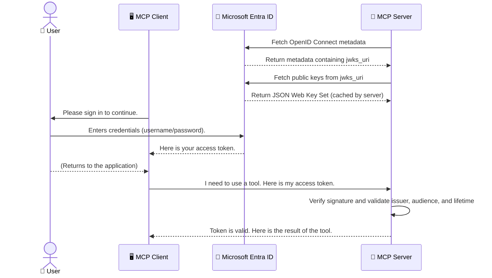

# Zavarovanje AI potekov dela: Avtentikacija Entra ID za strežnike Model Context Protocol

> [!NOTE]
> Koda oddaljenega strežnika v tej lekciji varuje zastarele končne točke `/sse` in `/message`
> in cilja na MCP `2025-11-25`. Ohranite njegove prakse identifikacije in preverjanja žetonov,
> vendar za nove implementacije uporabite prenos Streamable HTTP, združljiv z `2026-07-28`.


## Uvod
Zavarovanje vašega strežnika Model Context Protocol (MCP) je tako pomembno kot zaklepanje vhodnih vrat vašega doma. Če pustite strežnik MCP odprt, lahko vaše orodje in podatki postanejo dostopni nepooblaščenim osebam, kar lahko vodi do varnostnih kršitev. Microsoft Entra ID zagotavlja robustno oblačno rešitev za upravljanje identitet in dostopa, ki pomaga zagotoviti, da lahko z vašim strežnikom MCP komunicirajo samo pooblaščeni uporabniki in aplikacije. V tem razdelku se boste naučili, kako zaščititi vaše AI poteke dela z uporabo avtentikacije Entra ID.

## Cilji učenja
Do konca tega razdelka boste lahko:

- Razumeli pomen zavarovanja strežnikov MCP.
- Razložili osnove Microsoft Entra ID in avtentikacije OAuth 2.0.
- Prepoznali razliko med javnimi in zaupnimi odjemalci.
- Implementirali avtentikacijo Entra ID v lokalnih (javni odjemalec) in oddaljenih (zaupni odjemalec) scenarijih strežnika MCP.
- Uporabili varnostne najboljše prakse pri razvoju AI potekov dela.

## Varnost in MCP

Tako kot ne bi pustili odklepana vhodna vrata svojega doma, ne smete pustiti strežnika MCP odprtega za dostop komurkoli. Zavarovanje vaših AI potekov dela je bistvenega pomena za gradnjo robustnih, zaupanja vrednih in varnih aplikacij. Ta poglavje vas bo seznanilo z uporabo Microsoft Entra ID za zavarovanje vaših strežnikov MCP, kar zagotavlja, da lahko z vašimi orodji in podatki komunicirajo samo pooblaščeni uporabniki in aplikacije.

## Zakaj je varnost pomembna za strežnike MCP

Predstavljajte si, da ima vaš strežnik MCP orodje, ki lahko pošilja e-pošto ali dostopa do baze podatkov strank. Nezaščiten strežnik bi pomenil, da lahko vsakdo potencialno uporabi to orodje, kar lahko vodi do nepooblaščenega dostopa do podatkov, pošiljanja vsiljene pošte ali drugih zlonamernih dejanj.

Z implementacijo avtentikacije zagotovite, da je vsakemu zahtevku do vašega strežnika preverjena pristnost, s čimer potrdite identiteto uporabnika ali aplikacije, ki zahteva dostop. To je prvi in najpomembnejši korak pri zavarovanju vaših AI potekov dela.

## Uvod v Microsoft Entra ID

[**Microsoft Entra ID**](https://adoption.microsoft.com/microsoft-security/entra/) je oblačna storitev za upravljanje identitet in dostopa. Lahko si jo predstavljate kot univerzalnega varnostnika za vaše aplikacije. Obvladuje zapleten proces preverjanja identitet uporabnikov (avtentikacije) in določa, kaj jim je dovoljeno početi (avtorizacija).

Z uporabo Entra ID lahko:

- Omogočite varno prijavo za uporabnike.
- Zaščitite API-je in storitve.
- Upravljate politike dostopa iz osrednje lokacije.

Za strežnike MCP Entra ID ponuja robustno in široko zaupanja vredno rešitev za upravljanje tega, kdo lahko dostopa do zmogljivosti vašega strežnika.

---

## Razumevanje magije: Kako deluje avtentikacija Entra ID

Entra ID uporablja odprte standarde, kot je **OAuth 2.0**, za obravnavo avtentikacije. Čeprav so podrobnosti lahko kompleksne, je osnovni koncept preprost in ga je mogoče razumeti s pomočjo analogije.

### Prijazni uvod v OAuth 2.0: Ključ vratarja

OAuth 2.0 lahko primerjamo s storitvijo, ki vam parkira avto. Ko pridete v restavracijo, ne date vratarju vašega glavnega ključa od avta, ampak mu daste **ključ vratarja**, ki ima omejene pravice – lahko zažene avto in zaklene vrata, vendar ne more odpreti prtljažnika ali predala za rokavice.

V tej analogiji:

- **Vi** ste **uporabnik**.
- **Vaš avto** je **strežnik MCP** z njegovimi dragocenimi orodji in podatki.
- **Vratar** je **Microsoft Entra ID**.
- **Parkirni uslužbenec** je **MCP odjemalec** (aplikacija, ki poskuša dostopati do strežnika).
- **Ključ vratarja** je **dostopni žeton**.

Dostopni žeton je varen niz znakov, ki ga MCP odjemalec prejme od Entra ID po vaši prijavi. Odjemalec nato ta žeton predstavi strežniku MCP pri vsakem zahtevku. Strežnik lahko preveri ta žeton, da zagotovi, da je zahtevek zakonit in da ima odjemalec potrebna dovoljenja, vse to brez da bi moral kdajkoli obdelovati vaše dejanske poverilnice (kot je geslo).

### Potek avtentikacije

Tako proces v praksi poteka:



Strežnik MCP ne kliče Entra ID za preverjanje vsakogar dostopnega žetona. On
kriptografsko preverja podpis JWT s predpomnjeno javno ključavnico Entra ID
in potrjuje trditve žetona, vključno z izdajateljem, občinstvom in življenjsko dobo.
Strežnik prebere `jwks_uri` iz OpenID Connect metapodatkov, pridobi javne
ključe s tega URI-ja in jih občasno osvežuje zaradi rotacije ključev. Namesto, da bi to logiko
implementirali sami, uporabite podprto knjižnico za preverjanje žetonov.
Za več podrobnosti glejte
[Preverjanje žetonov na Microsoft identity platformi](https://learn.microsoft.com/entra/identity-platform/access-tokens#validate-tokens).

### Predstavitev Microsoft Authentication Library (MSAL)

Preden se poglobimo v kodo, je pomembno predstaviti ključno komponento, ki jo boste videli v primerih: **Microsoft Authentication Library (MSAL)**.

MSAL je knjižnica, ki jo je razvil Microsoft in olajša razvijalcem upravljanje avtentikacije. Namesto da bi morali vi pisati vso zapleteno kodo za rokovanje z varnostnimi žetoni, upravljanje prijav in osveževanje sej, MSAL opravi večji del dela namesto vas.

Uporaba knjižnice, kot je MSAL, je zelo priporočljiva, ker:

- **Je varna:** Uveljavlja industrijske standarde in varnostne najboljše prakse, s čimer zmanjšuje tveganje ranljivosti v vaši kodi.
- **Poenostavlja razvoj:** Skrije kompleksnost protokolov OAuth 2.0 in OpenID Connect, kar vam omogoča, da v svojo aplikacijo z nekaj vrsticami kode dodate robustno avtentikacijo.
- **Je vzdrževana:** Microsoft aktivno vzdržuje in posodablja MSAL, da odgovori na nove varnostne grožnje in spremembe platforme.

MSAL podpira širok nabor jezikov in ogrodij za aplikacije, vključno z .NET, JavaScript/TypeScript, Python, Java, Go ter mobilnimi platformami, kot sta iOS in Android. To pomeni, da lahko uporabljate enake dosledne vzorce avtentikacije v celotnem vašem tehnološkem zbiru.

Za več informacij o MSAL si lahko ogledate uradno [dokumentacijo MSAL pregleda](https://learn.microsoft.com/entra/identity-platform/msal-overview).

---

## Zavarovanje vašega strežnika MCP z Entra ID: korak za korakom

Zdaj pa si oglejmo, kako zavarovati lokalni strežnik MCP (ki komunicira prek `stdio`) z uporabo Entra ID. Ta primer uporablja **javni odjemalec**, ki je primeren za aplikacije, ki tečejo na uporabniškem računalniku, kot je namizna aplikacija ali lokalni razvojni strežnik.

### Scenarij 1: Zavarovanje lokalnega strežnika MCP (z javnim odjemalcem)

V tem scenariju si bomo ogledali strežnik MCP, ki teče lokalno, komunicira prek `stdio` in uporablja Entra ID za avtentikacijo uporabnika, preden omogoči dostop do svojih orodij. Strežnik bo imel eno orodje, ki pridobi uporabnikove podatke iz Microsoft Graph API.

#### 1. Nastavitev aplikacije v Entra ID

Pred pisanjem kode morate registrirati vašo aplikacijo v Microsoft Entra ID. Tako Entra ID dobi informacije o vaši aplikaciji in ji dodeli dovoljenje za uporabo avtentikacijske storitve.

1. Pojdite na **[Microsoft Entra portal](https://entra.microsoft.com/)**.
2. Pomaknite se do **Registracije aplikacij** in kliknite **Nova registracija**.
3. Vaši aplikaciji dajte ime (na primer "Moj lokalni strežnik MCP").
4. Za **Podprte tipe računov** izberite **Računi samo v tem organizacijskem imeniku**.
5. Polje **Preusmeritveni URI** lahko v tem primeru pustite prazno.
6. Kliknite **Registriraj**.

Ko je registracija končana, si zabeležite **ID aplikacije (odjemalca)** in **ID imenika (načrtnika)**. Potrebovali jih boste v kodi.

#### 2. Koda: analiza

Oglejmo si ključne dele kode, ki upravljajo avtentikacijo. Celotna koda tega primera je na voljo v mapi [Entra ID - Local - WAM](https://github.com/Azure-Samples/mcp-auth-servers/tree/main/src/entra-id-local-wam) v [mcp-auth-servers GitHub repozitoriju](https://github.com/Azure-Samples/mcp-auth-servers).

**`AuthenticationService.cs`**

Ta razred je odgovoren za rokovanje z Entra ID.

- **`CreateAsync`**: Ta metoda inicializira `PublicClientApplication` iz MSAL (Microsoft Authentication Library). Nastavljena je z ID-jem aplikacije `clientId` in ID-jem najemnika `tenantId`.
- **`WithBroker`**: Omogoča uporabo posrednika (kot je Windows Web Account Manager), ki zagotavlja varnejšo in bolj tekočo izkušnjo enotne prijave.
- **`AcquireTokenAsync`**: To je ključna metoda. Najprej skuša tiho pridobiti žeton (kar pomeni, da uporabnik ne bo moral ponovno potrditi prijave, če je že v veljavni seji). Če tihe pridobitve žetona ni mogoče, bo uporabnik pozvan k interaktivni prijavi.

```csharp
// Simplified for clarity
public static async Task<AuthenticationService> CreateAsync(ILogger<AuthenticationService> logger)
{
    var msalClient = PublicClientApplicationBuilder
        .Create(_clientId) // Your Application (client) ID
        .WithAuthority(AadAuthorityAudience.AzureAdMyOrg)
        .WithTenantId(_tenantId) // Your Directory (tenant) ID
        .WithBroker(new BrokerOptions(BrokerOptions.OperatingSystems.Windows))
        .Build();

    // ... cache registration ...

    return new AuthenticationService(logger, msalClient);
}

public async Task<string> AcquireTokenAsync()
{
    try
    {
        // Try silent authentication first
        var accounts = await _msalClient.GetAccountsAsync();
        var account = accounts.FirstOrDefault();

        AuthenticationResult? result = null;

        if (account != null)
        {
            result = await _msalClient.AcquireTokenSilent(_scopes, account).ExecuteAsync();
        }
        else
        {
            // If no account, or silent fails, go interactive
            result = await _msalClient.AcquireTokenInteractive(_scopes).ExecuteAsync();
        }

        return result.AccessToken;
    }
    catch (Exception ex)
    {
        _logger.LogError(ex, "An error occurred while acquiring the token.");
        throw; // Optionally rethrow the exception for higher-level handling
    }
}
```

**`Program.cs`**

Tukaj je vzpostavljen strežnik MCP in integrirana avtentikacijska storitev.

- **`AddSingleton<AuthenticationService>`**: Registrira `AuthenticationService` v vsebnik odvisnosti, da ga lahko uporabljajo drugi deli aplikacije (kot naše orodje).
- **`GetUserDetailsFromGraph` orodje**: To orodje potrebuje instanco `AuthenticationService`. Preden karkoli naredi, kliče `authService.AcquireTokenAsync()`, da pridobi veljavni dostopni žeton. Če je avtentikacija uspešna, s tem žetonom kliče Microsoft Graph API in pridobi uporabnikove podatke.

```csharp
// Simplified for clarity
[McpServerTool(Name = "GetUserDetailsFromGraph")]
public static async Task<string> GetUserDetailsFromGraph(
    AuthenticationService authService)
{
    try
    {
        // This will trigger the authentication flow
        var accessToken = await authService.AcquireTokenAsync();

        // Use the token to create a GraphServiceClient
        var graphClient = new GraphServiceClient(
            new BaseBearerTokenAuthenticationProvider(new TokenProvider(authService)));

        var user = await graphClient.Me.GetAsync();

        return System.Text.Json.JsonSerializer.Serialize(user);
    }
    catch (Exception ex)
    {
        return $"Error: {ex.Message}";
    }
}
```

#### 3. Kako vse skupaj deluje

1. Ko MCP odjemalec poskuša uporabiti `GetUserDetailsFromGraph` orodje, to orodje najprej kliče `AcquireTokenAsync`.
2. `AcquireTokenAsync` sproži knjižnico MSAL, da preveri veljavni žeton.
3. Če žeton ni najden, uporabnika posrednik (broker) pozove, da se prijavi z računom Entra ID.
4. Ko se uporabnik prijavi, Entra ID izda dostopni žeton.
5. Orodje prejme žeton in ga uporabi za varni klic Microsoft Graph API.
6. Podatki o uporabniku so vrnjeni MCP odjemalcu.

Ta postopek zagotavlja, da lahko orodje uporabljajo le avtenticirani uporabniki, s čimer učinkovito varuje vaš lokalni strežnik MCP.

### Scenarij 2: Zavarovanje oddaljenega strežnika MCP (z zaupnim odjemalcem)

Ko vaš strežnik MCP teče na oddaljenem računalniku (kot je strežnik v oblaku) in komunicira prek protokola, kot je HTTP Streaming, so varnostne zahteve drugačne. V tem primeru morate uporabiti **zaupni odjemalec** in **Authorization Code Flow**. To je varnejša metoda, saj aplikacijski skrivnosti niso nikoli razkrite brskalniku.

Ta primer uporablja MCP strežnik, zasnovan v TypeScript, ki uporablja Express.js za obravnavo HTTP zahtevkov.

#### 1. Nastavitev aplikacije v Entra ID

Nastavitev v Entra ID je podobna kot pri javnem odjemalcu, vendar z eno pomembno razliko: morate ustvariti **skrivnost odjemalca**.

1. Pojdite na **[Microsoft Entra portal](https://entra.microsoft.com/)**.
2. Vregistraciji aplikacije pojdite na zavihek **Certifikati in skrivnosti**.
3. Kliknite **Nova skrivnost odjemalca**, ji dodajte opis in kliknite **Dodaj**.
4. **Pomembno:** Takoj kopirajte vrednost skrivnosti. Kasneje je ne boste mogli več videti.
5. Prav tako morate konfigurirati **Preusmeritveni URI**. Pojdite na zavihek **Avtentikacija**, kliknite **Dodaj platformo**, izberite **Splet** in vnesite preusmeritveni URI za vašo aplikacijo (npr. `http://localhost:3001/auth/callback`).

> **⚠️ Pomembno varnostno opozorilo:** Za produkcijske aplikacije Microsoft močno priporoča uporabo metod avtentikacije brez skrivnosti, kot sta **Managed Identity** ali **Workload Identity Federation**, namesto skrivnosti odjemalcev. Skrivnosti odjemalcev predstavljajo varnostna tveganja, saj so lahko razkrite ali ogrožene. Upravljane identitete nudijo varnejši pristop, saj ni potrebe po shranjevanju poverilnic v vaši kodi ali konfiguraciji.
>
> Za več informacij o upravljanih identitetah in kako jih implementirati, glejte [Pregled upravljanih identitet za Azure vire](https://learn.microsoft.com/entra/identity/managed-identities-azure-resources/overview).

#### 2. Koda: analiza

Ta primer uporablja sejnijski pristop. Ko se uporabnik avtenticira, strežnik shrani dostopni in osvežitveni žeton v sejo in uporabniku dodeli sejnijski žeton. Ta sejnijski žeton se nato uporablja za nadaljnje zahtevke. Celotna koda tega primera je na voljo v mapi [Entra ID - Confidential client](https://github.com/Azure-Samples/mcp-auth-servers/tree/main/src/entra-id-cca-session) v [mcp-auth-servers GitHub repozitoriju](https://github.com/Azure-Samples/mcp-auth-servers).

**`Server.ts`**

Ta datoteka nastavi Express strežnik in MCP transportno plast.

- **`requireBearerAuth`**: To je vmesna programska oprema, ki ščiti končne točke `/sse` in `/message`. Preverja veljavni nosilec žetona (bearer token) v glavi zahtevka `Authorization`.
- **`EntraIdServerAuthProvider`**: To je prilagojeni razred, ki implementira vmesnik `McpServerAuthorizationProvider`. Odgovoren je za upravljanje OAuth 2.0 poteka.
- **`/auth/callback`**: Ta končna točka obravnava preusmeritev iz Entra ID, potem ko se je uporabnik avtenticiral. Zamenja avtentikacijsko kodo za dostopni in osvežitveni žeton.

```typescript
// Simplified for clarity
const app = express();
const { server } = createServer();
const provider = new EntraIdServerAuthProvider();

// Protect the SSE endpoint
app.get("/sse", requireBearerAuth({
  provider,
  requiredScopes: ["User.Read"]
}), async (req, res) => {
  // ... connect to the transport ...
});

// Protect the message endpoint
app.post("/message", requireBearerAuth({
  provider,
  requiredScopes: ["User.Read"]
}), async (req, res) => {
  // ... handle the message ...
});

// Handle the OAuth 2.0 callback
app.get("/auth/callback", (req, res) => {
  provider.handleCallback(req.query.code, req.query.state)
    .then(result => {
      // ... handle success or failure ...
    });
});
```

**`Tools.ts`**

Ta datoteka določa orodja, ki jih zagotavlja MCP strežnik. Orodje `getUserDetails` je podobno tistemu iz prejšnjega primera, vendar pridobi dostopni žeton iz seje.

```typescript
// Simplified for clarity
server.setRequestHandler(CallToolRequestSchema, async (request) => {
  const { name } = request.params;
  const context = request.params?.context as { token?: string } | undefined;
  const sessionToken = context?.token;

  if (name === ToolName.GET_USER_DETAILS) {
    if (!sessionToken) {
      throw new AuthenticationError("Authentication token is missing or invalid. Ensure the token is provided in the request context.");
    }

    // Get the Entra ID token from the session store
    const tokenData = tokenStore.getToken(sessionToken);
    const entraIdToken = tokenData.accessToken;

    const graphClient = Client.init({
      authProvider: (done) => {
        done(null, entraIdToken);
      }
    });

    const user = await graphClient.api('/me').get();

    // ... return user details ...
  }
});
```

**`auth/EntraIdServerAuthProvider.ts`**

Ta razred upravlja logiko za:

- Preusmerjanje uporabnika na prijavno stran Entra ID.
- Zamenjavo avtentikacijskega kodeksa za dostopni žeton.
- Shranjevanje žetonov v `tokenStore`.
- Osveževanje dostopnega žetona, ko poteče.

#### 3. Kako vse to deluje skupaj

1. Ko se uporabnik prvič poskuša povezati z MCP strežnikom, bo vmesnik `requireBearerAuth` zaznal, da nima veljavne seje in ga preusmeril na prijavno stran Entra ID.
2. Uporabnik se prijavi z nalogom Entra ID.
3. Entra ID preusmeri uporabnika nazaj na `/auth/callback` končno točko z avtentikacijskim kodeksom.
4. Strežnik zamenja kodeks za dostopni in osvežitveni žeton, jih shrani in ustvari sejni žeton, ki ga pošlje odjemalcu.
5. Odjemalec zdaj lahko uporabi ta sejni žeton v glavi `Authorization` za vse prihodnje zahteve na MCP strežnik.
6. Ko je orodje `getUserDetails` klicano, uporabi sejen žeton za iskanje dostopnega žetona Entra ID in nato uporabi ta žeton za klic Microsoft Graph API.

Ta potek je bolj zapleten kot potek javnega odjemalca, vendar je zahtevan za internetno dostopne končne točke. Ker so oddaljeni MCP strežniki dostopni preko javnega interneta, potrebujejo močnejše varnostne ukrepe za zaščito pred nepooblaščenim dostopom in morebitnimi napadi.


## Najboljše varnostne prakse

- **Vedno uporabljajte HTTPS**: šifrirajte komunikacijo med odjemalcem in strežnikom, da zaščitite žetone pred prestrezanjem.
- **Implementirajte nadzor dostopa na podlagi vlog (RBAC)**: ne preverjajte samo *če* je uporabnik avtenticiran; preverite *kaj* je pooblaščen narediti. Vloge lahko definirate v Entra ID in jih preverjate v svojem MCP strežniku.
- **Spremljajte in pregledujte**: beležite vse dogodke avtentikacije, da lahko zaznate in reagirate na sumljivo dejavnost.
- **Obvladovanje omejitev hitrosti in zategovanja**: Microsoft Graph in drugi API-ji implementirajo omejitve hitrosti, da preprečijo zlorabe. V svoj MCP strežnik implementirajte eksponentno vračanje in logiko ponovnih poskusov za elegantno obravnavo HTTP 429 (Preveč zahtev). Razmislite o predpomnjenju pogosto dostopnih podatkov za zmanjšanje klicev API.
- **Varnostno shranjevanje žetonov**: varno shranjujte dostopne in osvežitvene žetone. Za lokalne aplikacije uporabite varnostne mehanizme sistema. Za strežniške aplikacije razmislite o uporabi šifriranega shranjevanja ali varnih storitev za upravljanje ključev, kot je Azure Key Vault.
- **Obravnava poteka žetonov**: dostopni žetoni imajo omejeno življenjsko dobo. Implementirajte samodejno osveževanje žetonov z uporabo osvežitvenih žetonov, da ohranite nemoteno uporabniško izkušnjo brez potrebe po ponovni prijavi.
- **Razmislite o uporabi Azure API Management**: medtem ko vam implementacija varnosti neposredno v vašem MCP strežniku omogoča fino nadzorovanje, lahko API prehodi, kot je Azure API Management, samodejno obravnavajo mnoge varnostne vidike, vključno z avtentikacijo, avtorizacijo, omejitvijo hitrosti in spremljanjem. Nudijo centralizirano varnostno plast, ki stoji med vašimi odjemalci in vašimi MCP strežniki. Za več podrobnosti o uporabi API prehodov z MCP glejte: [Azure API Management Your Auth Gateway For MCP Servers](https://techcommunity.microsoft.com/blog/integrationsonazureblog/azure-api-management-your-auth-gateway-for-mcp-servers/4402690).


## Ključni poudarki

- Zagotavljanje varnosti vašega MCP strežnika je ključno za zaščito vaših podatkov in orodij.
- Microsoft Entra ID nudi robustno in razširljivo rešitev za avtentikacijo in avtorizacijo.
- Uporabite **javni odjemalec** za lokalne aplikacije in **zaupnega odjemalca** za oddaljene strežnike.
- **Authorization Code Flow** je najsrečnejša možnost za spletne aplikacije.


## Vaja

1. Pomislite na MCP strežnik, ki ga morda boste ustvarili. Bi bil to lokalni ali oddaljeni strežnik?
2. Glede na vaš odgovor, bi uporabili javnega ali zaupanja vrednega odjemalca?
3. Kakšno dovoljenje bi vaš MCP strežnik zahteval za izvajanje dejanj proti Microsoft Graph?


## Praktične vaje

### Vaja 1: Registracija aplikacije v Entra ID
Pojdite na portal Microsoft Entra.
Registrirajte novo aplikacijo za vaš MCP strežnik.
Zapišite ID aplikacije (odjemalca) in ID imenika (najemnika).

### Vaja 2: Zavarovanje lokalnega MCP strežnika (javni odjemalec)
- Sledite primerom kode za integracijo MSAL (Microsoft Authentication Library) za uporabniško avtentikacijo.
- Testirajte avtentikacijski potek s klicem MCP orodja, ki pridobiva podatke o uporabniku iz Microsoft Graph.

### Vaja 3: Zavarovanje oddaljenega MCP strežnika (zaupanja vreden odjemalec)
- Registrirajte zaupanja vrednega odjemalca v Entra ID in ustvarite skrivnost odjemalca.
- Konfigurirajte vaš Express.js MCP strežnik za uporabo Authorization Code Flow.
- Testirajte zaščitene končne točke in potrdite dostop z žetonom.

### Vaja 4: Uporabite najboljše varnostne prakse
- Omogočite HTTPS za vaš lokalni ali oddaljeni strežnik.
- Implementirajte nadzor dostopa na podlagi vlog (RBAC) v svoji strežniški logiki.
- Dodajte obravnavo poteka žetonov in varno shranjevanje žetonov.

## Viri

1. **MSAL pregled dokumentacije**  
   Naučite se, kako Microsoft Authentication Library (MSAL) omogoča varno pridobivanje žetonov prek platform:  
   [MSAL Overview on Microsoft Learn](https://learn.microsoft.com/en-gb/entra/msal/overview)

2. **Azure-Samples/mcp-auth-servers GitHub repozitorij**  
   Referenčne implementacije MCP strežnikov, ki prikazujejo avtentikacijske tokove:  
   [Azure-Samples/mcp-auth-servers on GitHub](https://github.com/Azure-Samples/mcp-auth-servers)

3. **Pregled upravljanih identitet za Azure vire**  
   Razumite, kako odpraviti skrivnosti z uporabo sistemskih ali uporabniških dodeljenih upravljanih identitet:  
   [Managed Identities Overview on Microsoft Learn](https://learn.microsoft.com/en-us/entra/identity/managed-identities-azure-resources/)

4. **Azure API Management: Vaš avtorizacijski prehod za MCP strežnike**  
   Poglobljen vpogled v uporabo APIM kot varnega OAuth2 prehoda za MCP strežnike:  
   [Azure API Management Your Auth Gateway For MCP Servers](https://techcommunity.microsoft.com/blog/integrationsonazureblog/azure-api-management-your-auth-gateway-for-mcp-servers/4402690)

5. **Microsoft Graph referenca dovoljenj**  
   Celovit seznam delegiranih in aplikacijskih dovoljenj za Microsoft Graph:  
   [Microsoft Graph Permissions Reference](https://learn.microsoft.com/zh-tw/graph/permissions-reference)


## Cilji učenja
Po zaključku tega razdelka boste:

- Lahko opišete, zakaj je avtentikacija ključna za MCP strežnike in AI delovne tokove.
- Nastavili in konfigurirali Entra ID avtentikacijo za scenarije lokalnega in oddaljenega MCP strežnika.
- Izbrali ustrezno vrsto odjemalca (javni ali zaupanja vreden) glede na namestitev vašega strežnika.
- Implementirali varne prakse kodiranja, vključno s shranjevanjem žetonov in avtorizacijo na podlagi vlog.
- Zaupanja vredno zaščitili svoj MCP strežnik in njegova orodja pred nepooblaščenim dostopom.

## Kaj sledi

- [5.13 Model Context Protocol (MCP) integracija z Microsoft Foundry](../mcp-foundry-agent-integration/README.md)

---

<!-- CO-OP TRANSLATOR DISCLAIMER START -->
**Omejitev odgovornosti**:
Ta dokument je bil preveden z uporabo AI prevajalske storitve [Co-op Translator](https://github.com/Azure/co-op-translator). Čeprav si prizadevamo za natančnost, vas prosimo, da upoštevate, da avtomatizirani prevodi lahko vsebujejo napake ali netočnosti. Izvirni dokument v njegovem izvirnem jeziku je treba obravnavati kot avtoritativni vir. Za kritične informacije je priporočljiv strokovni človeški prevod. Ne odgovarjamo za morebitna nesporazume ali napačne interpretacije, ki izhajajo iz uporabe tega prevoda.
<!-- CO-OP TRANSLATOR DISCLAIMER END -->