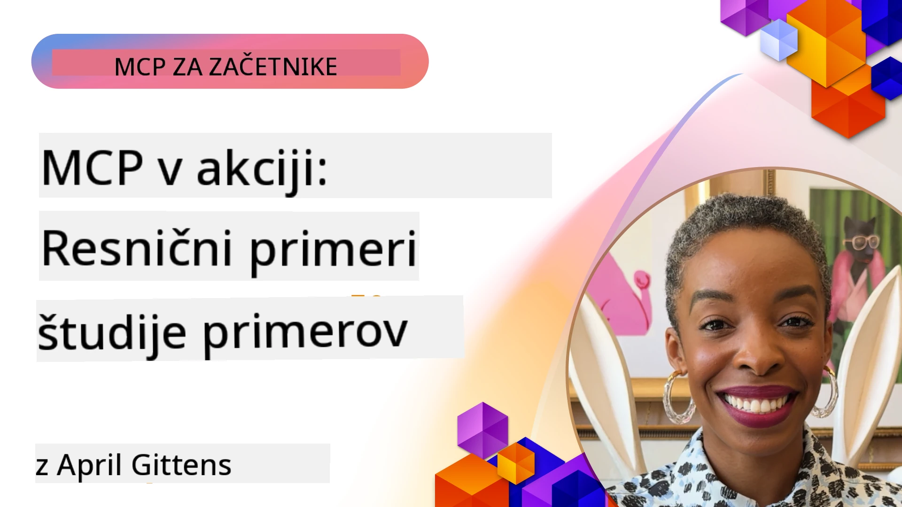

# MCP v praksi: Primeri iz resničnega sveta

_(Kliknite zgornjo sliko za ogled videoposnetka te lekcije)_

Protokol konteksta modela (MCP) preoblikuje način, kako AI aplikacije sodelujejo s podatki, orodji in storitvami. Ta razdelek predstavlja primere iz resničnega sveta, ki prikazujejo praktične uporabe MCP v različnih poslovnih scenarijih.

## Pregled

Ta razdelek prikazuje konkretne primere implementacij MCP, ki poudarjajo, kako organizacije uporabljajo ta protokol za reševanje kompleksnih poslovnih izzivov. Z analizo teh primerov boste pridobili vpogled v vsestranskost, razširljivost in praktične koristi MCP v resničnih situacijah.

## Ključni učni cilji

Z raziskovanjem teh primerov boste:

- Razumeli, kako se MCP lahko uporablja za reševanje specifičnih poslovnih problemov
- Spoznali različne vzorce integracije in arhitekturne pristope
- Prepoznali najboljše prakse za implementacijo MCP v podjetniških okoljih
- Pridobili vpoglede v izzive in rešitve, s katerimi se srečujemo pri implementacijah v resničnem svetu
- Prepoznali priložnosti za uporabo podobnih vzorcev v lastnih projektih

## Izpostavljeni primeri primerov

### 1. [Azure AI potovalni agenti – referenčna implementacija](./travelagentsample.md)

Ta primer preučuje Microsoftovo celovito referenčno rešitev, ki prikazuje, kako zgraditi večagentno, z umetno inteligenco podprto aplikacijo za načrtovanje potovanj z uporabo MCP, Azure OpenAI in Azure AI Search. Projekt prikazuje:

- Večagentno orkestracijo skozi MCP
- Podjetniško integracijo podatkov z Azure AI Search
- Varnostno in razširljivo arhitekturo z uporabo Azure storitev
- Razširljiva orodja z večkrat uporabnimi MCP komponentami
- Pogovorno uporabniško izkušnjo, omogočeno z Azure OpenAI

Arhitekturni in implementacijski podrobnosti nudijo dragocene vpoglede v gradnjo kompleksnih večagentnih sistemov z MCP kot koordinacijskim slojem.

### 2. [Posodabljanje elementov Azure DevOps iz podatkov YouTube](./UpdateADOItemsFromYT.md)

Ta primer prikazuje praktično uporabo MCP za avtomatizacijo delovnih procesov. Prikazuje, kako se MCP orodja lahko uporabijo za:

- Izvlečenje podatkov z spletnih platform (YouTube)
- Posodabljanje delovnih elementov v sistemih Azure DevOps
- Ustvarjanje ponovljivih avtomatiziranih potekov dela
- Integracijo podatkov med različnimi sistemi

Ta primer prikazuje, kako lahko že relativno preproste implementacije MCP prinesejo pomembne izboljšave učinkovitosti z avtomatizacijo rutinskih nalog in izboljšanjem skladnosti podatkov med sistemi.

### 3. [Pridobivanje dokumentacije v realnem času z MCP](./docs-mcp/README.md)

Ta primer vas vodi skozi povezavo Python konzolnega odjemalca z Model Context Protocol (MCP) strežnikom za pridobivanje in beleženje kontekstno ozaveščene Microsoft dokumentacije v realnem času. Naučili se boste, kako:

- Povezati se z MCP strežnikom z uporabo Python odjemalca in uradnega MCP SDK-ja
- Uporabiti streaming HTTP odjemalce za učinkovito pridobivanje podatkov v realnem času
- Klicati orodja za dokumentacijo na strežniku in odzive beležiti neposredno v konzolo
- Integrirati ažurno Microsoftovo dokumentacijo v vaše delovne procese brez zapuščanja terminala

Poglavje vključuje praktično nalogo, minimalen delujoč primer kode in povezave do dodatnih virov za poglobljeno učenje. Oglejte si celoten pregled in kodo v povezanem poglavju, da boste razumeli, kako MCP lahko preoblikuje dostop do dokumentacije in produktivnost razvijalcev v okolju konzole.

### 4. [Interaktivna spletna aplikacija za ustvarjanje študijskih načrtov z MCP](./docs-mcp/README.md)

Ta primer prikazuje, kako zgraditi interaktivno spletno aplikacijo z uporabo Chainlit in Model Context Protocol (MCP) za generiranje personaliziranih študijskih načrtov za katerokoli temo. Uporabniki lahko določijo predmet (npr. "certifikat AI-900") in trajanje študija (npr. 8 tednov), aplikacija pa bo zagotovila tedenski pregled priporočene vsebine. Chainlit omogoča pogovorni klepetalni vmesnik, ki naredi izkušnjo zanimivo in prilagodljivo.

- Pogovorna spletna aplikacija, omogočena z Chainlit
- Uporabniški pozivi za določitev teme in trajanja
- Tedenske priporočene vsebine z uporabo MCP
- Odzivi v realnem času v klepetalnem vmesniku, prilagojeni

Projekt prikazuje, kako lahko pogovorna umetna inteligenca in MCP kombinirata za ustvarjanje dinamičnih, uporabniško usmerjenih izobraževalnih orodij v sodobnem spletnem okolju.

### 5. [Dokumentacija v urejevalniku z MCP strežnikom v VS Code](./docs-mcp/README.md)

Ta primer prikazuje, kako lahko Microsoft Learn Docs neposredno pripeljete v vaše okolje VS Code z MCP strežnikom – brez preklapljanja med zavihki brskalnika! Videli boste, kako:

- Takojšnje iskanje in branje dokumentacije znotraj VS Code z uporabo MCP panela ali ukazne palete
- Navajanje dokumentacije in vstavljanje povezav neposredno v vaše README ali lekcijske markdown datoteke
- Uporaba GitHub Copilota in MCP skupaj za nemotene, z AI podprte delovne tokove kode in dokumentacije
- Preverjanje in izboljševanje dokumentacije z realnočasovnim povratnim informacijami in Microsoftovo zanesljivostjo
- Integracija MCP z GitHub poteki dela za neprekinjeno preverjanje dokumentacije

Implementacija vključuje:

- Primer konfiguracije `.vscode/mcp.json` za enostavno nastavitev
- Vodiče s posnetki zaslona o izkušnji v urejevalniku
- Nasvete za kombiniranje Copilota in MCP za največjo produktivnost

Ta scenarij je idealen za avtorje tečajev, pisce dokumentacije in razvijalce, ki želijo ostati osredotočeni v urejevalniku med delom z dokumentacijo, Copilotom in orodji za preverjanje - vse to podprto z MCP.

### 6. [Ustvarjanje MCP strežnika z APIM](./apimsample.md)

Ta primer daje korak za korakom vodič, kako ustvariti MCP strežnik z uporabo Azure API Management (APIM). Zajema:

- Nastavitev MCP strežnika v Azure API Management
- Izpostavljanje API operacij kot MCP orodij
- Konfiguracijo pravil za omejevanje hitrosti in varnost
- Testiranje MCP strežnika z Visual Studio Code in GitHub Copilot

Ta primer prikazuje, kako izkoristiti zmogljivosti Azure za ustvarjanje robustnega MCP strežnika, ki ga je mogoče uporabiti v različnih aplikacijah in izboljša integracijo AI sistemov s podjetniškimi API-ji.

### 7. [GitHub MCP Register — pospeševanje agentne integracije](https://github.com/mcp)

Ta primer preučuje, kako GitHubov MCP Register, lansiran septembra 2025, rešuje kritičen izziv v AI ekosistemu: razdrobljeno odkrivanje in nameščanje Model Context Protocol (MCP) strežnikov.

#### Pregled
**MCP Register** rešuje naraščajoči problem razpršenih MCP strežnikov po repozitorijih in registrih, kar je prej upočasnjevalo in oteževalo integracijo. Ti strežniki omogočajo AI agentom interakcijo z zunanjimi sistemi, kot so API-ji, baze podatkov in viri dokumentacije.

#### Opis problema
Razvijalci, ki gradijo agentne poteke dela, so se soočali z več izzivi:
- **Slaba odkritev** MCP strežnikov na različnih platformah
- **Podvajajoča se vprašanja nastavitev** po forumih in dokumentaciji
- **Varnostna tveganja** iz nepreverjenih in nezanesljivih virov
- **Pomanjkanje standardizacije** v kakovosti in kompatibilnosti strežnikov

#### Arhitektura rešitve
GitHubov MCP Register centralizira zanesljive MCP strežnike z glavnimi funkcijami:
- **Namestitev z enim klikom** preko VS Code za enostavno nastavitev
- **Urejanje signalov nad šumom** z uporabo zvezdic, aktivnosti in potrditve skupnosti
- **Neposredna integracija** z GitHub Copilot in drugimi MCP združljivimi orodji
- **Odprt model prispevkov**, ki omogoča sodelovanje skupnosti in podjetij

#### Poslovni vpliv
Register je prinesel merljive izboljšave:
- **Hitrejši zagon** za razvijalce z orodji, kot je Microsoft Learn MCP Server, ki pretoči uradno dokumentacijo neposredno agentom
- **Izboljšana produktivnost** preko specializiranih strežnikov, kot je `github-mcp-server`, ki omogoča avtomatizacijo GitHub v naravnem jeziku (ustvarjanje PR-jev, ponovni zagon CI, pregled kode)
- **Močnejše zaupanje ekosistema** z vnaprej izbranimi seznami in transparentnimi konfiguracijskimi standardi

#### Strateška vrednost
Za strokovnjake, specializirane za upravljanje življenjskega cikla agentov in reproducibilne poteke dela, MCP Register nudi:
- **Modularno nameščanje agentov** z uporabo standardiziranih komponent
- **Evalvacijske kanale, podprte z registrom**, za dosledno testiranje in preverjanje
- **Medorodna združljivost orodij**, ki omogoča nemoteno integracijo različnih AI platform

Ta primer dokazuje, da MCP Register ni le imenik – temveč temeljna platforma za razširljivo modelno integracijo in nameščanje agentskih sistemov v resničnem svetu.

### 8. [Objavljanje na družbenih omrežjih iz agenta](./publora-social-publishing.md)

Ta primer vodi skozi **oddaljeni MCP strežnik z možnostjo pisanja** — tak, katerega orodja izvajajo nepovratna dejanja v imenu uporabnika — z uporabo socialnih medijev kot demonstrativnega primera. Agent pripravi objavo, jo človek odobri, strežnik pa jo razporedi po omrežjih.

Zanimivi so projektni omejitve, ki jih postavlja objavljanje, in veljajo za vsak strežnik, ki piše namesto branja:

- **Odprto odkrivanje, avtorizirana izvedba** — `tools/list` je odgovorjen brez poverilnic, da lahko registri in odjemalci pregledajo, medtem ko vsak `tools/call` zahteva žeton in sicer vrne `401` z glavo `WWW-Authenticate`
- **OAuth registracija brez zunanjega koraka** — dinamična registracija odjemalcev danes, z dokumenti meta podatkov Client ID, kot jih usmerja specifikacija `2026-07-28`
- **Oznake orodij** (`readOnlyHint`, `destructiveHint`, `idempotentHint`), ki jih odjemalci uporabljajo za odločanje o potrditvi — namigi, ne prisila, nekaj, kar katalogi priključkov zdaj zahtevajo pri pregledu
- **Neizmišljivi identifikatorji**, zato neusklajena vrednost glasno odpove namesto da bi delovala na verjetnemu primeru
- **Idempotentni ključi na orodjih za ustvarjanje objav**, tako da ponoven poskus izvajanja agenta ne povzroči duplicirane objave
- **Brezkončna ciljna pot, opisana v shemi orodij**, ki preizkusi celotno pot pisanja in ne objavi ničesar, za pregledovalce in CI

Poglavje se zaključi s kratkim kontrolnim seznamom, ki ga lahko uporabite za strežnik, ki ga gradite.

## Zaključek

Ti osmimi poglobljeni primeri primerov prikazujejo izjemno vsestranskost in praktične uporabe Model Context Protocol v različnih resničnih scenarijih. Od kompleksnih sistemov za načrtovanje potovanj z več agenti in upravljanja podjetniških API-jev do poenostavljenih delovnih tokov dokumentacije ter revolucionarnega GitHub MCP registra, ti primeri prikazujejo, kako MCP zagotavlja standardiziran in razširljiv način povezovanja AI sistemov z orodji, podatki in storitvami, ki so potrebni za zagotavljanje izjemnih vrednosti.

Primeri zajemajo več dimenzij MCP implementacije:
- **Podjetniška integracija**: Azure API Management in avtomatizacija Azure DevOps
- **Večagentna orkestracija**: Načrtovanje potovanj z usklajenimi AI agenti
- **Produktivnost razvijalcev**: Integracija v VS Code in dostop do dokumentacije v realnem času
- **Razvoj ekosistema**: GitHub MCP Register kot temeljna platforma
- **Izobraževalne aplikacije**: Interaktivni generatorji študijskih načrtov in pogovorni vmesniki

Z raziskovanjem teh implementacij pridobite ključne vpoglede v:
- **Arhitekturne vzorce** za različne obsege in primere uporabe
- **Strategije izvajanja**, ki uravnotežajo funkcionalnost z vzdržnostjo
- **Varnostne in razširljivostne** premisleke za produkcijske uvedbe
- **Najboljše prakse** za razvoj MCP strežnikov in integracijo odjemalcev
- **Razmišljanje o ekosistemu** za gradnjo povezanih AI-podprtih rešitev

Ti primeri skupaj dokazujejo, da MCP ni zgolj teoretični okvir, temveč zrel, produkcijsko pripravljen protokol, ki omogoča praktične rešitve za kompleksne poslovne izzive. Ne glede na to, ali gradite preprosta avtomatizirana orodja ali sofisticirane večagentne sisteme, vzorci in pristopi, prikazani tukaj, nudijo trdno osnovo za vaše lastne MCP projekte.

## Dodatni viri

- [GitHub repozitorij Azure AI potovalnih agentov](https://github.com/Azure-Samples/azure-ai-travel-agents)
- [Orodje MCP za Azure DevOps](https://github.com/microsoft/azure-devops-mcp)
- [Orodje MCP Playwright](https://github.com/microsoft/playwright-mcp)
- [MCP strežnik Microsoft Docs](https://github.com/MicrosoftDocs/mcp)
- [GitHub MCP Register — pospeševanje agentne integracije](https://github.com/mcp)
- [Primeri skupnosti MCP](https://github.com/microsoft/mcp)

## Kaj sledi

- Prej: [Modul 8: Najboljše prakse](../08-BestPractices/README.md)
- Naslednje: [Modul 10: Poenostavitev AI delovnih tokov: Gradnja MCP strežnika z Microsoft Foundry Toolkit](../10-StreamliningAIWorkflowsBuildingAnMCPServerWithAIToolkit/README.md)

---

<!-- CO-OP TRANSLATOR DISCLAIMER START -->
**Omejitev odgovornosti**:
Ta dokument je bil preveden z uporabo AI prevajalske storitve [Co-op Translator](https://github.com/Azure/co-op-translator). Čeprav si prizadevamo za natančnost, vas prosimo, da upoštevate, da avtomatizirani prevodi lahko vsebujejo napake ali netočnosti. Izvirni dokument v njegovem izvirnem jeziku je treba obravnavati kot avtoritativni vir. Za kritične informacije je priporočljiv strokovni človeški prevod. Ne odgovarjamo za morebitna nesporazume ali napačne interpretacije, ki izhajajo iz uporabe tega prevoda.
<!-- CO-OP TRANSLATOR DISCLAIMER END -->