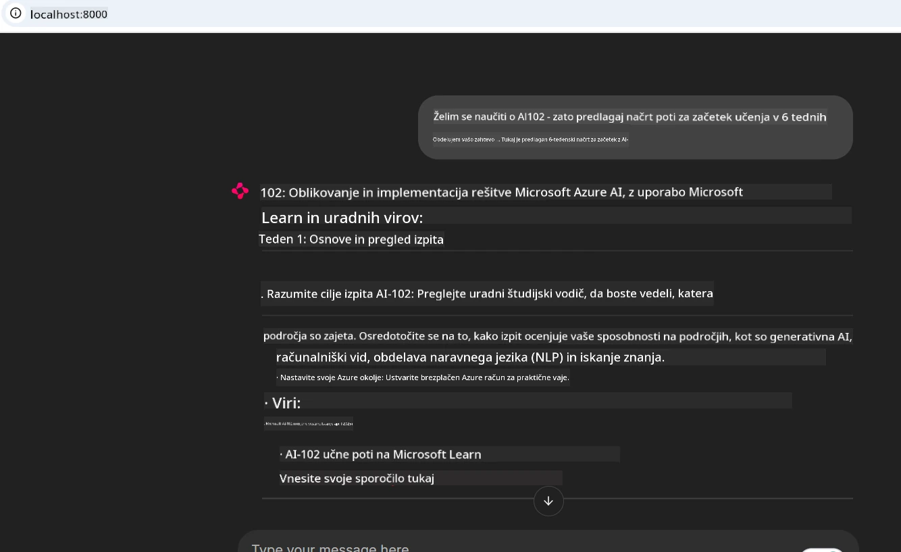
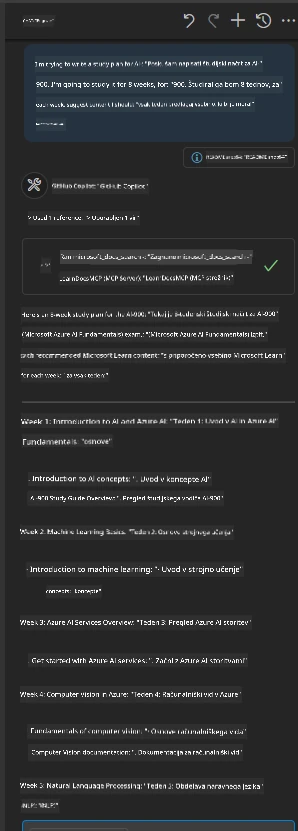

# Študija primera: Povezovanje s strežnikom Microsoft Learn Docs MCP iz odjemalca

Ste se kdaj znašli pri tem, da ste preklapljali med spletnimi mesti z dokumentacijo, Stack Overflow in neskončnimi zavihki iskalnikov, vse to med reševanjem težave v vaši kodi? Morda imate drugi zaslon samo za dokumentacijo ali pa stalno preklapljate med vašim IDE-jem in brskalnikom s pomočjo bližnjične tipke Alt-Tab. Ali ne bi bilo bolje, če bi lahko dokumentacijo prinesli neposredno v vaš delovni proces—integrirano v vaše aplikacije, IDE ali celo vaše lastne prilagojene pripomočke? V tej študiji primera bomo raziskali, kako to narediti tako, da se neposredno povežete s strežnikom Microsoft Learn Docs MCP iz vaše lastne odjemalske aplikacije.

## Pregled

Sodobni razvoj ni zgolj pisanje kode—pomeni najti pravo informacijo ob pravem času. Dokumentacija je povsod, a redko tam, kjer jo najbolj potrebujete: znotraj vaših orodij in delovnih tokov. Z integracijo pridobivanja dokumentacije neposredno v aplikacije lahko prihranite čas, zmanjšate preklapljanje konteksta in povečate produktivnost. V tem razdelku bomo pokazali, kako povezati odjemalca s strežnikom Microsoft Learn Docs MCP, da lahko dostopate do dokumentacije v realnem času in prilagojene glede na kontekst, ne da bi zapustili svojo aplikacijo.

Prehodili bomo postopek vzpostavitve povezave, pošiljanja zahtevka in učinkovitega upravljanja pretočnih odzivov. Ta pristop ne le poenostavi vaš delovni tok, ampak tudi odpira vrata za gradnjo pametnejših in bolj uporabnih razvijalskih orodij.

## Cilji učenja

Zakaj to počnemo? Ker so najboljše razvijalske izkušnje tiste, ki odpravijo ovire. Predstavljajte si svet, kjer vaš urejevalnik kode, klepetalni robot ali spletna aplikacija takoj odgovori na vaša dokumentacijska vprašanja z uporabo najnovejše vsebine Microsoft Learn. Do konca tega poglavja boste znali:

- Razumeti osnove komunikacije med strežnikom MCP in odjemalcem za dokumentacijo
- Izvesti konzolno ali spletno aplikacijo za povezavo s strežnikom Microsoft Learn Docs MCP
- Uporabiti pretočne HTTP odjemalce za pridobivanje dokumentacije v realnem času
- Beležiti in interpretirati odzive dokumentacije v vaši aplikaciji

Videli boste, kako vam te veščine pomagajo graditi orodja, ki niso le reaktivna, temveč zares interaktivna in kontekstualno prilagojena.

## Scenarij 1 - Pridobivanje dokumentacije v realnem času z MCP

V tem scenariju vam bomo pokazali, kako povezati odjemalca s strežnikom Microsoft Learn Docs MCP, da lahko dostopate do dokumentacije v realnem času in prilagojene glede na kontekst, ne da bi zapustili svojo aplikacijo.

Pojdimo v prakso. Vaša naloga je napisati aplikacijo, ki se poveže s strežnikom Microsoft Learn Docs MCP, pokliče orodje `microsoft_docs_search` in zabeleži pretočni odziv na konzolo.

### Zakaj ta pristop?
Ker je to temelj za gradnjo bolj naprednih integracij—ne glede na to, ali želite poganjati klepetalni robot, razširitev IDE ali spletno nadzorno ploščo.

Kodo in navodila za ta scenarij najdete v mapi [`solution`](./solution/README.md) znotraj te študije primera. Koraki vas bodo vodili skozi vzpostavitev povezave:
- Uporaba uradnega MCP SDK in pretočnega HTTP odjemalca za povezavo
- Klic orodja `microsoft_docs_search` z iskalnim parametrom za pridobivanje dokumentacije
- Izvajanje pravilnega beleženja in obravnave napak
- Ustvarjanje interaktivnega konzolnega vmesnika za omogočanje več vnosov iskalnih poizvedb

Ta scenarij prikazuje, kako:
- Povezati se s strežnikom Docs MCP
- Poslati poizvedbo
- Razčleniti in izpisati rezultate

Tako lahko izgleda zagon rešitve:

```
Prompt> What is Azure Key Vault?
Answer> Azure Key Vault is a cloud service for securely storing and accessing secrets. ...
```

Spodaj je minimalen primer rešitve. Celotna koda in podrobnosti so na voljo v rešitveni mapi.

<details>
<summary>Python</summary>

```python
import asyncio
from mcp.client.streamable_http import streamablehttp_client
from mcp import ClientSession

async def main():
    async with streamablehttp_client("https://learn.microsoft.com/api/mcp") as (read_stream, write_stream, _):
        async with ClientSession(read_stream, write_stream) as session:
            await session.initialize()
            result = await session.call_tool("microsoft_docs_search", {"query": "Azure Functions best practices"})
            print(result.content)

if __name__ == "__main__":
    asyncio.run(main())
```

- Za popolno implementacijo in beleženje glejte [`scenario1.py`](../../../../09-CaseStudy/docs-mcp/solution/python/scenario1.py).
- Za navodila za namestitev in uporabo si oglejte datoteko [`README.md`](./solution/python/README.md) v isti mapi.
</details>


## Scenarij 2 - Interaktivna spletna aplikacija za generator študijskega načrta z MCP

V tem scenariju se boste naučili, kako integrirati Docs MCP v spletni razvojni projekt. Cilj je omogočiti uporabnikom, da neposredno z vmesnika spletne strani iščejo Microsoft Learn dokumentacijo, s čimer postane dokumentacija takoj dostopna znotraj vaše aplikacije ali strani.

Videli boste, kako:
- Nastaviti spletno aplikacijo
- Povezati se s strežnikom Docs MCP
- Obravnavati uporabniški vnos in prikazati rezultate

Tako lahko izgleda zagon rešitve:

```
User> I want to learn about AI102 - so suggest the roadmap to get it started from learn for 6 weeks

Assistant> Here’s a detailed 6-week roadmap to start your preparation for the AI-102: Designing and Implementing a Microsoft Azure AI Solution certification, using official Microsoft resources and focusing on exam skills areas:

---
## Week 1: Introduction & Fundamentals
- **Understand the Exam**: Review the [AI-102 exam skills outline](https://learn.microsoft.com/en-us/credentials/certifications/exams/ai-102/).
- **Set up Azure**: Sign up for a free Azure account if you don't have one.
- **Learning Path**: [Introduction to Azure AI services](https://learn.microsoft.com/en-us/training/modules/intro-to-azure-ai/)
- **Focus**: Get familiar with Azure portal, AI capabilities, and necessary tools.

....more weeks of the roadmap...

Let me know if you want module-specific recommendations or need more customized weekly tasks!
```

Spodaj je minimalen primer rešitve. Celotna koda in podrobnosti so na voljo v rešitveni mapi.



<details>
<summary>Python (Chainlit)</summary>

Chainlit je ogrodje za gradnjo pogovornih spletnih aplikacij z umetno inteligenco. Omogoča enostavno ustvarjanje interaktivnih klepetalnih robotov in asistentov, ki lahko kličejo MCP orodja in prikazujejo rezultate v realnem času. Idealno za hitro prototipiranje in uporabniku prijazne vmesnike.

```python
import chainlit as cl
import requests

MCP_URL = "https://learn.microsoft.com/api/mcp"

@cl.on_message
def handle_message(message):
    query = {"question": message}
    response = requests.post(MCP_URL, json=query)
    if response.ok:
        result = response.json()
        cl.Message(content=result.get("answer", "No answer found.")).send()
    else:
        cl.Message(content="Error: " + response.text).send()
```

- Za popolno izvedbo si oglejte [`scenario2.py`](../../../../09-CaseStudy/docs-mcp/solution/python/scenario2.py).
- Za navodila za namestitev in zagon glejte [`README.md`](./solution/python/README.md).
</details>


## Scenarij 3: Dokumentacija znotraj urejevalnika z MCP strežnikom v VS Code

Če želite Microsoft Learn Docs pridobivati neposredno znotraj VS Code (namesto preklapljanja med zavihki brskalnika), lahko v vašem urejevalniku uporabite MCP strežnik. To vam omogoča:
- Iskanje in branje dokumentacije v VS Code brez zapuščanja delovnega okolja za kodiranje.
- Navajanje dokumentacije in vstavljanje povezav neposredno v vaše README ali datoteke s tečaji.
- Združevanje GitHub Copilot in MCP za gladek delovni proces dokumentacije, podprt z AI.

**Videli boste, kako:**
- Dodati veljavno datoteko `.vscode/mcp.json` v koren delovnega prostora (glejte spodnji primer).
- Odpreti MCP ploščo ali uporabiti paleto ukazov v VS Code za iskanje in vstavljanje dokumentacije.
- Navajati dokumentacijo neposredno v vaši markdown datoteki med delom.
- Združiti ta delovni tok z GitHub Copilot za še večjo produktivnost.

Tukaj je primer, kako nastaviti MCP strežnik v VS Code:

```json
{
  "servers": {
    "LearnDocsMCP": {
      "url": "https://learn.microsoft.com/api/mcp"
    }
  }
}
```

</details>

> Za podroben vodnik s posnetki zaslona in korak za korakom navodili glejte [`README.md`](./solution/scenario3/README.md).



Ta pristop je idealen za vsakogar, ki gradi tehnične tečaje, piše dokumentacijo ali razvija kodo s pogostimi potrebami po referencah.

## Ključni poudarki

Integracija dokumentacije neposredno v vaša orodja ni le udobje—je prelomnica za produktivnost. Z povezavo s strežnikom Microsoft Learn Docs MCP iz vašega odjemalca lahko:

- Odpravite preklapljanje konteksta med vašo kodo in dokumentacijo
- Pridobivate posodobljeno, kontekstualno prilagojeno dokumentacijo v realnem času
- Gradite pametnejša, bolj interaktivna razvijalska orodja

Te veščine vam bodo pomagale ustvariti rešitve, ki niso samo učinkovite, ampak tudi prijetne za uporabo.

## Dodatni viri

Za poglobljeno razumevanje raziščite te uradne vire:

- [Microsoft Learn Docs MCP Server (GitHub)](https://github.com/MicrosoftDocs/mcp)
- [Začetek z Azure MCP Server (mcp-python)](https://learn.microsoft.com/en-us/azure/developer/azure-mcp-server/get-started#create-the-python-app)
- [Kaj je Azure MCP Server?](https://learn.microsoft.com/en-us/azure/developer/azure-mcp-server/)
- [Uvod v Model Context Protocol (MCP)](https://modelcontextprotocol.io/introduction)
- [Dodajanje vtičnikov iz MCP strežnika (Python)](https://learn.microsoft.com/en-us/semantic-kernel/concepts/plugins/adding-mcp-plugins)

## Kaj sledi

- Nazaj na: [Pregled študij primerov](../README.md)
- Nadaljuj na: [Modul 10: Poenostavitev AI delovnih tokov z Microsoft Foundry Toolkit](../../10-StreamliningAIWorkflowsBuildingAnMCPServerWithAIToolkit/README.md)

---

<!-- CO-OP TRANSLATOR DISCLAIMER START -->
**Omejitev odgovornosti**:
Ta dokument je bil preveden z uporabo AI prevajalske storitve [Co-op Translator](https://github.com/Azure/co-op-translator). Čeprav si prizadevamo za natančnost, vas prosimo, da upoštevate, da avtomatizirani prevodi lahko vsebujejo napake ali netočnosti. Izvirni dokument v njegovem izvirnem jeziku je treba obravnavati kot avtoritativni vir. Za kritične informacije je priporočljiv strokovni človeški prevod. Ne odgovarjamo za morebitna nesporazume ali napačne interpretacije, ki izhajajo iz uporabe tega prevoda.
<!-- CO-OP TRANSLATOR DISCLAIMER END -->