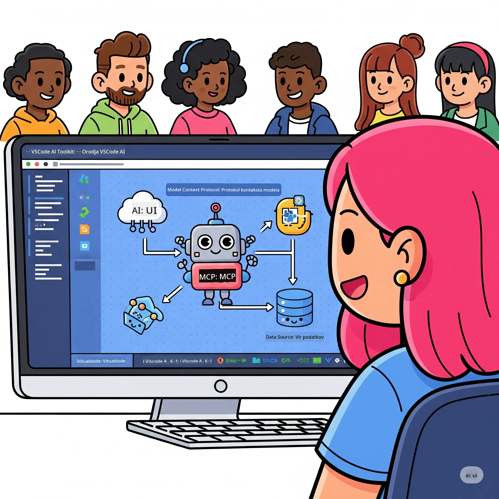
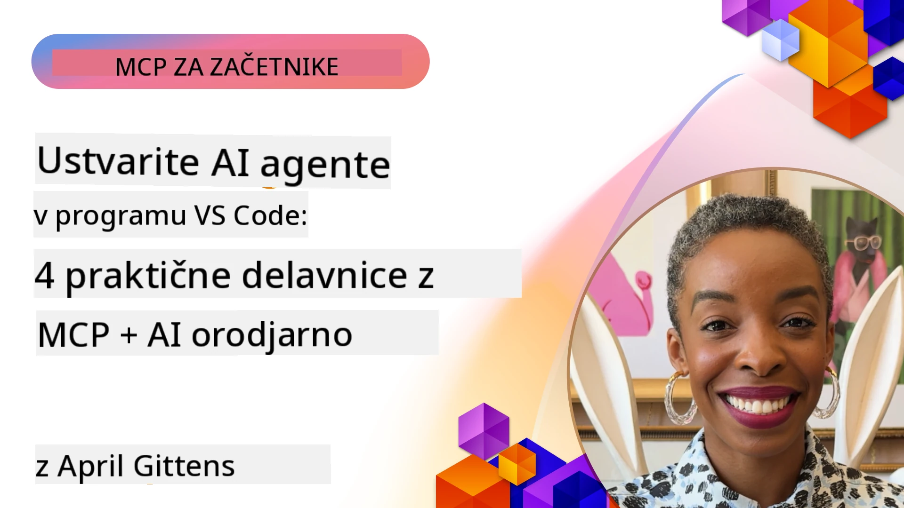

# Poenostavitev delovnih tokov AI: Gradnja MCP strežnika z Microsoft Foundry Toolkit

## 🎯 Pregled

_(Kliknite zgornjo sliko za ogled videa te lekcije)_

Dobrodošli na **Delavnici o Model Context Protocol (MCP)**! Ta obsežna praktična delavnica združuje dve najsodobnejši tehnologiji za revolucijo razvoja AI aplikacij:

> **Opomba o združljivosti:** koda delavnice je bila zgrajena in testirana z MCP
> `2025-11-25`, kot pokaže značka zgoraj. Uporabite
> [trenutno specifikacijo `2026-07-28`](https://modelcontextprotocol.io/specification/2026-07-28/)
> za nove implementacije protokola in preglejte opombe ob izdaji SDK pred
> premikom delavnic.

- **🔗 Model Context Protocol (MCP)**: Odprti standard za nemoteno integracijo AI orodij
- **🛠️ Microsoft Foundry Toolkit razširitev za VS Code**: Močna Microsoftova razširitev za razvoj AI

### 🎓 Kaj se boste naučili

Do konca te delavnice boste obvladali umetnost gradnje inteligentnih aplikacij, ki povezujejo AI modele z resničnimi orodji in storitvami. Od avtomatiziranega testiranja do prilagojenih API integracij boste pridobili praktične veščine za reševanje kompleksnih poslovnih izzivov.

## 🏗️ Tehnološki sklad

### 🔌 Model Context Protocol (MCP)

MCP je **"USB-C za AI"** – univerzalni standard, ki povezuje AI modele z zunanjimi orodji in podatkovnimi viri.

**✨ Glavne značilnosti:**

- 🔄 **Standardizirana integracija**: Univerzalni vmesnik za povezave AI-orodij
- 🏛️ **Fleksibilna arhitektura**: Lokalni in oddaljeni strežniki preko stdio/SSE prenosa
- 🧰 **Bogata ekosistem**: Orodja, pozivi in viri v enem protokolu
- 🔒 **Pripravljen za podjetja**: Vgrajena varnost in zanesljivost

**🎯 Zakaj je MCP pomemben:**
Tako kot je USB-C odpravil kaos kablov, MCP odpravi kompleksnost AI integracij. En protokol, neskončne možnosti.

### 🤖 Razširitev Microsoft Foundry Toolkit za VS Code

Microsoftova vodilna razširitev za razvoj AI, ki spremeni VS Code v AI moč.

**🚀 Osnovne zmogljivosti:**

- 📦 **Katalog modelov**: Dostop do modelov iz Azure AI, GitHub, Hugging Face, Ollama
- ⚡ **Lokalno sklepanje**: Izvajanje optimizirano za ONNX na CPU/GPU/NPU
- 🏗️ **Graditelj agentov**: Vizualni razvoj AI agentov z MCP integracijo
- 🎭 **Večmodalno**: Podpora za besedilo, vid in strukturiran izhod

**💡 Koristi razvoja:**

- Namestitev modelov brez konfiguracije
- Vizualno inženirstvo pozivov
- Igralna površina za testiranje v realnem času
- Nemotena integracija MCP strežnika

## 📚 Učna pot

### [🚀 Modul 1: Osnove Microsoft Foundry Toolkita](./lab1/README.md)

**Trajanje**: 15 minut

- 🛠️ Namestitev in konfiguracija Microsoft Foundry Toolkit za VS Code
- 🗂️ Raziščite Katalog modelov (več kot 100 modelov iz GitHub, ONNX, OpenAI, Anthropic, Google)
- 🎮 Obvladovanje Interaktivne igralne površine za testiranje modelov v realnem času
- 🤖 Izgradnja vašega prvega AI agenta z Graditeljem agentov
- 📊 Ocena uspešnosti modela z vgrajenimi metrikami (F1, relevantnost, podobnost, koherenca)
- ⚡ Spoznajte zmožnosti paketnega procesiranja in večmodalne podpore

**🎯 Rezultat učenja**: Ustvarite funkcionalnega AI agenta z obsežnim razumevanjem zmogljivosti Microsoft Foundry Toolkita

### [🌐 Modul 2: MCP z osnovami Microsoft Foundry Toolkita](./lab2/README.md)

**Trajanje**: 20 minut

- 🧠 Obvladovanje arhitekture in konceptov Model Context Protocol (MCP)
- 🌐 Raziskovanje ekosistema MCP strežnikov Microsofta
- 🤖 Gradnja agenta za avtomatizacijo brskalnika z uporabo Playwright MCP strežnika
- 🔧 Integracija MCP strežnikov z Microsoft Foundry Toolkit Graditeljem agentov
- 📊 Konfiguracija in testiranje MCP orodij znotraj vaših agentov
- 🚀 Izvoz in nameščanje MCP-podprtih agentov za produkcijsko uporabo

**🎯 Rezultat učenja**: Postavite AI agenta, ki je pospešen z zunanjimi orodji preko MCP

### [🔧 Modul 3: Napreden razvoj MCP z Microsoft Foundry Toolkit](./lab3/README.md)

**Trajanje**: 20 minut

- 💻 Ustvarite prilagojene MCP strežnike z Microsoft Foundry Toolkit
- 🐍 Konfigurirajte in uporabljajte najnovejši MCP Python SDK (v1.9.3)
- 🔍 Nastavite in uporabite MCP Inspector za odpravljanje napak
- 🛠️ Gradnja Weather MCP strežnika s profesionalnimi delovnimi tokovi za odpravljanje napak
- 🧪 Odpravljanje napak MCP strežnikov tako v Graditelju agentov kot v okolju Inspektorja

**🎯 Rezultat učenja**: Razvijte in odpravljajte napake pri prilagojenih MCP strežnikih z uporabo sodobnih orodij

### [🐙 Modul 4: Praktičen razvoj MCP - Prilagojen GitHub Clone strežnik](./lab4/README.md)

**Trajanje**: 30 minut

- 🏗️ Izgradite resnični GitHub Clone MCP strežnik za razvojne delovne tokove
- 🔄 Implementirajte pametno kloniranje repozitorijev z validacijo in obravnavo napak
- 📁 Ustvarite inteligentno upravljanje map in integracijo v VS Code
- 🤖 Uporabite GitHub Copilot Agent Mode s prilagojenimi MCP orodji
- 🛡️ Zagotovite produkcijsko zanesljivost in združljivost med platformami

**🎯 Rezultat učenja**: Postavite produkcijsko pripravljen MCP strežnik, ki poenostavlja dejanske razvojne delovne tokove

## 💡 Resnični primeri uporabe in vpliv

### 🏢 Podjetniški primeri rabe

#### 🔄 Avtomatizacija DevOps

Spremenite svoj razvojni potek z inteligentno avtomatizacijo:

- **Pametno upravljanje repozitorijev**: AI voden pregled kode in odločitve o združitvi
- **Inteligentni CI/CD**: Avtomatizirana optimizacija cevovoda na podlagi sprememb kode
- **Razvrščanje težav**: Samodejna klasifikacija in dodelitev napak

#### 🧪 Revolucija zagotavljanja kakovosti

Povzdignite testiranje z AI-podprto avtomatizacijo:

- **Inteligentna generacija testov**: Samodejno ustvarjanje obsežnih testnih sklopov
- **Vizualno testiranje regresije**: AI-podkrbljen zaznavanje sprememb v UI
- **Nadzor uspešnosti**: Proaktivna identifikacija in rešitev težav

#### 📊 Pametni podatkovni tokovi

Zgradite pametnejše delovne tokove za obdelavo podatkov:

- **Adaptivni ETL procesi**: Samooptimizirajoče transformacije podatkov
- **Zaznavanje nepravilnosti**: Nadzor kakovosti podatkov v realnem času
- **Inteligentno usmerjanje**: Pametno upravljanje podatkovnega toka

#### 🎧 Izboljšanje izkušenj strank

Ustvarite izjemne interakcije s strankami:

- **Podpora, prilagojena kontekstu**: AI agenti z dostopom do zgodovine strank
- **Proaktivna rešitev težav**: Napovedna uporabniška podpora
- **Večkanalna integracija**: Enotna AI izkušnja na različnih platformah

## 🛠️ Zahteve in namestitev

### 💻 Sistemske zahteve

| Komponenta | Zahteva | Opombe |
|-----------|-------------|-------|
| **Operacijski sistem** | Windows 10+, macOS 10.15+, Linux | Kateri koli sodoben OS |
| **Visual Studio Code** | Najnovejša stabilna različica | Zahtevano za Microsoft Foundry Toolkit |
| **Node.js** | v18.0+ in npm | Za razvoj strežnika MCP |
| **Python** | 3.10+ | Neobvezno za Python MCP strežnike |
| **Pomnilnik** | najmanj 8 GB RAM | Priporočeno 16 GB za lokalne modele |

### 🔧 Razvojno okolje

#### Priporočeni razširitvi za VS Code

- **Microsoft Foundry Toolkit** (ms-windows-ai-studio.windows-ai-studio)
- **Python** (ms-python.python)
- **Python Debugger** (ms-python.debugpy)
- **GitHub Copilot** (GitHub.copilot) - Neobvezno, vendar koristno

#### Neobvezna orodja

- **uv**: Sodobni upravljalnik Python paketov
- **MCP Inspector**: Orodje za vizualno odpravljanje napak MCP strežnikov
- **Playwright**: Za primere spletne avtomatizacije

## 🎖️ Cilji učenja in potrdilo

### 🏆 Preverjanje usposobljenosti

Z dokončanjem te delavnice boste dosegli mojstrstvo v:

#### 🎯 Osnovne kompetence

- [ ] **MCP protokol mojstrstvo**: Poglobljeno razumevanje arhitekture in vzorcev implementacije
- [ ] **Znanje Microsoft Foundry Toolkit-a**: Strokovna uporaba Microsoft Foundry Toolkit za hitro razvoj
- [ ] **Razvoj po meri strežnika**: Izdelava, uvajanje in vzdrževanje produkcijskih MCP strežnikov
- [ ] **Odličnost pri integraciji orodij**: Brezhibna povezanost AI z obstoječimi razvojni delovnimi tokovi
- [ ] **Uporaba reševanja problemov**: Uporaba pridobljenih spretnosti za resnične poslovne izzive

#### 🔧 Tehnične veščine

- [ ] Namestitev in konfiguracija Microsoft Foundry Toolkit v VS Code
- [ ] Oblikovanje in implementacija po meri MCP strežnikov
- [ ] Integracija Microsoft Foundry modelov z MCP arhitekturo
- [ ] Izgradnja avtomatiziranih testnih delovnih tokov s Playwright
- [ ] Uvajanje AI agentov za produkcijsko uporabo
- [ ] Odpravljanje napak in optimizacija zmogljivosti MCP strežnika

#### 🚀 Napredne zmožnosti

- [ ] Arhitektura AI integracij na ravni podjetja
- [ ] Izvajanje najboljših varnostnih praks za AI aplikacije
- [ ] Oblikovanje skalabilnih arhitektur MCP strežnikov
- [ ] Ustvarjanje prilagojenih orodnih verig za specifična področja
- [ ] Mentorstvo drugim pri razvoju AI-nativnih rešitev

## 📖 Dodatni viri

- [MCP specifikacija (2026-07-28)](https://modelcontextprotocol.io/specification/2026-07-28/)
- [Microsoft Foundry Toolkit GitHub repozitorij](https://github.com/microsoft/vscode-ai-toolkit)
- [Zbirka vzorčnih MCP strežnikov](https://github.com/modelcontextprotocol/servers)
- [Vodnik najboljših praks](https://modelcontextprotocol.io/docs/best-practices)
- [OWASP MCP Top 10](https://microsoft.github.io/mcp-azure-security-guide/mcp/) - Najboljše varnostne prakse

---

**🚀 Pripravljeni, da revolucionirate svoj razvojni delovni tok AI?**

Zgradimo skupaj prihodnost inteligentnih aplikacij z MCP in Microsoft Foundry Toolkit!

## Kaj sledi

Nadaljujte na: [Modul 11: MCP Server praktične vaje](../11-MCPServerHandsOnLabs/README.md)

---

<!-- CO-OP TRANSLATOR DISCLAIMER START -->
**Omejitev odgovornosti**:
Ta dokument je bil preveden z uporabo AI prevajalske storitve [Co-op Translator](https://github.com/Azure/co-op-translator). Čeprav si prizadevamo za natančnost, vas prosimo, da upoštevate, da avtomatizirani prevodi lahko vsebujejo napake ali netočnosti. Izvirni dokument v njegovem izvirnem jeziku je treba obravnavati kot avtoritativni vir. Za kritične informacije je priporočljiv strokovni človeški prevod. Ne odgovarjamo za morebitna nesporazume ali napačne interpretacije, ki izhajajo iz uporabe tega prevoda.
<!-- CO-OP TRANSLATOR DISCLAIMER END -->