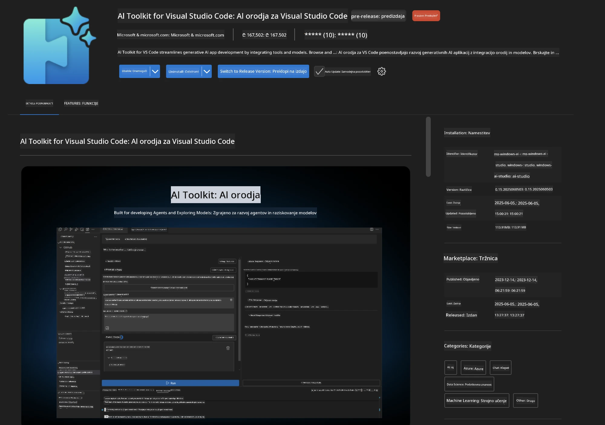
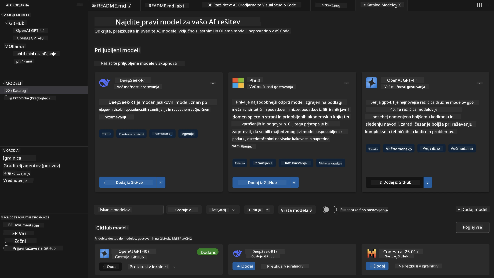
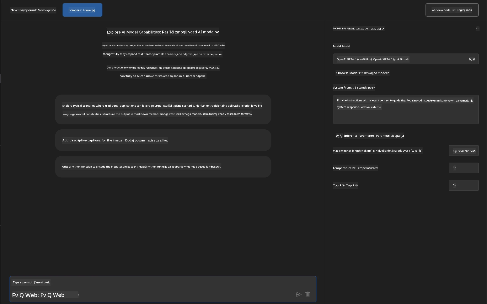
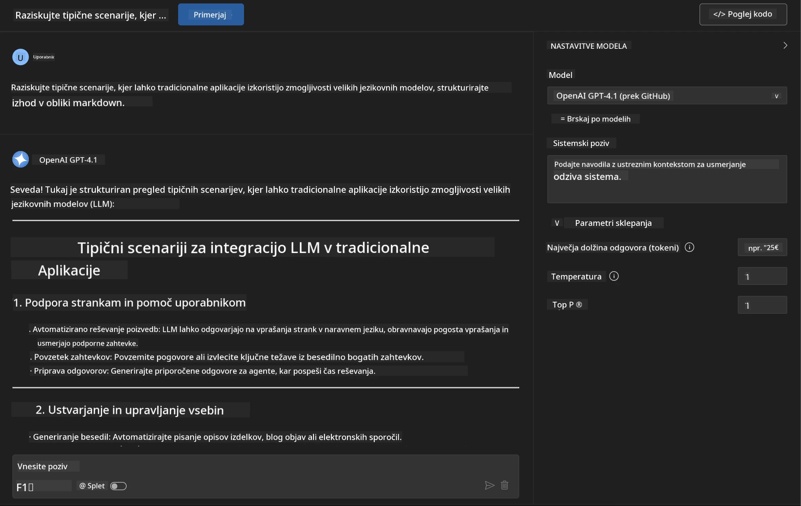
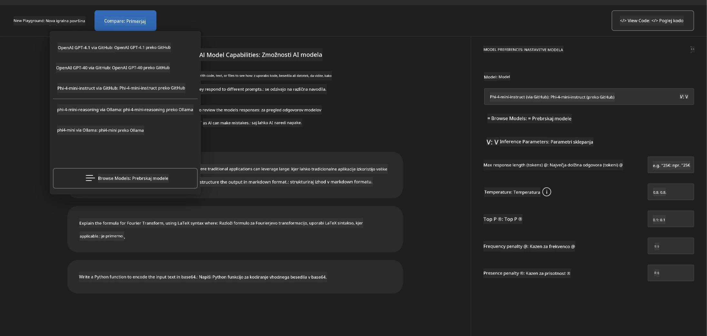
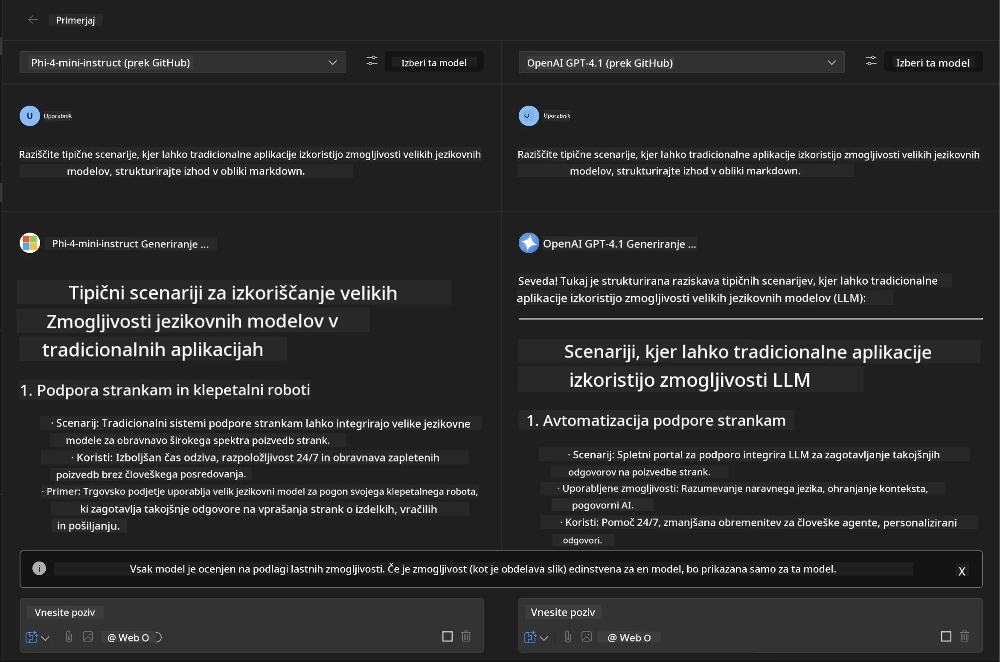
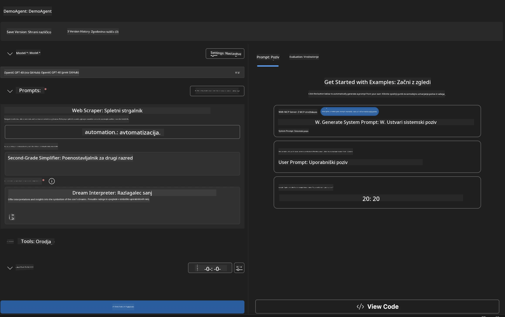
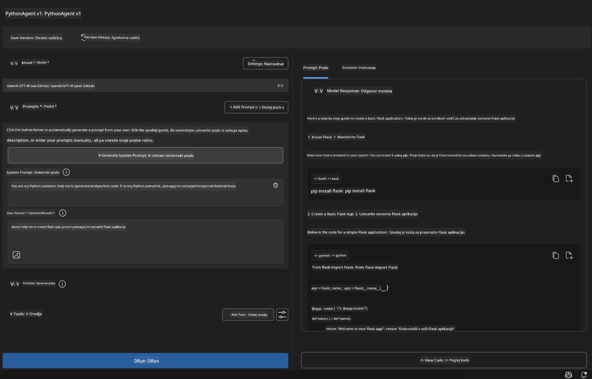

# 🚀 Modul 1: Osnove Microsoft Foundry Toolkit-a

[]()
[]()
[]()

## 📋 Cilji učenja

Do konca tega modula boste sposobni:
- ✅ Namestiti in konfigurirati razširitev Microsoft Foundry Toolkit za VS Code
- ✅ Krmariti po Katalogu modelov in razumeti različne vire modelov
- ✅ Uporabljati Playground za testiranje in eksperimentiranje z modeli
- ✅ Ustvariti prilagojene AI agente z Agent Builderjem
- ✅ Primerjati uspešnost modelov različnih ponudnikov
- ✅ Uporabljati najboljše prakse za inženiring pozivov

## 🧠 Uvod v Microsoft Foundry Toolkit

**Microsoft Foundry Toolkit Extension za VS Code** je osrednja Microsoftova razširitev, ki VS Code spremeni v celovito razvojno okolje za AI. Povezuje raziskave AI z razvojem praktičnih aplikacij in omogoča dostopnost generativne AI razvijalcem vseh stopenj znanja.

### 🌟 Ključne zmožnosti

| Značilnost | Opis | Uporaba |
|---------|-------------|----------|
| **🗂️ Katalog modelov** | Dostop do več kot 100 modelov iz GitHub, ONNX, OpenAI, Anthropic, Google | Odkritje in izbira modelov |
| **🔌 Podpora BYOM** | Integracija lastnih modelov (lokalnih/oddaljenih) | Prilagojena uvedba modelov |
| **🎮 Interaktivni Playground** | Testiranje modelov v realnem času s klepetalnim vmesnikom | Hitro prototipiranje in testiranje |
| **📎 Večmodalna podpora** | Obdelava besedila, slik in priponk | Kompleksne AI aplikacije |
| **⚡ Serijska obdelava** | Hkratno izvajanje več pozivov | Učinkoviti poteki testiranja |
| **📊 Ocena modela** | Vgrajeni metrični kazalci (F1, relevantnost, podobnost, koherenca) | Presoja uspešnosti |

### 🎯 Zakaj je Microsoft Foundry Toolkit pomemben

- **🚀 Pospešen razvoj**: Od zamisli do prototipa v nekaj minutah
- **🔄 Enoten potek dela**: En vmesnik za več AI ponudnikov
- **🧪 Enostavno eksperimentiranje**: Primerjajte modele brez kompleksnih nastavitev
- **📈 Pripravljen za produkcijo**: Brezhiben prehod iz prototipa do uvedbe

## 🛠️ Pogoji in namestitev

### 📦 Namestitev razširitve Microsoft Foundry Toolkit

**Korak 1: Dostop do Marketplace za razširitve**
1. Odprite Visual Studio Code
2. Odprite pogled extensions (`Ctrl+Shift+X` ali `Cmd+Shift+X`)
3. Poiščite "Microsoft Foundry Toolkit"

**Korak 2: Izberite svojo različico**
- **🟢 Izdaja**: Priporočeno za produkcijsko uporabo
- **🔶 Predizdaja**: Zgodnji dostop do najnovejših funkcij

**Korak 3: Namestite in aktivirajte**



### ✅ Kontrolni seznam za preverjanje
- [ ] Ikona Microsoft Foundry Toolkit se pojavi v stranski vrstici VS Code
- [ ] Razširitev je omogočena in aktivirana
- [ ] V izpisni plošči ni napak med namestitvijo

## 🧪 Praktična vaja 1: Raziskovanje modelov Microsoft Foundry

**🎯 Cilj**: Obvladati Katalog modelov in preizkusiti svoj prvi AI model

### 📊 Korak 1: Krmarjenje po Katalogu modelov

Katalog modelov je vaša vstopna točka v AI ekosistem. Združuje modele iz različnih virov, kar omogoča enostavno odkrivanje in primerjavo možnosti.

**🔍 Vodnik za krmarjenje:**

Kliknite na **MODELS - Katalog** v stranski vrstici Microsoft Foundry Toolkit



**💡 Nasvet strokovnjaka**: Poiščite modele s specifičnimi zmožnostmi, ki ustrezajo vaši uporabi (npr. generiranje kode, ustvarjalno pisanje, analiza).

> [!NOTE]
> GitHub modeli so bili opuščeni 30. julija 2026. Uporabite uvedbo Microsoft Foundry modela
> in se avtenticirajte z Microsoft Entra ID ali Azure API ključem.

### 🚀 Korak 2: Dodajte in konfigurirajte svoj prvi model

**Strategija izbire modela:**
- **GPT-5.1**: Priporočen splošni model za uporabo orodij in razmišljanje
- **Phi-4-mini**: Lahek model za hitre odzive pri enostavnih opravilih

**🔧 Postopek konfiguracije:**
1. Izberite **OpenAI GPT-5.1** iz kataloga
2. Kliknite **Dodaj med moje modele** - s tem registrirate model za uporabo
3. Izberite **Preizkusi v Playgroundu** za zagon testnega okolja
4. Počakajte na inicializacijo modela (prvo nastavitev lahko traja trenutek)



**⚙️ Razumevanje parametrov modela:**
- **Temperatura**: Nadzoruje ustvarjalnost (0 = determinističen, 1 = ustvarjalen)
- **Max Tokens**: Največja dolžina odgovora
- **Top-p**: Nucleus sampling za raznolikost odgovorov

### 🎯 Korak 3: Obvladajte vmesnik Playgrounda

Playground je vaša laboratorijska soba za AI eksperimentiranje. Tako lahko kar najbolje izkoristite njegove možnosti:

**🎨 Najboljše prakse za inženiring pozivov:**
1. **Bodite specifični**: Jasna, podrobna navodila prinesejo boljše rezultate
2. **Ponuja kontekst**: Vključite relevantne ozadjske informacije
3. **Uporabite primere**: Modelu pokažite, kaj želite, z uporabo primerov
4. **Ponovite**: Izboljšajte pozive glede na začetne rezultate

**🧪 Testni primeri:**
```markdown
# Example 1: Code Generation
"Write a Python function that calculates the factorial of a number using recursion. Include error handling and docstrings."

# Example 2: Creative Writing
"Write a professional email to a client explaining a project delay, maintaining a positive tone while being transparent about challenges."

# Example 3: Data Analysis
"Analyze this sales data and provide insights: [paste your data]. Focus on trends, anomalies, and actionable recommendations."
```



### 🏆 Izziv: Primerjava uspešnosti modelov

**🎯 Cilj**: Primerjajte različne modele z istimi pozivi, da razumete njihove prednosti

**📋 Navodila:**
1. Dodajte **Phi-4-mini** v svoje delovno okolje
2. Uporabite isti poziv za GPT-5.1 in Phi-4-mini



3. Primerjajte kakovost odgovora, hitrost in natančnost
4. Zabeležite ugotovitve v razdelku z rezultati



**💡 Ključna spoznanja:**
- Kdaj uporabiti LLM proti SLM
- Stroški v primerjavi z uspešnostjo
- Specializirane zmožnosti različnih modelov

## 🤖 Praktična vaja 2: Ustvarjanje prilagojenih agentov z Agent Builderjem

**🎯 Cilj**: Ustvariti specializirane AI agente za specifična opravila in delovne tokove

### 🏗️ Korak 1: Razumevanje Agent Builderja

Agent Builder je mesto, kjer Microsoft Foundry Toolkit zares zažari. Omogoča vam kreacijo namensko zasnovanih AI pomočnikov, ki združujejo moč velikih jezikovnih modelov s prilagojenimi navodili, specifičnimi parametri in specializiranim znanjem.

**🧠 Komponente arhitekture agenta:**
- **Osnovni model**: Temeljni LLM (GPT-5.1, Phi itd.)
- **Sistemski poziv**: Določa osebnost in vedenje agenta
- **Parametri**: Nastavitve za optimalno delovanje
- **Integracija orodij**: Povezava z zunanjimi API-ji in MCP storitvami
- **Spomin**: Kontekst pogovora in ohranjanje seje



### ⚙️ Korak 2: Globoka konfiguracija agenta

**🎨 Ustvarjanje učinkovitih sistemskih pozivov:**
```markdown
# Template Structure:
## Role Definition
You are a [specific role] with expertise in [domain].

## Capabilities
- List specific abilities
- Define scope of knowledge
- Clarify limitations

## Behavior Guidelines
- Response style (formal, casual, technical)
- Output format preferences
- Error handling approach

## Examples
Provide 2-3 examples of ideal interactions
```

*Seveda lahko uporabite tudi Generate System Prompt za pomoč AI pri generiranju in optimiziranju pozivov*

**🔧 Optimizacija parametrov:**
| Parameter | Priporočeno območje | Uporaba |
|-----------|------------------|----------|
| **Temperatura** | 0.1-0.3 | Tehnični/faktični odgovori |
| **Temperatura** | 0.7-0.9 | Ustvarjalna/delovna opravila |
| **Max Tokens** | 500-1000 | Jedrnati odgovori |
| **Max Tokens** | 2000-4000 | Podrobna pojasnila |

### 🐍 Korak 3: Praktična vaja - Python programerski agent

**🎯 Misija**: Ustvarite specializiranega pomočnika za Python programiranje

**📋 Koraki konfiguracije:**

1. **Izbira modela**: Izberite **Claude 3.5 Sonnet** (odličen za kodo)

2. **Oblikovanje sistemskega poziva**:
```markdown
# Python Programming Expert Agent

## Role
You are a senior Python developer with 10+ years of experience. You excel at writing clean, efficient, and well-documented Python code.

## Capabilities
- Write production-ready Python code
- Debug complex issues
- Explain code concepts clearly
- Suggest best practices and optimizations
- Provide complete working examples

## Response Format
- Always include docstrings
- Add inline comments for complex logic
- Suggest testing approaches
- Mention relevant libraries when applicable

## Code Quality Standards
- Follow PEP 8 style guidelines
- Use type hints where appropriate
- Handle exceptions gracefully
- Write readable, maintainable code
```

3. **Konfiguracija parametrov**:
   - Temperatura: 0.2 (za dosledno, zanesljivo kodo)
   - Max Tokens: 2000 (podrobna pojasnila)
   - Top-p: 0.9 (uravnotežena ustvarjalnost)



### 🧪 Korak 4: Testiranje vašega Python agenta

**Testni primeri:**
1. **Osnovna funkcija**: "Ustvari funkcijo za iskanje praštevil"
2. **Zapleteni algoritem**: "Implementiraj binarni iskalni drevo z metodami vstavljanja, brisanja in iskanja"
3. **Praktičen problem**: "Zgradi spletni strgalnik, ki upravlja z omejitvami hitrosti in ponovitvami"
4. **Razhroščevanje**: "Popravi to kodo [prilepi napačno kodo]"

**🏆 Merila uspeha:**
- ✅ Koda se izvaja brez napak
- ✅ Vključena ustrezna dokumentacija
- ✅ Sledi najboljšim praksam Pythona
- ✅ Ponuja jasna pojasnila
- ✅ Predlaga izboljšave

## 🎓 Zaključek modula 1 in nadaljnji koraki

### 📊 Preverjanje znanja

Preizkusite svoje znanje:
- [ ] Ali lahko razložite razliko med modeli v katalogu?
- [ ] Ste uspešno ustvarili in testirali prilagojenega agenta?
- [ ] Ali razumete, kako optimizirati parametre za različne primere uporabe?
- [ ] Ali lahko oblikujete učinkovite sistemske pozive?

### 📚 Dodatni viri

- **Microsoft Foundry Toolkit Dokumentacija**: [Uradni Microsoft dokumenti](https://github.com/microsoft/vscode-ai-toolkit)
- **Vodnik za inženiring pozivov**: [Najboljše prakse](https://platform.openai.com/docs/guides/prompt-engineering)
- **Modeli v Microsoft Foundry Toolkit**: [Modeli v razvoju](https://github.com/microsoft/vscode-ai-toolkit/blob/main/doc/models.md)

**🎉 Čestitamo!** Obvladali ste osnove Microsoft Foundry Toolkit in ste pripravljeni graditi naprednejše AI aplikacije!

### 🔜 Nadaljujte z naslednjim modulom

Ste pripravljeni na napredne zmožnosti? Nadaljujte z **[Modul 2: MCP z Microsoft Foundry Toolkit Fundamentals](../lab2/README.md)**, kjer se boste naučili:
- Povezovati vaše agente z zunanjimi orodji prek Model Context Protocol (MCP)
- Graditi agente za avtomatizacijo brskalnika z Playwrightom
- Integrirati MCP strežnike z vašimi Microsoft Foundry Toolkit agenti
- Okrepiti vaše agente z zunanjimi podatki in zmožnostmi

---

<!-- CO-OP TRANSLATOR DISCLAIMER START -->
**Omejitev odgovornosti**:
Ta dokument je bil preveden z uporabo AI prevajalske storitve [Co-op Translator](https://github.com/Azure/co-op-translator). Čeprav si prizadevamo za natančnost, vas prosimo, da upoštevate, da avtomatizirani prevodi lahko vsebujejo napake ali netočnosti. Izvirni dokument v njegovem izvirnem jeziku je treba obravnavati kot avtoritativni vir. Za kritične informacije je priporočljiv strokovni človeški prevod. Ne odgovarjamo za morebitna nesporazume ali napačne interpretacije, ki izhajajo iz uporabe tega prevoda.
<!-- CO-OP TRANSLATOR DISCLAIMER END -->