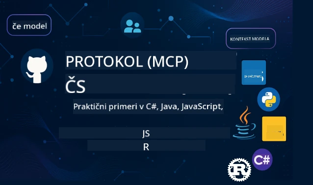

 

[](https://GitHub.com/microsoft/mcp-for-beginners/graphs/contributors)
[](https://GitHub.com/microsoft/mcp-for-beginners/issues)
[](https://GitHub.com/microsoft/mcp-for-beginners/pulls)
[](http://makeapullrequest.com)
[](https://mcptoplist.com/server/mcp.so%2Fmcp-for-beginners%2Fmicrosoft)

[](https://GitHub.com/microsoft/mcp-for-beginners/watchers)
[](https://GitHub.com/microsoft/mcp-for-beginners/fork)
[](https://GitHub.com/microsoft/mcp-for-beginners/stargazers)


[](https://discord.gg/nTYy5BXMWG)

Sledite tem korakom, da začnete uporabljati te vire:
1. **Razvezi repozitorij**: Kliknite [](https://GitHub.com/microsoft/mcp-for-beginners/fork)
2. **Klonirajte repozitorij**:   `git clone https://github.com/microsoft/mcp-for-beginners.git`
3. **Pridružite se** [](https://discord.gg/nTYy5BXMWG)


### 🌐 Podpora za več jezikov

#### Prevodi vzdrževani z [Co-op Translator](https://github.com/Azure/co-op-translator)

<!-- CO-OP TRANSLATOR LANGUAGES TABLE START -->
[Arabic](../ar/README.md) | [Bengali](../bn/README.md) | [Bulgarian](../bg/README.md) | [Burmese (Myanmar)](../my/README.md) | [Chinese (Simplified)](../zh-CN/README.md) | [Chinese (Traditional, Hong Kong)](../zh-HK/README.md) | [Chinese (Traditional, Macau)](../zh-MO/README.md) | [Chinese (Traditional, Taiwan)](../zh-TW/README.md) | [Croatian](../hr/README.md) | [Czech](../cs/README.md) | [Danish](../da/README.md) | [Dutch](../nl/README.md) | [Estonian](../et/README.md) | [Finnish](../fi/README.md) | [French](../fr/README.md) | [German](../de/README.md) | [Greek](../el/README.md) | [Hebrew](../he/README.md) | [Hindi](../hi/README.md) | [Hungarian](../hu/README.md) | [Indonesian](../id/README.md) | [Italian](../it/README.md) | [Japanese](../ja/README.md) | [Kannada](../kn/README.md) | [Khmer](../km/README.md) | [Korean](../ko/README.md) | [Lithuanian](../lt/README.md) | [Malay](../ms/README.md) | [Malayalam](../ml/README.md) | [Manipuri (Meitei Mayek)](../mni/README.md) | [Marathi](../mr/README.md) | [Nepali](../ne/README.md) | [Nigerian Pidgin](../pcm/README.md) | [Norwegian](../no/README.md) | [Persian (Farsi)](../fa/README.md) | [Polish](../pl/README.md) | [Portuguese (Brazil)](../pt-BR/README.md) | [Portuguese (Portugal)](../pt-PT/README.md) | [Punjabi (Gurmukhi)](../pa/README.md) | [Romanian](../ro/README.md) | [Russian](../ru/README.md) | [Serbian (Cyrillic)](../sr/README.md) | [Slovak](../sk/README.md) | [Slovenian](./README.md) | [Spanish](../es/README.md) | [Swahili](../sw/README.md) | [Swedish](../sv/README.md) | [Tagalog (Filipino)](../tl/README.md) | [Tamil](../ta/README.md) | [Telugu](../te/README.md) | [Thai](../th/README.md) | [Turkish](../tr/README.md) | [Ukrainian](../uk/README.md) | [Urdu](../ur/README.md) | [Vietnamese](../vi/README.md)

> **Raje klonirate lokalno?**
>
> Ta repozitorij vključuje prevode v več kot 50 jezikih, kar znatno poveča velikost prenosa. Če želite klonirati brez prevodov, uporabite sparse checkout:
>
> **Bash / macOS / Linux:**
> ```bash
> git clone --filter=blob:none --sparse https://github.com/microsoft/mcp-for-beginners.git
> cd mcp-for-beginners
> git sparse-checkout set --no-cone '/*' '!translations' '!translated_images'
> ```
>
> **CMD (Windows):**
> ```cmd
> git clone --filter=blob:none --sparse https://github.com/microsoft/mcp-for-beginners.git
> cd mcp-for-beginners
> git sparse-checkout set --no-cone "/*" "!translations" "!translated_images"
> ```
>
> Tako dobite vse, kar potrebujete za dokončanje tečaja, z veliko hitrejšim prenosom.
<!-- CO-OP TRANSLATOR LANGUAGES TABLE END -->

# 🚀 Kurikulum Model Context Protocol (MCP) za začetnike

## **Naučite se MCP z uporabo praktičnih primerov kode v C#, Java, JavaScript, Rust, Python in TypeScript**

## 🧠 Pregled kurikuluma Model Context Protocol
Dobrodošli na vaši poti v svet Model Context Protocol! Če ste se kdaj spraševali, kako se AI aplikacije povezujejo z različnimi orodji in storitvami, boste zdaj odkrili elegantno rešitev, ki spreminja način, kako razvijalci gradijo inteligentne sisteme.

Pomislite na MCP kot univerzalnega prevajalca za AI aplikacije - tako kot USB priključki omogočajo povezavo katere koli naprave z vašim računalnikom, MCP omogoča AI modelom povezavo s katerim koli orodjem ali storitvijo na standardiziran način. Ne glede na to, ali gradite svoj prvi chatbot ali delate na zapletenih AI potekih dela, vam razumevanje MCP daje moč za ustvarjanje zmogljivejših in prilagodljivejših aplikacij.

Ta kurikulum je zasnovan z potrpežljivostjo in skrbjo za vašo učno pot. Začeli bomo s preprostimi koncepti, ki jih že razumete, in postopoma nadgrajevali vaše znanje skozi praktične vaje v vašem najljubšem programskem jeziku. Vsak korak vključuje jasna pojasnila, praktične primere in veliko spodbud.

Ko boste zaključili to potovanje, boste samozavestni pri izdelavi lastnih MCP strežnikov, integraciji le-teh s priljubljenimi AI platformami ter razumevanju, kako ta tehnologija preoblikuje prihodnost razvoja umetne inteligence. Začnimo to vznemirljivo pustolovščino skupaj!

### Uradna dokumentacija in specifikacije

Trenutna revizija protokola je **MCP Specifikacija 2026-07-28**. MCP
specifikacija uporablja datumsko verzioniranje (format LLLL-MM-DD) za jasnost
združljivosti protokola.

> **Opomba o verziji:** ta kurikulum uči trenutne `2026-07-28`
> koncepte, vključno z brezstanjskimi zahtevki, ogrodjem Extensions in
> opuščanjem Roots, Sampling in Logging. Nekateri praktični primeri ostajajo
> eksplicitno verzionirani na `2025-11-25`, dokler se podpora SDK ne ujame. Oglejte si
> [Kaj se je spremenilo v MCP: Specifikacija 2026-07-28](./01-CoreConcepts/mcp-2026-07-28.md)
> za spremembe in navodila za migracijo.

Ti viri postajajo bolj dragoceni z rastjo vašega razumevanja, vendar se ne počutite pritiskani, da morate vse prebrati takoj. Začnite tam, kjer vas najbolj zanima!
- 📘 [MCP Dokumentacija](https://modelcontextprotocol.io/) – To je vaš glavni vir za vodiče in uporabniške priročnike korak za korakom. Dokumentacija je pisana za začetnike, z jasnimi primeri, ki jih lahko sledite v svojem tempu.
- 📜 [MCP Specifikacija](https://modelcontextprotocol.io/specification/2026-07-28) – To si predstavljajte kot vaš obsežen referenčni priročnik. Ko boste delali skozi kurikulum, se boste pogosto vračali, da preverite specifične podrobnosti in raziskujete napredne funkcije.
- 📜 [MCP Verzioniranje specifikacije](https://modelcontextprotocol.io/specification/versioning) – Vsebuje informacije o zgodovini verzij protokola in kako MCP uporablja datumsko verzioniranje (format LLLL-MM-DD).
- 🧑‍💻 [MCP GitHub Repozitorij](https://github.com/modelcontextprotocol) – Tukaj boste našli SDK-je, orodja in vzorce kode v več programskih jezikih. Je kot zakladnica praktičnih primerov in komponent, pripravljenih za uporabo.
- 🌐 [MCP Skupnost](https://github.com/orgs/modelcontextprotocol/discussions) – Pridružite se drugim učencem in izkušenim razvijalcem v razpravah o MCP. To je podpirajoča skupnost, kjer so vprašanja dobrodošla in znanje prostodusno deljeno.
  
## Cilji učenja

Do konca tega kurikuluma boste samozavestni in navdušeni nad svojimi novimi znanji. Dosegli boste naslednje:

• **Razumeti osnove MCP**: Spoznali boste, kaj je Model Context Protocol in zakaj spreminja način delovanja AI aplikacij skupaj, z analogijami in primeri, ki so razumljivi.

• **Ustvariti svoj prvi MCP strežnik**: Izdelali boste delujoč MCP strežnik v izbranem programskem jeziku, začeli s preprostimi primeri in postopoma razvijali svoje veščine.

• **Povezati AI modele s pravimi orodji**: Naučili se boste, kako premostiti vrzel med AI modeli in dejanskimi storitvami, kar bo vašim aplikacijam dalo močne nove zmogljivosti.

• **Izvesti najboljše prakse varnosti**: Spoznali boste, kako zagotoviti varnost MCP implementacij, zaščititi tako vaše aplikacije kot uporabnike.

• **Zagotoviti zanesljivo uvajanje**: Naučili se boste, kako svoja MCP projekta prenesti iz razvoja v produkcijo z uporabo praktičnih strategij uvajanja, ki delujejo v resničnem svetu.

• **Pridružiti se MCP skupnosti**: Postali boste del rastoče skupnosti razvijalcev, ki oblikujejo prihodnost razvoja AI aplikacij. 

## Osnove ozadja

Preden se poglobimo v specifike MCP, se prepričajmo, da ste udobni z nekaj osnovnimi koncepti. Ne skrbite, če niste strokovnjak na teh področjih - vse vam bomo pojasnili sproti!

### Razumevanje protokolov (temelj)

Protokol si predstavljajte kot pravila za pogovor. Ko pokličete prijatelja, oba veste, da morate, ko odgovorite, reči "zdravo", se izmenjevati v govoru in na koncu reči "nasvidenje". Računalniški programi potrebujejo podobna pravila za učinkovito komunikacijo.

MCP je protokol – niz dogovorjenih pravil, ki pomagajo AI modelom in aplikacijam imeti produktivne "pogovore" z orodji in storitvami. Tako kot pravila pogovora izboljšajo človeško komunikacijo, MCP naredi komunikacijo AI aplikacij veliko bolj zanesljivo in zmogljivo.

### Odnosi klient-strežnik (kako programi sodelujejo)

Vsak dan uporabljate odnose klient-strežnik! Ko uporabljate spletni brskalnik (klient) za obisk spletne strani, vzpostavljate povezavo s spletnim strežnikom, ki vam pošlje vsebino strani. Brskalnik zna poizvedovati za podatke, strežnik pa zna odgovoriti.

V MCP imamo podoben odnos: AI modeli delujejo kot klienti, ki zahtevajo informacije ali dejanja, medtem ko MCP strežniki zagotavljajo te zmogljivosti. To je kot imeti pomočnika (strežnik), ki ga AI lahko prosi, da opravi določena opravila.

### Zakaj je standardizacija pomembna (skladnost delovanja)

Predstavljajte si, da bi vsak proizvajalec avtomobilov uporabljal različne oblike črpalk za gorivo – za vsak avto bi potrebovali drugačen adapter! Standardizacija pomeni dogovor o skupnih pristopih, da stvari delujejo brezhibno skupaj.

MCP zagotavlja to standardizacijo za AI aplikacije. Namesto da bi vsak AI model potreboval lasten, prilagojen kodeks za delo z vsakim orodjem, MCP ustvarja univerzalni način njihove komunikacije. To pomeni, da lahko razvijalci izdelajo orodja enkrat in jih uporabijo z različnimi AI sistemi.

## 🧭 Pregled vaše učne poti

Vaša pot po MCP je skrbno strukturirana, da postopoma gradi vašo samozavest in veščine. Vsaka faza uvaja nove koncepte in krepi že pridobljeno znanje.

### 🌱 Temeljna faza: Razumevanje osnov (moduli 0-2)

Tu se začne vaša pustolovščina! Predstavili vam bomo koncepte MCP z uporabo znanih analogij in preprostih primerov. Spoznali boste, kaj je MCP, zakaj obstaja in kako se vklopi v širši svet razvoja AI.

• **Modul 0 - Uvod v MCP**: Začeli bomo s preiskovanjem, kaj je MCP in zakaj je tako pomemben za sodobne AI aplikacije. Videli boste primere MCP v praksi in razumeli, kako rešuje pogoste težave razvijalcev.

• **Modul 1 - Pojasnjeni osnovni koncepti**: Tukaj se boste naučili osnovnih gradnikov MCP. Uporabili bomo veliko analogij in vizualnih primerov, da bodo ti koncepti razumljivi in naravni.

• **Modul 2 - Varnost v MCP**: Varnost morda zveni zastrašujoče, vendar vam bomo pokazali, kako je MCP opremljen z vgrajenimi varnostnimi funkcijami in vas poučili o najboljših praksah za zaščito vaših aplikacij od samega začetka.

### 🔨 Gradbena faza: Ustvarjanje prvih implementacij (modul 3)

Zdaj se začne prava zabava! Dobite praktične izkušnje z izdelavo pravih MCP strežnikov in klientov. Ne skrbite – začeli bomo preprosto in vas vodili skozi vsak korak.

Ta modul vključuje več praktičnih vodičev, ki omogočajo vadbo v želenem programskem jeziku. Ustvarili boste svoj prvi strežnik, zgradili odjemalca za povezavo z njim in celo integrirali z priljubljenimi razvojnimi orodji, kot je VS Code.

Vsak vodič vključuje popolne primere kode, nasvete za odpravljanje težav in razlage, zakaj sprejemamo določene oblikovalske izbire. Do konca te faze boste imeli delujoče implementacije MCP, na katere boste lahko ponosni!

### 🚀 Faza rasti: Napredni koncepti in uporaba v resničnem svetu (moduli 4-5)

Ko obvladate osnove, ste pripravljeni raziskati bolj sofisticirane funkcije MCP. Obravnavali bomo praktične implementacijske strategije, tehnike odpravljanja napak in napredne teme, kot je večmodalna integracija umetne inteligence.

Naučili se boste tudi, kako razširiti svoje implementacije MCP za produkcijsko uporabo in integrirati z oblačnimi platformami, kot je Azure. Ti moduli vas pripravijo na gradnjo MCP rešitev, ki lahko obvladujejo zahteve resničnega sveta.

### 🌟 Faza mojstrstva: Skupnost in specializacija (moduli 6-11)

Zadnja faza se osredotoča na vstop v skupnost MCP in specializacijo na področjih, ki vas najbolj zanimajo. Naučili se boste, kako prispevati k odprtokodnim projektom MCP, izvajati napredne vzorce avtentikacije in graditi celovite rešitve z integracijo baz podatkov.

Modul 11 si zasluži posebno omembo – je popolna učna pot s 13 laboratorijskimi vajami, ki vas nauči graditi izdelanim MCP strežnikom pripravljenim za produkcijo z integracijo PostgreSQL. To je kot zaključni projekt, ki poveže vse, kar ste se naučili!

### 📚 Celotna struktura učnega načrta

| Modul | Tema | Opis | Povezava |
|--------|-------|-------------|------|
| **Moduli 0-3: Osnove** | | | |
| 00 | Uvod v MCP | Pregled protokola Model Context in njegov pomen v AI potokih | [Preberi več](./00-Introduction/README.md) |
| 01 | Razlaga osnovnih konceptov | Poglobljen pregled osnovnih konceptov MCP | [Preberi več](./01-CoreConcepts/README.md) |
| 1.1 | Kaj se je spremenilo v MCP (2026-07-28) | Brezdržavni protokol, ogrodje razširitev in odstranitve funkcij v trenutni specifikaciji | [Vodič](./01-CoreConcepts/mcp-2026-07-28.md) |
| 02 | Varnost v MCP | Varnostne grožnje in najboljše prakse | [Preberi več](./02-Security/README.md) |
| 2.1 | Pooblastila CIMD in DCR | Primerjava želenega CIMD registriranja z zastarelo DCR rešitvijo na zaščitenem MCP strežniku | [Primer](./02-Security/samples/cimd-dcr-auth/README.md) |
| 03 | Začetek dela z MCP | Nastavitev okolja, osnovni strežniki/odjemalci, integracija | [Preberi več](./03-GettingStarted/README.md) |
| **Modul 3: Izgradnja vašega prvega strežnika in odjemalca** | | | |
| 3.1 | Prvi strežnik | Ustvarite svoj prvi MCP strežnik | [Vodič](./03-GettingStarted/01-first-server/README.md) |
| 3.2 | Prvi odjemalec | Razvijte osnovnega MCP odjemalca | [Vodič](./03-GettingStarted/02-client/README.md) |
| 3.3 | Odjemalec z LLM | Integrirajte velike jezikovne modele | [Vodič](./03-GettingStarted/03-llm-client/README.md) |
| 3.4 | Integracija VS Code | Uporaba MCP strežnikov v VS Code | [Vodič](./03-GettingStarted/04-vscode/README.md) |
| 3.5 | stdio strežnik | Ustvarite strežnike z uporabo stdio prenosa | [Vodič](./03-GettingStarted/05-stdio-server/README.md) |
| 3.6 | HTTP pretakanje | Izvedba HTTP pretakanja v MCP | [Vodič](./03-GettingStarted/06-http-streaming/README.md) |
| 3.7 | Microsoft Foundry Toolkit | Uporaba Microsoft Foundry Toolkit z MCP | [Vodič](./03-GettingStarted/07-aitk/README.md) |
| 3.8 | Testiranje | Testirajte svojo implementacijo MCP strežnika | [Vodič](./03-GettingStarted/08-testing/README.md) |
| 3.9 | Namestitev | Namestitev MCP strežnikov v produkcijo | [Vodič](./03-GettingStarted/09-deployment/README.md) |
| 3.10 | Napredna uporaba strežnika | Uporaba naprednih strežnikov za napredno uporabo funkcij in izboljšano arhitekturo | [Vodič](./03-GettingStarted/10-advanced/README.md) |
| 3.11 | Enostavna avtentikacija | Poglavje, ki vam prikaže avtentikacijo od začetka in RBAC | [Vodič](./03-GettingStarted/11-simple-auth/README.md) |
| 3.12 | Gostitelji MCP | Konfiguracija Claude Desktop, Cursor, Cline in drugih MCP gostiteljev | [Vodič](./03-GettingStarted/12-mcp-hosts/README.md) |
| 3.13 | MCP Inšpektor | Odpravljanje napak in testiranje MCP strežnikov z orodjem Inspector | [Vodič](./03-GettingStarted/13-mcp-inspector/README.md) |
| 3.14 | Vzorcevanje | Uporaba vzorcevanja za sodelovanje z odjemalcem | [Vodič](./03-GettingStarted/14-sampling/README.md) |
| 3.15 | MCP aplikacije | Gradnja MCP aplikacij | [Vodič](./03-GettingStarted/15-mcp-apps/README.md) |
| **Modula 4-5: Praktično & Napredno** | | | |
| 04 | Praktična implementacija | SDK-ji, odpravljanje napak, testiranje, ponovno uporabni predlogi | [Preberi več](./04-PracticalImplementation/README.md) |
| 4.1 | Straničenje | Upravljanje velikih nizov rezultatov s straničenjem na osnovi kazalcev | [Vodič](./04-PracticalImplementation/pagination/README.md) |
| 05 | Napredne teme v MCP | Večmodalna AI, razširitev, uporaba v podjetjih | [Preberi več](./05-AdvancedTopics/README.md) |
| 5.1 | Integracija Azure | MCP integracija z Azure | [Vodič](./05-AdvancedTopics/mcp-integration/README.md) |
| 5.2 | Večmodalnost | Delo z več modalnostmi | [Vodič](./05-AdvancedTopics/mcp-multi-modality/README.md) |
| 5.3 | Demonstracija OAuth2 | Izvajanje avtentikacije OAuth2 | [Vodič](./05-AdvancedTopics/mcp-oauth2-demo/README.md) |
| 5.4 | Korenski konteksti | Razumevanje in izvajanje korenskih kontekstov | [Vodič](./05-AdvancedTopics/mcp-root-contexts/README.md) |
| 5.5 | Usmerjanje | Strategije usmerjanja MCP | [Vodič](./05-AdvancedTopics/mcp-routing/README.md) |
| 5.6 | Vzorcevanje | Tehnike vzorcevanja v MCP | [Vodič](./05-AdvancedTopics/mcp-sampling/README.md) |
| 5.7 | Razširljivost | Razširitev implementacij MCP | [Vodič](./05-AdvancedTopics/mcp-scaling/README.md) |
| 5.8 | Varnost | Napredne varnostne razmisleke | [Vodič](./05-AdvancedTopics/mcp-security/README.md) |
| 5.9 | Spletno iskanje | Izvajanje zmogljivosti spletnega iskanja | [Vodič](./05-AdvancedTopics/web-search-mcp/README.md) |
| 5.10 | Pretakanje v realnem času | Gradnja funkcionalnosti pretakanja v realnem času | [Vodič](./05-AdvancedTopics/mcp-realtimestreaming/README.md) |
| 5.11 | Iskanje v realnem času | Izvedba iskanja v realnem času | [Vodič](./05-AdvancedTopics/mcp-realtimesearch/README.md) |
| 5.12 | Avtentikacija Entra ID | Avtentikacija z Microsoft Entra ID | [Vodič](./05-AdvancedTopics/mcp-security-entra/README.md) |
| 5.13 | Integracija Foundry | Integracija z Microsoft Foundry | [Vodič](./05-AdvancedTopics/mcp-foundry-agent-integration/README.md) |
| 5.14 | Inženiring konteksta | Tehnike učinkovitega inženiringa konteksta | [Vodič](./05-AdvancedTopics/mcp-contextengineering/README.md) |
| 5.15 | MCP prilagojeni prenos | Implementacije prilagojenih prenosov | [Vodič](./05-AdvancedTopics/mcp-transport/README.md) |
| 5.16 | Funkcije protokola | Opozorila o napredku, preklic, predloge virov | [Vodič](./05-AdvancedTopics/mcp-protocol-features/README.md) |
| 5.17 | Adversarialno večagentno sklepanja | Dva agenta zagovarjata nasprotna stališča z uporabo skupnih MCP orodij, ocenjevanje z agentom sodnikom | [Vodič](./05-AdvancedTopics/mcp-adversarial-agents/README.md) |
| **Moduli 6-10: Skupnost in najboljše prakse** | | | |
| 06 | Prispevki skupnosti | Kako prispevati k MCP ekosistemu | [Vodič](./06-CommunityContributions/README.md) |
| 07 | Izkušnje iz zgodnje uporabe | Zgodbe o implementaciji v resničnem svetu | [Vodič](./07-LessonsfromEarlyAdoption/README.md) |
| 08 | Najboljše prakse za MCP | Zmogljivost, odpornost na napake, odpornost | [Vodič](./08-BestPractices/README.md) |
| 09 | Študije primerov MCP | Praktični primeri implementacije | [Vodič](./09-CaseStudy/README.md) |
| 10 | Delavnica s praktičnimi vajami | Gradnja MCP strežnika z Microsoft Foundry Toolkit | [Laboratorij](./10-StreamliningAIWorkflowsBuildingAnMCPServerWithAIToolkit/README.md) |
| **Modul 11: MCP strežnik z laboratorijskimi vajami v praksi** | | | |
| 11 | Integracija MCP strežnika z bazo podatkov | Celovita učna pot s 13 laboratorijskimi vajami za integracijo PostgreSQL | [Laboratoriji](./11-MCPServerHandsOnLabs/README.md) |
| 11.1 | Uvod | Pregled MCP z integracijo baze podatkov in primer uporabe analitike maloprodaje | [Laboratorij 00](./11-MCPServerHandsOnLabs/00-Introduction/README.md) |
| 11.2 | Osnovna arhitektura | Razumevanje arhitekture MCP strežnika, plasti baze podatkov in vzorcev varnosti | [Laboratorij 01](./11-MCPServerHandsOnLabs/01-Architecture/README.md) |
| 11.3 | Varnost in večnajemništvo | Varnost na ravni vrstic, avtentikacija in dostop do večnajemniških podatkov | [Laboratorij 02](./11-MCPServerHandsOnLabs/02-Security/README.md) |
| 11.4 | Nastavitev okolja | Nastavitev razvojnega okolja, Docker, Azure viri | [Laboratorij 03](./11-MCPServerHandsOnLabs/03-Setup/README.md) |
| 11.5 | Oblikovanje baze podatkov | Nastavitev PostgreSQL, oblikovanje sheme maloprodaje in vzorčni podatki | [Laboratorij 04](./11-MCPServerHandsOnLabs/04-Database/README.md) |
| 11.6 | Implementacija MCP strežnika | Gradnja strežnika FastMCP z integracijo baze podatkov | [Laboratorij 05](./11-MCPServerHandsOnLabs/05-MCP-Server/README.md) |
| 11.7 | Razvoj orodij | Ustvarjanje orodij za poizvedbe podatkov in introspekcija sheme | [Laboratorij 06](./11-MCPServerHandsOnLabs/06-Tools/README.md) |
| 11.8 | Semantično iskanje | Izvajanje vektorskih vgraditev z Azure OpenAI in pgvector | [Laboratorij 07](./11-MCPServerHandsOnLabs/07-Semantic-Search/README.md) |
| 11.9 | Testiranje in odpravljanje napak | Strategije testiranja, orodja za odpravljanje napak in pristopi k preverjanju | [Laboratorij 08](./11-MCPServerHandsOnLabs/08-Testing/README.md) |
| 11.10 | Integracija VS Code | Konfiguracija MCP integracije v VS Code in uporaba AI pogovora | [Laboratorij 09](./11-MCPServerHandsOnLabs/09-VS-Code/README.md) |
| 11.11 | Strategije uvajanja | Uvajanje z Dockerjem, Azure Container Apps in premisleki o razširjanju | [Laboratorij 10](./11-MCPServerHandsOnLabs/10-Deployment/README.md) |
| 11.12 | Nadzor | Application Insights, beleženje, nadzor zmogljivosti | [Laboratorij 11](./11-MCPServerHandsOnLabs/11-Monitoring/README.md) |
| 11.13 | Najboljše prakse | Optimizacija zmogljivosti, utrjevanje varnosti in nasveti za produkcijo | [Laboratorij 12](./11-MCPServerHandsOnLabs/12-Best-Practices/README.md) |
| **Modul 12: Orodja MCP** | | | |
| 12.1 | Orodja | Uporaba MCP v aplikaciji Copilot | [ Vodič ](./12-tooling/README.md) |

### 💻 Projekti vzorčnih kod

Ena najbolj vznemirljivih plati učenja MCP je videti, kako se vaše veščine kodiranja postopoma razvijajo. Naše primere kode smo zasnovali tako, da začnejo preprosto in rastejo v sofisticiranost, ko vaše razumevanje globlji. Tako predstavljamo koncepte – s kodo, ki je enostavna za razumevanje, a prikazuje resnične principe MCP, boste razumeli ne samo, kaj ta koda počne, ampak zakaj je strukturirana tako in kako se prilega večjim MCP aplikacijam.

#### Osnovni vzorci računala MCP

| Jezik | Opis | Povezava |
|----------|-------------|------|
| C# | Primer MCP strežnika | [Poglej kodo](./03-GettingStarted/samples/csharp/README.md) |
| Java | Računalnik MCP | [Poglej kodo](./03-GettingStarted/samples/java/calculator/README.md) |
| JavaScript | Demo MCP | [Poglej kodo](./03-GettingStarted/samples/javascript/README.md) |
| Python | MCP strežnik | [Poglej kodo](../../03-GettingStarted/samples/python/mcp_calculator_server.py) |
| TypeScript | Primer MCP | [Poglej kodo](./03-GettingStarted/samples/typescript/README.md) |
| Rust | Primer MCP | [Poglej kodo](./03-GettingStarted/samples/rust/README.md) |

#### Napredne implementacije MCP

| Jezik | Opis | Povezava |
|----------|-------------|------|
| C# | Napredni primer | [Poglej kodo](./04-PracticalImplementation/samples/csharp/README.md) |
| Java s Spring | Primer kontejnerske aplikacije | [Poglej kodo](./04-PracticalImplementation/samples/java/containerapp/README.md) |
| JavaScript | Napredni primer | [Poglej kodo](./04-PracticalImplementation/samples/javascript/README.md) |
| Python | Kompleksna implementacija | [Poglej kodo](./04-PracticalImplementation/samples/python/README.md) |
| TypeScript | Kontejnerski primer | [Poglej kodo](./04-PracticalImplementation/samples/typescript/README.md) |


## 🎯 Predpogoji za učenje MCP

Da boste iz tega učnega načrta potegnili največ, bi morali imeti:

- Osnovno znanje programiranja v vsaj enem od naslednjih jezikov: C#, Java, JavaScript, Python ali TypeScript
- Razumevanje modela odjemalec-strežnik in API-jev
- Poznavanje konceptov REST in HTTP
- (Neobvezno) Ozadje v AI/ML konceptih

- Vključenost v naše skupnostne razprave za podporo

## 📚 Učna pot & viri

To skladišče vključuje več virov, ki vam pomagajo učinkovito orientirati in učiti:

### Učna pot

Na voljo je celovita [učna pot](./study_guide.md), ki vam pomaga učinkovito navigirati po tem skladišču. Ta vizualna shema učnega načrta prikazuje, kako so vse teme povezane in nudi navodila o tem, kako učinkovito uporabljati vzorčne projekte. Še posebej uporabno je, če ste vizualni učenec, ki rad vidi celoto.

Vodič vključuje:
- Vizualna karta kurikuluma, ki prikazuje vse obravnavane teme
- Podroben razčlenitev vsakega razdelka skladišča
- Navodila o uporabi vzorčnih projektov
- Priporočene poti učenja za različne ravni znanja
- Dodatni viri za dopolnitev vašega učnega procesa

### Dnevnik sprememb

Vzdržujemo podroben [Dnevnik sprememb](./changelog.md), ki sledi vsem pomembnim posodobitvam gradiv kurikuluma, da boste lahko na tekočem z najnovejšimi izboljšavami in dopolnitvami.
- Dodajanje nove vsebine
- Strukturne spremembe
- Izboljšave funkcionalnosti
- Posodobitve dokumentacije

## 🛠️ Kako učinkovito uporabljati ta kurikulum

Vsaka lekcija v tem vodiču vključuje:

1. Jasna pojasnila konceptov MCP  
2. Primeri kode v živo v več jezikih  
3. Vaje za ustvarjanje pravih aplikacij MCP  
4. Dodatni viri za napredne učence

## 🎓 Vaša MCP pot se začne

Čestitke! Pravkar ste naredili prvi korak na vznemirljivi poti, ki bo razširila vaše programerske sposobnosti in vas povezala z najsodobnejšim razvojem AI.

### Kaj ste že dosegli

Z branjem tega uvoda ste že začeli graditi svoje znanje o MCP. Razumete, kaj je MCP, zakaj je pomemben in kako vam bo ta kurikulum pomagal na vaši učni poti. To je pomemben dosežek in začetek vašega strokovnega znanja o tej pomembni tehnologiji.

### Pustolovščina pred vami

Ko boste nadaljevali skozi module, ne pozabite, da je bil vsak strokovnjak nekoč začetnik. Koncepti, ki se vam zdaj zdijo zapleteni, bodo postali druga narava, ko jih boste prakticirali in uporabljali. Vsak majhen korak gradi močne sposobnosti, ki vam bodo služile skozi vašo razvojno kariero.

### Vaša mreža podpore

Pridružujete se skupnosti učencev in strokovnjakov, ki so strastni glede MCP in pripravljeni pomagati drugim uspeti. Ne glede na to, ali ste zataknjeni pri izzivu kodiranja ali navdušeni nad deljenjem preboja, je skupnost tukaj, da podpira vašo pot.

Če zataknete ali imate vprašanja o ustvarjanju AI aplikacij, se pridružite drugim učencem in izkušenim razvijalcem v razpravah o MCP. To je podporna skupnost, kjer so vprašanja dobrodošla in znanje se prosto deli.

[](https://discord.gg/nTYy5BXMWG)

Če imate povratne informacije o izdelku ali napake med gradnjo, obiskujte:

[](https://aka.ms/foundry/forum)

### Pripravljeni začeti?

Vaša MCP pustolovščina se začne zdaj! Začnite z Modulom 0 za prvo praktično izkušnjo z MCP ali pa preglejte vzorčne projekte, da vidite, kaj boste razvijali. Ne pozabite - vsak strokovnjak je začel točno tam, kjer ste zdaj vi, in z vztrajnostjo ter vajo boste navdušeni nad tem, kaj lahko dosežete.

Dobrodošli v svetu razvoja Model Context Protocola. Ustvarimo nekaj neverjetnega skupaj!

## 🤝 Prispevanje skupnosti učencev

Ta kurikulum postaja močnejši z vašimi prispevki! Ne glede na to, ali popravljate tipkarsko napako, predlagate jasnejša pojasnila ali dodajate nov primer, vaše prispevke pomagajo drugim začetnikom uspeti.

Hvala Microsoft Valued Professional [Shivam Goyal](https://www.linkedin.com/in/shivam2003/) za prispevek primerov kode.

Postopek prispevanja je zasnovan tako, da je prijazen in podporen. Večina prispevkov zahteva Contributor License Agreement (CLA), vendar vas bodo avtomatizirana orodja gladko vodila skozi proces.

## 📜 Učenje z odprto kodo

Celoten ta kurikulum je na voljo pod MIT [LICENCO](../../LICENSE), kar pomeni, da ga lahko prosto uporabljate, spreminjate in delite. To podpira našo misijo, da znanje o MCP naredimo dostopno razvijalcem po vsem svetu.
## 🤝 Smernice za prispevke

Ta projekt sprejema prispevke in predloge. Večina prispevkov zahteva, da se strinjate s
Contributor License Agreement (CLA), s katerim izjavite, da imate pravico in dejansko nameravate
podeliti pravice za uporabo vašega prispevka. Za več podrobnosti obiščite <https://cla.opensource.microsoft.com>.

Ko oddate pull request, bo CLA bot samodejno ugotovil, ali morate predložiti
CLA in ustrezno označil PR (npr. status preverjanje, komentar). Preprosto sledite navodilom
, ki jih poda bot. To boste morali storiti samo enkrat za vse repozitorije, ki uporabljajo naš CLA.

Ta projekt je sprejel [Microsoft Open Source Code of Conduct](https://opensource.microsoft.com/codeofconduct/).
Za več informacij glejte [Code of Conduct FAQ](https://opensource.microsoft.com/codeofconduct/faq/) ali
kontaktirajte [opencode@microsoft.com](mailto:opencode@microsoft.com) z dodatnimi vprašanji ali komentarji.

---

*Pripravljeni začeti svojo MCP pot? Začnite z [Modulom 00 - Uvod v MCP](./00-Introduction/README.md) in naredite prve korake v svetu razvoja Model Context Protocola!*


## 🎒 Drugi tečaji
Naša ekipa proizvaja še druge tečaje! Oglejte si:

<!-- CO-OP TRANSLATOR OTHER COURSES START -->
### LangChain
[](https://aka.ms/langchain4j-for-beginners)
[](https://aka.ms/langchainjs-for-beginners?WT.mc_id=m365-94501-dwahlin)
[](https://github.com/microsoft/langchain-for-beginners?WT.mc_id=m365-94501-dwahlin)
---

### Azure / Edge / MCP / Agenti
[](https://github.com/microsoft/AZD-for-beginners?WT.mc_id=academic-105485-koreyst)
[](https://github.com/microsoft/edgeai-for-beginners?WT.mc_id=academic-105485-koreyst)
[](https://github.com/microsoft/mcp-for-beginners?WT.mc_id=academic-105485-koreyst)
[](https://github.com/microsoft/ai-agents-for-beginners?WT.mc_id=academic-105485-koreyst)

---
 
### Serija Generativne AI
[](https://github.com/microsoft/generative-ai-for-beginners?WT.mc_id=academic-105485-koreyst)
[-9333EA?style=for-the-badge&labelColor=E5E7EB&color=9333EA)](https://github.com/microsoft/Generative-AI-for-beginners-dotnet?WT.mc_id=academic-105485-koreyst)
[-C084FC?style=for-the-badge&labelColor=E5E7EB&color=C084FC)](https://github.com/microsoft/generative-ai-for-beginners-java?WT.mc_id=academic-105485-koreyst)
[-E879F9?style=for-the-badge&labelColor=E5E7EB&color=E879F9)](https://github.com/microsoft/generative-ai-with-javascript?WT.mc_id=academic-105485-koreyst)

---
 
### Osnovno učenje
[](https://aka.ms/ml-beginners?WT.mc_id=academic-105485-koreyst)
[](https://aka.ms/datascience-beginners?WT.mc_id=academic-105485-koreyst)
[](https://aka.ms/ai-beginners?WT.mc_id=academic-105485-koreyst)
[](https://github.com/microsoft/Security-101?WT.mc_id=academic-96948-sayoung)
[](https://aka.ms/webdev-beginners?WT.mc_id=academic-105485-koreyst)
[](https://aka.ms/iot-beginners?WT.mc_id=academic-105485-koreyst)
[](https://github.com/microsoft/xr-development-for-beginners?WT.mc_id=academic-105485-koreyst)

---
 
### Serija Copilot
[](https://aka.ms/GitHubCopilotAI?WT.mc_id=academic-105485-koreyst)
[](https://github.com/microsoft/mastering-github-copilot-for-dotnet-csharp-developers?WT.mc_id=academic-105485-koreyst)
[](https://github.com/microsoft/CopilotAdventures?WT.mc_id=academic-105485-koreyst)
<!-- CO-OP TRANSLATOR OTHER COURSES END -->

---

<!-- CO-OP TRANSLATOR DISCLAIMER START -->
**Omejitev odgovornosti**:
Ta dokument je bil preveden z uporabo AI prevajalske storitve [Co-op Translator](https://github.com/Azure/co-op-translator). Čeprav si prizadevamo za natančnost, vas prosimo, da upoštevate, da avtomatizirani prevodi lahko vsebujejo napake ali netočnosti. Izvirni dokument v njegovem izvirnem jeziku je treba obravnavati kot avtoritativni vir. Za kritične informacije je priporočljiv strokovni človeški prevod. Ne odgovarjamo za morebitna nesporazume ali napačne interpretacije, ki izhajajo iz uporabe tega prevoda.
<!-- CO-OP TRANSLATOR DISCLAIMER END -->