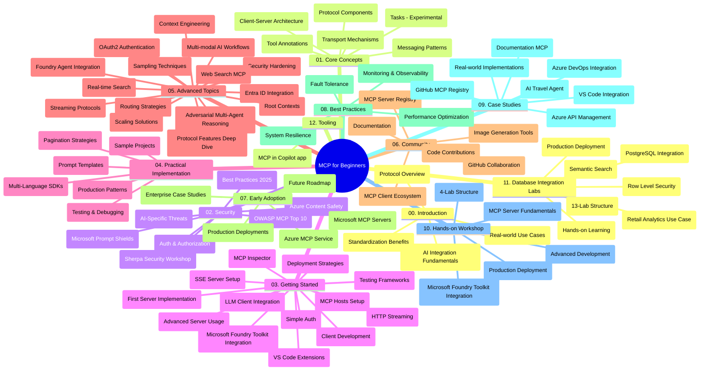

# Protokol konteksta modela (MCP) za začetnike - Študijski vodič

Ta študijski vodič ponuja pregled strukture in vsebine repozitorija za učni načrt "Protokol konteksta modela (MCP) za začetnike". Uporabite ta vodič za učinkovito navigacijo po repozitoriju in kar najbolj izkoristite razpoložljive vire.

## Pregled repozitorija

Protokol konteksta modela (MCP) je standardiziran okvir za interakcije med AI modeli in odjemalskimi aplikacijami. Sprva ga je ustvaril Anthropic, zdaj pa MCP vzdržuje širša skupnost MCP prek uradne organizacije na GitHubu. Ta repozitorij ponuja celovit učni načrt z praktičnimi primeri kode v C#, Javi, JavaScriptu, Pythonu in TypeScriptu, namenjen AI razvijalcem, sistemskim arhitektom in programski opremi inženirjem.

## Vizualni zemljevid učnega načrta

## Struktura repozitorija

Repozitorij je razdeljen na dvanajst glavnih delov, od katerih se vsak osredotoča na različne vidike MCP:

1. **Uvod (00-Introduction/)**
   - Pregled protokola konteksta modela
   - Zakaj je standardizacija pomembna v AI procesih
   - Praktični primeri uporabe in koristi

2. **Osnovni koncepti (01-CoreConcepts/)**
   - Arhitektura klient-strežnik
   - Ključne komponente protokola
   - Vzorce sporočanja v MCP
   - Trenutna specifikacija: [Kaj se je spremenilo v MCP: Specifikacija 2026-07-28](./01-CoreConcepts/mcp-2026-07-28.md) — brezdržavni jedro protokola, okvir Extensions in upokojitve Roots/Sampling/Logging

3. **Varnost (02-Security/)**
   - Varnostne grožnje v sistemih, ki temeljijo na MCP
   - Najboljše prakse za varno izvajanje
   - Strategije overjanja in avtorizacije
   - Praktičen [primer avtorizacije CIMD in DCR](./02-Security/samples/cimd-dcr-auth/README.md)
   - **Celovita varnostna dokumentacija**:
     - Najboljše prakse varnosti MCP
     - Vodnik za izvedbo Azure Content Safety
     - Varnostni nadzori in tehnike MCP
     - Hitri pregled najboljših praks MCP
   - **Ključne varnostne teme**:
     - Vdor v pozive in zastrupljanje orodij
     - Prevzem sej in problem zmedene pooblaščenosti
     - Ranljivosti prehoda žetonov
     - Pretirane pravice in nadzor dostopa
     - Varnost dobavne verige za AI komponente
     - Integracija Microsoft Prompt Shields

4. **Začetek uporabe (03-GettingStarted/)**
   - Nastavitev in konfiguracija okolja
   - Ustvarjanje osnovnih MCP strežnikov in klientov
   - Integracija z obstoječimi aplikacijami
   - Vključuje oddelke za:
     - Prvo implementacijo strežnika
     - Razvoj klienta
     - Integracijo LLM klienta
     - Integracijo v VS Code
     - Strežnik z dogodki, ki jih pošilja strežnik (SSE)
     - Napredna uporaba strežnika
     - HTTP pretakanje
    - Integracija Microsoft Foundry Toolkit
     - Testne strategije
     - Smernice za namestitev

5. **Praktična implementacija (04-PracticalImplementation/)**
   - Uporaba SDK-jev v različnih programskih jezikih
   - Tehnike razhroščevanja, testiranja in validacije
   - Oblikovanje ponovno uporabnih predlog pozivov in potekov dela
   - Vzorčni projekti z implementacijskimi primeri

6. **Napredne teme (05-AdvancedTopics/)**
   - Tehnike inženiringa konteksta
   - Integracija Foundry agenta
   - Večmodalni AI poteki dela
   - Demo predstavitve overjanja OAuth2
   - Funkcionalnosti iskanja v realnem času
   - Pretakanje v realnem času
   - Implementacija korenskih kontekstov
   - Strategije usmerjanja
   - Tehnike vzorčenja
   - Pristopi k skaliranju
   - Varnostni premisleki
   - Integracija varnosti Entra ID
   - Integracija spletnega iskanja
   - Adversarial večagentno sklepanje (vzorce razprave)

7. **Prispevki skupnosti (06-CommunityContributions/)**
   - Kako prispevati k kodi in dokumentaciji
   - Sodelovanje prek GitHuba
   - Izboljšave in povratne informacije, ki jih vodi skupnost
   - Uporaba različnih MCP klientov (Claude Desktop, Cline, VSCode)
   - Delo s priljubljenimi MCP strežniki, vključno z generiranjem slik

8. **Lekcije iz zgodnje uporabe (07-LessonsfromEarlyAdoption/)**
   - Resnični primeri implementacij in uspešne zgodbe
   - Gradnja in postavitev rešitev, ki temeljijo na MCP
   - Trendni in prihodnja razvojna pot
   - **Vodnik Microsoft MCP strežnikov**: Celovit vodič za 10 MCP strežnikov v produkciji, vključno z:
     - Microsoft Learn Docs MCP strežnik
     - Azure MCP strežnik (15+ specializiranih priključkov)
     - GitHub MCP strežnik
     - Azure DevOps MCP strežnik
     - MarkItDown MCP strežnik
     - SQL Server MCP strežnik
     - Playwright MCP strežnik
     - Dev Box MCP strežnik
     - Microsoft Foundry MCP strežnik
     - Microsoft 365 Agents Toolkit MCP strežnik

9. **Najboljše prakse (08-BestPractices/)**
   - Nastavitev zmogljivosti in optimizacija
   - Oblikovanje MCP sistemov, odpornim na napake
   - Testiranje in strategije odpornosti

10. **Študije primerov (09-CaseStudy/)**
    - **Sedem celovitih študij primerov**, ki prikazujejo raznolikost MCP v različnih scenarijih:
    - **Azure AI potovalni agenti**: Večagentna orkestracija z Azure OpenAI in AI Search
    - **Integracija Azure DevOps**: Avtomatizacija potekov dela z YouTube posodobitvami podatkov
    - **Pridobivanje dokumentacije v realnem času**: Python konzolni klient s HTTP pretakanjem
    - **Generator interaktivnih učnih načrtov**: Chainlit spletna aplikacija z pogovornim AI
    - **Dokumentacija v urejevalniku**: Integracija VS Code z GitHub Copilot poteki dela
    - **Azure API upravljanje**: Integracija podjetniških API z ustvarjanjem MCP strežnika
    - **GitHub MCP register**: Razvoj ekosistema in platforma za agentsko integracijo
    - Primeri implementacij, ki zajemajo podjetniško integracijo, produktivnost razvijalcev in razvoj ekosistema

11. **Praktična delavnica (10-StreamliningAIWorkflowsBuildingAnMCPServerWithAIToolkit/)**
    - Celovita praktična delavnica, ki združuje MCP z Microsoft Foundry Toolkit
    - Gradnja inteligentnih aplikacij, ki povezujejo AI modele z resničnimi orodji
    - Praktični moduli, ki zajemajo osnove, razvoj prilagojenih strežnikov in strategije za uvajanje v produkcijo
    - **Struktura laboratorija**:
      - Laboratorij 1: Osnove MCP strežnika
      - Laboratorij 2: Napredni razvoj MCP strežnika
      - Laboratorij 3: Integracija Microsoft Foundry Toolkit
      - Laboratorij 4: Uvajanje v produkcijo in skaliranje
    - Pristop učenja na osnovi laboratorijev z navodili korak za korakom

12. **Laboratoriji za integracijo MCP strežnika z bazo podatkov (11-MCPServerHandsOnLabs/)**
    - **Celovit učni načrt s 13 laboratoriji** za gradnjo MCP strežnikov, pripravljenih za produkcijo, z integracijo PostgreSQL
    - **Praktična implementacija analitike v maloprodaji** s primerom uporabe Zava Retail
    - **Podjetniški vzorci** vključno z varnostjo na ravni vrstic (RLS), semantičnim iskanjem in dostopom do podatkov več najemnikov
    - **Popolna struktura laboratorija**:
      - **Laboratoriji 00-03: Osnove** - Uvod, arhitektura, varnost, nastavitev okolja
      - **Laboratoriji 04-06: Gradnja MCP strežnika** - Razvoj baze podatkov, implementacija MCP strežnika, razvoj orodij
      - **Laboratoriji 07-09: Napredne funkcije** - Semantično iskanje, testiranje in razhroščevanje, integracija VS Code
      - **Laboratoriji 10-12: Produkcija in najboljše prakse** - Uvajanje, spremljanje, optimizacija
    - **Uporabljene tehnologije**: Okvir FastMCP, PostgreSQL, Azure OpenAI, Azure Container Apps, Application Insights
    - **Izidi učenja**: Produkcijsko pripravljeni MCP strežniki, vzorci integracije baze podatkov, analitika z AI, poslovna varnost

13. **Orodja (12-tooling/)**
    - Naučite se uporabljati MCP v aplikaciji Copilot in drugih orodjih

## Dodatni viri

Repozitorij vsebuje podporne vire:

- **Mapa slik**: Vsebuje diagrame in ilustracije, uporabljene v učnem načrtu
- **Prevodi**: Podpora za več jezikov z avtometričnimi prevodi dokumentacije
- **Uradni viri MCP**:
  - [Dokumentacija MCP](https://modelcontextprotocol.io/)
  - [Specifikacija MCP](https://modelcontextprotocol.io/specification/2026-07-28/)
  - [MCP repozitorij na GitHubu](https://github.com/modelcontextprotocol)

## Kako uporabljati ta repozitorij

1. **Zaporedno učenje**: Spremljajte poglavja po vrsti (00 do 11) za strukturirano učno izkušnjo.
2. **Osredotočenost na določen jezik**: Če vas zanima določen programski jezik, preglejte mape vzorcev za implementacije v vašem priljubljenem jeziku.
3. **Praktična implementacija**: Začnite z razdelkom "Začetek uporabe" za nastavitev okolja in ustvarjanje prvega MCP strežnika in klienta.
4. **Napredno raziskovanje**: Ko obvladate osnove, se poglobite v napredne teme za širitev znanja.
5. **Vključevanje skupnosti**: Pridružite se skupnosti MCP prek GitHub razprav in Discord kanalov, da se povežete s strokovnjaki in ostalimi razvijalci.

## MCP klienti in orodja

Učni načrt pokriva različne MCP klientje in orodja:

1. **Uradni klienti**:
   - Visual Studio Code
   - MCP v Visual Studio Code
   - Claude Desktop
   - Claude v VSCode
   - Claude API

2. **Klienti skupnosti**:
   - Cline (terminalski)
   - Cursor (urejevalnik kode)
   - ChatMCP
   - Windsurf

3. **Orodja za upravljanje MCP**:
   - MCP CLI
   - MCP Manager
   - MCP Linker
   - MCP Router

## Priljubljeni MCP strežniki

Repozitorij uvaja različne MCP strežnike, vključno z:

1. **Uradni Microsoft MCP strežniki**:
   - Microsoft Learn Docs MCP strežnik
   - Azure MCP strežnik (15+ specializiranih priključkov)
   - GitHub MCP strežnik
   - Azure DevOps MCP strežnik
   - MarkItDown MCP strežnik
   - SQL Server MCP strežnik
   - Playwright MCP strežnik
   - Dev Box MCP strežnik
   - Microsoft Foundry MCP strežnik
   - Microsoft 365 Agents Toolkit MCP strežnik

2. **Uradni referenčni strežniki**:
   - Datotečni sistem
   - Fetch
   - Pomnilnik
   - Zaporedno razmišljanje

3. **Generiranje slik**:
   - Azure OpenAI DALL-E 3
   - Stable Diffusion WebUI
   - Replicate

4. **Razvojna orodja**:
   - Git MCP
   - Nadzor terminala
   - Pomočnik za kodo

5. **Specializirani strežniki**:
   - Salesforce
   - Microsoft Teams
   - Jira & Confluence

## Prispevki

Ta repozitorij vabi prispevke skupnosti. Za navodila o učinkovitem prispevanju k MCP ekosistemu glejte razdelek Prispevki skupnosti.

----

*Ta študijski vodič je bil nazadnje posodobljen 9. septembra 2026. Odraža MCP
Specifikacijo `2026-07-28`, trenutno različico protokola. Nekateri praktični
primeri so še vedno izrecno verzionirani na `2025-11-25`, medtem ko njihovi SDK-ji in orodja
uporabljajo brezdržavni protokolarni API-je.*

---

<!-- CO-OP TRANSLATOR DISCLAIMER START -->
**Omejitev odgovornosti**:
Ta dokument je bil preveden z uporabo AI prevajalske storitve [Co-op Translator](https://github.com/Azure/co-op-translator). Čeprav si prizadevamo za natančnost, vas prosimo, da upoštevate, da avtomatizirani prevodi lahko vsebujejo napake ali netočnosti. Izvirni dokument v njegovem izvirnem jeziku je treba obravnavati kot avtoritativni vir. Za kritične informacije je priporočljiv strokovni človeški prevod. Ne odgovarjamo za morebitna nesporazume ali napačne interpretacije, ki izhajajo iz uporabe tega prevoda.
<!-- CO-OP TRANSLATOR DISCLAIMER END -->