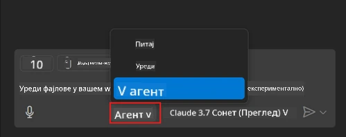
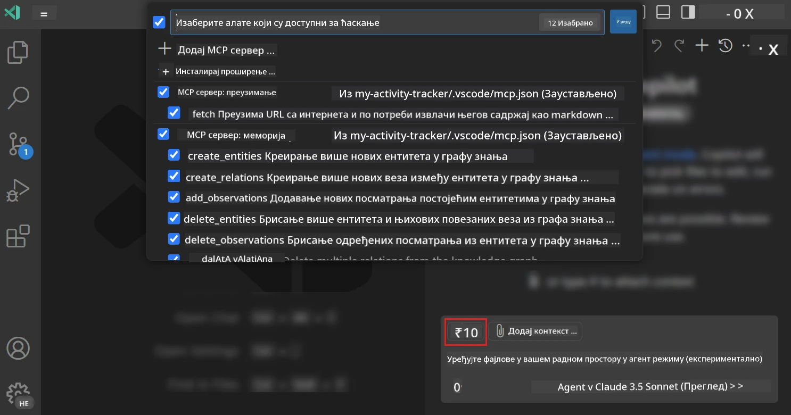
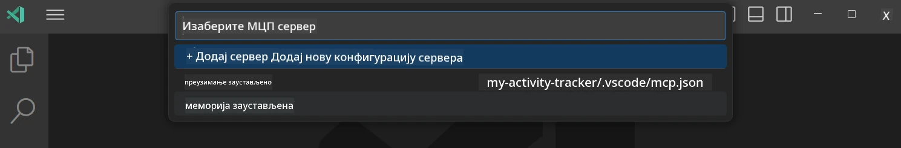
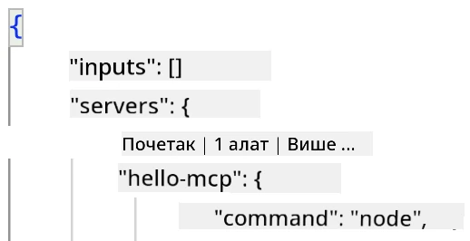
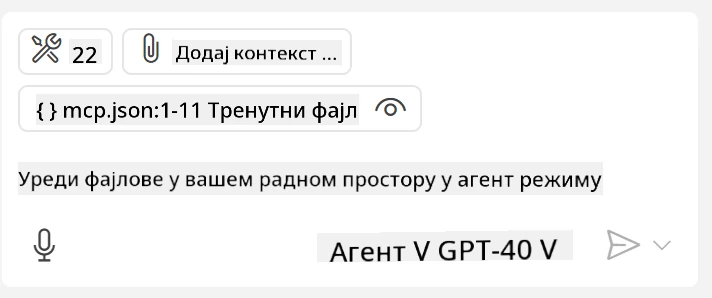
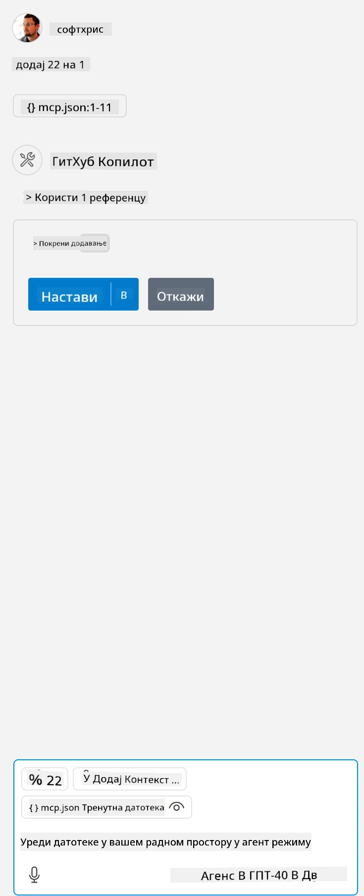

# Користење сервера у режиму GitHub Copilot агента

Visual Studio Code и GitHub Copilot могу да делују као клијент и користе MCP сервер. Можда се питате зашто бисмо то желели? Па, то значи да све функције које MCP сервер има могу сада да се користе директно из вашег IDE-а. Замислите да додате, на пример, GitHub-ов MCP сервер, што би омогућило контролу GitHub-а путем упита и природног језика, уместо уноса специфичних команди у терминал. Или замислите било шта што би могло побољшати ваше искуство рада као програмера, а да све буде контролисано на природном језику. Сада видите предности, зар не?

## Преглед

Овај час описује како користити Visual Studio Code и режим GitHub Copilot агента као клијент за ваш MCP сервер.

## Циљеви учења

На крају овог часа моћи ћете да:

- Користите MCP сервер преко Visual Studio Code-а.
- Покрећете функције као алате преко GitHub Copilot-а.
- Конфигуришете Visual Studio Code да пронађе и управља вашим MCP сервером.

## Коришћење

Можете контролисати ваш MCP сервер на два различита начина:

- Кориснички интерфејс, како ћете видети касније у овом поглављу.
- Терминал, могуће је контролисати ствари из терминала користећи извршни фајл `code`:

  Да бисте додали MCP сервер у ваш кориснички профил, користите командну линијску опцију --add-mcp и обезбедите JSON конфигурацију сервера у облику {\"name\":\"server-name\",\"command\":...}.

  ```
  code --add-mcp "{\"name\":\"my-server\",\"command\": \"uvx\",\"args\": [\"mcp-server-fetch\"]}"
  ```

### Преглед слика





Хајде даље да разговарамо о коришћењу визуелног интерфејса у следећим деловима.

## Приступ

Овако треба да приступимо овом проблему на високом нивоу:

- Конфигурисати фајл да пронађе наш MCP сервер.
- Покренути/Повезати се на тај сервер да бисмо добили листу његових могућности.
- Користити те могућности преко GitHub Copilot Chat интерфејса.

Одлично, сада када разумемо ток, хајде да пробамо да користимо MCP сервер преко Visual Studio Code-а кроз вежбу.

## Вежба: Користење сервера

У овој вежби ћемо конфигурисати Visual Studio Code да пронађе ваш MCP сервер како би могао да се користи из GitHub Copilot Chat интерфејса.

### -0- Претходни корак, омогућите откривање MCP сервера

Можда ћете морати да омогућите откривање MCP сервера.

1. Идите на `File -> Preferences -> Settings` у Visual Studio Code.

1. Потражите "MCP" и укључите `chat.mcp.discovery.enabled` у датотеци settings.json.

### -1- Креирајте фајл конфигурације

Почните тако што ћете креирати конфигурациони фајл у корену вашег пројекта. Потребан вам је фајл MCP.json који треба да поставите у фасциклу .vscode. Треба да изгледа овако:

```text
.vscode
|-- mcp.json
```

Затим погледајмо како можемо додати запис о серверу.

### -2- Конфигуришите сервер

Додајте следећи садржај у *mcp.json*:

```json
{
    "inputs": [],
    "servers": {
       "hello-mcp": {
           "command": "node",
           "args": [
               "build/index.js"
           ]
       }
    }
}
```

Горе је једноставан пример како покренути сервер написан у Node.js, за друге окружења наведите одговарајућу команду за покретање сервера користећи `command` и `args`.

### -3- Покрените сервер

Сада када сте додали запис, покренимо сервер:

1. Пронађите ваш запис у *mcp.json* и уверите се да видите икону за "покренути":

    

1. Кликните на икону "покрени", требало би да видите да се икона алата у GitHub Copilot Chat повећава, што означава да је број доступних алата увећан. Ако кликнете на ту икону, видећете листу регистрованих алата. Можете укључивати/искључивати сваки алат у зависности од тога да ли желите да GitHub Copilot користи те алате као контекст:

  

1. Да покренете алат, укуцајте упит који знате да одговара опису неког од ваших алата, на пример упит као "add 22 to 1":

  

  Требало би да видите одговор 23.

## Задатак

Покушајте да додате запис о серверу у ваш *mcp.json* фајл и уверите се да можете да покренете/зауставите сервер. Такође, уверите се да можете комуницирати са алатима на вашем серверу преко GitHub Copilot Chat интерфејса.

## Решење

[Решење](./solution/README.md)

## Кључни закључци

Закључци овог поглавља су следећи:

- Visual Studio Code је одличан клијент који вам омогућава да користите више MCP сервера и њихове алате.
- GitHub Copilot Chat интерфејс је начин на који комуницирате са серверима.
- Можете тражити од корисника уносе као што су API кључеви који се могу проследити MCP серверу приликом конфигурисања уноса у *mcp.json* фајлу.

## Примери

- [Java калкулатор](../samples/java/calculator/README.md)
- [.NET калкулатор](../../../../03-GettingStarted/samples/csharp)
- [JavaScript калкулатор](../samples/javascript/README.md)
- [TypeScript калкулатор](../samples/typescript/README.md)
- [Python калкулатор](../../../../03-GettingStarted/samples/python)

## Додатни ресурси

- [Документација за Visual Studio](https://code.visualstudio.com/docs/copilot/chat/mcp-servers)

## Шта следи

- Следеће: [Креирање stdio сервера](../05-stdio-server/README.md)

---

<!-- CO-OP TRANSLATOR DISCLAIMER START -->
**Изјава о одрицању одговорности**:
Овај документ је преведен коришћењем услуге за аутоматски превод [Co-op Translator](https://github.com/Azure/co-op-translator). Иако тежимо тачности, имајте у виду да аутоматски преводи могу садржати грешке или нетачности. Оригинални документ на његовом изворном језику треба сматрати ауторитативним извором. За критичне информације препоручује се професионални људски превод. Нисмо одговорни за било каква неспоразума или погрешна тумачења која произилазе из коришћења овог превода.
<!-- CO-OP TRANSLATOR DISCLAIMER END -->