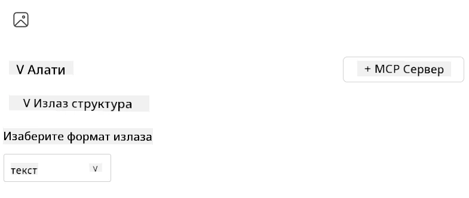
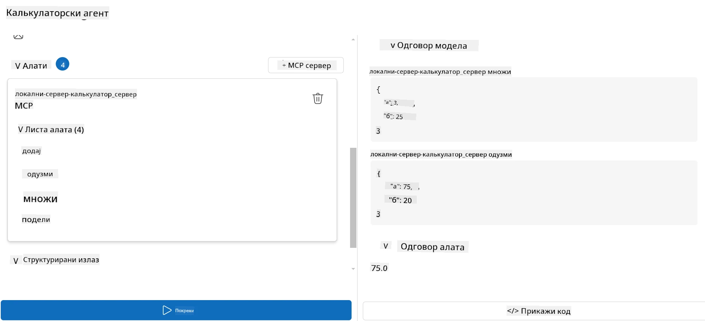

# Коришћење сервера са Microsoft Foundry Toolkit за Visual Studio Code

Када правите AI агента, није само у питању генерисање паметних одговора; такође је важно да вашем агенту омогућите да предузима акције. Ту долази до изражаја Model Context Protocol (MCP). MCP олакшава агентима приступ екстерним алатима и услугама на конзистентан начин. Замислите то као повезивање вашег агента са кутијом алата коју он *заиста* може да користи.

Рецимо да повежете агента са вашим калькулатор MCP сервером. Одједном, ваш агент може да израчунава математичке операције само примајући упит као „Колико је 47 пута 89?“ — без потребе да ручно кодира логику или прави прилагођене API-је.

## Преглед

Овај час покрива како да повежете калькулатор MCP сервер са агентом користећи
[Microsoft Foundry Toolkit за Visual Studio Code](https://aka.ms/AIToolkit),
омогућавајући вашем агенту да изводи математичке операције преко природног језика.

Microsoft Foundry Toolkit поједностављује развој и тестирање генеративних
AI апликација локално и на облаку.

*Напомена*: Toolkit тренутно подржава Python и TypeScript MCP шаблоне.

## Циљеви учења

До краја овог часа моћи ћете да:

- Користите MCP сервер уз Microsoft Foundry Toolkit.
- Конфигуришете агентске поставке како бисте му омогућили откривање и коришћење алата које пружа MCP сервер.
- Користите MCP алате преко природног језика.

## Приступ

Ево како треба да приступимо проблему на високом нивоу:

- Креирајте агента и дефинишите његов системски упит.
- Креирајте MCP сервер са калькулатор алатима.
- Повежите Agent Builder са MCP сервером.
- Тестирајте позив алата агента преко природног језика.

Одлично, сада када разумемо ток, хајде да конфигуришемо AI агента да користи спољне алате преко MCP, повећавајући његове могућности!

## Претпоставке

- [Visual Studio Code](https://code.visualstudio.com/)
- [Microsoft Foundry Toolkit за Visual Studio Code](https://aka.ms/AIToolkit)

## Вежба: Коришћење сервера

> [!WARNING]
> Напомена за кориснике macOS-а. Тренутно истражујемо проблем који утиче на инсталацију зависности на macOS-у. Као резултат, корисници macOS-а тренутно неће моћи да заврше овај туторијал. Ажурираћемо упутства чим поправка буде доступна. Хвала вам на стрпљењу и разумевању!

У овој вежби, направићете, покренути и унапредити AI агента са алатима са
MCP сервера унутар Visual Studio Code користећи Microsoft Foundry Toolkit.

### -0- Претходни корак, додајте Microsoft Foundry GPT-5.1 распоређивање

Креирајте Microsoft Foundry ресурс, распоредите **GPT-5.1**, и додајте га
у **My Models**. Прегледајте
[распоред пензионисања модела](https://learn.microsoft.com/azure/foundry/openai/concepts/model-retirement-schedule)
приликом избора распоређивања.

1. Отворите **Microsoft Foundry Toolkit** из **Activity Bar**.
1. У одељку **Catalog**, изаберите **Models** да отворите **Model Catalog**. Избором **Models** отвара се **Model Catalog** у новом уређивачком табу.
1. Повежите ваш Microsoft Foundry пројекат и изаберите ваше **GPT-5.1** распоређивање.
1. Кликните **+ Add** да додате распоређивање на листу **My Models**.
1. Потврдите на **Activity Bar** да се распоређивање појављује на листи.

### -1- Креирајте агента

**Agent (Prompt) Builder** вам омогућава да креирате и прилагодите своје AI агенте. У овом делу ћете направити новог агента и доделити модел који ће покретати разговор.

1. Отворите **Microsoft Foundry Toolkit** из **Activity Bar**.
1. У одељку **Tools**, изаберите **Agent (Prompt) Builder**. Избором **Agent (Prompt) Builder** отвара се у новом табу уређивача.
1. Кликните на дугме **+ New Agent**. Екстензија ће покренути чаробњака за подешавање путем **Command Palette**.
1. Унесите име **Calculator Agent** и притисните **Enter**.
1. У **Agent (Prompt) Builder**, изаберите ваше **GPT-5.1** Foundry распоређивање.

### -2- Креирајте системски упит за агента

Сад кад је агент постављен, време је да дефинишете његову личност и сврху. У овом делу, користићете функцију **Generate system prompt** да опишете намењено понашање агента — у овом случају калькулатор агента — и да модел напише системски упит за вас.

1. За одељак **Prompts**, кликните на дугме **Generate system prompt**. Ово дугме отвара prompt builder који користи AI за генерисање системског упита за агента.
1. У прозору **Generate a prompt**, унесите следеће: `You are a helpful and efficient math assistant. When given a problem involving basic arithmetic, you respond with the correct result.`
1. Кликните на дугме **Generate**. Појавиће се обавештење у доњем десном углу које потврђује да се системски упит генерише. Када генерација упита буде завршена, упит ће се појавити у пољу **System prompt** у оквиру **Agent (Prompt) Builder**.
1. Прегледајте **System prompt** и извршите измене ако је потребно.

### -3- Креирајте MCP сервер

Сада када сте дефинисали системски упит вашег агента — који усмерава његово понашање и одговоре — време је да агента опремите практичним могућностима. У овом делу ћете направити калькулатор MCP сервер са алатима за сабирање, одузимање, множење и дељење. Овај сервер ће омогућити вашем агенту да изводи математичке операције у реалном времену као одговор на природне језичке упите.



Microsoft Foundry Toolkit укључује шаблоне за креирање MCP сервера. Ми ћемо
користити Python шаблон за калькулатор MCP сервер.

*Напомена*: Toolkit тренутно подржава Python и TypeScript MCP шаблоне.

1. У одељку **Tools** у оквиру **Agent (Prompt) Builder**, кликните на дугме **+ MCP Server**. Екстензија ће покренути чаробњака за подешавање путем **Command Palette**.
1. Изаберите **+ Add Server**.
1. Изаберите **Create a New MCP Server**.
1. Изаберите **python-weather** као шаблон.
1. Изаберите **Default folder** за чување MCP сервер шаблона.
1. Унесите следеће име за сервер: **Calculator**
1. Отвориће се нови прозор Visual Studio Code. Изаберите **Yes, I trust the authors**.
1. Користећи терминал (**Terminal** > **New Terminal**), креирајте виртуелно окружење: `python -m venv .venv`
1. Користећи терминал, активирајте виртуелно окружење:
    1. Windows - `.venv\Scripts\activate`
    1. macOS/Linux - `source .venv/bin/activate`
1. Користећи терминал, инсталирајте зависности: `pip install -e .[dev]`
1. У приказу **Explorer** на **Activity Bar**, проширите директоријум **src** и изаберите **server.py** да отворите датотеку у уређивачу.
1. Замените код у датотеци **server.py** следећим и сачувајте:

    ```python
    """
    Sample MCP Calculator Server implementation in Python.

    
    This module demonstrates how to create a simple MCP server with calculator tools
    that can perform basic arithmetic operations (add, subtract, multiply, divide).
    """
    
    from mcp.server.fastmcp import FastMCP
    
    server = FastMCP("calculator")
    
    @server.tool()
    def add(a: float, b: float) -> float:
        """Add two numbers together and return the result."""
        return a + b
    
    @server.tool()
    def subtract(a: float, b: float) -> float:
        """Subtract b from a and return the result."""
        return a - b
    
    @server.tool()
    def multiply(a: float, b: float) -> float:
        """Multiply two numbers together and return the result."""
        return a * b
    
    @server.tool()
    def divide(a: float, b: float) -> float:
        """
        Divide a by b and return the result.
        
        Raises:
            ValueError: If b is zero
        """
        if b == 0:
            raise ValueError("Cannot divide by zero")
        return a / b
    ```

### -4- Покрените агента са калькулатор MCP сервером

Сада када ваш агент има алате, време је да их користи! У овом делу, послаћете упите агенту да тестирате и проверите да ли агент користи одговарајући алат са калькулатор MCP сервера.



Покренућете калькулатор MCP сервер на вашем локалном развојном рачунару путем **Agent Builder** као MCP клијента.

1. Притисните `F5` да започнете дебаговање MCP сервера. **Agent (Prompt) Builder** ће се отворити у новом уређивачком табу. Статус сервера је видљив у терминалу.
1. У пољу **User prompt** у оквиру **Agent (Prompt) Builder** унесите следећи упит: `I bought 3 items priced at $25 each, and then used a $20 discount. How much did I pay?`
1. Кликните на дугме **Run** да генеришете одговор агента.
1. Прегледајте излаз агента. Модел би требао закључити да сте платили **55$**.
1. Ево детаљног објашњења шта би се требало догодити:
    - Агент бира алате **multiply** и **subtract** да помогне у израчунавању.
    - Одговарајуће `a` и `b` вредности се додељују за алат **multiply**.
    - Одговарајуће `a` и `b` вредности се додељују за алат **subtract**.
    - Одговор сваког алата је приказан у одговарајућем пољу **Tool Response**.
    - Коначни излаз из модела је приказан у пољу **Model Response**.
1. Пошаљите додатне упите да бисте даље тестирали агента. Можете изменити постојећи упит у пољу **User prompt** тако што ћете кликнути у поље и заменити тренутни упит.
1. Када завршите са тестирањем агента, можете зауставити сервер у терминалу притиском на **CTRL/CMD+C**.

## Задатак

Покушајте да додате још један алат у вашу датотеку **server.py** (нпр. израчун квадратног корена броја). Пошаљите додатне упите који захтевају да агент користи ваш нови алат (или постојеће алате). Обавезно поново покрените сервер да би се учитали ново додати алати.

## Решење

[Решење](./solution/README.md)

## Кључни закључци

Закључци из овог поглавља су следећи:

- Microsoft Foundry Toolkit може да користи MCP сервере и њихове алате.
- Можете додавати нове алате MCP серверима, проширујући могућности агента да испуни развијајуће захтеве.
- Microsoft Foundry Toolkit укључује шаблоне за MCP сервере за креирање прилагођених алата.

## Додатни ресурси

- [Документација Microsoft Foundry Toolkit-а](https://aka.ms/AIToolkit/doc)

## Шта следи
- Следеће: [Тестирање и дебаговање](../08-testing/README.md)

---

<!-- CO-OP TRANSLATOR DISCLAIMER START -->
**Изјава о одрицању одговорности**:
Овај документ је преведен коришћењем услуге за аутоматски превод [Co-op Translator](https://github.com/Azure/co-op-translator). Иако тежимо тачности, имајте у виду да аутоматски преводи могу садржати грешке или нетачности. Оригинални документ на његовом изворном језику треба сматрати ауторитативним извором. За критичне информације препоручује се професионални људски превод. Нисмо одговорни за било каква неспоразума или погрешна тумачења која произилазе из коришћења овог превода.
<!-- CO-OP TRANSLATOR DISCLAIMER END -->