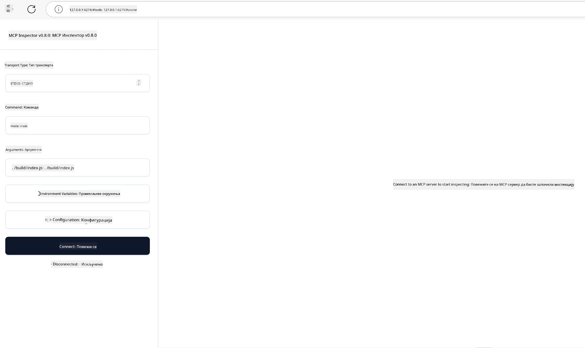

## Тестирање и отклањање грешака

Пре него што почнете са тестирањем вашег MCP сервера, важно је разумети доступне алате и најбоље праксе за отклањање грешака. Ефикасно тестирање осигурава да ваш сервер функционише онако како се очекује и помаже вам да брзо идентификујете и решите проблеме. Следећи одељак приказује препоручене приступе за валидацију ваше MCP имплементације.

## Преглед

Овај час обухвата како изабрати прави приступ тестирању и најефикаснији тест алат.

## Циљеви учења

На крају овог часа, бићете у могућности да:

- Опишете различите приступе за тестирање.
- Користите различите алате за ефикасно тестирање вашег кода.


## Тестирање MCP сервера

MCP пружа алате који вам помажу да тестирате и отклањате грешке ваших сервера:

- **MCP Инспектор**: Алат командне линије који може да се покрене и као CLI алат и као визуелни алат.
- **Ручно тестирање**: Можете користити алат као што је curl за покретање веб захтева, али сваки алат који може да извршава HTTP ће послужити.
- **Јединично тестирање**: Могуће је користити ваш омиљени тест фрејмворк за тестирање функција и сервера и клијента.

### Коришћење MCP инспектора

О употреби овог алата смо разговарали у претходним часовима, али хајде да га најпре укратко опишемо. Алат је направљен у Node.js-у и можете га користити позивањем `npx` извршног фајла који ће привремено преузети и инсталирати сам алат, а након што заврши са извршавањем вашег захтева, очистиће се.

[MCP инспектор](https://github.com/modelcontextprotocol/inspector) вам помаже да:

- **Откријете ресурсе сервера**: Аутоматски детектује доступне ресурсе, алате и промптове
- **Тестирате извршавање алата**: Испробајте различите параметре и видите одговоре у реалном времену
- **Погледате метаподатке сервера**: Испитајте информације о серверу, шеме и конфигурације

Типично извршење алата изгледа овако:

```bash
npx @modelcontextprotocol/inspector node build/index.js
```

Горе наведена команда покреће MCP и његов визуелни интерфејс и лансира локални веб интерфејс у вашем претраживачу. Можете очекивати да видите контролну таблу која приказује ваше регистроване MCP сервере, њихове доступне алате, ресурсе и промптове. Интерфејс вам омогућава интерактивно тестирање извршавања алата, преглед метаподака сервера и приказ одговора у реалном времену, чинећи валидацију и отклањање грешака MCP имплементација лакшим.

Ево како то може изгледати: 

Овај алат можете покренути и у CLI режиму у ком случају додајете атрибут `--cli`. Ево примера покретања алата у "CLI" режиму који приказује све алате на серверу:

```sh
npx @modelcontextprotocol/inspector --cli node build/index.js --method tools/list
```

### Ручно тестирање

Поред покретања инспектор алата за тестирање могућности сервера, сличан приступ је покретање клијента способног за коришћење HTTP-а као што је на пример curl.

Са curl-ом можете директно тестирати MCP сервере коришћењем HTTP захтева:

```bash
# Example: Test server metadata
curl http://localhost:3000/v1/metadata

# Example: Execute a tool
curl -X POST http://localhost:3000/v1/tools/execute \
  -H "Content-Type: application/json" \
  -d '{"name": "calculator", "parameters": {"expression": "2+2"}}'
```

Као што видите из горе приказаног коришћења curl-а, користите POST захтев за покретање алата са payload-ом који се састоји од имена алата и његових параметара. Користите приступ који вам највише одговара. CLI алати уопштено гледано су бржи за употребу и погодни су за скриптовање, што може бити корисно у CI/CD окружењу.

### Јединично тестирање

Креирајте јединичне тестове за ваше алате и ресурсе како бисте осигурали да раде како је предвиђено. Ево примера тестирајућег кода.

```python
import pytest

from mcp.server.fastmcp import FastMCP
from mcp.shared.memory import (
    create_connected_server_and_client_session as create_session,
)

# Mark the whole module for async tests
pytestmark = pytest.mark.anyio


async def test_list_tools_cursor_parameter():
    """Test that the cursor parameter is accepted for list_tools.

    Note: FastMCP doesn't currently implement pagination, so this test
    only verifies that the cursor parameter is accepted by the client.
    """

 server = FastMCP("test")

    # Create a couple of test tools
    @server.tool(name="test_tool_1")
    async def test_tool_1() -> str:
        """First test tool"""
        return "Result 1"

    @server.tool(name="test_tool_2")
    async def test_tool_2() -> str:
        """Second test tool"""
        return "Result 2"

    async with create_session(server._mcp_server) as client_session:
        # Test without cursor parameter (omitted)
        result1 = await client_session.list_tools()
        assert len(result1.tools) == 2

        # Test with cursor=None
        result2 = await client_session.list_tools(cursor=None)
        assert len(result2.tools) == 2

        # Test with cursor as string
        result3 = await client_session.list_tools(cursor="some_cursor_value")
        assert len(result3.tools) == 2

        # Test with empty string cursor
        result4 = await client_session.list_tools(cursor="")
        assert len(result4.tools) == 2
    
```

Горњи код ради следеће:

- Користи pytest фрејмворк који вам омогућава креирање тестова као функција и коришћење assert изјава.
- Креира MCP сервер са два различита алата.
- Користи `assert` изјаву да провери да су одређени услови испуњени.

Погледајте [цео фајл овде](https://github.com/modelcontextprotocol/python-sdk/blob/main/tests/client/test_list_methods_cursor.py)

Са горе наведеним фајлом, можете тестирати свој сервер да бисте били сигурни да су могућности креиране како треба.

Сви главни SDK-ови имају сличне одељке за тестирање па можете прилагодити вашем изабраном окружењу.

## Примери

- [Java Калкулатор](../samples/java/calculator/README.md)
- [.NET Калкулатор](../../../../03-GettingStarted/samples/csharp)
- [JavaScript Калкулатор](../samples/javascript/README.md)
- [TypeScript Калкулатор](../samples/typescript/README.md)
- [Python Калкулатор](../../../../03-GettingStarted/samples/python)

## Додатни ресурси

- [Python SDK](https://github.com/modelcontextprotocol/python-sdk)

## Шта следи

- Следеће: [Деплојмент](../09-deployment/README.md)

---

<!-- CO-OP TRANSLATOR DISCLAIMER START -->
**Изјава о одрицању одговорности**:
Овај документ је преведен коришћењем услуге за аутоматски превод [Co-op Translator](https://github.com/Azure/co-op-translator). Иако тежимо тачности, имајте у виду да аутоматски преводи могу садржати грешке или нетачности. Оригинални документ на његовом изворном језику треба сматрати ауторитативним извором. За критичне информације препоручује се професионални људски превод. Нисмо одговорни за било каква неспоразума или погрешна тумачења која произилазе из коришћења овог превода.
<!-- CO-OP TRANSLATOR DISCLAIMER END -->