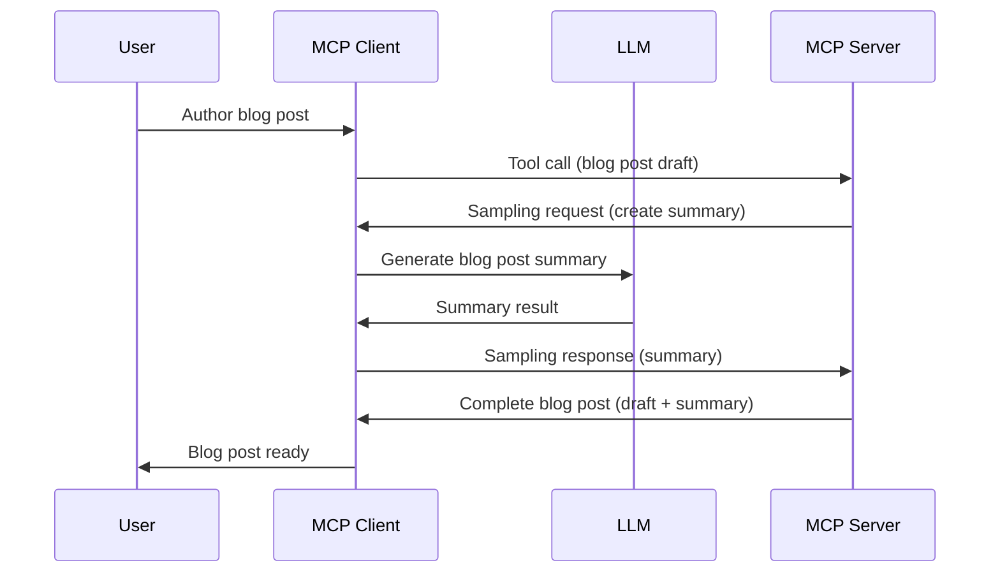

> [!WARNING]
> Узораковање је застарело у MCP `2026-07-28`. Овај час је задржан за
> наслеђене имплементације. Нови сервери би требало да се директно интегришу са LLM
> добављачем API-ја.

# Узораковање - делегирање функција клијенту

> Узораковање остаје у спецификацији `2026-07-28` ради компатибилности и
> може бити уклоњено у првој ревизији објављеној на или после 28. јула
> 2027. Примери у овом часу могу користити SDK API-је који имплементирају `2025-11-25`.
> Погледајте [Шта је све променљиво у MCP: Спецификација 2026-07-28](../../01-CoreConcepts/mcp-2026-07-28.md).

У наслеђеним имплементацијама, Узораковање омогућава MCP серверу да тражи помоћ од LLM
којим управља клијент. За нове имплементације, уместо тога позовите изабраног LLM добављача
директно.

Хајде да истражимо неколико случајева коришћења и како изградити решење које укључује узораковање.

## Преглед

У овом часу фокусирамо се на објашњење када и где користити Узораковање и како га конфигурисати.

## Циљеви учења

У овом поглављу ћемо:

- Објаснити шта је Узораковање и када га користити.
- Приказати како конфигурисати Узораковање у MCP-у.
- Пружити примере употребе Узораковања у пракси.

## Шта је Узораковање и зашто га користити?

Узораковање је напредна функција која ради на следећи начин:



### Захтев за узораковање

У реду, сада када имамо општи преглед вероватног сценарија, хајде да причамо о захтеву за узораковање који сервер шаље клијенту. Ево како захтев може изгледати у JSON-RPC формату:

```json
{
  "jsonrpc": "2.0",
  "id": 1,
  "method": "sampling/createMessage",
  "params": {
    "messages": [
      {
        "role": "user",
        "content": {
          "type": "text",
          "text": "Create a blog post summary of the following blog post: <BLOG POST>"
        }
      }
    ],
    "modelPreferences": {
      "hints": [
        {
          "name": "gpt-5.1"
        }
      ],
      "intelligencePriority": 0.8,
      "speedPriority": 0.5
    },
    "systemPrompt": "You are a helpful assistant.",
    "maxTokens": 100
  }
}
```

Вреди истаћи неколико ствари:

- Prompt, под content -> text, је наш упит који даје инструкцију LLM-у да сажме садржај блог поста.

- **modelPreferences**. Овај одељак је управо то, препорука, препорука које конфигурације треба користити са LLM-ом. Корисник може изабрати да ли ће пратити ове препоруке или их мењати. У овом случају препоруке за модел који треба користити и за приоритет брзине и интелигенције.
- **systemPrompt**, ово је ваш нормални системски упит који даје LLM-у личност и садржи упутства и смернице.
- **maxTokens**, ово је још једна карактеристика која каже колико токена се препоручује за овај задатак.

### Одговор на узораковање

Овај одговор је оно што MCP клијент на крају шаље назад MCP серверу и представља резултат позива клијента LLM-у, чекање на одговор и затим конструисање ове поруке. Ево како може изгледати у JSON-RPC:

```json
{
  "jsonrpc": "2.0",
  "id": 1,
  "result": {
    "role": "assistant",
    "content": {
      "type": "text",
      "text": "Here's your abstract <ABSTRACT>"
    },
    "model": "gpt-5.1",
    "stopReason": "endTurn"
  }
}
```

Одговор је апстракт блог поста управо како је и тражено. Клијент
је изабрао активну `gpt-5.1` имплементацију из серверових препорука модела;
препоруке модела су само сугестије, па клијент може одабрати друге активне
имплементације кад је то потребно.

У реду, сада када разумемо главни ток и користан задатак за коришћење "креирање блог поста + апстракт", хајде да видимо шта треба да урадимо да би то функционисало.

### Типови порука

Поруке за узораковање нису ограничене само на текст већ можете послати и слике и аудио. Ево како JSON-RPC изгледа другачије:

**Текст**

```json
{
  "type": "text",
  "text": "The message content"
}
```

**Садржај слике**

```json
{
  "type": "image",
  "data": "base64-encoded-image-data",
  "mimeType": "image/jpeg"
}
```

**Садржај аудио записа**

```json
{
  "type": "audio",
  "data": "base64-encoded-audio-data",
  "mimeType": "audio/wav"
}
```

> NOTE: За тренутни статус и смернице за миграцију, погледајте
> [документацију за застарело узораковање](https://modelcontextprotocol.io/specification/2026-07-28/client/sampling).

## Како конфигурисати Узораковање у клијенту

> Напомена: ако правите само сервер, овде не морате много радити.

У клијенту треба да спецификујете следећу функцију овако:

```json
{
  "capabilities": {
    "sampling": {}
  }
}
```

Ово ће затим бити преузето када ваш изабрани клијент инициализује везу са сервером.

## Пример узораковања у пракси - Креирање блог поста

Хајде да заједно направимо sampling сервер, биће потребно урадити следеће:

1. Направити алат на серверу.
1. Тај алат треба да направи захтев за узораковање
1. Алат треба да чека да клијент одговори на захтев за узораковање.
1. Затим треба да се произведе резултат алата.

Хајде да видимо код корак по корак:

### -1- Направи алат

**python**

```python
@mcp.tool()
async def create_blog(title: str, content: str, ctx: Context[ServerSession, None]) -> str:
    """Create a blog post and generate a summary"""

```

### -2- Направи захтев за узораковање

Продужите ваш алат следећим кодом:

**python**

```python
post = BlogPost(
        id=len(posts) + 1,
        title=title,
        content=content,
        abstract=""
    )

prompt = f"Create an abstract of the following blog post: title: {title} and draft: {content} "

result = await ctx.session.create_message(
        messages=[
            SamplingMessage(
                role="user",
                content=TextContent(type="text", text=prompt),
            )
        ],
        max_tokens=100,
)

```

### -3- Чекај одговор и врати одговор

**python**

```python
post.abstract = result.content.text

posts.append(post)

# return the complete product
return json.dumps({
    "id": post.title,
    "abstract": post.abstract
})
```

### -4- Комплетан код

**python**

```python
from starlette.applications import Starlette
from starlette.routing import Mount, Host

from mcp.server.fastmcp import Context, FastMCP

from mcp.server.session import ServerSession
from mcp.types import SamplingMessage, TextContent

import json


from uuid import uuid4
from typing import List
from pydantic import BaseModel


mcp = FastMCP("Blog post generator")

# app = FastAPI()

posts = []

class BlogPost(BaseModel):
    id: int
    title: str
    content: str
    abstract: str

posts: List[BlogPost] = []

@mcp.tool()
async def create_blog(title: str, content: str, ctx: Context[ServerSession, None]) -> str:
    """Create a blog post and generate a summary"""

    post = BlogPost(
        id=len(posts) + 1,
        title=title,
        content=content,
        abstract=""
    )

    prompt = f"Create an abstract of the following blog post: title: {title} and draft: {content} "

    result = await ctx.session.create_message(
        messages=[
            SamplingMessage(
                role="user",
                content=TextContent(type="text", text=prompt),
            )
        ],
        max_tokens=100,
    )

    post.abstract = result.content.text

    posts.append(post)

    # return the complete blog post
    return json.dumps({
        "id": post.title,
        "abstract": post.abstract
    })

if __name__ == "__main__":
    print("Starting server...")
    # mcp.run()
    mcp.run(transport="streamable-http")

# run app with: python server.py
```

### -5- Тестирање у Visual Studio Code

Да бисте тестирали ово у Visual Studio Code-у, урадите следеће:

1. Покрените сервер у терминалу
1. Додајте га у *mcp.json* (и уверите се да је покренут) нешто овако:

   ```json
   "servers": {
      "blog-server": {
        "type": "http",
        "url": "http://localhost:8000/mcp"
      }
   }
   ```

1. Унесите prompt:

   ```text
   create a blog post named "Where Python comes from", the content is "Python is actually named after Monty Python Flying Circus"
   ```

1. Дозволите да се узораковање догоди. Први пут када тестирате бићете упитани да прихватите додатни дијалог, потом ћете видети нормални дијалог који тражи да покренете алат

1. Испитајте резултате. Видећете резултате лепо приказане у GitHub Copilot Chat-у али можете и проверити сиромашан JSON одговор.

**Додатак**. Visual Studio Code алати одлично подржавају узораковање. Можете конфигурисати приступ Узорцима на вашем инсталираном серверу тако што ћете га пронаћи овако:

1. Идите у секцију екстензија.
1. Изаберите икону зупчаника за ваш инсталирани сервер у одељку "MCP SERVERS - INSTALLED".
1 Изаберите "Configure Model Access", овде можете изабрати које моделе GitHub Copilot сме да користи приликом узорковања. Такође можете видети све захтеве за узораковање који су се последње време догодили избором "Show Sampling requests".

## Задатак

У овом задатку ћете направити модификованије Узорковање, односно интеграцију узораковања која подржава генерисање описа производа. Ево вашег сценарија:

**Сценарио**: Радник у бекофису е-комерца има проблем јер му много времена одузима генерисање описа производа. Стога треба направити решење у ком можете позвати алат "create_product" са аргументима "title" и "keywords" и он треба да произведе комплетан производ укључујући и поље "description" које ће бити попуњено од стране LLM-а клијента.

САВЕТ: користите оно што сте раније научили да конструишете овај сервер и његов алат користећи захтев за узораковање.

## Решење

[Решење](./solution/README.md)

## Кључне појединости

Узораковање је моћна функција која омогућава серверу да делегира задатке клијенту када му је потребна помоћ LLM-а.

## Шта следи

- [Поглавље 4 - Практична имплементација](../../04-PracticalImplementation/README.md)

---

<!-- CO-OP TRANSLATOR DISCLAIMER START -->
**Изјава о одрицању одговорности**:
Овај документ је преведен коришћењем услуге за аутоматски превод [Co-op Translator](https://github.com/Azure/co-op-translator). Иако тежимо тачности, имајте у виду да аутоматски преводи могу садржати грешке или нетачности. Оригинални документ на његовом изворном језику треба сматрати ауторитативним извором. За критичне информације препоручује се професионални људски превод. Нисмо одговорни за било каква неспоразума или погрешна тумачења која произилазе из коришћења овог превода.
<!-- CO-OP TRANSLATOR DISCLAIMER END -->