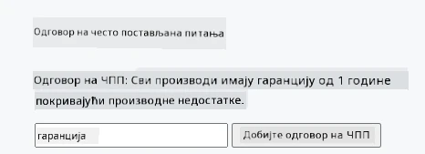
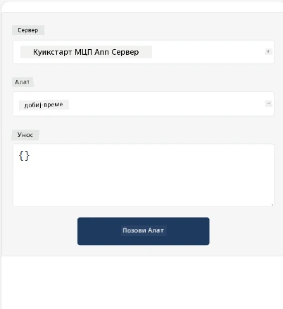
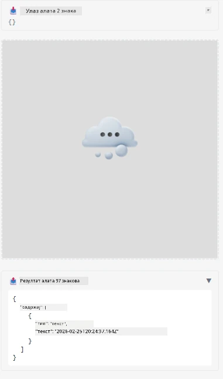

Ево примера који приказује MCP апликацију

## Инсталација

1. Идите у фасциклу *mcp-app*
1. Покрените `npm install`, ово би требало да инсталира фронтенд и бекенд зависности

Проверите да ли бекенд компајлира покретањем:

```sh
npx tsc --noEmit
```

Ако је све у реду, неће бити излаза.

## Покрени бекенд

> Ово захтева мало више труда ако користите Виндоус машину јер MCP Apps решење користи `concurrently` библиотеку за покретање за коју морате пронаћи замену. Ево проблематичне линије у *package.json* у MCP апликацији:

```json
"start": "concurrently \"cross-env NODE_ENV=development INPUT=mcp-app.html vite build --watch\" \"tsx watch main.ts\""
```

Ова апликација има два дела, бекенд део и гостујући део.

Покрените бекенд позивом:

```sh
npm start
```

Ово би требало да покрене бекенд на `http://localhost:3001/mcp`.

> Напомена, ако сте у Codespace окружењу, можда ћете морати да подесите видљивост порта на јавну. Проверите да ли можете приступити крајњој тачки у прегледачу преко https://<name од Codespace>.app.github.dev/mcp

## Опција -1 Тестирање апликације у Visual Studio Code

Да бисте тестирали решење у Visual Studio Code, урадите следеће:

- Додајте унос за сервер у `mcp.json` овако:

    ```json
    {
        "servers": {
            "my-mcp-server-7178eca7": {
                "url": "http://localhost:3001/mcp",
                "type": "http"
            }
        },
        "inputs": []
    }
    ```

1. Кликните дугме "start" у *mcp.json*
1. Уверите се да је прозор за чет отворен и укуцајте `get-faq`, требало би да видите резултат као следећи:

    

## Опција -2- Тестирање апликације са гостом

Репозиторијум <https://github.com/modelcontextprotocol/ext-apps> садржи неколико различитих гостију које можете користити за тестирање ваших MVP апликација.

Овде ћемо вам показати две различите опције:

### Локална машина

- Идите у *ext-apps* након што сте клонирали репо.

- Инсталирајте зависности

   ```sh
   npm install
   ```

- У другом терминал прозору, идите у *ext-apps/examples/basic-host*

    > ако сте у Codespace, потребно је да идете у serve.ts, линија 27 и замените http://localhost:3001/mcp својим Codespace URL-ом за бекенд, на пример https://psychic-xylophone-657rpjgvxpc5g64-3001.app.github.dev/mcp

- Покрените госта:

    ```sh
    npm start
    ```

    Ово би требало да повеже госта са бекендом и требало би да видите апликацију како ради овако:

    

### Codespace

Тренутно је потребно мало више труда да се подеси Codespace окружење. Да бисте користили госта преко Codespace-а:

- Погледајте фасциклу *ext-apps* и идите у *examples/basic-host*.
- Покрените `npm install` да инсталирате зависности
- Покрените `npm start` да покренете госта.

## Тестирајте апликацију

Испробајте апликацију на следећи начин:

- Изаберите дугме "Call Tool" и требало би да видите резултате као следеће:

    

Одлично, све ради.

---

<!-- CO-OP TRANSLATOR DISCLAIMER START -->
**Изјава о одрицању одговорности**:
Овај документ је преведен коришћењем услуге за аутоматски превод [Co-op Translator](https://github.com/Azure/co-op-translator). Иако тежимо тачности, имајте у виду да аутоматски преводи могу садржати грешке или нетачности. Оригинални документ на његовом изворном језику треба сматрати ауторитативним извором. За критичне информације препоручује се професионални људски превод. Нисмо одговорни за било каква неспоразума или погрешна тумачења која произилазе из коришћења овог превода.
<!-- CO-OP TRANSLATOR DISCLAIMER END -->