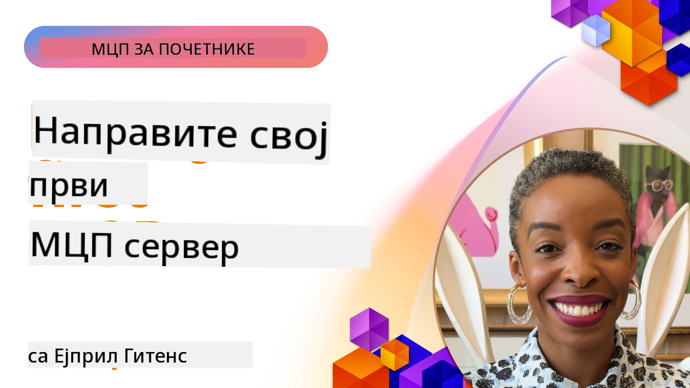

## Почетак  

_(Кликните на слику изнад да бисте погледали видео овог часа)_

Овај одељак се састоји из неколико лекција:

- **1 Ваш први сервер**, у овој првој лекцији научићете како да направите свој први сервер и прегледате га помоћу алата инспектора, вредан начин за тестирање и дебаговање сервера, [до лекције](01-first-server/README.md)

- **2 Клијент**, у овој лекцији научићете како да напишете клијента који може да се повеже са вашим сервером, [до лекције](02-client/README.md)

- **3 Клијент са LLM-ом**, још бољи начин писања клијента је додавањем LLM-а тако да може да "парафразира" са вашим сервером шта да ради, [до лекције](03-llm-client/README.md)

- **4 Коришћење GitHub Copilot Agent режима за MCP сервер у Visual Studio Code**. Овде гледамо како покренути MCP сервер из Visual Studio Code, [до лекције](04-vscode/README.md)

- **5 stdio Transport Server** stdio транспорт је препоручени стандард за локалну MCP комуникацију сервер-клијент, обезбеђујући сигурну комуникацију засновану на подпроцесима са уграђеном изолацијом процеса [до лекције](05-stdio-server/README.md)

- **6 HTTP стриминг са MCP (Streamable HTTP)**. Научите о стандардном
	удаљеном транспорту у [MCP спецификацији 2026-07-28](https://modelcontextprotocol.io/specification/2026-07-28/basic/transports/streamable-http),
	плус задржана имплементација заснована на сесијама у лекцији.
	[до лекције](06-http-streaming/README.md)

- **7 Коришћење Microsoft Foundry Toolkit за Visual Studio Code** за коришћење и тестирање ваших MCP клијената и сервера [у овој лекцији](07-aitk/README.md)

- **8 Тестирање**. Овде ћемо се посебно фокусирати како можемо тестирати наш сервер и клијента на различите начине, [до лекције](08-testing/README.md)

- **9 Деплојмент**. Ово поглавље ће погледати различите начине деплојања ваших MCP решења, [до лекције](09-deployment/README.md)

- **10 Напредна употреба сервера**. Ово поглавље покрива напредну употребу сервера, [до лекције](./10-advanced/README.md)

- **11 Аутентификација**. Ово поглавље покрива како додати једноставну аутентификацију, од Basic Auth до коришћења JWT и RBAC. Похађање овде је препоручљиво, а затим погледајте Напредне теме у Поглављу 5 и извршите додатно ојачавање безбедности преко препорука у Поглављу 2, [до лекције](./11-simple-auth/README.md)

- **12 MCP хостови**. Конфигуришите и користите популарне MCP хост клијенте укључујући Claude Desktop, Cursor, Cline и Windsurf. Сазнајте типове транспорта и решавање проблема, [до лекције](./12-mcp-hosts/README.md)

- **13 MCP инспектор**. Дебагујте и тестирајте ваше MCP сервере интерактивно користећи MCP инспектор алат. Научите како да решавате проблеме са алатима, ресурсима и протоколским порукама, [до лекције](./13-mcp-inspector/README.md)

- **14 Узорковање**. Научите застарелу примитиву Узорковања за `2025-11-25` и
	како мигрирати нове дизајне на директну интеграцију са LLM провајдером. Узорковање је
	застарело у MCP `2026-07-28`. [до лекције](./14-sampling/README.md)

- **15 MCP апликације**. Правите MCP сервере који такође одговарају са UI упутствима, [до лекције](./15-mcp-apps/README.md)

Протокол контекста модела (MCP) је отворени протокол који стандардизује како апликације обезбеђују контекст LLM-овима. Замислите MCP као USB-C порт за АИ апликације - обезбеђује стандардизовани начин повезивања AI модела са различитим изворима података и алатима.

## Циљеви учења

До краја ове лекције, моћи ћете да:

- Подесите развојна окружења за MCP у C#, Java, Python, TypeScript и JavaScript
- Направите и деплојујете основне MCP сервере са прилагођеним функцијама (ресурси, упити и алати)
- Креирате хост апликације које се повезују са MCP серверима
- Тестирате и дебагујете MCP имплементације
- Разумете уобичајене проблеме подешавања и њихова решења
- Повежете ваше MCP имплементације са популарним LLM сервисима

## Подешавање вашег MCP окружења

Пре него што почнете рад са MCP, важно је припремити ваше развојно окружење и разумети основни радни ток. Овај одељак ће вас провести кроз почетне кораке подешавања како би сте обезбедили глатак почетак са MCP.

### Захтеви

Пре него што зароните у развој MCP-а, уверите се да имате:

- **Развојно окружење**: за изабрани језик (C#, Java, Python, TypeScript или JavaScript)
- **IDE/Уредник**: Visual Studio, Visual Studio Code, IntelliJ, Eclipse, PyCharm или било који савремени уредник кода
- **Менаџери пакета**: NuGet, Maven/Gradle, pip, или npm/yarn
- **API кључеви**: за било које AI сервисе које планирате да користите у вашим хост апликацијама

### Званични SDK-ови

У наредним поглављима видећете решења изграђена користећи Python, TypeScript,
Java и .NET. Ево званичних SDK-ова.

Подршка за MCP `2026-07-28` се независно објављује по језицима.
Пре покретања примера, проверите верзију пакета и белешке о издању SDK-а
за подржане ревизије протокола. Погледајте
[званичну листу SDK-ова](https://modelcontextprotocol.io/docs/sdk):
- [C# SDK](https://github.com/modelcontextprotocol/csharp-sdk) - Одржава се у сарадњи са Microsoft-ом
- [Java SDK](https://github.com/modelcontextprotocol/java-sdk) - Одржава се у сарадњи са Spring AI
- [TypeScript SDK](https://github.com/modelcontextprotocol/typescript-sdk) - Званична TypeScript имплементација
- [Python SDK](https://github.com/modelcontextprotocol/python-sdk) - Званична Python имплементација (FastMCP)
- [Kotlin SDK](https://github.com/modelcontextprotocol/kotlin-sdk) - Званична Kotlin имплементација
- [Swift SDK](https://github.com/modelcontextprotocol/swift-sdk) - Одржава се у сарадњи са Loopwork AI
- [Rust SDK](https://github.com/modelcontextprotocol/rust-sdk) - Званична Rust имплементација
- [Go SDK](https://github.com/modelcontextprotocol/go-sdk) - Званична Go имплементација

## Кључне поуке

- Подешавање MCP развојног окружења је једноставно са SDK-овима специфичним за језик
- Прављење MCP сервера обухвата креирање и регистровање алата са јасним шемама
- MCP клијенти се повезују са серверима и моделима да би искористили проширене могућности
- Тестирање и дебаговање су кључни за поуздане MCP имплементације
- Опције деплоја варирају од локалног развоја до решења заснованих на облаку

## Вежбање

Имамо сет примера који допуњује вежбе које ћете видети у свим поглављима овог одељка. Поред тога, свака лекција има своје вежбе и задатке

- [Java Калкулатор](./samples/java/calculator/README.md)
- [.NET Калкулатор](../../../03-GettingStarted/samples/csharp)
- [JavaScript Калкулатор](./samples/javascript/README.md)
- [TypeScript Калкулатор](./samples/typescript/README.md)
- [Python Калкулатор](../../../03-GettingStarted/samples/python)

## Додатни ресурси

- [Прављење агената користећи Протокол контекста модела на Azure](https://learn.microsoft.com/azure/developer/ai/intro-agents-mcp)
- [Удаљени MCP са Azure Container Apps (Node.js/TypeScript/JavaScript)](https://learn.microsoft.com/samples/azure-samples/mcp-container-ts/mcp-container-ts/)
- [.NET OpenAI MCP агент](https://learn.microsoft.com/samples/azure-samples/openai-mcp-agent-dotnet/openai-mcp-agent-dotnet/)

## Шта следи

Почните са првом лекцијом: [Креирање вашег првог MCP сервера](01-first-server/README.md)

Када завршите овај модул, наставите са: [Модул 4: Практична имплементација](../04-PracticalImplementation/README.md)

---

<!-- CO-OP TRANSLATOR DISCLAIMER START -->
**Изјава о одрицању одговорности**:
Овај документ је преведен коришћењем услуге за аутоматски превод [Co-op Translator](https://github.com/Azure/co-op-translator). Иако тежимо тачности, имајте у виду да аутоматски преводи могу садржати грешке или нетачности. Оригинални документ на његовом изворном језику треба сматрати ауторитативним извором. За критичне информације препоручује се професионални људски превод. Нисмо одговорни за било каква неспоразума или погрешна тумачења која произилазе из коришћења овог превода.
<!-- CO-OP TRANSLATOR DISCLAIMER END -->