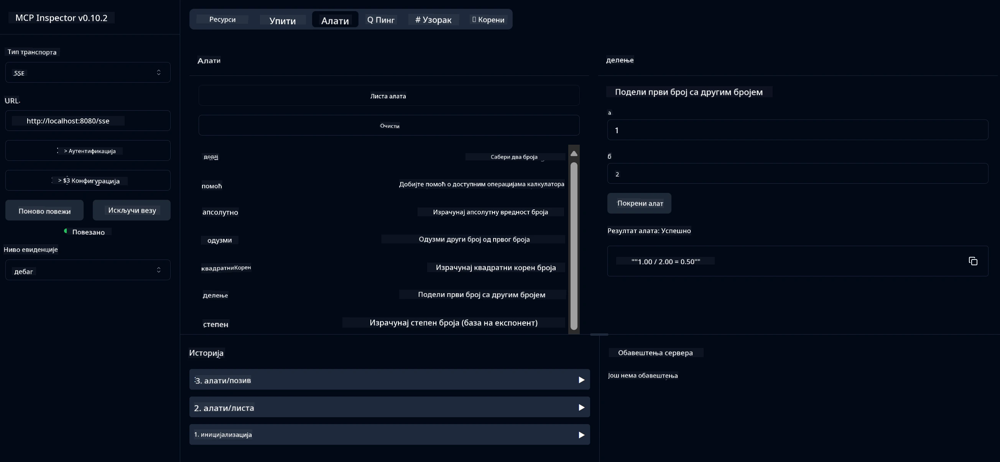

# Основна услуга калкулатора MCP

> [!NOTE]
> Овај пример користи наследни HTTP+SSE транспорт и циља на SDK компатибилан
> са MCP `2025-11-25`. Нови удаљени сервери треба да користе `2026-07-28` Streamable
> HTTP подршку.

Ова услуга пружа основне операције калкулатора кроз Протокол Контекста Модела (MCP) користећи Spring Boot са WebFlux транспортом. Дизајнирана је као једноставан пример за почетнике који уче о MCP имплементацијама.

За више информација, погледајте документацију [MCP Server Boot Starter](https://docs.spring.io/spring-ai/reference/api/mcp/mcp-server-boot-starter-docs.html).

## Преглед

Услуга приказује:
- Подршку за SSE (Server-Sent Events)
- Аутоматску регистрацију алата користећи Spring AI `@Tool` анотацију
- Основне функције калкулатора:
  - Сабирање, одузимање, множење, дељење
  - Израчунавање степена и квадратног корена
  - Модулус (остатак) и апсолутна вредност
  - Помоћна функција за описе операција

## Карактеристике

Ова услуга калкулатора нуди следеће могућности:

1. **Основне аритметичке операције**:
   - Сабирање два броја
   - Одузимање једног броја од другог
   - Множење два броја
   - Дељење једног броја са другим (са провером нуле)

2. **Напредне операције**:
   - Израчунавање степена (подизање основе на експонент)
   - Израчунавање квадратног корена (са контролом негативног броја)
   - Израчунавање модула (остатка)
   - Израчунавање апсолутне вредности

3. **Систем за помоћ**:
   - Уграђена помоћ која објашњава све доступне операције

## Коришћење услуге

Услуга излаже следеће API крајње тачке кроз MCP протокол:

- `add(a, b)`: Додаје два броја
- `subtract(a, b)`: Одузима други број од првог
- `multiply(a, b)`: Множи два броја
- `divide(a, b)`: Делити први број са другим (са провером нуле)
- `power(base, exponent)`: Израчунава степен броја
- `squareRoot(number)`: Израчунава квадратни корен (са контролом негативног броја)
- `modulus(a, b)`: Израчунава остатак при дељењу
- `absolute(number)`: Израчунава апсолутну вредност
- `help()`: Прима информације о доступним операцијама

## Тест клијент

Једноставан тест клијент је укључен у пакет `com.microsoft.mcp.sample.client`. Класа `SampleCalculatorClient` демонстрира доступне операције калкулаторске услуге.

## Коришћење LangChain4j клијента

Пројекат укључује пример LangChain4j клијента у 
`com.microsoft.mcp.sample.client.LangChain4jClient` који демонстрира како
интегрисати услугу калкулатора са Microsoft Foundry моделом.

### Предуслови

1. Креирајте Microsoft Foundry ресурс и распоредите активан модел као што је
   `gpt-5.1`.
2. Подесите крајњу тачку модела, API кључ и име распореда:

   ```bash
   export AZURE_OPENAI_ENDPOINT="https://<resource-name>.openai.azure.com"
   export AZURE_OPENAI_API_KEY="<api-key>"
   export AZURE_OPENAI_DEPLOYMENT="gpt-5.1"
   ```

3. Проверите
   [распоред пензионисања модела Microsoft Foundry](https://learn.microsoft.com/azure/foundry/openai/concepts/model-retirement-schedule)
   пре него што одаберете распоред.
4. Уверите се да сервер калкулатора ради на `localhost:8080`.

### Покретање LangChain4j клијента

Овај пример показује:
- Повезивање са калкулатор MCP сервером преко SSE транспорта
- Коришћење LangChain4j за креирање ћаскања бота који користи операције калкулатора
- Интеграцију са распоређеним Microsoft Foundry моделом

Клијент шаље следеће примерке упита да демонстрира функционалност:
1. Израчунавање збира два броја
2. Проналажење квадратног корена броја
3. Добијање информација о доступним операцијама калкулатора

Покрените пример и проверите излаз на конзоли да видите како AI модел користи калкулаторске алате за одговор на упите.

### Конфигурација Microsoft Foundry модела

LangChain4j клијент користи Azure OpenAI v1-компатибилну крајњу тачку коју пружа
Microsoft Foundry:

```java
String endpoint = System.getenv("AZURE_OPENAI_ENDPOINT");
ChatLanguageModel model = OpenAiOfficialChatModel.builder()
   .baseUrl(endpoint.replaceAll("/+$", "") + "/openai/v1/")
   .apiKey(System.getenv("AZURE_OPENAI_API_KEY"))
   .isAzure(true)
   .modelName(System.getenv().getOrDefault("AZURE_OPENAI_DEPLOYMENT", "gpt-5.1"))
    .timeout(Duration.ofSeconds(60))
    .build();
```

`AZURE_OPENAI_DEPLOYMENT` мора одговарати имену додељеном приликом распореда модела,
што може бити другачије од имена основног модела.

## Зависности

Пројекат захтева следеће кључне зависности:

```xml
<!-- For MCP Server -->
<dependency>
    <groupId>org.springframework.ai</groupId>
    <artifactId>spring-ai-starter-mcp-server-webflux</artifactId>
</dependency>

<!-- For LangChain4j integration -->
<dependency>
    <groupId>dev.langchain4j</groupId>
    <artifactId>langchain4j-mcp</artifactId>
    <version>${langchain4j.version}</version>
</dependency>

<!-- For Microsoft Foundry's OpenAI-compatible endpoint -->
<dependency>
    <groupId>dev.langchain4j</groupId>
   <artifactId>langchain4j-open-ai-official</artifactId>
    <version>${langchain4j.version}</version>
</dependency>
```

## Изградња пројекта

Изградите пројекат користећи Maven:
```bash
./mvnw clean install -DskipTests
```

## Покретање сервера

### Коришћење Јаве

```bash
java -jar target/calculator-server-0.0.1-SNAPSHOT.jar
```

### Коришћење MCP инспектора

MCP инспектор је користан алат за интеракцију са MCP услугама. Да бисте га користили са овом услугом калкулатора:

1. **Инсталирајте и покрените MCP инспектор** у новом прозору терминала:
   ```bash
   npx @modelcontextprotocol/inspector
   ```

2. **Приступите веб интерфејсу** кликом на URL који апликација приказује (обично http://localhost:6274)

3. **Конфигуришите везу**:
   - Подесите тип транспорта на "SSE"
   - Поставите URL на ваш активни SSE сервер: `http://localhost:8080/sse`
   - Кликните "Connect"

4. **Користите алате**:
   - Кликните "List Tools" да бисте видели доступне калкулаторске операције
   - Изаберите алат и кликните "Run Tool" да извршите операцију



### Коришћење Docker-а

Пројекат укључује Dockerfile за контејнеризовану имплементацију:

1. **Изградите Docker слику**:
   ```bash
   docker build -t calculator-mcp-service .
   ```

2. **Покрените Docker контејнер**:
   ```bash
   docker run -p 8080:8080 calculator-mcp-service
   ```

Ово ће:
- Изградити мулти-степенски Docker слику са Maven 3.9.9 и Eclipse Temurin 24 JDK
- Креирати оптимизовану слику контејнера
- Изложити услугу на порту 8080
- Покренути MCP калкулатор услугу унутар контејнера

Можете приступити услузи на `http://localhost:8080` након што контејнер буде покренут.

## Решавање проблема

### Уобичајени проблеми са повезивањем модела

1. **Грешке аутентификације**: Потврдите да `AZURE_OPENAI_API_KEY` припада
   ресурсу идентификованом са `AZURE_OPENAI_ENDPOINT`.
2. **Распоред није пронађен**: Потврдите да `AZURE_OPENAI_DEPLOYMENT` тачно одговара
   имену распореда у Microsoft Foundry.
3. **Ограничење броја захтева**: Прегледајте квоту распореда и покушајте поново након интервала
   који сервиси враћају.

За додатну помоћ, погледајте
[LangChain4j документацију](https://github.com/langchain4j/langchain4j) и
[Microsoft Foundry документацију](https://learn.microsoft.com/azure/ai-foundry/).

---

<!-- CO-OP TRANSLATOR DISCLAIMER START -->
**Изјава о одрицању одговорности**:
Овај документ је преведен коришћењем услуге за аутоматски превод [Co-op Translator](https://github.com/Azure/co-op-translator). Иако тежимо тачности, имајте у виду да аутоматски преводи могу садржати грешке или нетачности. Оригинални документ на његовом изворном језику треба сматрати ауторитативним извором. За критичне информације препоручује се професионални људски превод. Нисмо одговорни за било каква неспоразума или погрешна тумачења која произилазе из коришћења овог превода.
<!-- CO-OP TRANSLATOR DISCLAIMER END -->