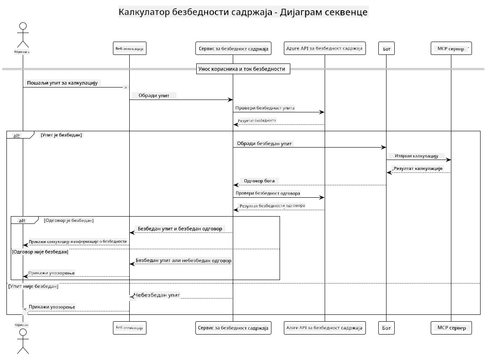

## Архитектура система

Овај пројекат демонстрира веб апликацију која користи проверу безбедности садржаја пре него што проследи корисничке упите сервису за калкулатор преко Модел Контекст Протокола (MCP).



### Како функционише

1. **Унос корисника**: Корисник уноси упит за израчунавање у веб интерфејс
2. **Провера безбедности садржаја (унос)**: Упит анализира Azure Content Safety API
3. **Одлука о безбедности (унос)**:
   - Ако је садржај безбедан (озбиљност < 2 у свим категоријама), наставља се ка калкулатору
   - Ако је садржај означен као потенцијално штетан, процес се зауставља и враћа упозорење
4. **Интеграција калкулатора**: Безбедан садржај обрађује LangChain4j, који комуницира са MCP калкулатор сервером
5. **Провера безбедности садржаја (излаз)**: Одговор бота анализира Azure Content Safety API
6. **Одлука о безбедности (излаз)**:
   - Ако је одговор бота безбедан, приказује се кориснику
   - Ако је одговор бота означен као потенцијално штетан, замењује се упозорењем
7. **Одговор**: Резултати (ако су безбедни) приказују се кориснику заједно са обе анализе безбедности

## Коришћење Model Context Protocol (MCP) са калкулатор услугама

Овај пројекат показује како користити Model Context Protocol (MCP) за позивање MCP услуга калкулатора из LangChain4j. Имплементација користи локални MCP сервер који ради на порту 8080 за пружање калкулатор операција.

### Постављање Azure Content Safety сервиса

Пре коришћења функција безбедности садржаја, потребно је креирати Azure Content Safety сервис ресурс:

1. Пријавите се у [Azure портал](https://portal.azure.com)
2. Кликните на "Креирај ресурс" и претражите „Content Safety“
3. Изаберите "Content Safety" и кликните "Креирај"
4. Унесите јединствено име за ваш ресурс
5. Изаберите претплату и групу ресурса (или креирајте нову)
6. Изаберите подржани регион (проверите [Доступност региона](https://azure.microsoft.com/en-us/global-infrastructure/services/?products=cognitive-services) за детаље)
7. Изаберите одговарајући ниво ценовника
8. Кликните "Креирај" за имплементацију ресурса
9. Када се имплементација заврши, кликните "Иди на ресурс"
10. У левом менију, под „Управљање ресурсом“, изаберите „Кључеви и крајње тачке“
11. Копирајте један од кључева и URL крајње тачке за следећи корак

### Конфигурисање окружења

Подесите Microsoft Foundry модел крајњу тачку, API кључ и име деплоја:
```sh
export AZURE_OPENAI_ENDPOINT="https://<resource-name>.openai.azure.com"
export AZURE_OPENAI_API_KEY="<api-key>"
export AZURE_OPENAI_DEPLOYMENT="gpt-5.1"
```

За функције безбедности садржаја, поставите:
```sh
export CONTENT_SAFETY_ENDPOINT=<your_content_safety_endpoint>
export CONTENT_SAFETY_KEY=<your_content_safety_key>
```

Ове променљиве окружења користи апликација за аутентификацију са Azure Content Safety сервисом. Ако ове променљиве нису подешене, апликација ће користити резервне вредности у сврху демонстрације, али функције безбедности садржаја неће радити исправно.

### Покретање MCP сервера калкулатора

Пре покретања клијента, потребно је покренути MCP сервер калкулатора у SSE режиму на localhost:8080.

## Опис пројекта

Овај пројекат демонстрира интеграцију Model Context Protocol (MCP) са LangChain4j за позивање калкулатор услуга. Кључне карактеристике укључују:

- Коришћење MCP за повезивање са сервисом калкулатора за основне математичке операције
- Двослојна провера безбедности садржаја на корисничким упитима и одговорима бота
- Интеграција са имплементираним Microsoft Foundry моделом преко LangChain4j
- Коришћење Server-Sent Events (SSE) за MCP транспорт

## Интеграција безбедности садржаја

Пројекат укључује свеобухватне функције безбедности садржаја како би се обезбедило да и уноси корисника и системски одговори буду без штетног садржаја:

1. **Провера уноса**: Сви кориснички упити се анализирају на категорије штетног садржаја као што су говор мржње, насиље, самооштећивање и сексуални садржај пре процесирања.

2. **Провера излаза**: Чак и када се користе потенцијално нецензурисани модели, систем проверава све генерисане одговоре кроз исте филтере безбедности садржаја пре приказивања кориснику.

Ова двослојна метода обезбеђује да систем остане безбедан без обзира који AI модел се користи, штитећи кориснике од штетних уноса и потенцијално проблематичних AI генерисаних излаза.

## Веб клијент

Апликација укључује пријатан веб интерфејс који омогућава корисницима интеракцију са системом Content Safety Calculator:

### Карактеристике веб интерфејса

- Једноставан, интуитиван формулар за унос упита за израчунавање
- Двослојна провера безбедности садржаја (унос и излаз)
- Повратне информације у реалном времену о безбедности упита и одговора
- Индикатори безбедности у боји за лакше тумачење
- Чист, одзиван дизајн који ради на разним уређајима
- Примери безбедних упита као водич за кориснике

### Коришћење веб клијента

1. Покрените апликацију:
   ```sh
   mvn spring-boot:run
   ```

2. Отворите прегледач и идите на `http://localhost:8087`

3. Унесите упит за израчунавање у предвиђено текстуално поље (нпр. „Израчунај збир 24.5 и 17.3“)

4. Кликните "Пошаљи" да обрадите захтев

5. Погледајте резултате, који ће укључивати:
   - Анализу безбедности вашег упита
   - Израчунавани резултат (ако је упит био безбедан)
   - Анализу безбедности одговора бота
   - Било каква упозорења о безбедности ако је унос или излаз био означен

Веб клијент аутоматски обавља обе процедуре провере безбедности садржаја, осигуравајући да су све интеракције безбедне и прикладне без обзира који AI модел је у употреби.

---

<!-- CO-OP TRANSLATOR DISCLAIMER START -->
**Изјава о одрицању одговорности**:
Овај документ је преведен коришћењем услуге за аутоматски превод [Co-op Translator](https://github.com/Azure/co-op-translator). Иако тежимо тачности, имајте у виду да аутоматски преводи могу садржати грешке или нетачности. Оригинални документ на његовом изворном језику треба сматрати ауторитативним извором. За критичне информације препоручује се професионални људски превод. Нисмо одговорни за било каква неспоразума или погрешна тумачења која произилазе из коришћења овог превода.
<!-- CO-OP TRANSLATOR DISCLAIMER END -->