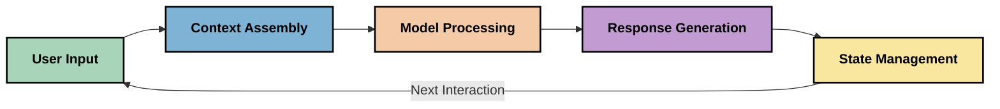
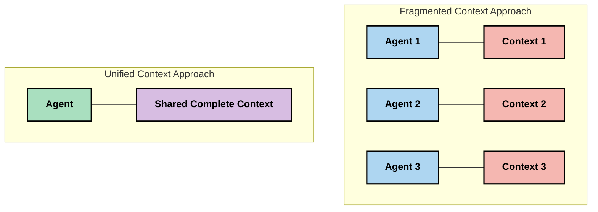
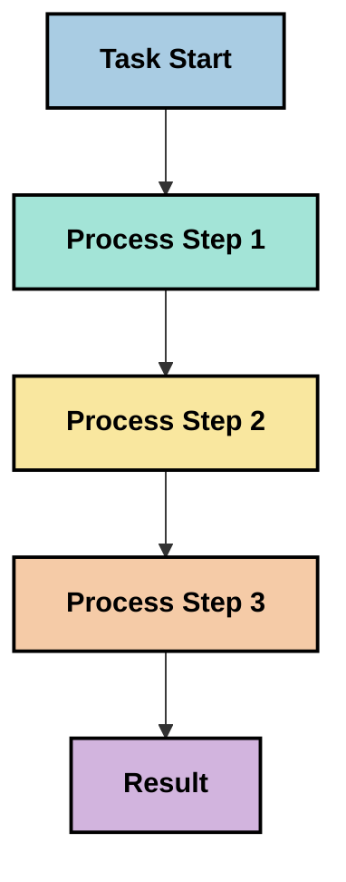
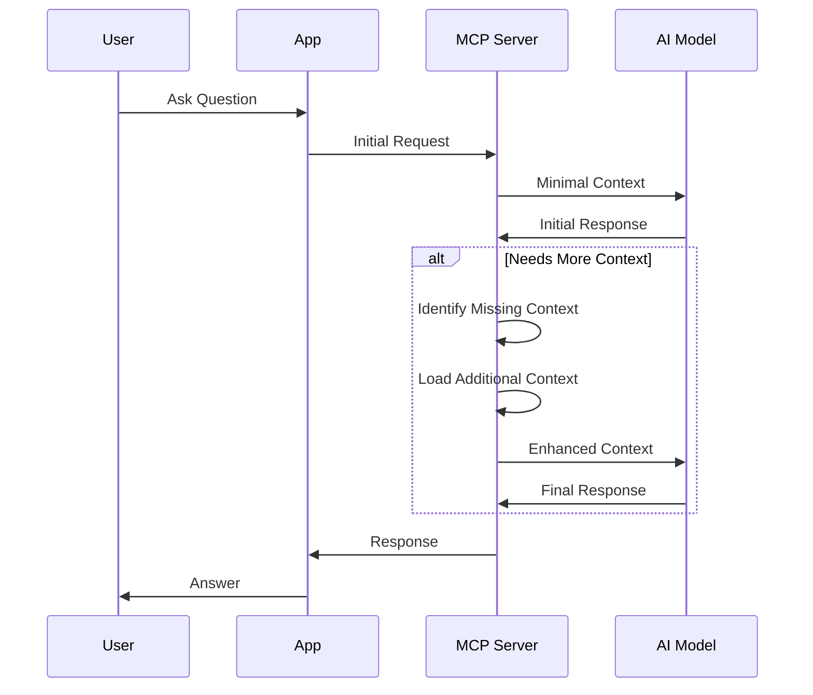
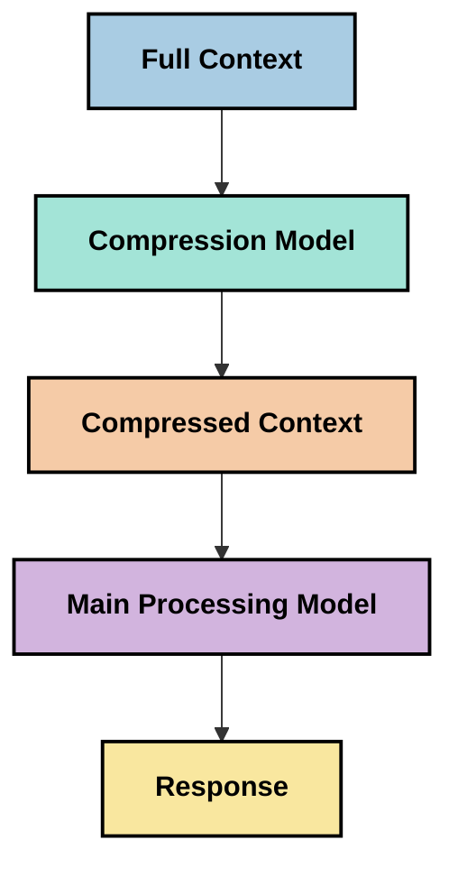
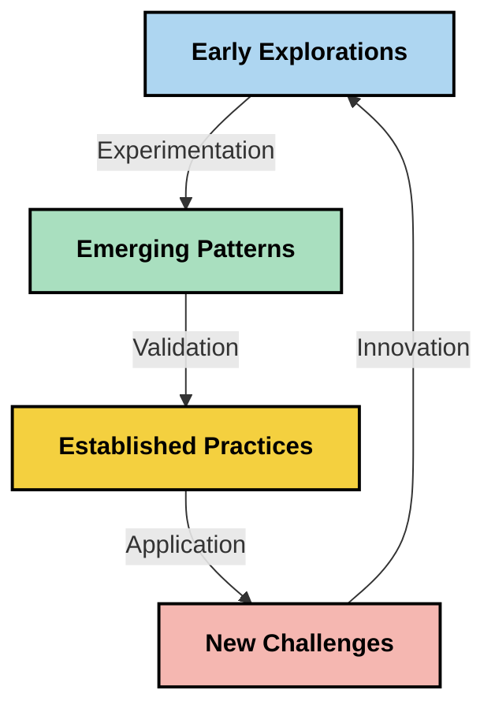

# Инжењеринг контекста: Нови концепт у MCP екосистему

## Преглед

Инжењеринг контекста је нови концепт у области вештачке интелигенције који истражује како се информације структуирају, испоручују и одржавају током интеракција између клијената и AI услуга. Како MCP екосистем (Model Context Protocol) еволуира, разумевање ефективног управљања контекстом постаје све важније. Овај модул уводи концепт инжењеринга контекста и истражује његове потенцијалне примене у MCP имплементацијама.

## Циљеви учења

До краја овог модула бићете у стању да:

- Разумете нови концепт инжењеринга контекста и његову потенцијалну улогу у MCP апликацијама
- Идентификујете кључне изазове у управљању контекстом које MCP протокол адресира
- Истражите технике за побољшање учинка модела кроз боље руковање контекстом
- Размотрите приступе за мерење и процену ефикасности контекста
- Примените ове нове концепте како бисте побољшали AI искуства кроз MCP оквир

## Увод у инжењеринг контекста

Инжењеринг контекста је нови концепт фокусиран на намерно дизајнирање и управљање током информација између корисника, апликација и AI модела. За разлику од афирмисаних области као што је инжењеринг упита (prompt engineering), инжењеринг контекста се још дефинише од стране практичара који решавају јединствене изазове пружања правих информација AI моделима у правом тренутку.

Како су велики језички модели (LLM) еволуирали, значај контекста је постао све очигледнији. Квалитет, релевантност и структура контекста који пружамо директно утичу на излазе модела. Инжењеринг контекста истражује ову везу и настоји да развије принципе за ефикасно управљање контекстом.

> "Године 2025, модели постају изузетно интелигентни. Али чак ни најпаметнији човек неће моћи ефективно да обави свој посао без контекста шта се од њега тражи... 'Инжењеринг контекста' је следећи ниво инжењеринга упита. Ради се о аутоматском раду у динамичком систему." — Валден Јан, Cognition AI

Инжењеринг контекста може обухватити:

1. **Избор контекста**: Одређивање које информације су релевантне за задати задатак
2. **Структурирање контекста**: Организовање информација за максималну разумљивост модела
3. **Испорука контекста**: Оптимизација начина и времена слања информација моделима
4. **Одржавање контекста**: Управљање стањем и развојем контекста током времена
5. **Процена контекста**: Мерење и побољшање ефикасности контекста

Ове области су нарочито релевантне за MCP екосистем који пружа стандардизован начин за апликације да преносе контекст LLM моделима.


## Перспектива путовања контекста

Један начин да се визуализује инжењеринг контекста је праћење пута информација кроз MCP систем:



### Кључне фазе путовања контекста:

1. **Унос корисника**: Сирове информације од корисника (текст, слике, документи)
2. **Састављање контекста**: Комбиновање уноса корисника са системским контекстом, историјом разговора и другим преузетим информацијама
3. **Обрада модела**: AI модел обрађује састављени контекст
4. **Генерисање одговора**: Модел производи излазе на основу достављеног контекста
5. **Управљање стањем**: Систем ажурира свој интерни статус на основу интеракције

Ова перспектива истиче динамичку природу контекста у AI системима и поставља важна питања о најбољем управљању информацијама у свакој фази.

## Нови принципи у инжењерингу контекста

Како се област инжењеринга контекста развија, неки рани принципи почињу да се формирају кроз рад практичара. Ови принципи могу помоћи у информисању избора имплементација MCP-а:

### Принцип 1: Потпуно делити контекст

Контекст треба да буде у потпуности подељен између свих компоненти система, а не фрагментисан између више агената или процеса. Када је контекст расподељен, одлуке донете у једном делу система могу бити у конфликту са оним донетим другде.



У MCP апликацијама ово сугерише дизајн система где контекст несметано тече кроз цео ланац уместо да буде подељен на делове.

### Принцип 2: Препознати да радње носе имплицитне одлуке

Свакa радња коју модел предузме носи имплицитне одлуке о томе како тумачити контекст. Када више компоненти делује на различите контексте, те имплицитне одлуке могу бити у конфликту, што доводи до неусклађених резултата.

Овај принцип има важне импликације за MCP апликације:
- Предност линеарне обраде сложених задатака уместо паралелне извршне фрагментиране контексте
- Обезбедити да све тачке одлучивања имају приступ истој контекстуалној информацији
- Дизајнирати системе где каснији кораци могу видети цео контекст ранијих одлука

### Принцип 3: Баланс између дубине контекста и ограничења прозора

Како разговори и процеси расту дужи, прозори контекста коначно препуне. Ефикасан инжењеринг контекста истражује приступе управљања овим тензијама између свеобухватног контекста и техничких ограничења.

Потенцијални приступи укључују:
- Компресију контекста која задржава суштинске информације уз мању употребу токена
- Прогресивно учитавање контекста базирано на релевантности тренутним потребама
- Сумирање претходних интеракција уз очување кључних одлука и чињеница

## Изазови са контекстом и дизајн MCP протокола

Model Context Protocol (MCP) осмишљен је имајући у виду јединствене изазове управљања контекстом. Разумевање ових изазова помаже објашњењу кључних аспеката дизајна MCP протокола:


### Изазов 1: Ограничења прозора контекста
Већина AI модела има фиксне величине прозора контекста, што ограничава колико информација могу обрадити одједном.

**Одговор дизајна MCP-а:** 
- Протокол подржава структуриран, ресурсо-базирани контекст који се може ефикасно реферисати
- Ресурси могу бити пейџинговани и учитавани прогресивно

### Изазов 2: Одређивање релевантности
Тешко је одредити које су информације најрелевантније за укључивање у контекст.

**Одговор дизајна MCP-а:**
- Флексибилни алати омогућавају динамичко преузимање информација базирано на потребама
- Структурисани упити омогућавају доследну организацију контекста

### Изазов 3: Постојаност контекста
Управљање стањем кроз интеракције захтева пажљиво праћење контекста.

**Одговор дизајна MCP-а:**
- Стандаризовано управљање сесијама
- Јасно дефинисани обрасци интеракција за еволуцију контекста

### Изазов 4: Мултимодални контекст
Различити типови података (текст, слике, структуирани подаци) захтевају различите приступе.

**Одговор дизајна MCP-а:**
- Дизајн протокола прилагођава различитим типовима садржаја
- Стандаризована репрезентација мултимодалних информација

### Изазов 5: Безбедност и приватност
Контекст често садржи осетљиве информације које морају бити заштићене.

**Одговор дизајна MCP-а:**
- Јасне границе између одговорности клијента и сервера
- Локалне опције обраде ради минимизирања излагања података

Разумевање ових изазова и како их MCP решава пружа основу за истраживање напреднијих техника инжењеринга контекста.

## Нови приступи инжењерингу контекста

Како се област инжењеринга контекста развија, појављују се неки обећавајући приступи. Они представљају тренутна размишљања, а не устаљене добре праксе, и вероватно ће се развијати са стицањем искуства у MCP имплементацијама.

### 1. Јединствена линеарна обрада (single-threaded linear processing)

Насупрот мулти-агент архитектурама које расподељују контекст, неки практичари откривају да једнонишка линеарна обрада даје конзистентније резултате. Ово је у складу са принципом одржавања јединственог контекста.



Иако овај приступ може деловати мање ефикасно од паралелне обраде, често даје кохерентније и поузданије резултате јер сваки корак гради на потпуном разумевању претходних одлука.

### 2. Деловање и приоритетизација контекста

Расцепљивање великих контекста на управљиве делове и приоритизација најважнијег.

```python
# Conceptual Example: Context Chunking and Prioritization
def process_with_chunked_context(documents, query):
    # 1. Break documents into smaller chunks
    chunks = chunk_documents(documents)
    
    # 2. Calculate relevance scores for each chunk
    scored_chunks = [(chunk, calculate_relevance(chunk, query)) for chunk in chunks]
    
    # 3. Sort chunks by relevance score
    sorted_chunks = sorted(scored_chunks, key=lambda x: x[1], reverse=True)
    
    # 4. Use the most relevant chunks as context
    context = create_context_from_chunks([chunk for chunk, score in sorted_chunks[:5]])
    
    # 5. Process with the prioritized context
    return generate_response(context, query)
```

Концепт изнад илуструје како можемо великe документe подијелити на управљиве дијелове и изабрати само најрелевантније делове за контекст. Овај приступ може помоћи у раду у оквиру ограничења прозора контекста уз и даље коришћење великих база знања.

### 3. Прогресивно учитавање контекста

Учитавање контекста постепено по потреби, уместо одједном.



Прогресивно учитавање контекста почиње са минималним контекстом и шири се само кад је потребно. Ово може значајно смањити употребу токена за једноставне упите уз одржавање могућности руковања сложеним питањима.

### 4. Компресија и сумирање контекста

Смањење величине контекста уз очување суштинских информација.



Компресија контекста фокусира се на:
- Уклањање вишка информација
- Сумирање дужег садржаја
- Издвајање кључних чињеница и детаља
- Очување критичних елемената контекста
- Оптимизацију за ефикасност коришћења токена

Овај приступ може бити посебно вредан за одржавање дугих разговора у оквиру прозора контекста или за ефикасну обраду великих докумената. Неки практичари користе специјализоване моделе посебно за компресију контекста и сумирање историје разговора.


## Разматрања при истраживању инжењеринга контекста

Како истражујемо нову област инжењеринга контекста, нека разматрања су вредна пажње у раду са MCP имплементацијама. Ово нису прописане најбоље праксе већ области истраживања које могу донети побољшања у вашем специфичном случају употребе.

### Размотрите своје циљеве контекста

Пре имплементације сложених решења за управљање контекстом, јасно дефинишите шта покушавате да постигнете:
- Које специфичне информације модел треба да би био успешан?
- Које информације су суштинске, а које додатне?
- Која су ваша ограничења у перформансама (латенција, лимити токена, трошкови)?

### Истражите слојевите приступе контексту

Неке праксе налазе успех у контексту организованом у концептуалне слојеве:
- **Основни слој**: Суштинске информације које модел увек треба
- **Ситуациони слој**: Контекст специфичан за тренутну интеракцију
- **Подршки слој**: Додатне информације које могу бити корисне
- **Резервни слој**: Информације приступачне само по потреби

### Истражите стратегије преузимања

Ефикасност контекста често зависи од начина на који се информације преузимају:
- Семантичка претрага и уграђивање за проналажење концептуално релевантних информација
- Претрага заснована на кључним речима за специфичне фактичке детаље
- Хибридни приступи који комбинују више метода преузимања
- Филтрирање метаподатака за сужење домена по категоријама, датумима или изворима

### Експериментишите са кохеренцијом контекста

Структура и проток вашег контекста могу утицати на разумевање модела:
- Груписање повезаних информација заједно
- Користећи доследан формат и организовање
- Одржавање логичког или хронолошког редоследа где је то прикладно
- Избегавање противречних информација

### Утегните компромисе мулти-агент архитектура

Иако су мулти-агент архитектуре популарне у многим AI оквирима, оне долазе са значајним изазовима у управљању контекстом:
- Фрагментација контекста може довести до неусклађених одлука међу агентима
- Паралелна обрада може увести конфликте који су тешки за помирење
- Трошкови комуникације између агената могу смањити добитак у перформансама
- За одржавање кохеренције неопходно је комплексно управљање стањем

У многим случајевима, приступ са једним агентом и свеобухватним управљањем контекстом може дати поузданије резултате него више специјализованих агената са фрагментираним контекстом.

### Развијте методе процене

Да бисте временом побољшали инжењеринг контекста, размотрите како ћете мерити успех:
- A/B тестирање различитих структура контекста
- Праћење коришћења токена и времена одзива
- Прати задовољство корисника и стопе завршетка задатака
- Анализирање када и зашто контекстуалне стратегије не успевају

Ова разматрања представљају активне области истраживања у простору инжењеринга контекста. Како област сазрева, вероватно ће се појавити дефинитивнији обрасци и праксе.

## Мерење ефикасности контекста: Еволуирајући оквир

Како инжењеринг контекста постаје концепт, практичари почињу да истражују како бисмо могли мерити његову ефикасност. Још не постоји устаљен оквир, али разни мерни показатељи се разматрају који би могли усмерити будући рад.

### Потенцијалне димензије мерења


#### 1. Разматрања ефикасности уноса

- **Однос контекста и одговора**: Колико контекста је потребно у односу на величину одговора?
- **Употреба токена**: Колики проценат датих токена контекста утиче на одговор?
- **Редаукција контекста**: Колико ефективно можемо компримовати сирове информације?

#### 2. Разматрања учинка

- **Утицај на латенцију**: Како управљање контекстом утиче на време одговора?
- **Економија токена**: Да ли оптимизујемо коришћење токена ефикасно?
- **Прецизност преузимања**: Колико је релевантна преузета информација?
- **Коришћење ресурса**: Који су потребни рачунарски ресурси?

#### 3. Разматрања квалитета

- **Релевантност одговора**: Колико одговор адресира упит?
- **Фактичка прецизност**: Да ли управљање контекстом побољшава тачност чињеница?
- **Конзистентност**: Да ли су одговори доследни код сличних упита?
- **Стопа халуцинација**: Да ли бољи контекст смањује халуцинације модела?

#### 4. Разматрања корисничког искуства

- **Стопа потребе за додатним питањима**: Колико често корисници траже појашњење?
- **Завршетак задатака**: Да ли корисници успешно остварују своје циљеве?
- **Индикатори задовољства**: Како корисници оцењују своје искуство?

### Истраживачки приступи мерењу

Када експериментишете са инжењерингом контекста у MCP имплементацијама, размотрите ове истраживачке приступе:

1. **Поређења са основним нивоом**: Успоставите основу са једноставним приступима контексту пре тестирања напредних метода

2. **Инкременталне измене**: Мењајте један аспект управљања контекстом у једном тренутку да изолујете његов ефекат

3. **Евалуација усредсређена на корисника**: Комбинујте квантитативне мере са квалитативним повратним информацијама корисника

4. **Анализа неуспеха**: Испитајте случајеве у којима стратегије контекста не успевају да разумете потенцијална побољшања

5. **Мултидимензионална процена**: Размотрите компромисе између ефикасности, квалитета и корисничког искуства

Овај експериментални, вишеструки приступ мерењу је у складу са растућом природом инжењеринга контекста.

## Завршне мисли

Инжењеринг контекста је нова област истраживања која може постати централна за ефикасне MCP апликације. Размишљајући о томе како информације протичу кроз ваш систем, потенцијално можете створити AI искуства која су ефикаснија, прецизнија и вреднија корисницима.

Технике и приступи описани у овом модулу представљају рано размишљање у овој области, а не устаљене праксе. Инжењеринг контекста се може развити у дефинисану дисциплину како AI могућности еволуирају и како се наше разумевање продубљује. За сада, експериментисање у комбинацији са пажљивим мерењем делује као најпродуктивнији приступ.

## Потенцијални будући правци

Област инжењеринга контекста је још у раној фази, али појављују се неки обећавајући правци:

- Принципи инжењеринга контекста могу значајно утицати на учинак модела, ефикасност, корисничко искуство и поузданост
- Јединствене процедуре са свеобухватним управљањем контекстом могу надмашити мулти-агентске архитектуре у многим случајевима употребе
- Специјализовани модели за компресију контекста могу постати стандардни делови AI ланаца
- Тензија између потпуности контекста и ограничења токена вероватно ће покренути иновације у руковању контекстом
- Како модели постану способнији за ефикасну комуникацију сличну људској, права мулти-агентска сарадња може постати изводљивија
- MCP имплементације могу еволуирати у стандардирачке обрасце управљања контекстом који излазе из текућег експериментисања



## Ресурси

### Званични MCP ресурси
- [Model Context Protocol Website](https://modelcontextprotocol.io/)
- [Model Context Protocol Specification](https://github.com/modelcontextprotocol/modelcontextprotocol)
- [MCP документација](https://modelcontextprotocol.io/docs)
- [MCP C# SDK](https://github.com/modelcontextprotocol/csharp-sdk)
- [MCP Python SDK](https://github.com/modelcontextprotocol/python-sdk)
- [MCP TypeScript SDK](https://github.com/modelcontextprotocol/typescript-sdk)
- [MCP Inspector](https://github.com/modelcontextprotocol/inspector) - Визуелни алат за тестирање MCP сервера

### Чланци о инжењерству контекста
- [Не прави мулти-агенте: Принципи инжењерства контекста](https://cognition.ai/blog/dont-build-multi-agents) - Увид Валда Јана у принципе инжењерства контекста
- [Практичан водич за прављење агената](https://cdn.openai.com/business-guides-and-resources/a-practical-guide-to-building-agents.pdf) - OpenAI водич за ефикасан дизајн агената
- [Прављење ефикасних агената](https://www.anthropic.com/engineering/building-effective-agents) - Приступ Anthropic компаније развоју агената

### Повезана истраживања
- [Динамичко проширење преузимања за велике језичке моделе](https://arxiv.org/abs/2310.01487) - Истраживање динамичких приступа преузимању података
- [Загубљени у средини: Како језички модели користе дуге контексте](https://arxiv.org/abs/2307.03172) - Важно истраживање образаца обраде контекста
- [Хијерархијска текстуално-повезана генерација слика са CLIP латентима](https://arxiv.org/abs/2204.06125) - Рад DALL-E 2 са увидима у структуру контекста
- [Истраживање улоге контекста у архитектурама великих језичких модела](https://aclanthology.org/2023.findings-emnlp.124/) - Недавна истраживања о обради контекста
- [Сарадња мулти-агената: Преглед](https://arxiv.org/abs/2304.03442) - Истраживање мулти-агентских система и њихових изазова

### Додатни ресурси
- [Технике оптимизације прозора контекста](https://learn.microsoft.com/en-us/azure/ai-services/openai/concepts/context-window)
- [Напредне RAG технике](https://www.microsoft.com/en-us/research/blog/retrieval-augmented-generation-rag-and-frontier-models/)
- [Документација Semantic Kernel](https://github.com/microsoft/semantic-kernel)
- [Microsoft Foundry алати за Visual Studio Code](https://github.com/microsoft/vscode-ai-toolkit)

## Шта следи

- [5.15 MCP прилагођени транспорт](../mcp-transport/README.md)

---

<!-- CO-OP TRANSLATOR DISCLAIMER START -->
**Изјава о одрицању одговорности**:
Овај документ је преведен коришћењем услуге за аутоматски превод [Co-op Translator](https://github.com/Azure/co-op-translator). Иако тежимо тачности, имајте у виду да аутоматски преводи могу садржати грешке или нетачности. Оригинални документ на његовом изворном језику треба сматрати ауторитативним извором. За критичне информације препоручује се професионални људски превод. Нисмо одговорни за било каква неспоразума или погрешна тумачења која произилазе из коришћења овог превода.
<!-- CO-OP TRANSLATOR DISCLAIMER END -->