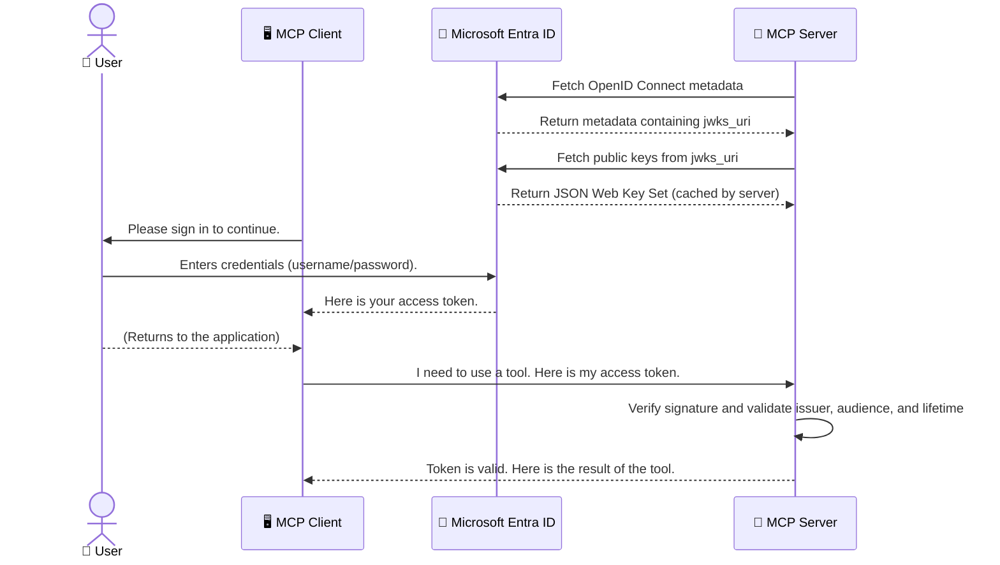

# Заштита радних токова вештачке интелигенције: Ентра ID аутентификација за Модел Контекст Протокол сервере

> [!NOTE]
> Код даљинског сервера у овој лекцији штити застареле `/sse` и `/message`
> крајње тачке и циља MCP `2025-11-25`. Задржите његове методе идентификације и валидације токена,
> али користите пренос струје преко Streamable HTTP у складу са `2026-07-28` за нове
> имплементације.

## Увод
Заштита вашег Модел Контекст Протокол (MCP) сервера је једнако важна као и закључавање улаза у ваш дом. Остављање MCP сервера отвореним изложиће ваше алате и податке неовлашћеном приступу, што може довести до безбедносних пропуста. Microsoft Entra ID пружа робустан облачно базиран систем за управљање идентитетом и приступом, помажући да само овлашћени корисници и апликације могу да комуницирају са вашим MCP сервером. У овом делу ћете научити како да заштитите своје радне токове вештачке интелигенције коришћењем Entra ID аутентификације.

## Циљеви учења
До краја овог дела, моћи ћете да:

- Разумете значај заштите MCP сервера.
- Објасните основе Microsoft Entra ID и OAuth 2.0 аутентификације.
- Препознате разлику између јавних и поверљивих клијената.
- Имплементирате Entra ID аутентификацију у локалним (јавни клијент) и даљинским (поверљиви клијент) сценаријима MCP сервера.
- Примeните безбедносне најбоље праксе приликом развоја AI радних токова.

## Безбедност и MCP

Баш као што не бисте оставили улазна врата куће незакључана, тако не бисте ни свој MCP сервер требало да оставите отвореним за приступ свима. Заштита ваших AI радних токова је кључна за изградњу робусних, поузданих и безбедних апликација. Ово поглавље ће вас упознати са коришћењем Microsoft Entra ID за заштиту MCP сервера, осигуравајући да само овлашћени корисници и апликације могу да интерагују са вашим алатима и подацима.

## Зашто је безбедност битна за MCP сервере

Замислите да ваш MCP сервер поседује алат који може слати е-пошту или приступати бази купаца. Несигуран сервер значи да било ко потенцијално може користити тај алат, што може довести до неовлашћеног приступа подацима, слања нежељене поште или других злонамерних активности.

Имплементирањем аутентификације осигураћете да сваки захтев ка вашем серверу буде проверен, потврђујући идентитет корисника или апликације која прави захтев. Ово је први и најважнији корак у обезбеђивању ваших AI радних токова.

## Увод у Microsoft Entra ID

[**Microsoft Entra ID**](https://adoption.microsoft.com/microsoft-security/entra/) је облачна услуга за управљање идентитетима и приступом. Замислите је као универзалног чувара безбедности за ваше апликације. Она рукује компликованим процесом проверe идентитета корисника (аутентификација) и одређивањем шта они смеју да раде (аутораизација).

Коришћењем Entra ID, можете:

- Омогућити сигуран пријављивање корисника.
- Заштитити API-је и сервисе.
- Управљати приступним политикама са централизоване локације.

За MCP сервере, Entra ID пружа робустан и широко поуздан начин управљања ко може приступити способностима вашег сервера.

---

## Разумевање магије: Како функционише Entra ID аутентификација

Entra ID користи отворене стандарде као што је **OAuth 2.0** за руковање аутентификацијом. Иако детаљи могу бити сложени, основна идеја је једноставна и може се разумети преко аналогије.

### Љубазан увод у OAuth 2.0: Кључ валета

Замислите OAuth 2.0 као услугу валета (паркинг сервис) за ваш аутомобил. Када стигнете у ресторан, не давате валету свој главни кључ. Уместо тога, дајете **кључ валета** који има ограничене дозвољене акције — може укључити ауто и закључати врата, али не може отворити пртљажник или инструмент таблу.

У овој аналогији:

- **Ви** сте **Корисник**.
- **Ваш ауто** је **MCP Сервер** са својим вредним алатима и подацима.
- **Валет** је **Microsoft Entra ID**.
- **Чувар паркинга** је **MCP Клијент** (апликација која покушава да приступи серверу).
- **Кључ валета** је **Токен приступа**.

Токен приступа је сигуран низ текста који MCP клијент добија од Entra ID након што се пријавите. Клијент потом представља овај токен MCP серверу при сваком захтеву. Сервер може да верификује токен како би потврдио да је захтев легитиман и да клијент има потребне дозволе, све без потребе да икада рукује вашим стварним акредитивима (као што је ваша лозинка).

### Ток аутентификације

Ево како процес функционише у пракси:



MCP сервер не позива Entra ID да верификује сваки токен приступа. Он
криптографски проверава JWT потпис са предзапамћеним јавним кључем Entra ID
и валидацијом захтева токена, укључујући издавача, публику и временски рок трајања.
Сервер учитава `jwks_uri` из OpenID Connect метаподатака, преузима јавне
кључеве са тог URI-ја и периодично их освежава за руковање ротирањем кључева. Користите
подржану библиотеку за валидацију токена уместо да имплементирате ову логику
сами. За детаље, видети
[Валидирање токена у Microsoft identity платформи](https://learn.microsoft.com/entra/identity-platform/access-tokens#validate-tokens).

### Упознавање са Microsoft Authentication Library (MSAL)

Пре него што заронимо у код, важно је упознати један кључни састојак који ћете видети у примерима: **Microsoft Authentication Library (MSAL)**.

MSAL је библиотека коју је развио Microsoft и која знатно олакшава програмерима управљање аутентификацијом. Уместо да ви пишете сав сложени код за руковање безбедносним токенима, управљање пријавама и освежавање сесија, MSAL преузима овај терет на себе.

Користећи библиотеку као што је MSAL високо се препоручује јер:

- **Безбедна је:** Имплементира протоколе индустријског стандарда и безбедносне најбоље праксе, смањујући ризик од рањивости у вашем коду.
- **Поједностављује развој:** Апстрахује сложеност OAuth 2.0 и OpenID Connect протокола, омогућавајући вам да са само неколико редова кода додате робусну аутентификацију у вашу апликацију.
- **Одржава се:** Microsoft активно одржава и ажурира MSAL како би одговорио на нове безбедносне претње и промене платформи.

MSAL подржава велики број језика и оквира апликација, укључујући .NET, JavaScript/TypeScript, Python, Java, Go и мобилне платформе као што су iOS и Android. То значи да можете користити исте конзистентне образце аутентификације кроз читав технолошки скуп.

За више информација о MSAL, погледајте званичну [dokumentaciju за MSAL](https://learn.microsoft.com/entra/identity-platform/msal-overview).

---

## Заштита вашег MCP сервера са Entra ID: Водич корак по корак

Сада ћемо проћи кроз процес како обезбедити локални MCP сервер (који комуницира преко `stdio`) користећи Entra ID. Овај пример користи **јавног клијента**, што је погодније за апликације које раде на корисниковом рачунару, као што су десктоп апликације или сервер за локални развој.

### Случај 1: Заштита локалног MCP сервера (са јавним клијентом)

У овом сценарију ћемо погледати MCP сервер који ради локално, комуницира преко `stdio`, и користи Entra ID за аутентикацију корисника пре омогућавања приступа његовим алатима. Сервер ће имати један алат који дохвата информације о профилу корисника из Microsoft Graph API-ја.

#### 1. Подешавање апликације у Entra ID

Пре него што напишете било какав код, потребно је да региструјете вашу апликацију у Microsoft Entra ID. Ово обавештава Entra ID о вашој апликацији и даје јој дозволу за коришћење услуге аутентификације.

1. Идите на **[Microsoft Entra портал](https://entra.microsoft.com/)**.
2. Идите у **App registrations** и кликните на **New registration**.
3. Дајте вашој апликацији име (на пример, "Мој локални MCP сервер").
4. За **Supported account types**, изаберите **Accounts in this organizational directory only**.
5. Можете оставити **Redirect URI** празан за овај пример.
6. Кликните **Register**.

Након регистрације, запишите **Application (client) ID** и **Directory (tenant) ID**. Биће вам потребни у коду.

#### 2. Код: Разлагање

Погледајмо кључне делове кода који руковања аутентификацијом. Цео код овог примера доступан је у фасцикли [Entra ID - Local - WAM](https://github.com/Azure-Samples/mcp-auth-servers/tree/main/src/entra-id-local-wam) у [mcp-auth-servers GitHub репозиторијуму](https://github.com/Azure-Samples/mcp-auth-servers).

**`AuthenticationService.cs`**

Ова класа је одговорна за интеракцију са Entra ID.

- **`CreateAsync`**: Ова метода иницијализује `PublicClientApplication` из MSAL-а (Microsoft Authentication Library). Конфигурисана је са вашим `clientId` и `tenantId` апликације.
- **`WithBroker`**: Омогућава коришћење брокера (као што је Windows Web Account Manager), који пружа сигурније и неприметно једнократно пријављивање.
- **`AcquireTokenAsync`**: Ово је главна метода. Прво покушава тихо да добије токен (корисник неће морати поново да се пријављује ако већ има важећу сесију). Ако тихи тренутак није могућ, захтеваће интерактивну пријаву кориснику.

```csharp
// Simplified for clarity
public static async Task<AuthenticationService> CreateAsync(ILogger<AuthenticationService> logger)
{
    var msalClient = PublicClientApplicationBuilder
        .Create(_clientId) // Your Application (client) ID
        .WithAuthority(AadAuthorityAudience.AzureAdMyOrg)
        .WithTenantId(_tenantId) // Your Directory (tenant) ID
        .WithBroker(new BrokerOptions(BrokerOptions.OperatingSystems.Windows))
        .Build();

    // ... cache registration ...

    return new AuthenticationService(logger, msalClient);
}

public async Task<string> AcquireTokenAsync()
{
    try
    {
        // Try silent authentication first
        var accounts = await _msalClient.GetAccountsAsync();
        var account = accounts.FirstOrDefault();

        AuthenticationResult? result = null;

        if (account != null)
        {
            result = await _msalClient.AcquireTokenSilent(_scopes, account).ExecuteAsync();
        }
        else
        {
            // If no account, or silent fails, go interactive
            result = await _msalClient.AcquireTokenInteractive(_scopes).ExecuteAsync();
        }

        return result.AccessToken;
    }
    catch (Exception ex)
    {
        _logger.LogError(ex, "An error occurred while acquiring the token.");
        throw; // Optionally rethrow the exception for higher-level handling
    }
}
```

**`Program.cs`**

Овде се поставља MCP сервер и интегрише услуга аутентификације.

- **`AddSingleton<AuthenticationService>`**: Овај запис региструје `AuthenticationService` у контејнеру за убризгавање зависности, тако да га други делови апликације (као што је наш алат) могу користити.
- **`GetUserDetailsFromGraph` алат**: Овај алат захтева инстанцу `AuthenticationService`. Пре било какве активности, позива `authService.AcquireTokenAsync()` да добије важећи токен приступа. Ако је аутентификација успешна, користи токен за позив Microsoft Graph API-ју и преузима податке корисника.

```csharp
// Simplified for clarity
[McpServerTool(Name = "GetUserDetailsFromGraph")]
public static async Task<string> GetUserDetailsFromGraph(
    AuthenticationService authService)
{
    try
    {
        // This will trigger the authentication flow
        var accessToken = await authService.AcquireTokenAsync();

        // Use the token to create a GraphServiceClient
        var graphClient = new GraphServiceClient(
            new BaseBearerTokenAuthenticationProvider(new TokenProvider(authService)));

        var user = await graphClient.Me.GetAsync();

        return System.Text.Json.JsonSerializer.Serialize(user);
    }
    catch (Exception ex)
    {
        return $"Error: {ex.Message}";
    }
}
```

#### 3. Како све то ради заједно

1. Када MCP клијент покуша да користи `GetUserDetailsFromGraph` алат, алат прво позива `AcquireTokenAsync`.
2. `AcquireTokenAsync` покреће MSAL библиотеку да провери да ли постоји важећи токен.
3. Ако не постоји токен, MSAL преко брокера тражи од корисника да се пријави са својим Entra ID налогом.
4. Када се корисник пријави, Entra ID издаје токен приступа.
5. Алат прими токен и користи га за безбедан позив Microsoft Graph API-ју.
6. Подаци корисника се враћају MCP клијенту.

Овај процес обезбеђује да само аутентификовани корисници могу да користе алат, ефикасно штитећи ваш локални MCP сервер.

### Случај 2: Заштита даљинског MCP сервера (са поверљивим клијентом)

Када ваш MCP сервер ради на даљинској машини (као што је сервер у облаку) и комуницира преко протокола као што је HTTP Streaming, безбедносни захтеви су другачији. У том случају требало би да користите **поверљиви клијент** и **Authorization Code Flow**. Ово је безбеднија метода јер тајне апликације никада нису изложене прегледачу.

Овај пример користи TypeScript базиран MCP сервер који користи Express.js за обраду HTTP захтева.

#### 1. Подешавање апликације у Entra ID

Подешавање у Entra ID је слично као код јавног клијента, али уз једну кључну разлику: потребно је направити **клијент тајну**.

1. Идите на **[Microsoft Entra портал](https://entra.microsoft.com/)**.
2. У регистровању ваше апликације, идите на језичак **Certificates & secrets**.
3. Кликните **New client secret**, дајте опис и кликните **Add**.
4. **Важна напомена:** Одмах копирајте вредност тајне. Нећете је моћи поново видети.
5. Такође морате конфигурисати **Redirect URI**. Идите на језичак **Authentication**, кликните **Add a platform**, изаберите **Web** и унесите redirect URI за вашу апликацију (нпр. `http://localhost:3001/auth/callback`).

> **⚠️ Важна безбедносна напомена:** За продукционе апликације, Microsoft снажно препоручује коришћење **аутентификације без тајни** попут **Managed Identity** или **Workload Identity Federation** уместо клијент тајни. Клијент тајне представљају безбедносни ризик јер могу бити изложене или компромитоване. Managed Identities пружају безбеднији приступ елиминишући потребу за чувањем акредитива у коду или конфигурацији.
>
> За више информација о managed identities и како их имплементирати, видети [Преглед managed identities за Azure ресурсе](https://learn.microsoft.com/entra/identity/managed-identities-azure-resources/overview).

#### 2. Код: Разлагање

Овај пример користи приступ заснован на сесијама. Када се корисник аутентификује, сервер чува токен приступа и токен за освежавање у сесији и даје кориснику сесијски токен. Овај сесијски токен се затим користи за наредне захтеве. Цео код овог примера доступан је у фасцикли [Entra ID - Confidential client](https://github.com/Azure-Samples/mcp-auth-servers/tree/main/src/entra-id-cca-session) у [mcp-auth-servers GitHub репозиторијуму](https://github.com/Azure-Samples/mcp-auth-servers).

**`Server.ts`**

Овај фајл подешава Express сервер и MCP транспортни слој.

- **`requireBearerAuth`**: Ово је middleware који штити `/sse` и `/message` крајње тачке. Проверава да ли постоји важећи bearer токен у `Authorization` заглављу захтева.
- **`EntraIdServerAuthProvider`**: Ово је прилагођена класа која имплементира `McpServerAuthorizationProvider` интерфејс. Одговорна је за руковање OAuth 2.0 током.
- **`/auth/callback`**: Ова крајња тачка обрађује редирект са Entra ID након што се корисник аутентификовaо. Она мења authorization код у токен приступа и освежавајући токен.

```typescript
// Simplified for clarity
const app = express();
const { server } = createServer();
const provider = new EntraIdServerAuthProvider();

// Protect the SSE endpoint
app.get("/sse", requireBearerAuth({
  provider,
  requiredScopes: ["User.Read"]
}), async (req, res) => {
  // ... connect to the transport ...
});

// Protect the message endpoint
app.post("/message", requireBearerAuth({
  provider,
  requiredScopes: ["User.Read"]
}), async (req, res) => {
  // ... handle the message ...
});

// Handle the OAuth 2.0 callback
app.get("/auth/callback", (req, res) => {
  provider.handleCallback(req.query.code, req.query.state)
    .then(result => {
      // ... handle success or failure ...
    });
});
```

**`Tools.ts`**

Ова датотека дефинише алате које MCP сервер пружа. `getUserDetails` алат је сличан оном у претходном примеру, али добија приступни токен из сесије.

```typescript
// Simplified for clarity
server.setRequestHandler(CallToolRequestSchema, async (request) => {
  const { name } = request.params;
  const context = request.params?.context as { token?: string } | undefined;
  const sessionToken = context?.token;

  if (name === ToolName.GET_USER_DETAILS) {
    if (!sessionToken) {
      throw new AuthenticationError("Authentication token is missing or invalid. Ensure the token is provided in the request context.");
    }

    // Get the Entra ID token from the session store
    const tokenData = tokenStore.getToken(sessionToken);
    const entraIdToken = tokenData.accessToken;

    const graphClient = Client.init({
      authProvider: (done) => {
        done(null, entraIdToken);
      }
    });

    const user = await graphClient.api('/me').get();

    // ... return user details ...
  }
});
```

**`auth/EntraIdServerAuthProvider.ts`**

Ова класа обрађује логику за:

- Преусмеравање корисника на страницу за пријаву у Entra ID.
- Размену кода за овлашћење за приступни токен.
- Чување токена у `tokenStore`.
- Освежавање приступног токена када истекне.

#### 3. Како све то ради заједно

1. Када корисник први пут покуша да се повеже на MCP сервер, `requireBearerAuth` посредник ће уочити да нема валидну сесију и преусмериће га на страницу за пријаву у Entra ID.
2. Корисник се пријављује са својим Entra ID налогом.
3. Entra ID преусмерава корисника назад на `/auth/callback` крајњу тачку са кодом за овлашћење.
4. Сервер размењује код за приступни и освежавајући токен, чува их и креира сесијски токен који се шаље клијенту.
5. Клијент сада може да користи овај сесијски токен у заглављу `Authorization` за све будуће захтеве ка MCP серверу.
6. Када се позове `getUserDetails` алат, он користи сесијски токен да пронађе приступни токен Entra ID, а затим га користи за позив Microsoft Graph API-ју.

Овај ток је сложенији од тока јавног клијента, али је неопходан за интернет-оријентисане крајње тачке. Пошто су удаљени MCP сервери приступачни преко јавног интернета, потребне су јаче безбедносне мере да би се заштитили од неовлашћеног приступа и потенцијалних напада.


## Најбоље праксе за безбедност

- **Увек користите HTTPS**: Енкриптујте комуникацију између клијента и сервера како бисте заштитили токене од пресретања.
- **Имплементирајте контролу приступа засновану на улогама (RBAC)**: Не само да проверавате *да ли* је корисник аутентификован; проверавајте *шта* је овлашћен да ради. Можете дефинисати улоге у Entra ID и проверавати их у вашем MCP серверу.
- **Пратите и вршите ревизију**: Логујте све догађаје аутентификације да бисте могли да откријете и реагујете на сумњиве активности.
- **Обрадите ограничења учесталости и успоравање (throttling)**: Microsoft Graph и други API-ји имплементирају ограничења учесталости да спрече злоупотребу. Имплементирајте експоненцијално повлачење и логику поновног покушаја у вашем MCP серверу како бисте лепо обрадили HTTP 429 (превише захтева) одговоре. Размотрите кеширање често приступаних података да бисте смањили позиве API-ју.
- **Безбедно чување токена**: Чувајте приступне и освежавајуће токене на безбедан начин. За локалне апликације користите безбедне системе за чување. За серверске апликације размотрите коришћење шифрованог складишта или услуге за управљање кључевима као што је Azure Key Vault.
- **Обрада истека токена**: Приступни токени имају ограничен рок важности. Имплементирајте аутоматско освежавање токена користећи освежавајуће токене да обезбедите непрекинут кориснички доживљај без поновне аутентификације.
- **Размотрите коришћење Azure API Management**: Док имплементација безбедности директно у вашем MCP серверу даје фину контролу, API Gateway као што је Azure API Management може аутоматски решити многа безбедносна питања, укључујући аутентикацију, овлашћење, ограничење учесталости и мониторинг. Они пружају централизовани безбедносни слој између ваших клијената и ваших MCP сервера. За више детаља о коришћењу API Gateway-ја са MCP погледајте наш [Azure API Management Your Auth Gateway For MCP Servers](https://techcommunity.microsoft.com/blog/integrationsonazureblog/azure-api-management-your-auth-gateway-for-mcp-servers/4402690).


## Кључне поуке

- Безбедност вашег MCP сервера је кључна за заштиту ваших података и алата.
- Microsoft Entra ID пружа робусно и скалабилно решење за аутентикацију и овлашћење.
- Користите **јавног клијента** за локалне апликације и **поверљивог клијента** за удаљене сервере.
- **Authorization Code Flow** је најсигурнија опција за веб апликације.


## Вежба

1. Размислите о MCP серверу који бисте могли направити. Да ли би то био локални или удаљени сервер?
2. На основу вашег одговора, да ли бисте користили јавног или поверљивог клијента?
3. Које дозволе би ваш MCP сервер захтевао за извођење радњи против Microsoft Graph?


## Практичне вежбе

### Вежба 1: Региструјте апликацију у Entra ID
Идите на Microsoft Entra портал.
Региструјте нову апликацију за ваш MCP сервер.
Забележите Application (client) ID и Directory (tenant) ID.

### Вежба 2: Обезбедите локални MCP сервер (јавни клијент)
- Пратите пример кода да интегришете MSAL (Microsoft Authentication Library) за аутентификацију корисника.
- Тестирајте ток аутентификације позивајући MCP алат који преузима детаље корисника са Microsoft Graph.

### Вежба 3: Обезбедите удаљени MCP сервер (поверљиви клијент)
- Региструјте поверљивог клијента у Entra ID и креирајте тајни кључ клијента.
- Конфигуришите ваш Express.js MCP сервер да користи Authorization Code Flow.
- Тестирајте заштићене крајње тачке и потврдите приступ на основу токена.

### Вежба 4: Примените најбоље безбедносне праксе
- Омогућите HTTPS за ваш локални или удаљени сервер.
- Имплементирајте контролу приступа засновану на улогама (RBAC) у логици сервера.
- Додајте обраду истека токена и безбедно чување токена.

## Ресурси

1. **MSAL Детаљна документација**  
   Сазнајте како Microsoft Authentication Library (MSAL) омогућава сигурно добијање токена на различитим платформама:  
   [MSAL Overview on Microsoft Learn](https://learn.microsoft.com/en-gb/entra/msal/overview)

2. **Azure-Samples/mcp-auth-servers GitHub Репозиторијум**  
   Референтне имплементације MCP сервера који демонстрирају токове аутентикације:  
   [Azure-Samples/mcp-auth-servers on GitHub](https://github.com/Azure-Samples/mcp-auth-servers)

3. **Преглед Managed Identities за Azure ресурсе**  
   Разумите како да елиминишете тајне користећи системом или корисником додељене managed identities:  
   [Managed Identities Overview on Microsoft Learn](https://learn.microsoft.com/en-us/entra/identity/managed-identities-azure-resources/)

4. **Azure API Management: Ваш Gateway за аутентикацију MCP сервера**  
   Детаљан приказ коришћења APIM као сигурног OAuth2 gateway-а за MCP сервере:  
   [Azure API Management Your Auth Gateway For MCP Servers](https://techcommunity.microsoft.com/blog/integrationsonazureblog/azure-api-management-your-auth-gateway-for-mcp-servers/4402690)

5. **Референца Microsoft Graph дозвола**  
   Комплетна листа делегираних и апликацијских дозвола за Microsoft Graph:  
   [Microsoft Graph Permissions Reference](https://learn.microsoft.com/zh-tw/graph/permissions-reference)


## Резултати учења
Након завршетка овог одељка, моћи ћете да:

- Објасните зашто је аутентификација критична за MCP сервере и AI токове рада.
- Подесите и конфигуришете Entra ID аутентикацију за локалне и удаљене MCP сервере.
- Изаберете одговарајућу врсту клијента (јавни или поверљиви) у зависности од имплементације серверa.
- Имплементирате безбедне праксе програмирања, укључујући чување токена и овлашћење засновано на улогама.
- Са поверењем заштитите ваш MCP сервер и његове алате од неовлашћеног приступа.

## Шта следи

- [5.13 Model Context Protocol (MCP) Интеграција са Microsoft Foundry](../mcp-foundry-agent-integration/README.md)

---

<!-- CO-OP TRANSLATOR DISCLAIMER START -->
**Изјава о одрицању одговорности**:
Овај документ је преведен коришћењем услуге за аутоматски превод [Co-op Translator](https://github.com/Azure/co-op-translator). Иако тежимо тачности, имајте у виду да аутоматски преводи могу садржати грешке или нетачности. Оригинални документ на његовом изворном језику треба сматрати ауторитативним извором. За критичне информације препоручује се професионални људски превод. Нисмо одговорни за било каква неспоразума или погрешна тумачења која произилазе из коришћења овог превода.
<!-- CO-OP TRANSLATOR DISCLAIMER END -->