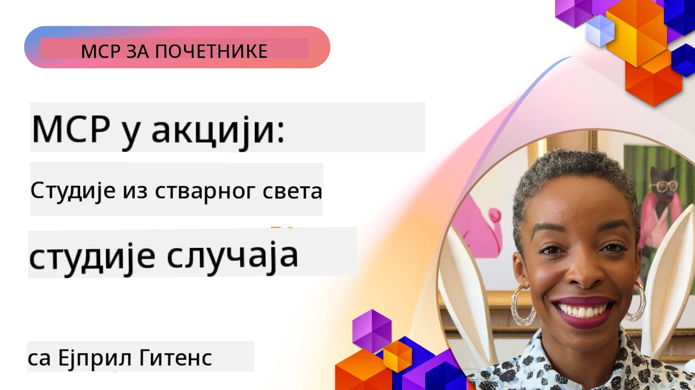

# MCP у пракси: студије стварних случајева

_(Кликните на слику изнад да бисте гледали видео о овој лекцији)_

Протокол контекста модела (MCP) трансформише начин на који AI апликације комуницирају са подацима, алатима и услугама. Овај одељак представља студије стварних случајева које илуструју практичне примене MCP у различитим пословним сценаријима.

## Преглед

Овај одељак приказује конкретне примере MCP имплементација, истичући како организације користе овај протокол за решавање сложених пословних изазова. Испитујући ове студије случајева, добићете увиде у свестраност, скалабилност и практичне предности MCP у стварним сценаријима.

## Кључни циљеви учења

Истражујући ове студије случајева, научићете да:

- Разумете како се MCP може применити за решавање специфичних пословних проблема
- Упознате се са различитим моделима интеграције и архитектонским приступима
- Препознате најбоље праксе за имплементацију MCP у пословним окружењима
- Стекнете увиде у изазове и решења која се јављају у реалним имплементацијама
- Препознате могућности за примену сличних образаца у својим пројектима

## Истакнуте студије случаја

### 1. [Azure AI Travel Agents – Референтна имплементација](./travelagentsample.md)

Ова студија случаја анализира свеобухватно референтно решење компаније Microsoft које показује како изградити апликацију за планирање путовања са више агената, покретану вештачком интелигенцијом, користећи MCP, Azure OpenAI и Azure AI Search. Пројекат приказује:

- Оркестрацију више агената кроз MCP
- Интеграцију пословних података са Azure AI Search
- Сигурну и скалабилну архитектуру коришћењем Azure услуга
- Прошириве алате са поново употребљивим MCP компонентама
- Конверзацијално корисничко искуство покретано Azure OpenAI

Архитектура и детаљи имплементације пружају вредне увиде у изградњу сложених система са више агената са MCP као слојем координације.

### 2. [Ажурирање Azure DevOps ставки из YouTube података](./UpdateADOItemsFromYT.md)

Ова студија случаја показује практичну примену MCP за аутоматизацију радних токова. Приказује како се MCP алати могу користити за:

- Извлачење података са онлајн платформи (YouTube)
- Ажурирање радних ставки у Azure DevOps системима
- Креирање поновљивих аутоматских радних токова
- Интеграцију података из различитих система

Овај пример илуструје како чак и релативно једноставне MCP имплементације могу пружити значајна побољшања ефикасности аутоматизацијом рутинских задатака и побољшањем конзистентности података између система.

### 3. [Претраживање документације у реалном времену са MCP](./docs-mcp/README.md)

Ова студија случаја вас води кроз повезивање Python клијента конзоле са MCP сервером ради преузимања и евидентирања Microsoft документације са уважавањем контекста у реалном времену. Научићете како да:

- Повежете се на MCP сервер помоћу Python клијента и званичног MCP SDK-а
- Користите стриминг HTTP клијенте за ефикасно преузимање података у реалном времену
- Позивате алате за документацију на серверу и директно записујете одговоре у конзолу
- Интегришете ажурну Microsoft документацију у свој радни ток без напуштања терминала

Поглавље укључује практични задатак, минималан радни пример кода и везе ка додатним изворима за дубље учење. Погледајте целокупан водич и код у линку да бисте разумели како MCP може трансформисати приступ документацији и продуктивност програмера у окружењима заснованим на конзоли.

### 4. [Интерактивна генератор апликација студијског плана са MCP](./docs-mcp/README.md)

Ова студија случаја показује како изградити интерактивну веб апликацију користећи Chainlit и Model Context Protocol (MCP) за генерисање персонализованих планова учења за било коју тему. Корисници могу назначити предмет (на пример „AI-900 сертификат“) и трајање учења (нпр. 8 недеља), а апликација ће пружити недељни преглед препорученог садржаја. Chainlit омогућава конверзацијални чат интерфејс, чинећи искуство забавним и адаптивним.

- Конверзацијална веб апликација покретана Chainlit-ом
- Кориснички дефинисани упити за тему и трајање
- Препоруке садржаја недеља по недеља користећи MCP
- Реакције у реалном времену у чат интерфејсу

Пројекат илуструје како се конверзацијална AI и MCP могу комбиновати за креирање динамичних, кориснички вођених образовних алата у савременом веб окружењу.

### 5. [Документација у уређивачу уз MCP сервер у VS Code](./docs-mcp/README.md)

Ова студија случаја показује како можете донети Microsoft Learn документацију директно у своје VS Code окружење уз помоћ MCP сервера — више нема пребацивања између картица прегледача! Видећете како да:

- Одмах тражите и читате документацију унутар VS Code користећи MCP панел или командну палету
- Цитирате документацију и уносе везе директно у README или markdown датотеке курсева
- Користите GitHub Copilot и MCP за беспрекорне радне токове документације и кода покретане вештачком интелигенцијом
- Верификујете и унапређујете документацију уз повратне информације у реалном времену и прецизност из Microsoft извора
- Интегришете MCP уз GitHub радне токове за континуирану проверу документације

Имплементација укључује:

- Пример конфигурације `.vscode/mcp.json` за лако подешавање
- Водиче са снимцима екрана искуства уређивача
- Савете за комбиновaње Copilot-а и MCP-а за максималну продуктивност

Овај сценарио је идеалан за ауторе курсева, писце документације и програмере који желе да остану фокусирани у свом уређивачу док раде са документацијом, Copilot-ом и алаткама за проверу — све покретано MCP-ом.

### 6. [Креирање APIM MCP сервера](./apimsample.md)

Ова студија случаја пружа корак по корак водич о томе како направити MCP сервер користећи Azure API Management (APIM). Обухвата:

- Подешавање MCP сервера у Azure API Management
- Излагање API операција као MCP алати
- Конфигурисање политика за ограничење броја захтева и безбедност
- Тестирање MCP сервера коришћењем Visual Studio Code и GitHub Copilot-а

Овај пример илуструје како искористити могућности Azure за креирање робусног MCP сервера који се може користити у разним апликацијама, унапређујући интеграцију AI система са пословним API-јима.

### 7. [GitHub MCP регистар — убрзавајући агенцијску интеграцију](https://github.com/mcp)

Ова студија случаја анализира како GitHub-ов MCP Регистар, покренут у септембру 2025, решава критичан изазов у AI екосистему: фрагментирану доступност и распоређивање MCP сервера.

#### Преглед
**MCP Регистар** решава проблем расутих MCP сервера по репозиторијумима и регистрима, што је раније отежавало интеграцију и чинило је споријом и подложном грешкама. Ови сервери омогућавају AI агентима да комуницирају са спољним системима као што су API-ји, базе података и извори документације.

#### Изазови
Развојни програмери агентских радних токова су се суочавали са више изазова:
- **Слаба проналазивост** MCP сервера на различитим платформама
- **Репетитивна питања о подешавању** расута по форумима и документацији
- **Безбедносни ризици** од непроверених и непоузданих извора
- **Недостатак стандарда** у квалитету и компатибилности сервера

#### Архитектура решења
GitHub-ов MCP Регистар централизује поуздане MCP сервере са кључним функцијама:
- **Интеграција једним кликом** преко VS Code за поједностављено подешавање
- **Филтрирање сигнала од шума** према звездама, активности и провереним заједницама
- **Директна интеграција** са GitHub Copilot-ом и другим MCP-компатибилним алатима
- **Отворени модел доприноса** који омогућава доприносе заједнице и пословних партнера

#### Пословни утицај
Регистар је остварио мерљива побољшања:
- **Брже упознавање** за програмере који користе алате као што је Microsoft Learn MCP Server, који емитује званичну документацију директно агентима
- **Побољшана продуктивност** кроз специјализоване сервере као што је `github-mcp-server`, омогућавајући аутоматизацију GitHub задатака на природном језику (креирање PR, поновно извршавање CI, скенирање кода)
- **Јача поверења у екосистем** кроз куриране листе и транспарентне стандарде конфигурације

#### Стратешка вредност
За практичаре специјализоване за управљање животним циклусом агената и поуздане радне токове, MCP Регистар пружа:
- **Модуларно распоређивање агената** са стандардизованим компонентама
- **Платформу за процену са регистром** за доследно тестирање и верификацију
- **Интероперабилност између алата** која омогућава беспрекорну интеграцију преко различитих AI платформи

Ова студија случаја показује да MCP Регистар није само директоријум — то је темељна платформа за скалабилну, реалну интеграцију модела и распоређивање агенцијских система.

### 8. [Објављивање на друштвеним мрежама путем агента](./publora-social-publishing.md)

Ова студија случаја објашњава **MCP сервер способан за писање из даљине** — онај чији алати предузимају неповратне радње у име корисника — користећи као пример објављивање на друштвеним мрежама. Агент саставља пост, човек га одобрава, а сервер заказује објаве на мрежама.

Интересантни део су дизајнерска ограничења које објављивање намеће, а која важе за било који сервер који пише уместо да чита:

- **Отворено проналажење, аутентификовано извршење** — `tools/list` одговара без акредитација тако да регистри и клијенти могу да прегледају, док сваки `tools/call` захтева токен и иначе враћа `401` са `WWW-Authenticate` заглављем
- **OAuth регистрација без корака ван појаса** — динамична регистрација клијента данас, са Client ID Metadata Documents као смерницом коју спецификација `2026-07-28` указује
- **Аннотације алата** (`readOnlyHint`, `destructiveHint`, `idempotentHint`) које клијенти користе да одлуче шта да потврде — наговештаји а не приморавање, и нешто што директоријуми конектора сада очекују при ревизији
- **Неизмисливи идентификатори**, тако да халуцинована вредност гласно пада у воду уместо да делује на плусибилној
- **Кључеви идемпотенције на алатима за креирање постова**, да поновни покушај у време извршења агента не резултира дупликатом објаве
- **Описана циљна без оптерећења у шеми алата** која вежба цео пут писања и не објављује ништа, за рецензенте и CI

Поглавље се завршава кратком контролном листом коју можете применити на сервер који градите.

## Закључак

Ових осам обимних студија случаја показују изузетну свестраност и практичне примене Протокола контекста модела у различитим стварним сценаријима. Од сложених система за планирање путовања са више агената и управљања пословним API-јима до поједностављених радних токова документације и револуционарног GitHub MCP Регистра, ови примери приказују како MCP пружа стандардизован, скалабилан начин повезивања AI система са алатима, подацима и услугама које су им потребне за пружање изванредне вредности.

Студије случаја покривају више димензија имплементације MCP:
- **Пословна интеграција**: Azure API Management и Azure DevOps аутоматизација
- **Оркестрација више агената**: Планирање путовања са координисаним AI агентима
- **Продуктивност програмера**: Интеграција са VS Code и приступ документацији у реалном времену
- **Развој екосистема**: GitHub MCP Регистар као темељна платформа
- **Образовне примене**: Интерактивни генератори студијских планова и конверзацијални интерфејси

Проучавајући ове имплементације, стичете кључне увиде у:
- **Архитектонске шаблоне** за различите размере и употребе
- **Стратегије имплементације** које балансирају функционалност и одрживост
- **Безбедносне и скалабилне** аспекте за производне имплементације
- **Најбоље праксе** за развој MCP сервера и интеграцију клијената
- **Екосистемски приступ** за изградњу међусобно повезаних решења покретаних AI-ом

Ови примери заједно показују да MCP није само теоријски оквир већ зрел, продукционо спреман протокол који омогућава практична решења сложених пословних изазова. Без обзира да ли градите једноставне алате за аутоматизацију или софистициране системе са више агената, образци и приступи илустровани овде пружају солидну основу за ваше MCP пројекте.

## Додатни ресурси

- [Azure AI Travel Agents GitHub репозиторијум](https://github.com/Azure-Samples/azure-ai-travel-agents)
- [Azure DevOps MCP алат](https://github.com/microsoft/azure-devops-mcp)
- [Playwright MCP алат](https://github.com/microsoft/playwright-mcp)
- [Microsoft Docs MCP сервер](https://github.com/MicrosoftDocs/mcp)
- [GitHub MCP Регистар — убрзавајући агенцијску интеграцију](https://github.com/mcp)
- [MCP заједнички примери](https://github.com/microsoft/mcp)

## Шта следи

- Претходни: [Модул 8: Најбоље праксе](../08-BestPractices/README.md)
- Следећи: [Модул 10: Струјни AI радни токови: Изградња MCP сервера са Microsoft Foundry Toolkit](../10-StreamliningAIWorkflowsBuildingAnMCPServerWithAIToolkit/README.md)

---

<!-- CO-OP TRANSLATOR DISCLAIMER START -->
**Изјава о одрицању одговорности**:
Овај документ је преведен коришћењем услуге за аутоматски превод [Co-op Translator](https://github.com/Azure/co-op-translator). Иако тежимо тачности, имајте у виду да аутоматски преводи могу садржати грешке или нетачности. Оригинални документ на његовом изворном језику треба сматрати ауторитативним извором. За критичне информације препоручује се професионални људски превод. Нисмо одговорни за било каква неспоразума или погрешна тумачења која произилазе из коришћења овог превода.
<!-- CO-OP TRANSLATOR DISCLAIMER END -->